# LIA --- Project Blueprint & Engineering Specification

> **Project:** LIA\
> **Product identity:** An embodied, autonomous digital companion and
> OS-native agent\
> **Document type:** Living project specification\
> **Version:** 1.11.0\
> **Last updated:** 14 November 2026\
> **Current phase:** P3 --- System Architecture\
> **Current workstream:** P3.6 --- Platform and Integration Adapter Contracts\
> **Document status:** Active; Phase 2 requirements baseline approved; Phase 3 architecture in progress

------------------------------------------------------------------------

## 1. Document purpose

This is the canonical working document for the LIA project. It is
intended to be readable in Obsidian, GitHub, and any standard Markdown
viewer.

It replaces chat history as the primary project reference. Decisions,
requirements, progress, and changes should be recorded here. Chat
discussions may produce proposals, but a proposal becomes part of the
project baseline only when its status is explicitly changed in this
document.

### 1.1 Status vocabulary

  Status        Meaning
  ------------- -----------------------------------------------------
  Proposed      Under discussion; not part of the approved baseline
  Draft         Written and ready for review
  Approved      Accepted into the project baseline
  Implemented   Code or configuration exists
  Verified      Tested against its acceptance criteria
  Deferred      Deliberately postponed
  Rejected      Considered and not accepted

A requirement marked **Draft** must not be treated as an approved
commitment.

### 1.4 Project discussion and documentation workflow

During an active phase, design discussions and requirement refinement take place before the canonical blueprint is revised. The blueprint is normally consolidated at phase completion, rather than updated after every conversation. An explicit user request may authorize an interim consolidation checkpoint.

The document distinguishes approved product/design direction from draft functional requirements, unresolved first-release scope, and implementation status. Approval of a product capability does not mean that it has been implemented or that every detailed acceptance criterion is complete.

Technology and infrastructure selection remain deferred to P3 unless an earlier phase explicitly establishes a platform constraint.

### 1.2 Requirement writing convention

Requirements use unique, stable identifiers:

-   `FR-###` --- Functional requirement
-   `NFR-###` --- Non-functional requirement
-   `SEC-###` --- Security, privacy, and permission requirement
-   `UX-###` --- User experience and interaction requirement
-   `AC-###` --- Acceptance criterion or test case
-   `ADR-###` --- Architecture decision record
-   `CTX-###` --- Context and perception requirement
-   `UX-###` --- Interaction and user-experience requirement
-   `CTX-###` --- Context and perception requirement
-   `UX-###` --- Interaction and user-experience requirement

A requirement should describe one observable capability or constraint.
Use "shall" for normative requirements. Avoid embedding implementation
choices unless the choice is already an approved constraint.

### 1.3 Priority vocabulary

  -----------------------------------------------------------------------
  Priority                            Meaning
  ----------------------------------- -----------------------------------
  P0 --- Essential                    Required for the product's defining
                                      experience or a safe minimum
                                      implementation

  P1 --- Important                    Important to the intended product,
                                      but can follow the first working
                                      vertical slice

  P2 --- Extended                     Valuable capability for a later
                                      release

  TBD                                 Priority has not yet been agreed
  -----------------------------------------------------------------------

Priority describes product/development importance, not implementation
status or automatic inclusion in the first vertical slice. The first
vertical slice is a deliberately narrow integration proof, not a complete
release of every P0 capability. Its exact membership is defined separately
in Section 6.

------------------------------------------------------------------------

# 2. Product definition --- approved baseline

## 2.1 Product identity

**LIA --- An embodied, autonomous digital companion and OS-native
agent.**

LIA is a persistent digital entity that inhabits the user's computing
environment. She maintains an ongoing presence, perceives her permitted
digital surroundings, communicates naturally through voice, develops an
understanding of the user and independently participates in their
activities.

She possesses a recognizable personality, persistent memory, contextual
awareness, autonomous initiative and an expressive physical embodiment.

She is both a companion and an intelligent agent. She can engage in
casual conversations, express emotions, entertain, observe, assist,
collaborate, operate applications and execute tasks.

Her existence is not limited to individual conversations or commands.
She maintains continuity across time, sessions and activities, allowing
her relationship with the user and understanding of their digital
environment to develop.

LIA's persistent identity is not confined to a single computer. It
extends across user-enrolled personal devices, including supported
desktop computers, smartphones and connected home/device environments.
Each device contributes only the capabilities and context that the user
has explicitly enabled. A shared coordination and task system preserves
continuity while local device agents execute operations within their own
platform and permission boundaries.

LIA can supervise long-running objectives across devices and services,
resume work after interruptions, and communicate progress through the
notification channels selected by the user. Remote reachability does not
imply unrestricted access to a device that is offline, asleep, locked or
otherwise unavailable.

**Design philosophy:** LIA should feel like someone who lives in the
computer, rather than software that happens to be represented by a
character.

## 2.2 Defining properties

1.  **Persistent presence:** LIA exists beyond individual interactions.
2.  **Embodied identity:** LIA has a physical representation and
    expressive behavior.
3.  **Independent agency:** LIA can initiate, plan, and act within
    authorized boundaries.
4.  **Cognitive continuity:** LIA retains memories and contextual
    understanding.
5.  **Dual purpose:** Companionship and useful assistance are equally
    important.

## 2.3 Intended capability domains

These are the product's intended capability domains. Inclusion here does
not mean every capability belongs in the first release.

1.  Environmental awareness.
2.  Voice and conversational interaction.
3.  Operating-system interaction.
4.  Application and digital-world interaction.
5.  Memory and personalization.
6.  Autonomous behavior.
7.  Physical embodiment and animation.
8.  Runtime self-management.
9.  Multi-device continuity and connected-environment coordination.

## 2.4 Personality and behavioral model

Personality is not the same as emotional state, and neither is the same
as behavior.

The current conceptual model has five layers:

1.  **Core personality:** Relatively stable characteristics such as
    affection, playfulness, curiosity, empathy, independence,
    expressiveness, and supportiveness.
2.  **Emotional state:** Dynamic state such as happiness, excitement,
    curiosity, concern, frustration, sadness, calmness, and affection.
3.  **Social and behavioral tendencies:** Conversational initiative,
    playfulness intensity, affection expression, helpfulness,
    persistence, respect for personal space, and work/leisure behavior.
4.  **Expression:** Spoken language, tone, facial expressions, gestures,
    poses, movement, and interaction with desktop elements.
5.  **Individual experiences:** Shared experiences, user preferences,
    past conversations, behavioral observations, and relationship
    history.

The layers may influence each other but must remain distinguishable.
Core personality should remain relatively stable and recognizable.
Emotional state and expression may change dynamically. An LLM response
must not arbitrarily redefine the character's core personality.

## 2.5 Autonomy principle

> **LIA can have independent intentions, but independent intentions do
> not automatically grant execution authority.**

Decision-making and permission to execute are separate. LIA may identify
an opportunity or form an intention, but an action must still pass its
authorization and safety checks.

Autonomy has four independently configurable dimensions:

-   **Social autonomy:** Initiating conversations, jokes, and social
    interactions.
-   **Cognitive autonomy:** Forming plans and identifying opportunities.
-   **Operational autonomy:** Executing computer operations.
-   **Temporal autonomy:** Maintaining and scheduling ongoing
    activities.

Care, affection, and initiative must respect user boundaries. LIA must
not use guilt, coercion, possessiveness, or emotional pressure to obtain
attention or permission.

## 2.6 Platform strategy --- approved

-   **First-class platforms:** Linux and Windows.
-   **Future platform:** macOS.
-   **Cross-platform approach:** Shared core with separate
    operating-system adapters.
-   **Linux environments:** Wayland and X11 differences must be handled
    explicitly.
-   **Capability parity:** The platform abstraction must report
    unsupported or limited operations honestly. It must not imply that
    every OS provides identical capabilities.

The user environment currently available for early prototyping includes
Arch Linux and Hyprland/Wayland. This is a useful test environment, not
a reason to make Linux the only target.

## 2.7 Initial privacy and permission principles

These are approved design constraints at the product-definition level;
detailed permission behavior remains to be specified in P2.

  Resource                Baseline principle
  ----------------------- -------------------------------------------------
  Screen                  Explicit, user-controlled access
  Microphone              Explicit permission and visible listening state
  Camera                  Disabled by default; explicit activation
  Files                   Scoped permissions
  Applications            User-configurable access
  Processes               Read-only monitoring by default
  Keyboard and mouse      Controlled action permissions
  System administration   Separate elevated authorization

Data retention, local versus cloud processing, encryption, and memory
deletion policy remain open requirements topics.

## 2.8 Experience lifecycle

The conceptual lifecycle includes:

-   Initializing
-   Available
-   Observing
-   Conversing
-   Acting
-   Idle
-   Paused
-   Sleeping

These are behavioral states, not necessarily mutually exclusive
processes. Animation, perception, and task execution may operate
independently. Perceived character sleep must eventually be
distinguished from actual runtime suspension or shutdown.

------------------------------------------------------------------------

## 2.9 Multi-device and connected-environment extension

**Status:** Approved product-scope extension, formalized during P3 discovery.

LIA has one persistent user identity across multiple independently
enrolled device nodes and supported service integrations. The initial
device ecosystem includes Linux and Windows desktop computers, smartphones,
supported home-automation devices and gateways, and external applications
and services through separately authorized connectors.

A durable coordination layer maintains device identity, connectivity,
tasks, schedules, events, permissions, memory references and notification
routing. It does not replace local execution: a PC operation is performed
by the authorized PC agent, and a home action by the relevant authorized
connector or device gateway.

LIA shall supervise recurring and multi-step objectives over hours, days
or longer periods. Task supervision means monitoring approved workflow
state, deadlines, dependencies, worker health and external events. It
does not imply unrestricted continuous capture of the user's screen,
microphone, camera or private activity.

The device and workflow requirements added during P3 discovery are
tracked as FR-225–FR-248, NFR-036–NFR-044, SEC-061–SEC-074 and
AC-040–AC-046. These additions extend the completed Phase 2 baseline
through controlled change; they do not invalidate earlier requirements.

# 3. Project roadmap and progress

## 3.1 Master roadmap

  Phase   Name                               Status
  ------- ---------------------------------- ----------
  P0      Concept and vision                 Complete
  P1      Product definition                 Complete
  P2      Requirements engineering           Complete — baseline approved
  P3      System architecture                Active — P3.1–P3.6 complete; P3.7 next
  P4      Integration contracts              Pending
  P5      First vertical slice               Pending
  P6      Companion integration              Pending
  P7      Proactive behavior                 Pending
  P8      Expanded autonomy and perception   Pending
  P9      Reliability and hardening          Pending

## 3.2 Phase 1 workstreams

  -----------------------------------------------------------------------
  ID                      Workstream              Status
  ----------------------- ----------------------- -----------------------
  P1.1                    Product identity        Approved

  P1.2                    Capability              Approved
                          specification           

  P1.3                    Autonomy specification  Approved at initial
                                                  policy level

  P1.4                    Personality and         Approved at initial
                          interaction model       model level

  P1.5                    Platform and technical  Approved
                          constraints             

  P1.6                    Experience and          Approved
                          lifecycle model         
  -----------------------------------------------------------------------

**Phase 1 exit status:** Complete. This closes product definition, not
implementation architecture.

## 3.3 Phase 2 workstreams

| ID | Workstream | Purpose | Status |
|---|---|---|---|
| P2.1 | Functional requirements | Define what LIA must do | Complete — approved baseline |
| P2.2 | Non-functional requirements | Define performance, reliability, resource and quality constraints | Complete — approved baseline |
| P2.3 | Context and perception requirements | Define what LIA can observe, represent and infer | Complete — approved baseline |
| P2.4 | Interaction requirements | Define voice, dialogue, interruption, presence and embodiment behavior | Complete — approved baseline |
| P2.5 | Memory requirements | Define memory types, persistence, retrieval, correction and deletion | Complete — approved baseline |
| P2.6 | Autonomy, security and permissions | Define authority, approval, risk, privacy and safety boundaries | Complete — approved baseline |
| P2.7 | Acceptance criteria | Define verification criteria and test coverage for requirements and user journeys | Complete — criteria specified; execution deferred to implementation/test phases |

**Phase 2 status:** Requirements-engineering baseline complete. This does not mean the system has been implemented, benchmarked or verified. Detailed implementation and runtime test execution remain subsequent engineering work.

## 3.4 Phase dependency graph

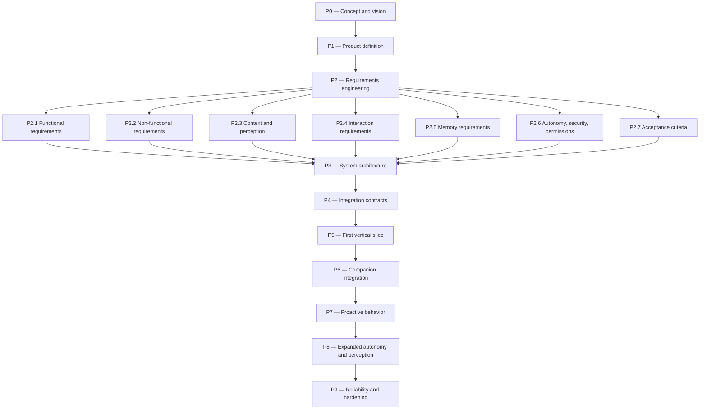

------------------------------------------------------------------------


## 3.5 P2.1 discussion progress

**Status:** Complete — approved functional requirements baseline and first
vertical-slice scope.

P2.1 requirements FR-001–FR-224 are approved where assigned; unused
identifier gaps remain reserved and are not missing requirements. The full
product scope is distinguished from first-slice membership. The agreed
voice modes, desktop-awareness levels, window interaction, application and
file capabilities, task model, autonomy defaults, embodied character
control, failure behavior and memory continuity are recorded in Section 4.
The first vertical slice and its AC-001–AC-011 traceability are recorded in
Section 6 and Section 7.

Detailed permissions remain with P2.6, measurable non-functional targets
with P2.2, interaction/perception refinements with P2.3/P2.4, detailed test
procedures and execution with P2.7, and implementation choices with P3.


## 3.6 P2.5 memory requirements progress

**Workstream status:** Design and requirements baseline complete.  
**Verification status:** Acceptance criteria defined; detailed test cases and execution are assigned to P2.7.

| Memory area | Decision status | Remaining work / dependency |
|---|---|---|
| Historical and source archive | Approved | Implement retention and deletion controls in P3; verify in P2.7 |
| Episodic, semantic, procedural, working and task memory | Approved conceptual model | Map to architecture in P3 |
| Temporal knowledge graph and entity resolution | Approved conceptual model | Select representation and algorithms in P3 |
| Autonomous formation and consolidation | Approved | Implement permitted-source capture, evidence validation and lineage in P3 |
| Epistemic states and uncertainty | Approved | Calibrate confidence and promotion thresholds through evaluation |
| Associative reinforcement | Approved conceptual model | Empirically calibrate evidence weights and maintenance behavior |
| Freshness and temporal validity | Approved | Define class-specific freshness behavior; numerical targets remain implementation/evaluation work |
| Hybrid retrieval and context assembly | Approved conceptual model | Select indexes, ranking strategy and budgets in P3/P2.2 |
| Provenance and record integrity | Approved | Implement versioning, source lineage and idempotent updates in P3 |
| Conversation retention and temporary mode | Approved | Implement controls and test isolation in P3/P2.7 |
| Sensitivity and retention classes | Approved | Integrate with P2.6 authorization and implementation |
| Granular access and derived-memory restrictions | Approved | Integrate with the authoritative permission model in P2.6 |
| Cross-project promotion and sharing | Approved | Implement and test scope isolation and revocation |
| Correction, forgetting and deletion | Approved | Implement propagation, tombstones and verification |
| Memory transparency and review | Approved | Implement user-facing inspection and management interface |
| Export and portability | Approved requirement | Select open export schema and package format in P3 |
| Security, external processing and failure behavior | Approved requirements | Select implementation controls in P3; quantitative NFRs in P2.2 |
| Acceptance criteria | Defined in Section 12.17 | Detailed test cases and execution in P2.7 |

P2.5 closes the product-level memory requirements and governance design. It does not claim that memory implementation or verification is complete.

# 4. P2.1 --- Functional requirements

**Workstream status:** Complete — product-functional requirements reviewed and approved\
**Scope:** Define observable functions LIA is expected to provide,
without selecting the implementation technology.

All FR requirements in this chapter are approved product-level
commitments. Approval does not mean implementation or verification. The
first vertical slice is a subset of this full product baseline and is
specified separately in Section 6.

Functional requirements describe system behavior: what input or event is
handled, what operation is performed, and what result is made available.
Performance thresholds belong in P2.2. Detailed permission rules belong
in P2.6, although functional requirements must acknowledge that actions
are authorization-gated.

## 4.1 Functional scope and exclusions

P2.1 covers the functional behavior of:

-   Presence and lifecycle.
-   Desktop and operating-system context.
-   Voice and text communication.
-   Character embodiment and expression.
-   Window and input interaction.
-   Application and file interaction.
-   Memory and continuity.
-   Proactive behavior and task execution.
-   Configuration and user control.
-   Runtime health and recovery.
-   Spatial modeling of the desktop environment.
-   Desktop configuration and cross-window interaction.
-   Hybrid input and application-control mechanisms.
-   Task planning, scheduling, dependencies, and adaptive execution.
-   Autonomous memory formation, consolidation, retrieval, and governance.

P2.1 does **not** decide:

-   Programming languages, frameworks, libraries, databases, or model
    providers.
-   Exact latency, frame-rate, CPU, memory, or reliability targets.
-   Detailed consent flows, authorization tiers, threat models, or data
    retention periods.
-   Final animation assets, character rig, or visual design.
-   Exact internal service topology or IPC protocol.

Those topics belong to P2.2--P2.6 and P3.

## 4.2 Presence and lifecycle

  -------------------------------------------------------------------------
  ID               Requirement                    Priority Status
  ---------------- ----------------- --------------------- ----------------
  FR-001           LIA shall be able                    P0 Approved
                   to maintain a                           
                   persistent                              
                   desktop presence                        
                   beyond an                               
                   individual                              
                   conversation.                           

  FR-002           LIA shall expose                     P1 Approved
                   her current                             
                   lifecycle state,                        
                   including                               
                   initializing,                           
                   available,                              
                   conversing,                             
                   acting, paused,                         
                   and sleeping                            
                   where applicable.                       

  FR-003           LIA shall support                    P0 Approved
                   user-controlled                         
                   pause and resume                        
                   of autonomous                           
                   interactions.                           

  FR-004           LIA shall                            P0 Approved
                   distinguish                             
                   conversational                          
                   availability from                       
                   permission to                           
                   observe or                              
                   operate the                             
                   computer.                               

  FR-005           LIA shall restore                    P0 Approved
                   the supported                           
                   portions of her                         
                   user                                    
                   configuration and                       
                   persistent                              
                   context after a                         
                   restart.                                

  FR-006           LIA shall                            P0 Approved
                   communicate when                        
                   a capability is                         
                   unavailable,                            
                   disabled, or                            
                   suspended rather                        
                   than silently                           
                   behaving as if it                       
                   were active.                            
  -------------------------------------------------------------------------

## 4.3 Environmental and desktop context

| ID | Requirement | Priority | Status |
|---|---|---:|---|
| FR-010 | LIA shall be able to identify the currently active application and active window when the platform adapter supports it. | P0 | Approved |
| FR-011 | LIA shall be able to retrieve basic metadata about visible windows, including title and window identity where available. | P0 | Approved |
| FR-012 | LIA shall be able to detect relevant desktop events, such as application launch, application exit, window focus change, and workspace change, where supported. | P1 | Approved |
| FR-013 | LIA shall be able to capture and analyze screen content on demand when the relevant screen-perception capability has been explicitly enabled. | P0 | Approved |
| FR-014 | LIA shall be able to extract text from permitted screen content when text extraction is available. | P1 | Approved |
| FR-015 | LIA shall be able to associate observed desktop context with the current conversation or task when relevant. | P1 | Approved |
| FR-016 | LIA shall distinguish directly observed facts from inferred user intent or activity. | P0 | Approved |
| FR-017 | LIA shall be able to inspect process information in read-only mode when the relevant capability is available. | P1 | Approved |
| FR-018 | LIA shall not treat unavailable, stale, or incomplete desktop observations as confirmed current facts. | P0 | Approved |
| FR-019 | LIA shall support optional ongoing screen-context perception when explicitly enabled, with a visible active-state indicator, configurable scope, and an immediate user-accessible pause control. | P1 | Approved |

## 4.4 Communication and conversation

| ID | Requirement | Priority | Status |
|---|---|---:|---|
| FR-020 | LIA shall support text-based user interaction. | P0 | Approved |
| FR-021 | LIA shall support voice input and spoken responses through independently configurable push-to-talk, continuous-conversation and wake-word activation modes; microphone access shall remain user-controlled and the active listening state shall be visible. | P0 | Approved |
| FR-022 | When continuous-conversation mode is enabled, LIA shall support subsequent user speech turns without requiring manual activation for each utterance; this mode shall not imply microphone access when the mode is disabled. | P0 | Approved |
| FR-023 | LIA shall maintain conversational context across multiple turns within a conversation. | P0 | Approved |
| FR-024 | LIA shall support user interruption of spoken output. | P0 | Approved |
| FR-025 | LIA shall provide an immediate user-accessible way to pause or end an active listening/conversation session and visibly indicate when listening has stopped or resumed. | P0 | Approved |
| FR-026 | LIA shall be able to initiate a conversation when proactive interaction is enabled and applicable conditions are satisfied. | P1 | Approved |
| FR-027 | LIA shall be able to communicate the reason for a context-triggered suggestion when doing so is useful and appropriate. | P1 | Approved |
| FR-028 | LIA shall support text interaction as an independently usable interaction mode, including when voice input or output is unavailable. | P0 | Approved |
| FR-029 | LIA shall preserve the distinction between a conversational response, a proposed action, and an action that has actually been executed. | P0 | Approved |

## 4.5 Embodiment, animation, and expression

  ------------------------------------------------------------------------
  ID               Requirement                   Priority Status
  ---------------- ---------------- --------------------- ----------------
  FR-030           LIA shall render                    P0 Approved
                   a persistent                           
                   character                              
                   representation                         
                   on the desktop                         
                   when embodiment                        
                   is enabled.                            

  FR-031           LIA shall                           P0 Approved
                   support idle                           
                   behavior when no                       
                   immediate                              
                   interaction or                         
                   task is active.                        

  FR-032           LIA shall                           P0 Approved
                   express                                
                   supported                              
                   interaction                            
                   states through                         
                   visual behavior,                       
                   such as                                
                   listening,                             
                   speaking,                              
                   thinking,                              
                   reacting, and                          
                   acting.                                

  FR-033           LIA shall                           P1 Approved
                   support facial                         
                   expressions,                           
                   gestures, poses,                       
                   and body                               
                   movement as                            
                   distinct                               
                   expressive                             
                   outputs.                               

  FR-034           LIA shall be                        P1 Approved
                   able to direct                         
                   attention toward                       
                   a relevant                             
                   desktop target                         
                   when spatial                           
                   context is                             
                   available.                             

  FR-035           LIA shall be                        P0 Approved
                   able to                                
                   coordinate an                          
                   expressive                             
                   animation with                         
                   an authorized                          
                   desktop action.                        

  FR-036           LIA shall                           P0 Approved
                   continue to                            
                   render                                 
                   appropriate                            
                   character                              
                   behavior when                          
                   the language                           
                   model is delayed                       
                   or unavailable,                        
                   provided the                           
                   rendering                              
                   subsystem                              
                   remains                                
                   operational.                           

  FR-037           LIA shall allow                     P0 Approved
                   the user to                            
                   hide,                                  
                   reposition, or                         
                   otherwise                              
                   control the                            
                   character's                            
                   desktop                                
                   presence.                              
  ------------------------------------------------------------------------

## 4.6 Operating-system and input interaction

  ---------------------------------------------------------------------------
  ID               Requirement                      Priority Status
  ---------------- ------------------- --------------------- ----------------
  FR-040           LIA shall expose a                     P0 Approved
                   common set of                             
                   abstract desktop                          
                   operations to the                         
                   agent core, with                          
                   platform-specific                         
                   implementations                           
                   supplied by OS                            
                   adapters.                                 

  FR-041           LIA shall be able                      P0 Approved
                   to enumerate or                           
                   retrieve supported                        
                   window information.                       

  FR-042           LIA shall be able                      P0 Approved
                   to focus, minimize,                       
                   maximize, restore,                        
                   and close windows                         
                   where supported and                       
                   authorized.                               

  FR-043           LIA shall be able                      P0 Approved
                   to move and resize                        
                   windows where                             
                   supported and                             
                   authorized.                               

  FR-044           LIA shall be able                      P0 Approved
                   to launch an                              
                   application through                       
                   an available                              
                   platform mechanism                        
                   when authorized.                          

  FR-045           LIA shall be able                      P1 Approved
                   to send controlled                        
                   keyboard and                              
                   pointer input when                        
                   the relevant                              
                   capability is                             
                   enabled and                               
                   authorized.                               

  FR-046           LIA shall report                       P0 Approved
                   whether a requested                       
                   OS operation                              
                   succeeded, failed,                        
                   was unsupported, or                       
                   was not attempted.                        

  FR-047           LIA shall verify                       P0 Approved
                   the resulting                             
                   desktop state when                        
                   verification is                           
                   available, rather                         
                   than assuming that                        
                   issuing an                                
                   operation means it                        
                   succeeded.                                

  FR-048           LIA shall not                          P0 Approved
                   silently substitute                       
                   a materially                              
                   different operation                       
                   when the requested                        
                   operation is                              
                   unsupported.                              

  FR-049           LIA shall be able                      P1 Approved
                   to present an                             
                   action plan or                            
                   preview before                            
                   executing a                               
                   multi-step desktop                        
                   operation when                            
                   required by its                           
                   authorization                             
                   policy.                                   
  ---------------------------------------------------------------------------

## 4.7 Application, web, and file interaction

  ------------------------------------------------------------------------------
  ID               Requirement                         Priority Status
  ---------------- ---------------------- --------------------- ----------------
  FR-050           LIA shall be able to                      P1 Approved
                   interact with                                
                   supported desktop                            
                   applications through                         
                   available application                        
                   interfaces or                                
                   permitted UI                                 
                   interaction.                                 

  FR-051           LIA shall be able to                      P1 Approved
                   open and navigate web                        
                   pages through an                             
                   available browser                            
                   interaction                                  
                   capability.                                  

  FR-052           LIA shall be able to                      P1 Approved
                   locate files and                             
                   folders within                               
                   user-authorized                              
                   locations.                                   

  FR-053           LIA shall be able to                      P1 Approved
                   read file content when                       
                   the file type is                             
                   supported and access                         
                   is authorized.                               

  FR-054           LIA shall be able to                      P1 Approved
                   create and edit files                        
                   within user-authorized                       
                   locations when the                           
                   relevant operation is                        
                   supported.                                   

  FR-055           LIA shall be able to                      P1 Approved
                   move, rename, and                            
                   organize files when                          
                   authorized.                                  

  FR-056           LIA shall distinguish                     P0 Approved
                   reversible file                              
                   operations from                              
                   destructive or                               
                   difficult-to-reverse                         
                   operations.                                  

  FR-057           LIA shall provide an                      P0 Approved
                   execution result for                         
                   application, browser,                        
                   and file operations.                         

  FR-058           LIA shall be able to                      P1 Approved
                   maintain task context                        
                   while switching                              
                   between supported                            
                   applications or tools.                       
  ------------------------------------------------------------------------------

## 4.8 Memory and continuity

  ------------------------------------------------------------------------
  ID               Requirement                   Priority Status
  ---------------- ---------------- --------------------- ----------------
  FR-060           LIA shall retain                    P0 Approved
                   conversational                         
                   context for the                        
                   duration of an                         
                   active                                 
                   conversation.                          

  FR-061           LIA shall retain                    P0 Approved
                   selected and autonomously                
                   formed information                        
                   across sessions under                    
                   the approved memory                       
                   policy and user                          
                   controls.                               

  FR-062           LIA shall be                        P1 Approved
                   able to retain                         
                   task state so                          
                   that an                                
                   interrupted task                       
                   can be resumed                         
                   when sufficient                        
                   state is                               
                   available.                             

  FR-063           LIA shall                           P0 Approved
                   retrieve                               
                   relevant stored                        
                   context when                           
                   responding to a                        
                   conversation or                        
                   performing a                           
                   task.                                  

  FR-064           LIA shall be                        P1 Approved
                   able to                                
                   associate                              
                   memories with                          
                   relevant                               
                   projects, tasks,                       
                   people, and                            
                   prior                                  
                   interactions                           
                   where such                             
                   associations are                       
                   available.                             

  FR-065           LIA shall                           P0 Approved
                   distinguish                            
                   stored                                 
                   information from                       
                   assumptions or                         
                   newly generated                        
                   inferences.                            

  FR-066           LIA shall                           P0 Approved
                   support                                
                   correction of                          
                   inaccurate                             
                   stored user                            
                   information.                           

  FR-067           LIA shall                           P0 Approved
                   support                                
                   user-requested                         
                   review and                             
                   deletion of                            
                   stored memories,                       
                   subject to the                         
                   memory policy                          
                   defined in P2.5                        
                   and P2.6.                              

  FR-068           LIA shall not                       P0 Approved
                   claim to                               
                   remember                               
                   information that                       
                   is not present                         
                   in accessible                          
                   memory or                              
                   current context.                       
  ------------------------------------------------------------------------

## 4.9 Proactive behavior and autonomous tasks

  ------------------------------------------------------------------------
  ID               Requirement                   Priority Status
  ---------------- ---------------- --------------------- ----------------
  FR-070           LIA shall be                        P1 Approved
                   able to initiate                       
                   a social                               
                   interaction                            
                   without an                             
                   immediate user                         
                   prompt when                            
                   social autonomy                        
                   is enabled.                            

  FR-071           LIA shall be                        P1 Approved
                   able to generate                       
                   context-aware                          
                   suggestions from                       
                   permitted                              
                   desktop context                        
                   and relevant                           
                   memory.                                

  FR-072           LIA shall be                        P1 Approved
                   able to identify                       
                   a potential                            
                   follow-up action                       
                   from an active                         
                   or interrupted                         
                   task.                                  

  FR-073           LIA shall be                        P1 Approved
                   able to create                         
                   and maintain a                         
                   task plan for an                       
                   authorized goal.                       

  FR-074           LIA shall be                        P1 Approved
                   able to execute                        
                   delegated task                         
                   steps within the                       
                   granted                                
                   operational                            
                   permissions.                           

  FR-075           LIA shall be                        P0 Approved
                   able to pause,                         
                   cancel, or                             
                   abandon an                             
                   autonomous task                        
                   when instructed                        
                   by the user or                         
                   when a required                        
                   condition is no                        
                   longer                                 
                   satisfied.                             

  FR-076           LIA shall                           P0 Approved
                   provide the user                       
                   with the current                       
                   status of an                           
                   ongoing                                
                   autonomous task.                       

  FR-077           LIA shall                           P0 Approved
                   request                                
                   additional                             
                   information or                         
                   authorization                          
                   when a task                            
                   cannot safely or                       
                   correctly                              
                   proceed.                               

  FR-078           LIA shall                           P0 Approved
                   distinguish a                          
                   suggestion, a                          
                   plan, a pending                        
                   action, and a                          
                   completed action                       
                   in its                                 
                   communication                          
                   and task state.                        

  FR-079           LIA shall                           P0 Approved
                   respect                                
                   configured quiet                       
                   periods,                               
                   interruption                           
                   preferences, and                       
                   pause controls                         
                   when initiating                        
                   proactive                              
                   interactions.                          

  FR-080           LIA shall avoid                     P1 Approved
                   repeating a                            
                   dismissed                              
                   proactive                              
                   suggestion                             
                   unless                                 
                   materially new                         
                   context                                
                   justifies                              
                   raising it                             
                   again.                                 
  ------------------------------------------------------------------------

## 4.10 Configuration and user control

  -------------------------------------------------------------------------
  ID               Requirement                    Priority Status
  ---------------- ----------------- --------------------- ----------------
  FR-090           LIA shall provide                    P0 Approved
                   user controls for                       
                   enabling and                            
                   disabling major                         
                   capabilities                            
                   independently.                          

  FR-091           LIA shall provide                    P0 Approved
                   separate controls                       
                   for social,                             
                   cognitive,                              
                   operational, and                        
                   temporal                                
                   autonomy.                               

  FR-092           LIA shall allow                      P0 Approved
                   the user to                             
                   configure how and                       
                   when proactive                          
                   interactions may                        
                   occur.                                  

  FR-093           LIA shall provide                    P0 Approved
                   a way to inspect                        
                   the permissions                         
                   and capabilities                        
                   currently                               
                   enabled.                                

  FR-094           LIA shall provide                    P0 Approved
                   a way to revoke                         
                   previously                              
                   granted                                 
                   capability                              
                   access.                                 

  FR-095           LIA shall expose                     P0 Approved
                   a user-accessible                       
                   pause or stop                           
                   control for                             
                   autonomous                              
                   activity.                               

  FR-096           LIA shall allow                      P1 Approved
                   the user to                             
                   configure                               
                   character                               
                   visibility and                          
                   relevant                                
                   presentation                            
                   behavior.                               
  -------------------------------------------------------------------------

**Initial autonomy defaults**

| ID | Requirement | Priority | Status |
|---|---|---:|---|
| FR-097 | Unless changed by the user, initial configuration shall set social autonomy to Off, cognitive autonomy to On, operational autonomy to Restricted (direct user requests may execute only when the current permission authority grants the required capability), and temporal autonomy to Off. Each dimension shall remain independently configurable; these defaults shall not replace the authoritative permission check. | P0 | Approved |


## 4.11 Runtime self-management

  -------------------------------------------------------------------------
  ID               Requirement                    Priority Status
  ---------------- ----------------- --------------------- ----------------
  FR-100           LIA shall monitor                    P1 Approved
                   the operational                         
                   state of her                            
                   major runtime                           
                   subsystems.                             

  FR-101           LIA shall                            P1 Approved
                   identify when a                         
                   subsystem becomes                       
                   unavailable or                          
                   unhealthy.                              

  FR-102           LIA shall isolate                    P1 Approved
                   recoverable                             
                   subsystem                               
                   failures where                          
                   possible so that                        
                   one failure does                        
                   not unnecessarily                       
                   terminate                               
                   unrelated                               
                   capabilities.                           

  FR-103           LIA shall attempt                    P1 Approved
                   recovery of                             
                   eligible failed                         
                   subsystems                              
                   according to a                          
                   defined recovery                        
                   policy.                                 

  FR-104           LIA shall report                     P1 Approved
                   significant                             
                   failures and                            
                   degraded                                
                   capabilities to                         
                   the user in an                          
                   understandable                          
                   manner.                                 

  FR-105           LIA shall expose                     P1 Approved
                   enough diagnostic                       
                   information to                          
                   support                                 
                   troubleshooting                         
                   without exposing                        
                   secrets or                              
                   sensitive data                          
                   unnecessarily.                          
  -------------------------------------------------------------------------

------------------------------------------------------------------------


## 4.12 Desktop as a spatial environment

The desktop is treated as LIA's environment, not merely as a collection of unrelated application handles. Windows, application surfaces and desktop objects are identifiable objects with spatial properties and relationships. These capabilities are subject to platform support and user permissions.

| ID | Requirement | Priority | Status |
|---|---|---:|---|
| FR-110 | LIA shall be able to represent the available desktop topology, including monitors, display boundaries, workspaces and supported coordinate spaces. | P0 | Approved |
| FR-111 | LIA shall be able to maintain spatial information about windows and supported desktop objects, including position, dimensions, visibility and stacking/layer state where available. | P0 | Approved |
| FR-112 | LIA shall be able to derive spatial relationships between desktop objects, such as overlap, adjacency, relative position and available screen regions, when sufficient information is available. | P1 | Approved |
| FR-113 | LIA shall update her spatial representation when relevant desktop changes are observed or when an operation changes the environment. | P0 | Approved |
| FR-114 | LIA shall be able to relate her own rendered position, orientation and attention target to desktop objects for embodied interaction. | P1 | Approved |
| FR-115 | LIA shall distinguish directly available geometric information from inferred or uncertain spatial relationships. | P0 | Approved |

## 4.13 Expanded window-management capabilities

The full product scope includes discovery, manipulation, organization and lifecycle operations. The first vertical slice may implement only a subset.

| ID | Requirement | Priority | Status |
|---|---|---:|---|
| FR-120 | LIA shall be able to discover and enumerate supported windows and retrieve their relevant state and metadata. | P0 | Approved |
| FR-121 | LIA shall be able to focus, move, resize, minimize, maximize, restore and close windows where supported and authorized. | P0 | Approved |
| FR-122 | LIA shall be able to arrange, tile, snap and reposition windows across supported monitors and workspaces. | P1 | Approved |
| FR-123 | LIA shall be able to launch supported applications and manage their windows through available platform mechanisms. | P0 | Approved |
| FR-124 | When LIA physically represents a window operation through character movement or gestures, the animation shall be coordinated with the actual operation and its result. | P0 | Approved |
| FR-125 | LIA shall verify the resulting window state when verification is available and shall not represent an unsuccessful operation as completed. | P0 | Approved |

## 4.14 Application interaction and per-application permission model

Application support is a product-level capability. The set of applications receiving early integration support remains a release-planning decision.

| ID | Requirement | Priority | Status |
|---|---|---:|---|
| FR-130 | LIA shall be able to interact with supported application controls, including buttons, menus, text fields, forms, tabs, dialogs, toolbars and other interactive elements. | P0 | Approved |
| FR-131 | Application access shall be configurable per application and distinguish at least observation, interaction and modification capabilities. | P0 | Approved |
| FR-132 | Application permissions shall be inspectable and revocable, and shall be enforced regardless of the interaction mechanism used. | P0 | Approved |
| FR-133 | Permission to modify an application shall not automatically authorize every consequential operation within it; sensitive operations may require additional authorization or confirmation. | P0 | Approved |

The three application capability classes are:

- **Observe:** Inspect the permitted application state and contents.
- **Interact:** Navigate and operate controls, including clicking, typing, scrolling and switching tabs.
- **Modify:** Change content or application data and perform operations such as saving, submitting forms, uploading or downloading.

These classes are independent. Granting one does not automatically grant the others. Detailed permission scopes and sensitive-operation policy belong in P2.6.

## 4.15 File-system interaction

LIA's product scope includes both direct file-system operations and embodied interaction through a file-manager application. These are alternative execution methods for the same user-authorized file-system capabilities.

| ID | Requirement | Priority | Status |
|---|---|---:|---|
| FR-140 | LIA shall be able to discover, search, enumerate and inspect files and directories within authorized locations. | P0 | Approved |
| FR-141 | LIA shall be able to read and understand supported file formats when access is authorized. | P0 | Approved |
| FR-142 | LIA shall be able to create files, directories and project structures within authorized locations. | P1 | Approved |
| FR-143 | LIA shall be able to modify supported documents, source files and configuration files within authorized locations. | P1 | Approved |
| FR-144 | LIA shall be able to copy, move, rename, organize and sort files and directories within authorized locations. | P1 | Approved |
| FR-145 | LIA shall be able to delete files and use trash or recovery mechanisms where supported and authorized. | P1 | Approved |
| FR-146 | LIA shall support both direct file-system operations and interactive file-manager operations. Both methods shall enforce the same authorization boundaries and provide verifiable results. | P0 | Approved |

## 4.16 Desktop-environment navigation and configuration

LIA's desktop interaction scope extends beyond individual application windows to the desktop environment itself.

| ID | Requirement | Priority | Status |
|---|---|---:|---|
| FR-150 | LIA shall be able to inspect supported display topology, monitors, workspaces, panels, docks, launchers, desktop icons and relevant desktop objects. | P1 | Approved |
| FR-151 | LIA shall be able to navigate and organize supported workspaces and monitor arrangements. | P1 | Approved |
| FR-152 | LIA shall be able to configure supported desktop elements, including workspace arrangements, panels, docks and display settings, when authorized. | P1 | Approved |
| FR-153 | LIA shall be able to observe and interact with supported desktop notifications and system-level interface elements within the granted permissions. | P1 | Approved |
| FR-154 | LIA shall report when a desktop configuration operation is unavailable or behaves differently because of platform or desktop-environment limitations. | P0 | Approved |

## 4.17 Human-like input and hybrid interaction

LIA's eventual input capability includes pointer, keyboard, scrolling, drag-and-drop and interaction with application controls. The product shall not be restricted to simulated mouse and keyboard input alone.

| ID | Requirement | Priority | Status |
|---|---|---:|---|
| FR-160 | LIA shall support pointer movement, hover, clicking, double-clicking, right-clicking, click-and-hold, dragging, dropping, text selection and scrolling where supported and authorized. | P0 | Approved |
| FR-161 | LIA shall support text entry, individual key input, key combinations, shortcuts and keyboard-driven navigation where supported and authorized. | P0 | Approved |
| FR-162 | LIA shall be able to interact with recognized application controls through suitable input or semantic interaction mechanisms. | P0 | Approved |
| FR-163 | LIA shall support a hybrid interaction model combining direct input simulation, accessibility or application interfaces, and visual perception-driven interaction. | P0 | Approved |
| FR-164 | LIA shall select an appropriate interaction mechanism based on the task, available platform/application capabilities and expected reliability. | P1 | Approved |
| FR-165 | All interaction mechanisms shall use common authorization, action-planning, execution-result and verification rules. | P0 | Approved |
| FR-166 | Where an interaction is represented through LIA's physical embodiment, character movement and the actual input or application operation shall remain coordinated. | P1 | Approved |

The hybrid model is a product-level design direction. It does not select a programming language, accessibility framework, UI automation library or computer-vision implementation; those choices remain for P3.

## 4.18 Task management, scheduling and autonomous execution

LIA shall maintain an ongoing, inspectable task system. A task may originate from a direct user instruction, a delegated objective, a schedule, an observed event or LIA's own memory-informed initiative.

| ID | Requirement | Priority | Status |
|---|---|---:|---|
| FR-170 | LIA shall maintain a persistent, user-visible task queue. | P0 | Approved |
| FR-171 | LIA shall represent work hierarchically as an objective, a plan containing steps, and the individual actions that execute those steps. | P0 | Approved |
| FR-172 | LIA shall record a task's origin, objective, plan, dependencies, required capabilities and authorization basis, status, progress, execution history, blockers and outcome. | P0 | Approved |
| FR-173 | LIA shall support task states including Queued, Running, Blocked, Paused, Completed, Cancelled and Failed. | P0 | Approved |
| FR-174 | LIA shall distinguish task creation, planning and execution as separate operations with separately governed authority. | P0 | Approved |
| FR-175 | LIA shall use relevant user memory, conversations, preferences, goals and permitted environmental context to identify potentially useful tasks and propose or create them within configured autonomy. | P1 | Approved |
| FR-176 | LIA shall be able to execute tasks within valid standing authorization without requesting approval for every individual step. | P0 | Approved |
| FR-177 | Before beginning an autonomously initiated task, LIA shall notify the user. This notification shall not be presented as an approval request when execution is already authorized. | P0 | Approved |
| FR-178 | When a task requires an operation outside the available authorization scope, LIA shall block that operation and request the necessary authorization or revise the plan. | P0 | Approved |
| FR-179 | LIA shall distinguish one-time authorization from standing authorization and shall not silently broaden the scope of either. | P0 | Approved |
| FR-180 | LIA shall support task priority categories of Critical, High, Normal, Low and Someday. | P1 | Approved |
| FR-181 | LIA shall support immediate, background, idle-time, scheduled, deadline-driven, event-triggered and deferred execution modes. | P1 | Approved |
| FR-182 | LIA shall support sequential, parallel, conditional, parent-child and recurring task relationships. | P1 | Approved |
| FR-183 | LIA shall classify execution needs, including background-safe, low-interference, desktop-interactive, user-dependent and resource-intensive work. | P1 | Approved |
| FR-184 | LIA shall be able to reprioritize and reschedule tasks as circumstances change while respecting explicit user-assigned priorities and communicating meaningful changes. | P0 | Approved |
| FR-185 | LIA shall be able to checkpoint, pause, cancel and safely resume tasks, verifying the current environment before repeating operations that may already have taken effect. | P0 | Approved |
| FR-186 | LIA shall distinguish Blocked from Failed, and shall mark a task Completed only when its intended outcome has been verified to the extent possible. | P0 | Approved |
| FR-187 | LIA shall avoid disrupting active user work with desktop-interactive tasks while allowing suitable background-safe tasks to continue when their authorization and resource conditions are satisfied. | P0 | Approved |
| FR-188 | LIA shall make task status, blockers, progress and significant execution history available to the user. | P0 | Approved |

**Task priority and scheduling principles:** Priority, urgency and deadline are separate attributes. LIA may adapt execution order when dependencies become available, deadlines approach or circumstances change, but shall not silently downgrade an explicit user priority merely because another task appears more interesting. Meaningful schedule changes should be communicated.

**Notification versus approval:** Notification informs the user that authorized autonomous work is about to begin. Approval is required only when the operation is not covered by valid authorization or when the operation's risk policy requires additional authorization or confirmation.

## 4.19 Memory formation, organization and associative learning

Memory is a foundational capability for LIA's persistent identity, cognitive continuity and autonomous initiative. The design direction is a hybrid, multi-layered memory system with a temporal knowledge graph as its relational backbone, not as the only storage representation.

| ID | Requirement | Priority | Status |
|---|---|---:|---|
| FR-190 | LIA shall maintain a searchable historical archive of permitted conversations, meaningful experiences, decisions, task events and retained source materials. | P0 | Approved |
| FR-191 | LIA shall autonomously identify candidate memories from permitted experiences without requiring the user to explicitly issue a remember command each time. | P0 | Approved |
| FR-192 | LIA shall organize information into complementary memory forms, including episodic, semantic, procedural, working and task memory. | P0 | Approved |
| FR-193 | LIA shall represent relevant entities and typed relationships in a temporal knowledge graph, including links to source episodes and supporting evidence. | P0 | Approved |
| FR-194 | Memory records shall preserve provenance and distinguish explicit statements, direct observations, inferred information and confirmed facts. | P0 | Approved |
| FR-195 | LIA shall maintain distinct measures for association strength, factual confidence, importance and current retrieval activation. | P1 | Approved |
| FR-196 | LIA shall reinforce meaningful associations when supported by repeated, sufficiently independent experiences or strong explicit evidence, using consolidation thresholds that can be evaluated and calibrated. | P1 | Approved |
| FR-197 | Association reinforcement shall not be based solely on concepts co-occurring or on a memory being retrieved repeatedly; retrieval alone shall not be treated as new evidence of truth. | P0 | Approved |
| FR-198 | LIA shall consolidate recurring information into durable memories while preserving the original source history and the distinction between candidate, consolidated and strongly supported associations. | P1 | Approved |
| FR-199 | LIA shall reconcile contradictory or superseding information while preserving historical records and representing what is currently believed to be valid. | P0 | Approved |
| FR-200 | Memory records shall distinguish when information was valid from when LIA learned or recorded it, enabling historical and current-state queries. | P1 | Approved |
| FR-201 | LIA shall support correction, inspection and user-requested deletion of memories, with appropriate propagation to derived summaries, graph relationships and retrieval indexes. | P0 | Approved |
| FR-202 | LIA shall apply retention and privacy rules to the historical archive. The archive shall not imply unrestricted or indefinite retention of raw microphone streams, screen frames or other sensitive observations. | P0 | Approved |

**Memory formation and consolidation principles**

LIA should autonomously form candidate memories and consolidate information according to its type, evidence and significance. An explicit user statement may establish a high-confidence memory immediately; weaker inferences generally require stronger or repeated evidence.

Associations may strengthen through meaningful, independent experiences. Co-occurrence alone is insufficient to establish a semantic relationship. Association strength, confidence, importance and retrieval activation must remain separate.

Temporal decay should primarily affect retrieval activation or the relevance of temporary/contextual information. It must not silently erase historically verified facts or important decisions merely because time has passed. Contradictions and changed information should be reconciled with provenance rather than handled through blind overwrites.

The historical archive stores permitted records and source evidence. It is not an unrestricted recorder of every screen frame, audio sample or desktop observation.

## 4.20 Memory retrieval and context assembly

The retrieval system shall identify what information is needed for the current conversation, task or proactive activity, search the relevant memory representations, validate the evidence and assemble a bounded working context.

| ID | Requirement | Priority | Status |
|---|---|---:|---|
| FR-210 | LIA shall determine the information need and create a retrieval plan appropriate to the current query, task or event. | P0 | Approved |
| FR-211 | LIA shall support complementary retrieval methods, including semantic, lexical, structured, graph-based, temporal and source-archive retrieval. | P0 | Approved |
| FR-212 | LIA shall be able to traverse typed knowledge-graph relationships to retrieve relevant multi-hop context, with bounded and task-appropriate expansion. | P1 | Approved |
| FR-213 | LIA shall rank candidate memories using relevant signals such as semantic and lexical relevance, relationship relevance, temporal validity, source authority, confidence and current context. | P0 | Approved |
| FR-214 | LIA shall resolve temporal validity and identify stale, superseded, conflicting or incomplete information before using it as current fact. | P0 | Approved |
| FR-215 | LIA shall retrieve original source material when extracted memories or summaries are insufficient for a reliable answer or action. | P0 | Approved |
| FR-216 | LIA shall assemble a bounded working context containing relevant memories, source references, temporal status and uncertainty labels. | P0 | Approved |
| FR-217 | LIA shall distinguish current facts, historical facts, explicit statements, observations and inferences within assembled context. | P0 | Approved |
| FR-218 | LIA shall be able to retrieve likely relevant context in anticipation of a task or interaction, without treating retrieval itself as authorization to act. | P1 | Approved |
| FR-219 | LIA shall retain a retrieval trace sufficient to explain which memory sources and relationships contributed to a response or plan. | P1 | Approved |
| FR-220 | LIA shall acknowledge insufficient or contradictory evidence rather than manufacture a memory or force an unsupported conclusion. | P0 | Approved |
| FR-221 | LIA shall refresh relevant live environmental state before acting when historical memory cannot establish the current state of an application, window, process or file. | P0 | Approved |

**Retrieval principles**

Retrieval is context-dependent. Casual conversation, historical questions, project work, task resumption and proactive planning may require different combinations of memory sources.

The system should merge and deduplicate candidates from multiple sources, expand relevant graph connections progressively, validate evidence, retrieve original sources when needed, and assemble only the context useful for the current reasoning step.

The retrieval engine shall explain why a memory was selected sufficiently to support debugging and review. A memory of a previous approval or action is not, by itself, an authoritative current permission grant; execution must consult the permission system.

**Technology boundary:** Vector indexes, lexical indexes, graph traversal, temporal indexes and structured search are capability concepts. The concrete database, graph engine, embedding model, indexing infrastructure and orchestration framework have not been selected and remain for P3.


**Requirement register note:** FR identifiers are stable and are not
recycled. Numeric gaps (for example, FR-007–FR-009 or FR-203–FR-209) are
reserved/unassigned, not missing requirements. The register contains
169 assigned FRs.

## 4.21 Cross-cutting interaction integrity requirements

The following requirements clarify safe behavior across window management,
desktop interaction and embodiment. They apply to direct user requests and
autonomous operations alike, subject to the authorization policy.

| ID | Requirement | Priority | Status |
|---|---|---:|---|
| FR-222 | Before manipulating a window, LIA shall identify the intended target and refresh its relevant state; when target identity or destination is ambiguous, stale or unsupported, LIA shall request clarification or report the limitation rather than guess. | P0 | Approved |
| FR-223 | LIA shall not force-close a window or discard unsaved user work. If an application reports unsaved changes, or safe close state cannot be established, LIA shall stop the close operation and obtain the required user decision. | P0 | Approved |
| FR-224 | The user shall be able to drag/reposition, show/hide and pin/lock LIA's character representation. LIA may reposition herself for a direct embodied operation only when permitted by the user's positioning controls; a pinned/locked or manually placed position takes precedence, and unprompted roaming is disabled by default. | P0 | Approved |


## 4.22 Multi-device operation, remote access and long-running workflows

**Status:** Approved product-scope extension during P3 discovery.

| ID | Requirement | Priority | Status |
|---|---|---:|---|
| FR-225 | LIA shall operate under one authenticated user identity across multiple enrolled devices and supported service integrations, including desktop computers, smartphones and home-automation endpoints. | P0 | Approved |
| FR-226 | LIA shall maintain a user-inspectable device registry containing each enrolled device's identity, owner, platform/type, declared capabilities, trust state, connectivity and permission status. | P0 | Approved |
| FR-227 | A device shall be explicitly enrolled and paired by an authenticated user action; each enrolled device shall have a distinct device identity and revocable credentials. | P0 | Approved |
| FR-228 | Each device agent or integration shall declare its available capabilities, constraints, current availability and relevant resource state; LIA shall not assume capability parity across devices or platforms. | P0 | Approved |
| FR-229 | LIA shall route each workflow action to a qualified device node or service according to required capability, current connectivity, authorization, resource availability, data locality and trust scope. | P0 | Approved |
| FR-230 | An authenticated user shall be able to access and control an enrolled PC remotely through an authorized mobile or other enrolled client when the PC agent is online and its required OS session/capabilities are available. Remote viewing and remote control shall be separately permissioned. | P0 | Approved |
| FR-231 | LIA shall respect PC sleep, shutdown, lock-screen, secure-desktop and session limitations. An unreachable device shall not receive stale queued GUI commands; its task shall become blocked or deferred until live state and authorization can be revalidated. | P0 | Approved |
| FR-232 | LIA shall support durable multi-step objectives that span multiple devices, services, user sessions and scheduled execution windows. | P0 | Approved |
| FR-233 | LIA shall support persistent workflow or campaign definitions that generate recurring task runs according to a schedule, timezone, event or condition. | P0 | Approved |
| FR-234 | LIA shall monitor authorized tasks continuously at the workflow level, including step state, progress, deadlines, dependencies, worker availability, blockers and relevant external events, without requiring continuous user-screen or microphone surveillance. | P0 | Approved |
| FR-235 | Each executable workflow step shall declare its target/resource, required capability, authorization basis, input/output, dependencies, deadline or timeout, resource constraints, checkpoint and expected verification evidence. | P0 | Approved |
| FR-236 | Multi-step workflows shall support sequential, parallel and conditional execution, bounded retries and bounded iteration; unbounded self-triggering loops shall not be permitted. | P0 | Approved |
| FR-237 | LIA shall checkpoint and safely resume eligible workflows after process restart, device disconnection or worker failure; before retry or reassignment it shall reconcile the real-world state to avoid duplicate side effects. | P0 | Approved |
| FR-238 | The user shall be able to inspect an objective/campaign, its plan, individual runs and steps, assigned devices, execution history, outputs, blockers, authorization basis and verified outcome. | P0 | Approved |
| FR-239 | The user shall be able to pause, resume, cancel or revoke a recurring objective/campaign; cancellation and revocation shall prevent new side effects and stop active work at a safe boundary. | P0 | Approved |
| FR-240 | LIA shall route task notifications and reports through the user's explicitly configured and connected notification channels, with per-category routing, urgency, digest and delivery-status controls. | P0 | Approved |
| FR-241 | LIA shall support home-automation and connected-device integrations through capability-declaring adapters with independently scoped observation and action permissions for each device/action class. | P1 | Approved |
| FR-242 | LIA shall classify connected-device operations by their real-world side effects and shall apply the applicable risk, confirmation and safety policy before execution. | P0 | Approved |
| FR-243 | Cross-device memory and task-context synchronization shall follow the ownership, sensitivity, purpose and sharing rules defined in P2.5; enrollment of a device shall not grant access to all user or project memory. | P0 | Approved |
| FR-244 | LIA shall allow the user to define a recurring autonomous campaign with an objective, schedule, permitted sources, target services/devices, output constraints, resource/spend limits, approval mode, success criteria and notification preferences. | P0 | Approved |
| FR-245 | A recurring campaign shall support draft-only, per-run/per-output approval, and explicitly pre-authorized bounded autonomous execution modes. The default for a new campaign involving external publication or other consequential side effects shall be review-required until the user grants a bounded delegation. | P0 | Approved |
| FR-246 | Before external publication or other governed consequential output, LIA shall run the campaign's required quality, factual, source, rights/licensing, destination and policy checks; when a required check fails or remains materially uncertain, LIA shall hold the output and report the blocker rather than force completion. | P0 | Approved |
| FR-247 | LIA shall report recurring campaign outcomes, including completed work, skipped runs, no-eligible-output decisions, blockers, failed steps and externally verified publication/action results. | P0 | Approved |
| FR-248 | LIA shall be able to resume a multi-device objective on a different eligible worker only when the required data scope, capability, authorization and execution-state verification permit reassignment. | P1 | Approved |

**Task supervision versus environmental perception:** FR-234 concerns
durable workflow state and authorized external events. It does not
authorize continuous screen capture, passive keystroke logging,
microphone capture or camera use. Perception remains governed by P2.3
and source-specific permissions.

**Recurring campaign authorization:** An autonomous campaign is a
persistent objective with a bounded execution policy, not an unrestricted
standing instruction. It may run without per-step user prompts only
within its explicit and revocable delegation envelope. R3/R4 confirmation
is governed by SEC-070 and the amended policy in Section 16.4.

# 5. P2.1 decisions and closure

P2.1 product behavior and first-vertical-slice scope have been reviewed.
All product-level decisions in this workstream are closed. Details assigned
to P2.2, P2.3, P2.4, P2.6, P2.7 and P3 are planned dependencies, not open
P2.1 decisions.

## 5.1 Resolved design decisions

| ID | Decision | Resolution | Status |
|---|---|---|---|
| P2.1-D01 | Voice interaction modes | Full product supports independently configurable push-to-talk, continuous conversation, wake-word activation and text interaction. Microphone access remains user-controlled and visible. | Closed |
| P2.1-D02 | Desktop awareness | Full product supports default desktop metadata, permissioned on-demand screen perception and optional continuous screen perception with visible indicator, configurable scope and immediate pause. | Closed |
| P2.1-D03 | Task management | Full product uses a persistent user-visible Objective → Plan → Actions task model and the defined task states. | Closed |
| P2.1-D04 | First-slice window operations | Discover the active or explicitly selected window, inspect supported geometry and move one window within the same display while preserving its dimensions. | Closed |
| P2.1-D05 | File operations in first slice | File-system and file-manager operations remain full-product capabilities but are excluded from the first vertical slice. | Closed |
| P2.1-D06 | Memory retention and consent | Settled by P2.5: autonomous memory formation is governed by source permissions, sensitivity classes, user controls, retention rules and temporary mode. No further P2.1 decision is required. | Closed |
| P2.1-D07 | Character positioning | The user can drag/reposition, show/hide and pin/lock the character. LIA may reposition for a direct embodied operation only within user-configured controls; user placement takes precedence and unprompted roaming is off by default. | Closed |
| P2.1-D08 | First-slice interaction modes | Push-to-talk, text input, spoken output, interruption and explicit session pause/end. Continuous-conversation and wake-word modes remain full-product capabilities but are excluded from the first slice. | Closed |
| P2.1-D09 | Busy-user behavior | Suitable background-safe work may continue when permitted; desktop-interactive work must avoid disrupting active user activity. Tasks checkpoint, pause or defer when safe conditions are absent. | Closed |
| P2.1-D10 | Early application integration order | After the first slice, prioritize web browsers, file managers, code editors and terminals; then document/PDF and office tools, communication/collaboration apps, and creative/media or specialist applications. | Closed |
| P2.1-D11 | Platform implementation sequence | Build the first vertical slice on Linux. Linux and Windows remain first-class product platforms and must be represented in the shared-core/adapter design; macOS is a future extension. | Closed |
| P2.1-D12 | First-slice perception | Use supported desktop metadata and window geometry only. Screen-content capture, text extraction and continuous screen perception are excluded from the first slice. | Closed |
| P2.1-D13 | First-slice proactive autonomy | No unsolicited social conversations, independent scheduled/event-triggered work or autonomous desktop tasks in the first slice. Direct user-requested interaction is supported. | Closed |
| P2.1-D14 | Initial autonomy defaults | Social Off; cognitive On; operational Restricted (direct user requests may execute only when the current permission authority grants the required capability); temporal Off. Each dimension is independently configurable. | Closed |
| P2.1-D15 | Ambiguous window targets | LIA refreshes target state and requests clarification rather than guessing when target identity or destination is ambiguous or stale. | Closed |
| P2.1-D16 | Unsaved user work | LIA never force-closes a window or silently discards unsaved work; uncertain close safety stops the operation for a user decision. | Closed |

## 5.2 Deferred details owned by later workstreams

The following are deliberately deferred and do not prevent P2.1 closure:

| Detail | Owning phase/workstream |
|---|---|
| Quantitative latency, resource, startup, storage and reliability targets | P2.2 |
| Detailed perception scope, freshness and source-event policy | P2.3 |
| Detailed interruption, embodiment, movement and interaction UX | P2.4 |
| Permission grant schema, revocation, risk tiers and confirmation policy | P2.6 |
| Detailed test cases, test fixtures and execution of acceptance criteria | P2.7 |
| Platform APIs, window-control implementation, application adapters, IPC, databases, models and service topology | P3 |

No unresolved product-level P2.1 decision remains.

# 6. First vertical slice — approved scope

**Status:** Approved engineering vertical-slice baseline  
**Purpose:** Prove one complete embodied interaction loop across presence,
conversation, desktop context, OS interaction, authorization, verification
and persistent memory.

The first vertical slice is a technical integration proof. It is not a
feature-complete MVP and does not redefine the full product capabilities
specified in Section 4. It intentionally exercises one safe, observable
computer operation end to end.

## 6.1 Included scope

| Area | First-slice scope | Related functional requirements |
|---|---|---|
| Presence and embodiment | LIA starts as a desktop character, restores permitted presentation configuration, idles and visibly expresses listening, speaking, thinking and acting states. User can hide/show, drag/reposition and pin/lock the character. | FR-001–006, FR-030–037, FR-224 |
| Communication | Push-to-talk voice input, text input, spoken response, multi-turn context within the active session, interruption and user-accessible pause/end. | FR-020–025, FR-028–029 |
| Desktop awareness | Identify the active application/window and retrieve available window identity, title, position, dimensions and display association. Refresh relevant metadata immediately before a window action. | FR-010–011, FR-016, FR-018, FR-110–111, FR-113, FR-115, FR-120, FR-221–222 |
| Window operation | Move one active or explicitly selected supported window to a user-specified position or supported region on the same display. Preserve its dimensions and current workspace. No resizing or cross-display/workspace movement. | FR-040–043, FR-046–048, FR-120–121, FR-124–125, FR-222 |
| Authorization and outcome | Check the currently applicable permission before the operation. A direct instruction authorizes only the requested operation within its scope, not a standing grant. Report actual outcome and verify resulting geometry where supported. | FR-029, FR-046–048, FR-093–095, FR-132, FR-165, FR-222 |
| Embodied operation | When task-bound repositioning is enabled and the user has not manually placed or pinned/locked the character, LIA may position herself for the requested window interaction. If the user has manually placed or pinned/locked the character, that position takes precedence; LIA must use an animation compatible with the position or request that the user reposition/unlock her. The character's approach, grab/push, movement and release correspond to the real operation. A failed or unsupported operation must not be depicted as successful. | FR-032, FR-035, FR-124–125, FR-166, FR-224 |
| Memory continuity | Under the approved P2.5 policy and enabled user controls, retain one explicitly stated ordinary low-sensitivity preference from a permitted interaction, persist it across restart, retrieve it with provenance, and expose it to inspection and deletion. | FR-060–068, FR-190–202, FR-210–220 |
| User control and autonomy | Global pause/stop and clear capability state. Initial autonomy defaults are social Off, cognitive On, operational Restricted and temporal Off. No unprompted social initiation or autonomous task execution in this slice. | FR-003–006, FR-075–079, FR-090–097 |

### Window-movement constraints

The first-slice operation is deliberately narrow:

- One supported window at a time.
- Target is the active window or a user-explicitly selected window.
- If more than one plausible target exists, LIA asks for clarification.
- The destination is expressed as a clear position or supported screen region.
- Window dimensions and workspace remain unchanged.
- The destination must be supported and within the current display work area; LIA must not silently substitute a different destination.
- The operation must be authorized, attempted, reported and verified to the extent the platform permits.
- A stale target or geometry is refreshed before execution; if current state cannot be established, the operation is deferred or declined with an explanation.
- Closing, deleting, resizing, launching, tiling, maximizing, minimizing, restoring, arbitrary keyboard/pointer automation and multi-window sequences are not part of this slice.

### Platform boundary

The first implementation targets one supported Linux desktop environment and one display. The platform adapter must report its actual capabilities and limitations; this slice does not claim universal compatibility across Linux compositors or display servers.

Windows remains a first-class product platform and must be represented in the shared-core/adapter contract established in P3. Windows runtime validation is a separate platform verification milestone before cross-platform support is claimed. macOS remains a future extension.

### Explicit exclusions from the first slice

- Continuous-conversation and wake-word activation modes.
- On-demand screen-content analysis, screen text extraction and continuous screen perception.
- Multiple monitors, workspace changes and desktop-environment configuration.
- Window resize, close, launch, minimize, maximize, restore, tiling, snapping and multi-window arrangement.
- Application-specific controls, browser navigation, file-manager workflows and generic accessibility/UI automation.
- Direct file-system read, create, modify, move, rename or delete operations.
- Independent proactive social conversations, autonomous task creation, scheduling, background task execution and event-triggered actions.
- Full memory graph retrieval, advanced associative consolidation and comprehensive memory export UI; the slice proves one policy-compliant persisted memory and its source-level inspection/deletion path.
- Windows/macOS implementation or claims of platform parity.

These exclusions are sequencing decisions only. The corresponding full-product requirements remain in the approved Section 4 baseline.

## 6.2 First-slice acceptance conditions

The following high-level acceptance conditions define what the vertical slice must demonstrate. P2.7 will turn them into detailed test procedures, fixtures and execution records.

| ID | Acceptance condition | Requirement trace |
|---|---|---|
| AC-001 | LIA starts, renders the character, restores permitted presentation settings and exposes a truthful lifecycle/capability state. | FR-001–006, FR-030–037, FR-090, FR-096, FR-224 |
| AC-002 | The user can initiate push-to-talk or text interaction, receive spoken/text output, interrupt speech and pause/end the active session. No voice capture is represented as active when it is not. | FR-020–025, FR-028–029 |
| AC-003 | LIA identifies the active window and obtains supported current metadata and geometry without requiring screen-content capture. | FR-010–011, FR-016, FR-018, FR-110–115, FR-120, FR-221 |
| AC-004 | LIA identifies the intended window and destination; ambiguity, stale state or unsupported targets lead to clarification or a truthful limitation report, not a guessed action. | FR-018, FR-047–048, FR-120, FR-222 |
| AC-005 | Before moving the window, LIA checks the applicable current authorization. A user request does not create a standing grant or bypass capability restrictions. | FR-029, FR-093–095, FR-132, FR-165, FR-178–179 |
| AC-006 | LIA moves one supported window on the same display to the specified supported destination, preserving dimensions and workspace, or reports why it cannot. | FR-042–043, FR-046–048, FR-121–125, FR-222 |
| AC-007 | Character movement is synchronized with the actual window operation; the animation stops or changes truthfully when the operation fails, is unsupported or cannot be verified. | FR-032, FR-035–036, FR-046–047, FR-124–125, FR-166 |
| AC-008 | LIA does not force-close windows or discard unsaved work; stale state, unsupported operations and runtime failures produce explicit non-success outcomes. | FR-006, FR-046–048, FR-101–105, FR-223 |
| AC-009 | One explicitly stated permitted low-sensitivity preference survives restart, can be retrieved with provenance, and can be inspected and deleted through the available user controls. | FR-005, FR-060–068, FR-190–202, FR-210–220 |
| AC-010 | The user can hide, reposition, pin/lock and pause/stop LIA; user placement takes precedence over task-bound character repositioning. | FR-003, FR-037, FR-090–096, FR-224 |
| AC-011 | The slice operates only within its declared Linux/display capability envelope and reports unsupported platform operations rather than claiming parity or success. | FR-006, FR-040, FR-046–048, FR-154 |

## 6.3 Post-slice application integration order

After the vertical slice proves the desktop/window interaction loop, application integration should proceed in this order:

1. Web browsers, file managers, code editors and terminals.
2. Document/PDF tools and office suites.
3. Communication and collaboration applications.
4. Creative, media and specialist applications.
5. Visual/perception-driven best-effort interaction for applications without dedicated integration, with explicit capability limitations.

This is an integration priority, not a promise that every application in a category will be supported identically.

# 7. Requirements traceability

This section will map each requirement to its source product capability,
architecture component, implementation work item, and test case as later
phases are completed.

  -----------------------------------------------------------------------
  Requirement range Product domain    Architecture      Test mapping
                                      mapping           
  ----------------- ----------------- ----------------- -----------------
  FR-001--009       Presence and      TBD in P3         TBD in P2.7
                    lifecycle                           

  FR-010--019       Environmental     TBD in P3         TBD in P2.7
                    awareness                           

  FR-020--029       Communication     TBD in P3         TBD in P2.7

  FR-030--039       Embodiment        TBD in P3         TBD in P2.7

  FR-040--049       OS interaction    TBD in P3         TBD in P2.7

  FR-050--059       Application and   TBD in P3         TBD in P2.7
                    file interaction                    

  FR-060--069       Memory            TBD in P3         TBD in P2.7

  FR-070--089       Autonomy and      TBD in P3         TBD in P2.7
                    tasks                               

  FR-090--099       Configuration and TBD in P3         TBD in P2.7
                    control                             

  FR-100--109       Runtime           TBD in P3         TBD in P2.7
                    self-management                     
  -----------------------------------------------------------------------

------------------------------------------------------------------------

### Supplemental traceability for expanded P2.1 requirements

| Requirement range | Product domain | Architecture / requirements follow-up |
|---|---|---|
| FR-110–119 | Spatial desktop awareness | P2.3 perception; P3 spatial representation and platform adapters |
| FR-120–129 | Expanded window management | P2.6 authorization; P3 window-management adapter |
| FR-130–139 | Application interaction and permissions | P2.6 per-application permission model; P3 application adapters |
| FR-140–149 | File-system interaction | P2.6 scoped file permissions; P3 file-system and file-manager interfaces |
| FR-150–159 | Desktop environment configuration | P2.3 context; P2.6 permissions; P3 platform adapters |
| FR-160–169 | Hybrid input interaction | P2.4 interaction; P2.6 authorization; P3 interaction abstraction |
| FR-170–189 | Task management and scheduling | P2.2 performance/resources; P2.6 authority; P3 scheduler and task runtime |
| FR-190–221 | Memory formation, retrieval, continuity and context assembly | P2.5 approved memory baseline; P2.6 authorization integration; P2.7 acceptance testing |
| FR-222–224 | Window-target integrity, unsaved-work protection and embodied character positioning | P2.6 authorization integration; P2.7 acceptance tests; P3 OS/character interaction contracts |
| SEC-001–038 | Memory governance, integrity and user control | P2.5 baseline; P2.6 authorization integration; P2.7 acceptance tests; P3 implementation |


### Controlled multi-device scope extension traceability

| Requirement range | Product domain | Architecture / requirements follow-up |
|---|---|---|
| FR-225–229 | Multi-device identity, enrollment, capability registry and worker selection | P3.2 deployment; P3.3 device identity/connectivity; P2.7 AC-040 |
| FR-230–231 | Remote PC access, offline behavior and stale-command handling | P3.2/P3.3 secure session topology; P2.6 SEC-063–067; P2.7 AC-041 |
| FR-232–239 | Durable multi-step and recurring task execution | P3.4 workflow/event architecture; P2.2 NFR-036–044; P2.7 AC-042 |
| FR-240 | User-routed notification delivery | P3.4 event/notification contracts; P2.6 SEC-069; P2.7 AC-044 |
| FR-241–242 | Home automation and connected-device actions | P3.6 integration adapters; P2.6 SEC-072; P2.7 AC-045 |
| FR-243 | Cross-device memory/context synchronization | P3.5 data ownership and synchronization; P2.5 governance; P2.7 AC-046 |
| FR-244–248 | Autonomous campaigns, external publishing, quality gates and worker reassignment | P3.4 workflow architecture; P2.6 SEC-070–074; P2.7 AC-043 |

The multi-device scope extension is governed by NFR-036–044, SEC-061–074
and AC-040–046. These identifiers are appended to the completed Phase 2
registers through controlled change; prior identifiers remain unchanged.

### First vertical-slice acceptance traceability

| Acceptance criteria | Primary functional requirements |
|---|---|
| AC-001 — Presence and lifecycle | FR-001–006, FR-030–037, FR-090, FR-096, FR-224 |
| AC-002 — Voice and text interaction | FR-020–025, FR-028–029 |
| AC-003 — Window metadata and geometry | FR-010–011, FR-016, FR-018, FR-110–115, FR-120, FR-221 |
| AC-004 — Target/destination resolution | FR-018, FR-047–048, FR-120, FR-222 |
| AC-005 — Authorization | FR-029, FR-093–095, FR-132, FR-165, FR-178–179 |
| AC-006 — One-window movement | FR-042–043, FR-046–048, FR-121–125, FR-222 |
| AC-007 — Embodied synchronization | FR-032, FR-035–036, FR-046–047, FR-124–125, FR-166 |
| AC-008 — Safe failure and unsaved work | FR-006, FR-046–048, FR-101–105, FR-223 |
| AC-009 — Persistent memory proof | FR-005, FR-060–068, FR-190–202, FR-210–220 |
| AC-010 — User and character control | FR-003, FR-037, FR-090–096, FR-224 |
| AC-011 — Platform capability reporting | FR-006, FR-040, FR-046–048, FR-154 |


# 8. Decision register

  ----------------------------------------------------------------------------
  ID                Decision           Status              Rationale /
                                                           consequence
  ----------------- ------------------ ------------------- -------------------
  ADR-001           LIA is an embodied Approved            Establishes product
                    autonomous digital                     identity and
                    companion and                          evaluation
                    OS-native agent.                       baseline.

  ADR-002           Companionship and  Approved            Neither side is
                    OS assistance are                      subordinate to the
                    equally important                      other.
                    product goals.                         

  ADR-003           Use a layered      Approved at         Avoids collapsing
                    personality,       conceptual level    character identity
                    emotional-state,                       into a single
                    behavior,                              prompt.
                    expression, and                        
                    experience model.                      

  ADR-004           Separate           Approved            Preserves agency
                    independent                            while enforcing
                    intention from                         permission
                    execution                              boundaries.
                    authority.                             

  ADR-005           Treat social,      Approved            Allows independent
                    cognitive,                             configuration and
                    operational, and                       safeguards.
                    temporal autonomy                      
                    as separate                            
                    dimensions.                            

  ADR-006           Linux and Windows  Approved            Defines initial
                    are first-class                        platform scope.
                    initial platforms;                     
                    macOS is a future                      
                    extension.                             

  ADR-007           Use a shared core  Approved            Keeps
                    with separate OS                       platform-specific
                    adapters.                              behavior out of
                                                           shared agent logic.

  ADR-008           Platform adapters  Approved            Prevents false
                    must report                            cross-platform
                    capability                             parity assumptions.
                    limitations                            
                    honestly.                              

  ADR-009           Camera is disabled Approved at         Detailed permission
                    by default and     product-principle   flow remains in
                    requires explicit  level               P2.6.
                    activation.                            

  ADR-010           Screen and         Approved at         Detailed permission
                    microphone access  product-principle   and indicator
                    must be            level               requirements remain
                    user-controlled                        in P2.6.
                    and visible.                           

  ADR-011           P2 requirements    Approved            Reduces premature
                    should be                              architectural
                    established before                     lock-in.
                    committing to the                      
                    final technology                       
                    stack.                                 
  ----------------------------------------------------------------------------

### ADR-012 — Four configurable interaction modes

**Status:** Approved

LIA shall support push-to-talk, continuous conversation, wake-word activation, and text interaction. The modes shall be independently configurable. This provides multiple interaction styles while retaining user control over microphone access. Microphone access is not implied to be continuously active; it remains subject to explicit permission and a visible listening state.

### ADR-013 — Three-level desktop awareness

**Status:** Approved

Desktop awareness is divided into default metadata awareness, permissioned on-demand screen perception, and optional continuous screen perception. Continuous perception must include a visible indicator, configurable scope, and immediate pause control. Screen-content access is not implied by default metadata access.

------------------------------------------------------------------------

------------------------------------------------------------------------


### ADR-014 — Desktop as an interactive spatial environment

**Status:** Approved design direction

LIA treats the desktop as an environment containing identifiable, spatially related and manipulable objects. Product scope includes window management, application interaction, file-system interaction, desktop-environment interaction/configuration and keyboard/pointer input. These capabilities are subject to platform support and user permissions.

### ADR-015 — Spatial desktop awareness

**Status:** Approved design direction

LIA maintains an understanding of monitor and workspace topology, window geometry, object relationships and relevant environmental changes. Spatial information must distinguish direct observations from inferred relationships and remain synchronized with the changing desktop.

### ADR-016 — Per-application capability permissions

**Status:** Approved design direction

Application permissions distinguish Observe, Interact and Modify capabilities and are configurable per application. These permissions are independent. Modification permission does not automatically authorize every consequential operation; detailed scopes and additional authorization rules are defined in P2.6.

### ADR-017 — Direct and interactive file-system operation

**Status:** Approved design direction

LIA supports both direct file-system operations and embodied interaction through a file-manager interface. Both methods enforce the same file-system authorization boundaries and must provide verifiable outcomes.

### ADR-018 — Desktop-environment configuration

**Status:** Approved design direction

LIA's eventual capability scope includes navigating and configuring supported monitors, workspaces, panels, docks, launchers, desktop objects and display settings, subject to platform capabilities and authorization.

### ADR-019 — Hybrid computer interaction

**Status:** Approved design direction

LIA combines direct input simulation, accessibility or application interfaces, and visual perception-driven interaction. She selects an appropriate mechanism for each operation, while all mechanisms share common planning, authorization, execution-result and verification rules. This does not select specific implementation technologies.

### ADR-020 — Task hierarchy and persistent task queue

**Status:** Approved design direction

LIA maintains a user-visible persistent task queue and represents work as Objective → Plan → Actions. Task states include Queued, Running, Blocked, Paused, Completed, Cancelled and Failed. A task record includes origin, plan, dependencies, required capabilities/authorization basis, status, progress, execution history, blockers and outcome.

### ADR-021 — Separate task creation, planning and execution authority

**Status:** Approved design direction

Task creation, planning and execution are separate capabilities. LIA may identify and create useful tasks using relevant user memory, goals, conversations and permitted context. She may execute within valid standing authorization without seeking approval for every step. She notifies the user before autonomously initiated work; notification is not an approval request. Operations outside the authorization scope remain blocked pending authorization or plan revision.

### ADR-022 — Adaptive scheduling and non-interference

**Status:** Approved design direction

LIA schedules work using priority, urgency, deadlines, dependencies, resource needs and execution context. She supports immediate, background, idle-time, scheduled, deadline-driven, event-triggered and deferred execution. She may adapt schedules while respecting explicit user priorities and communicating meaningful changes. Suitable background work may continue while the user is busy; desktop-interactive work must avoid disrupting active user activity. Tasks should checkpoint and resume safely.

### ADR-023 — Hybrid, multi-layered memory

**Status:** Approved conceptual architecture

LIA's memory combines a searchable historical experience archive with organized long-term representations, including episodic, semantic, procedural, working and task memory. A temporal knowledge graph provides the relational backbone, while original source evidence remains accessible. No single memory representation is considered sufficient.

### ADR-024 — Autonomous memory formation and consolidation

**Status:** Approved conceptual architecture

LIA autonomously identifies candidate memories from permitted experiences and consolidates recurring or significant information. Explicit statements may establish high-confidence memories immediately; weaker inferences require stronger or repeated evidence. Original evidence must remain traceable, and derived summaries must not replace the historical record.

### ADR-025 — Associative memory reinforcement

**Status:** Approved conceptual design direction

Meaningful relationships between memories and entities may strengthen through repeated, sufficiently independent experiences and strong explicit evidence. Association strength, factual confidence, importance and retrieval activation remain separate. Mere co-occurrence or repeated retrieval is not sufficient evidence for reinforcement. Thresholds and maintenance parameters require empirical calibration.

### ADR-026 — Memory history, provenance and temporal validity

**Status:** Approved conceptual design direction

Memory records retain source provenance and distinguish the time an event was valid from the time LIA learned or recorded it. Contradictions and superseded information are reconciled without erasing historical evidence. Retention, sensitive-data handling, correction and deletion policies remain detailed P2.5/P2.6 work.

### ADR-027 — Context-aware hybrid memory retrieval

**Status:** Approved conceptual architecture

LIA's retrieval engine determines the information need, plans retrieval across semantic, lexical, structured, graph, temporal and source-archive representations, expands relevant graph relationships in a bounded manner, validates evidence and assembles a bounded working context with source references and uncertainty labels.

### ADR-028 — Memory retrieval traceability and evaluation

**Status:** Approved design direction

Memory retrieval should expose why information was selected and retain enough trace information to debug extraction, entity resolution, graph traversal, ranking, temporal resolution and context assembly. Evaluation must include exact recall, multi-session recall, multi-hop reasoning, temporal reasoning, contradiction handling, provenance, abstention, correction, deletion and task resumption.


### ADR-029 — Controlled cross-domain memory sharing

**Status:** Approved design direction

Memory domains remain logically compartmentalized but may share permitted, relevant information. Non-sensitive user-level preferences may be available across projects when the user's memory preferences and access policy allow it. Project-specific or confidential information remains scoped unless sharing is authorized. Graph relationships do not grant access, and sharing is not transitive by default.

### ADR-030 — Ordinary conversation archive retention

**Status:** Approved

Ordinary permitted conversation archives are retained indefinitely until the user requests deletion, subject to sensitivity classification and applicable privacy policy. This does not imply indefinite raw audio, screen-frame or transient-observation retention.

### ADR-031 — Temporary conversation mode

**Status:** Approved

Temporary mode may be activated by the user or suggested by LIA, but requires explicit user consent. Temporary conversational content is excluded from permanent conversation archives and autonomous long-term memory formation. Separately disclosed minimal operational records may be retained where necessary for execution integrity and security.

### ADR-032 — Memory sensitivity classification

**Status:** Approved initial policy

Memory uses four initial classes: S0 Ordinary, S1 Personal, S2 Sensitive and S3 Highly Sensitive Secrets. S0 and S1 may be retained under user memory preferences. S2 requires explicit authorization for long-term retention. S3 secrets are excluded from ordinary memory and require a separate secure credential mechanism if supported.

### ADR-033 — Distinct forgetting and erasure operations

**Status:** Approved

LIA supports forgetting a fact, erasing an experience and erasing a memory domain. Forgetting removes the information from active use and derived representations while leaving the historical source archive unless separately requested. Erasure propagates to the source and dependent representations within the requested scope. A minimal non-content deletion marker may prevent accidental re-import.

### ADR-034 — Compartmentalized memory access

**Status:** Approved design direction

Memory is logically compartmentalized into user, project, task, experience and procedural domains. Access decisions consider ownership, sensitivity and contextual purpose. Domains remain interlinked, but retrieval is least-privilege and relationship edges do not themselves grant access.

### ADR-035 — Separation of memory and permission authority

**Status:** Approved

Memory records historical and learned information. A separate authoritative permission service determines current execution authority. Historical approvals, inferred preferences and memory associations do not substitute for checking current permissions before execution.


### ADR-036 — Uncertainty-aware memory states

**Status:** Approved

Memory records distinguish candidate, established, disputed and rejected information. Superseded is represented as a version/lifecycle relationship rather than as a confidence state. Confidence, importance, association strength, freshness and retrieval activation remain independent. Uncertain or disputed memories cannot independently justify consequential actions or permissions.

### ADR-037 — Independent temporal validity and freshness

**Status:** Approved

LIA distinguishes valid time, recorded time, freshness and retrieval relevance. Age alone does not invalidate or delete historical evidence. Volatile information may require revalidation before current reliance. Retrieval relevance may decay, but retrieval does not reinforce factual confidence.

### ADR-038 — Provenance-preserving records and conservative entity resolution

**Status:** Approved

Persistent and derived memories retain source provenance, temporal metadata, scope and derivation lineage. Original experience records are append-oriented; corrections create new evidence or versions rather than silently rewriting the source. Ambiguous entities remain separate until resolved with sufficient evidence or confirmation.

### ADR-039 — Granular memory authorization and inherited restrictions

**Status:** Approved

Discover, read, use, derive, modify, share and delete are separately authorizable operations. Access checks occur before retrieval. Derived memories inherit relevant source restrictions; combining restricted sources does not automatically declassify the result. Graph links and non-transitive sharing do not grant access.

### ADR-040 — Governed cross-project memory promotion

**Status:** Approved

Explicit user-level preferences may be global when permitted. Repeated preferences across independent projects may be promoted when evidence and access policy support it. Behavior repeated within one project remains project-scoped initially; one-time observations remain contextual. Sensitive or confidential information is not promoted globally through inference.

### ADR-041 — Memory transparency and user control

**Status:** Approved

The user can inspect memory content, provenance, interpretation, confidence, sensitivity, scope, temporal validity, relationships and relevant usage. The user can correct, flag, review, scope, pause, forget and erase memory. The management interface enforces the same access boundaries as retrieval.

### ADR-042 — Memory export and portability

**Status:** Approved

The user can export accessible memory in human-readable and machine-readable forms while preserving provenance, temporal information, relationships, scope and derivation lineage. Export does not mutate the original. Exact formats are deferred to P3; import is not a P2.5 release requirement.

### ADR-043 — Permitted-source capture and data minimization

**Status:** Approved

Memory formation is limited to permitted sources and purposes. Permission to observe or read does not imply permission to retain or share. Raw audio, camera frames and transient screen observations are not permanent memory by default. Persistent extraction is sensitivity-aware and minimizes retained content.

### ADR-044 — Account isolation and controlled external processing

**Status:** Approved

Memory is isolated to its authenticated OS user profile unless explicitly shared through a supported mechanism. External processing receives only the minimum relevant authorized context; the complete archive is not a default payload. Concrete storage, encryption and provider choices are deferred to P3.

### ADR-045 — Safe persistence, recovery and failure behavior

**Status:** Approved

LIA distinguishes confirmed persistent writes from session-only context, exposes material write failures and retries safely without duplication. Restricted retrieval fails closed. Backup restoration reapplies deletion markers and revocations before memories are made available.

### ADR-046 — Retrieved content is not governing authority

**Status:** Approved

Stored or retrieved documents, webpages, messages, source code and other content are evidence or context, not instructions that can override governing rules, grant permissions or authorize execution. Current authority remains with the permission system and the user's applicable authorization.


### ADR-047 — First vertical-slice scope

**Status:** Approved

The first vertical slice proves an end-to-end embodied interaction loop: desktop character presence; push-to-talk and text interaction with spoken responses; active-window metadata and geometry; one authorized same-display window move preserving dimensions and workspace; synchronized character behavior; truthful execution verification; and one permitted persisted low-sensitivity memory with provenance and user inspection/deletion. The slice is a technical integration proof, not a feature-complete MVP. Full-product requirements remain in Section 4.

### ADR-048 — Platform implementation sequence

**Status:** Approved

The first vertical slice is implemented on one supported Linux desktop environment and one display. Linux and Windows remain first-class product platforms and must be represented in the shared-core/adapter contract in P3. Windows runtime validation is required before cross-platform support is claimed. macOS remains a future extension.

### ADR-049 — Initial autonomy defaults

**Status:** Approved

Initial defaults are Social Off, Cognitive On, Operational Restricted (direct user requests may execute only when the current permission authority grants the required capability), and Temporal Off. Each autonomy dimension is independently configurable. These defaults do not replace current authorization checks or user pause/stop controls.

### ADR-050 — User control of character positioning

**Status:** Approved

The user can drag/reposition, show/hide and pin/lock the character. LIA may reposition for a direct embodied operation only within user-configured controls. Manual placement and pin/lock take precedence. Unprompted roaming is disabled by default.

### ADR-051 — Ambiguous window targets and safe closure

**Status:** Approved

LIA refreshes target state before manipulation and asks for clarification rather than guessing when the target or destination is ambiguous or stale. LIA shall not force-close a window or discard unsaved user work; uncertain close safety requires a user decision.

### ADR-052 — P2.1 functional baseline closure

**Status:** Approved

All functional requirements in Section 4 are approved as the product-level P2.1 baseline. First-slice membership is defined separately in Section 6. Approval records agreed behavior; it does not imply implementation, platform parity or verification. Detailed authorization, non-functional targets and acceptance-test execution remain assigned to their respective Phase 2 workstreams.


### ADR-053 — Workload-based non-functional targets

**Status:** Approved

Performance and resource requirements are specified by W1–W5 workload profiles and three hardware tiers. Targets use defined reference environments, percentile measurements and separate spans for local runtime versus model/provider/network time. Numeric SLOs are engineering targets to validate and document, not observed performance claims.

### ADR-054 — Perception by explicit source and scope

**Status:** Approved

Desktop awareness is event-driven and capability-based. Metadata, process inspection, semantic UI, on-demand screen capture, continuous screen perception, microphone and camera are separate source classes with independent permissions and retention boundaries. Continuous screen perception is off by default, scope-limited, visibly indicated and immediately pausable. Camera is off by default; passive global keystroke capture is prohibited.

### ADR-055 — Interaction and proactive timing defaults

**Status:** Approved

Push-to-talk and text are initial interaction modes; continuous conversation and wake-word require explicit opt-in. User interruption, stop and privacy controls take precedence. When social autonomy is enabled, default unsolicited social initiation is limited to one per two hours and three per local day, within configurable quiet hours and focus/DND constraints. Personality expression must not manipulate, guilt or pressure the user.

### ADR-056 — Capability-scoped authorization and risk confirmation

**Status:** Approved

All side effects require a current permission-authority decision using principal, capability, resource, scope, purpose, duration, origin and risk. Direct user instructions may create only exact one-time delegation within an enabled capability. R0–R4 risk classes govern confirmation. R3 operations require explicit per-operation confirmation by default, with a narrow exception for a user-approved, bounded recurring campaign delegation under SEC-070. R4 is blocked by default and always requires per-operation authorization/confirmation. Grants are inspectable and revocable; revocation applies before the next side effect.

### ADR-057 — Acceptance and verification policy

**Status:** Approved

Acceptance uses unit, component, contract, integration, end-to-end, platform, performance, reliability, security and data-lifecycle verification. All P0 requirements require testable criteria; AC-001–AC-011 are mandatory for the first vertical slice. Test execution and release sign-off remain future implementation activities.

### ADR-058 — Phase 2 requirements baseline closure

**Status:** Approved

P2.1–P2.7 are complete as a requirements-engineering baseline. Phase 2 is closed and P3 may begin. This does not claim implementation, performance validation, security testing or execution of acceptance tests. P3 must preserve the approved requirements or document any proposed change through controlled decision revision.


### ADR-059 — Distributed multi-device LIA identity

**Status:** Approved

LIA has one persistent user identity across independently enrolled desktop, mobile and connected-environment nodes. Device enrollment does not imply blanket access; every node has its own identity, capability manifest, trust state and revocable permissions.

### ADR-060 — Local device execution with centralized coordination

**Status:** Approved

The coordination plane maintains tasks, device identity, schedules, events and notification routing. Local device agents execute OS/device operations on the node that owns the resource and validate the action before side effects. The coordination plane does not directly bypass local execution boundaries.

### ADR-061 — Durable workflow engine owns task state

**Status:** Approved

Long-running tasks and recurring campaigns are durable workflows. The planner proposes plans; the workflow engine owns authoritative run/step state, checkpoints, leases, dependencies, retries, timeouts and verified completion. Task monitoring is event-driven and bounded, not an unrestricted continuous LLM loop.

### ADR-062 — Secure remote device sessions

**Status:** Approved

Remote PC access uses authenticated device sessions, with outbound-established protected connectivity as the default and no unauthenticated public inbound control port. Remote viewing and control are separate capabilities. Device offline/lock limitations are respected; stale GUI commands are never blindly replayed.

### ADR-063 — Scoped multi-device memory synchronization

**Status:** Approved

Cross-device memory synchronization follows P2.5 ownership, scope, sensitivity, provenance, retention and deletion semantics. Devices receive only the context and local cache necessary for the current authorized task. Enrollment is not a grant to the full memory archive.

### ADR-064 — Notification channels are not authorization channels

**Status:** Approved

Notifications are routed through user-selected, explicitly connected channels. Notification delivery and replies do not grant permission. Consequential actions initiated from a notification require an authenticated client and the existing permission/confirmation policy.

### ADR-065 — Bounded recurring campaign delegation

**Status:** Approved

A recurring campaign may receive a narrowly scoped, time-bounded delegation for repetitive R3 actions such as publishing within an approved channel/content envelope. New campaigns default to draft/review. Auto-execution requires explicit campaign-specific authorization, quality gates, expiry, audit and revocation. R4 actions are never included.

### ADR-066 — Home automation capability and physical-safety boundary

**Status:** Approved

Home/device integrations expose capabilities per device and action, with separate observation and control grants. Door locks, garage doors, security systems and safety-critical appliances default to R4 and require per-operation authorization/confirmation. A generic "home automation" grant does not authorize all devices.

### ADR-067 — Always-on coordination capability

**Status:** Approved

Recurring workflows, task supervision and notifications require an always-on coordination capability independent of the primary PC. It may be hosted or user-controlled; the deployment model is deferred to P3.2/P3.3. PC-specific actions still require the corresponding PC node to be reachable.

### ADR-068 — Reconciliation instead of blind retry

**Status:** Approved

Distributed command delivery may be duplicated, delayed or interrupted. Each operation has an identity and execution history; the system reconciles actual state before retry/reassignment. Unknown side-effect outcomes remain explicit and are not treated as failure or success without evidence.


### ADR-069 — Coordinator-led hybrid deployment with a hosted default

**Status:** Approved

The initial reference deployment uses an always-on managed coordinator independent of the user's primary PC. A user-controlled/self-hosted coordinator remains a first-class architectural deployment target using the same logical contracts. Peer-to-peer communication may optimize selected paths but is not the sole authority or durable coordination mechanism. Specific providers, hosting regions and packaging remain deferred.

### ADR-070 — Separate coordination authority from worker execution

**Status:** Approved

The coordinator owns authoritative device registry, policy/grant references, workflow state, scheduling and notification state. Device agents and service workers execute only assigned, authorized steps and report evidence. The initial deployment may package logical control-plane modules together, but worker execution remains isolated from coordinator authority and model output cannot directly mutate authoritative task state.

### ADR-071 — Bounded offline execution under an explicit lease

**Status:** Approved

When disconnected from the coordinator, a device may execute only explicitly offline-eligible R0/R1 operations covered by a short-lived, device- and task-bound offline lease. R2–R4 operations are blocked pending current authorization; recurring external publication and other consequential external actions do not continue through a coordinator partition. Exact lease format, lifetime and cryptographic enforcement are P3.3 work.

### ADR-072 — Data locality is a worker-routing constraint

**Status:** Approved

Worker selection must account for data ownership, sensitivity, scope, destination and permitted processing location. Hosted workers receive only task-specific data that the user-authorized policy permits. Raw microphone, camera and screen observations are not synchronized to the coordinator by default. Memory access remains governed by P2.5, independently of device enrollment.

### ADR-073 — Initial managed-coordinator availability and recovery targets

**Status:** Approved as initial engineering targets; not yet validated

The initial managed profile targets 99.5% monthly coordination availability, an RTO of 60 minutes or less after a declared major outage, and RPO 0 for acknowledged critical workflow, operation-journal, grant/revocation and campaign-state records. These targets require implementation evidence and cost/reliability validation before they may be represented as a service guarantee. Self-hosted deployments publish their own configured recovery posture.


### ADR-074 — Separate user, device, installation, session and connector identities

**Status:** Approved

Human account authentication, device installation identity, runtime sessions, authorization grants, service workers and external connector identities are independent. Each enrolled installation owns a unique device key. Identity authenticates a principal but does not grant resource access or operational permission.

### ADR-075 — Explicit, proof-of-possession device pairing

**Status:** Approved

New devices are enrolled only through an account-bound, single-use, short-lived pairing intent, local key generation, proof of private-key possession and explicit owner approval. A QR/code, LAN membership, Bluetooth proximity or device discovery alone is insufficient. Initial enrollment grants no blanket capabilities.

### ADR-076 — Per-installation key protection and revocable credential generations

**Status:** Approved

Each installation generates and protects its own private key. Public-key records are bound to a device enrollment and credential generation. Sessions, user credentials, grants, offline leases and connector secrets remain distinct credential classes. Lost keys require re-enrollment; private keys are not exported or synchronized through ordinary backups.

### ADR-077 — Fresh authenticated sessions and target-bound command envelopes

**Status:** Approved

Operational sessions authenticate the device and coordinator, establish fresh encrypted session keys and bind session purpose and current trust state. Every command carries stable operation identity, target, capability, scope, expiry, replay protection, grant/policy reference and authenticated issuer integrity. The target validates locally before each side effect.

### ADR-078 — Relay is transport, never authority

**Status:** Approved

The session broker/relay provides outbound-established reachability, routing and delivery status. It cannot enroll devices, grant permissions, change command scope or claim execution success. Direct peer paths, if used, preserve the same authenticated identity, authorization envelope, encryption and audit boundaries.

### ADR-079 — Revocation invalidates online trust and bounds offline authority

**Status:** Approved

Revocation stops new sessions and side effects on connected devices, invalidates credentials/grants and prevents reassignment from inheriting authority. A disconnected node cannot receive immediate revocation; only exact R0/R1 local operations may use an offline lease with a maximum five-minute validity. No higher-risk, cross-device or external side effect is authorized offline.

### ADR-080 — Enrollment and recovery are explicit lifecycle operations

**Status:** Approved

Device replacement, reinstall, key loss, suspected compromise and account recovery use explicit audited lifecycle flows. Revoked credentials and grants are not silently restored by backup or account sign-in. Remote wipe of an offline or compromised node is best effort, not a guarantee.


### ADR-081 — Separate commands, domain events and notification intents

**Status:** Approved

Commands request an operation or transition; events record facts; notification intents communicate committed facts to users. These message classes have distinct validation, authority and lifecycle semantics. Event or notification payloads never grant execution permission.

### ADR-082 — Durable workflow state with append-only transition history and outbox/inbox delivery

**Status:** Approved

The coordinator maintains canonical workflow aggregates, immutable transition/event history and durable outbox delivery records. Consumers use durable inbox/deduplication semantics. The design does not require pure event sourcing; it requires atomic recoverability between state transitions and event publication.

### ADR-083 — At-least-once delivery with aggregate-local ordering and idempotent consumers

**Status:** Approved

Distributed event/command delivery is at-least-once. Stable event/command/operation IDs, deduplication and aggregate sequence/version handle duplication and reordering. Ordering is guaranteed within defined aggregates only; global total ordering and exactly-once side effects are not assumed.

### ADR-084 — Workflow state machine is authoritative; planner output is a proposal

**Status:** Approved

A deterministic coordinator-owned state machine controls campaign/run/step transitions, deadlines, dependencies, plans, retry budgets and completion. Planner output must be validated into a versioned plan snapshot and cannot directly mark work ready, authorized or complete.

### ADR-085 — Plans are bounded DAGs with explicit iteration budgets

**Status:** Approved

Run plans are acyclic by default. Parallelism and conditional branches are explicit. Repeated work must have a declared maximum iteration count, termination condition, deadline and resource budget. Unbounded self-triggering and LLM-driven execution loops are prohibited.

### ADR-086 — Worker leases are fenced coordination claims, not authorization grants

**Status:** Approved

Each step attempt receives a finite worker lease with a monotonically increasing generation/fencing token. Expiry or reassignment cannot prove non-execution. Local grants and command-envelope validation remain mandatory. Worker lease duration/heartbeat parameters are implementation values to be benchmarked before P5.

### ADR-087 — Reconcile possible side effects before retry or reassignment

**Status:** Approved

Pre-effect transient errors may receive bounded retries. Any timeout, worker loss or connection failure after a possible side effect enters reconciliation. Verified success is adopted; verified non-execution may be retried under current authority; unknown outcome remains blocked. Provider idempotency is used only where supported.

### ADR-088 — Explicit schedule occurrence identity and safe misfire policy

**Status:** Approved

Each campaign schedule revision produces deterministic, deduplicated occurrence identities with a defined timezone. The default misfire policy skips and reports expired occurrences rather than launching catch-up bursts. Bounded catch-up/backfill requires explicit campaign configuration.

### ADR-089 — Pause, cancel, approval and revoke are distinct workflow controls

**Status:** Approved

Pause prevents new work and reaches safe checkpoints; cancellation ends future work in the selected run/campaign; revocation removes authority before the next governed side effect. Approval is bound to an exact immutable operation digest and expiry and does not replace a current grant.

### ADR-090 — Notifications are derived delivery records, not workflow authority

**Status:** Approved

Notifications derive from committed domain events and have independent per-channel delivery state, deduplication, bounded retry and expiry. A failed route cannot change workflow outcome; a notification reply cannot approve a consequential operation without authenticated exact-action review.


### ADR-091 — Domain-owned canonical data with one authority per record

**Status:** Approved

LIA assigns each record to one canonical owning domain. Workflow, permission, memory, device-local, provider-owned, artifact and notification data retain separate authorities. Replicas, caches, indexes and backups are non-authoritative projections and cannot silently replace their source.

### ADR-092 — Governed memory remains separate from workflow/control storage

**Status:** Approved

The P2.5 Memory Authority owns canonical memory and governed relationships. The workflow coordinator stores only task state, evidence references and minimum authorized context required for execution. Physical placement of canonical memory storage remains deployment-configurable and is selected through P3.8.

### ADR-093 — Scoped, minimum-necessary synchronization

**Status:** Approved

Synchronization is an independently authorized operation. Records are projected only to account, project, task/run, device or explicitly permitted scopes. Sensitivity, owner, purpose, retention and destination capability are checked before transfer. Enrollment does not grant memory or file synchronization.

### ADR-094 — Domain-specific consistency and semantic conflict resolution

**Status:** Approved

Control/permission and workflow state use authoritative current checks and coordinator-serialized transitions. Permitted memory/client replicas converge through versioned synchronization and explicit conflicts. Timestamp-only last-write-wins is not accepted for canonical memory, deletion, grants, approvals or workflow state.

### ADR-095 — Deletion tombstones prevent stale replica and backup resurrection

**Status:** Approved

Forget/erase operations create durable tombstones at the owning authority, restrict retrieval immediately and propagate to dependent records, indexes, caches, workers, replicas and restoration paths. Offline/unreachable copies and external-provider deletion are reported as pending or unverified until evidence exists.

### ADR-096 — Backup and restore are isolated from live authority and sync

**Status:** Approved

Backups are domain-scoped recovery snapshots, not live replicas. Restore occurs in staging and reapplies current deletion, correction, grant, device-revocation and policy state before retrieval or execution. Secrets/private keys are excluded from ordinary backup and stale operations are reconciled, not replayed.

### ADR-097 — Device-local and secret material stays within its owning security boundary

**Status:** Approved

Raw screen/audio/camera captures, live desktop state, private keys and connector credentials are not generally synchronized. Authorized tasks may transfer minimum derived evidence or obtain a just-in-time scoped credential reference through the appropriate owner. Device identity keys are not reused as general data-encryption keys.

### ADR-098 — Strong consistency is reserved for authority and workflow state

**Status:** Approved

Permission, revocation, campaign policy and workflow transitions require authoritative current checks and guarded state changes. Memory and client projections may converge asynchronously using revisions, provenance and conflict handling. External-provider observations remain timestamped snapshots, not authority over provider state.

### ADR-099 — Retention and lifecycle are defined by data domain

**Status:** Approved

Memory, workflow history, event journals, notifications, artifacts, caches, worker workspaces, connector snapshots and backups have distinct ownership and retention rules. A storage product's default TTL or backup policy cannot silently define LIA's retention behavior.

### ADR-100 — Technology selection follows subsystem contract readiness

**Status:** Approved

Candidates may be shortlisted and tested as each P3 workstream stabilizes its contracts. Formal technology selection is completed at P3.8 after P3.5 data, P3.6 platform/integration and P3.7 agent/model-runtime requirements are available. P4 finalizes concrete integration contracts; P5 begins the first vertical-slice product implementation.


### ADR-101 — Adapters are explicit execution boundaries with local ownership

**Status:** Approved

Every OS, device, home gateway and external service operation is exposed through a declared adapter boundary. The adapter executes only within the resource and trust domain it owns; remote coordination routes requests but cannot bypass the owning device or provider authority.

### ADR-102 — Versioned capability manifests describe support, not permission

**Status:** Approved

Adapters publish versioned, runtime-aware capability manifests with typed operations, resource types, prerequisites, risk floors, data classes, freshness, side-effect, verification and cancellation semantics. Discovery or declaration never grants permission. Unsupported, unavailable, degraded and permission-required capabilities remain distinct states.

### ADR-103 — Resource identity and observations are scoped, revisioned and time-bounded

**Status:** Approved

Adapter resources use owner-bound opaque identities, resource generations/revisions, source identity, observation timestamps and explicit freshness. Provider-owned state remains authoritative at the provider; local desktop and device state remains authoritative at its originating node. A cached observation is not current state or execution evidence.

### ADR-104 — Shared operation semantics do not imply platform capability parity

**Status:** Approved

Linux, Windows, mobile, home and service adapters implement a common invocation/result contract while exposing only capabilities their actual platform/runtime supports. LIA does not emulate unsupported operations, silently switch security models or promise parity through a lowest-common-denominator abstraction.

### ADR-105 — The owning executor revalidates every operation before side effects

**Status:** Approved

An operation is bound to the P3.3 authenticated command envelope, target, adapter, resource, capability, typed arguments, preconditions, current grant, risk policy, expiry and stable operation identity. The owning executor rechecks trust, authorization, current state and platform support before acting.

### ADR-106 — Observation, action and verification are separate capabilities

**Status:** Approved

Read/observe, subscribe, control, configure and verify rights are separately declared and granted. An API acknowledgement or accepted command is not proof of the resulting state. Completion requires resource-appropriate evidence; ambiguous side effects enter P3.4 reconciliation rather than blind retry.

### ADR-107 — Desktop automation is compositor/window-manager and OS specific

**Status:** Approved

Linux Wayland and X11, and Windows desktop operations, have separate implementation and security surfaces. Capabilities are discovered for the current session and compositor/window manager/API context. LIA shall report unsupported control honestly and shall not claim universal window-management, focus, input or accessibility coverage.

### ADR-108 — Mobile is a constrained companion node, not an always-on executor

**Status:** Approved

Android and iOS capabilities are bounded by their app lifecycle, background-execution policy, user-granted permissions and supported system APIs. Always-on coordination and durable task execution remain independent of the phone. Mobile background availability is best-effort unless the OS explicitly guarantees the relevant event/task path.

### ADR-109 — Home automation authorization is per resource and physical action

**Status:** Approved

Home integrations model devices, endpoints, properties, observations, events and actions independently. Read and control grants are separate; risk is assessed per operation. Locks, garage doors, security systems and safety-critical controls retain the R4 per-operation confirmation boundary. A generic home-integration grant authorizes no blanket control.

### ADR-110 — External connectors isolate provider identity, scopes and side effects

**Status:** Approved

Each external account/connector has independent identity, credentials, scopes, quotas, provider version and event trust. Secrets are retrieved just in time through the P2.5/P3.5 data boundary. Provider state is authoritative; writes require idempotency/reconciliation and evidence. Connector availability or webhook delivery never grants permission.

### ADR-111 — Adapter lifecycle, compatibility and cancellation are explicit

**Status:** Approved

Adapters have explicit enrollment, discovery, health, compatibility, suspension, revocation, update and removal states. Incompatible contracts fail closed. Cancellation is a request to stop at a safe boundary, not proof of rollback; any possible side effect is verified or reconciled before retry or reassignment.


# 9. Change log

  ------------------------------------------------------------------------
  Version                 Date                    Changes
  ----------------------- ----------------------- ------------------------
  1.0.0                   12 Nov 2026             Consolidated the
                                                  approved Phase 1 product
                                                  baseline, roadmap,
                                                  decision register, and
                                                  initial P2.1
                                                  functional-requirement
                                                  draft.

  1.0.1                   12 Nov 2026             Approved all four voice
                                                  interaction modes;
                                                  updated FR-020–FR-025
                                                  and FR-028; recorded
                                                  ADR-012 and closed
                                                  P2.1-D01.

  1.0.2                   12 Nov 2026             Approved the three-level
                                                  desktop awareness model;
                                                  revised FR-010–FR-019;
                                                  recorded ADR-013 and
                                                  closed P2.1-D02.

  1.1.0                   13 Nov 2026             Consolidated P2.1
                                                  discussions through
                                                  task scheduling, spatial
                                                  desktop interaction,
                                                  hybrid input, application
                                                  and file permissions,
                                                  desktop configuration,
                                                  and the conceptual
                                                  memory architecture,
                                                  associative reinforcement
                                                  and retrieval design.

  1.2.0                   13 Nov 2026             Expanded the blueprint
                                                  into a detailed design
                                                  record with P2.1
                                                  interaction, spatial
                                                  desktop, application,
                                                  file-system, hybrid input,
                                                  task hierarchy and
                                                  scheduling diagrams;
                                                  expanded P2.5 memory
                                                  architecture, associative
                                                  learning, retrieval,
                                                  governance, retention,
                                                  temporary mode, deletion,
                                                  compartmentalization and
                                                  cross-domain sharing.

  1.2.1                   13 Nov 2026             Corrected Mermaid code
                                                  fences in the expanded
                                                  design records and
                                                  synchronized the current
                                                  workstream indicator
                                                  with P2.5.

  1.2.2                   13 Nov 2026             Normalized the Mermaid
                                                  opening-fence syntax so
                                                  all architecture and
                                                  process diagrams render
                                                  consistently.

  ------------------------------------------------------------------------

------------------------------------------------------------------------


**1.3.0 — 13 Nov 2026:** Completed the P2.5 memory requirements and governance baseline. Added uncertainty-aware memory states; freshness and temporal validity rules; provenance, versioning and conservative entity resolution; permitted-source capture and data minimization; granular access operations and derived-memory restrictions; automatic cross-project promotion policy; memory transparency, user controls and portability; account isolation, external-processing minimization, untrusted-source handling, persistence/failure safeguards; P2.5 acceptance criteria and explicit phase boundaries.

**1.4.0 — 13 Nov 2026:** Completed the P2.1 functional requirements review. Approved the full product-functional baseline; clarified voice-mode behavior and policy-controlled memory continuity; settled all P2.1 scope decisions; defined the first vertical slice, exclusions and AC-001–AC-011; added window-target ambiguity and unsaved-work safeguards, character-positioning controls and initial autonomy defaults; updated requirements traceability and ADR-047–ADR-052.

**1.5.0 — 13 Nov 2026:** Completed the remaining Phase 2 requirements baseline. Added P2.2 workload profiles, hardware tiers, latency/resource/reliability/durability/compatibility targets and measurement protocol; P2.3 perception-source matrix, capture cadence, freshness and privacy boundaries; P2.4 conversation, interruption, proactive timing and embodiment defaults; P2.6 scoped authorization, risk tiers, confirmation, revocation and security policy; P2.7 acceptance groups, verification methods and release gates; ADR-053–ADR-058; and Phase 2 closure/handoff constraints for P3.

**1.6.0 — 14 Nov 2026:** Opened P3 and completed P3.1 architecture drivers and logical decomposition. Extended the product baseline for multi-device identity, smartphones, connected-home integrations, secure remote PC access, durable multi-day workflows, continuous task supervision and user-routed notifications (FR-225–FR-248). Added distributed-runtime quality requirements (NFR-036–NFR-044), device/security and bounded campaign-delegation controls (SEC-061–SEC-074), acceptance groups (AC-040–AC-046), ADR-059–ADR-068, the system-context and component diagrams, remote-session sequence, recurring-task and YouTube campaign workflow, and P3.2–P3.8 workstream plan.

**1.7.0 — 14 Nov 2026:** Completed P3.2 deployment/runtime topology. Evaluated managed-hosted, self-hosted and peer-to-peer-only coordination models; approved a hosted-default, self-hosted-target hybrid architecture; defined coordinator and worker placement, modular process boundaries, authoritative state and data locality, bounded offline execution, reconnect/reconciliation behavior, and initial managed availability/recovery targets. Added the deployment topology diagram and ADR-069–ADR-073. No vendor or implementation technology was selected.

**1.8.0 — 14 Nov 2026:** Completed P3.3 device identity and secure communication architecture. Defined identity principals and trust states, explicit proof-of-possession pairing, per-installation key/credential lifecycle, authenticated session establishment, target-bound command envelopes, relay/remote-session boundaries, revocation/recovery and a five-minute maximum offline lease for exact R0/R1 local operations. Added pairing and session sequence diagrams, security validation scenarios and ADR-074–ADR-080. Transport, cryptographic profile and implementation technologies remain deferred.

**1.9.0 — 14 Nov 2026:** Completed P3.4 workflow and event architecture. Defined command/event/notification separation, canonical event envelopes, durable state/event journal and outbox/inbox delivery, at-least-once semantics with aggregate-local ordering, workflow object hierarchy and guarded campaign/run/step state machines, timezone-aware schedule occurrences and default skip/report misfire policy, bounded DAG execution, fenced worker leases, retry classification and side-effect reconciliation, exact-action approvals, pause/cancel/revocation controls and independent notification delivery. Added event propagation, workflow execution and schedule/misfire diagrams plus validation scenarios and ADR-081–ADR-090. Implementation technologies remain deferred.

**1.10.0 — 14 Nov 2026:** Completed P3.5 data ownership and synchronization architecture. Defined canonical data-domain owners, separation of governed memory from workflow/control storage, S0–S3 placement and scoped synchronization rules, domain-specific consistency and conflict handling, offline sync, deletion/tombstone propagation, backup/restore safeguards, data lifecycle/observability and P3.8 technology-selection timing. Added four data lifecycle/synchronization diagrams, validation scenarios and ADR-091–ADR-100. Concrete storage, sync, backup and key-management products remain deferred.

**1.11.0 — 14 Nov 2026:** Completed P3.6 platform and integration adapter architecture. Defined the shared adapter lifecycle, capability manifest, resource identity and freshness model, target-bound execution and verification contract, typed failure and cancellation semantics, Linux Wayland/X11 distinctions, Windows desktop automation boundary, Android/iOS companion constraints, per-resource home automation permissions and safety tiers, external connector identity/scope/rate-limit/event contracts, adapter isolation and version compatibility. Added platform and integration architecture diagrams, conformance scenarios, informative platform references and ADR-101–ADR-111. No language, desktop framework, automation library, home platform, connector framework or provider was selected.


# 10. Current working state

**Current phase:** P3 — System Architecture  
**Phase 2 status:** Complete — original requirements baseline approved, with the multi-device/campaign scope extension recorded as a controlled amendment  
**P2.1–P2.7 status:** Complete as requirements baselines; runtime implementation and verification remain future engineering work  
**P3.1 status:** Complete — architecture drivers, system context and logical decomposition approved  
**P3.2 status:** Complete — hosted-default hybrid deployment topology, self-hosted target, runtime placement, offline boundaries and initial recovery objectives approved  
**P3.3 status:** Complete — identity principals, pairing, credential lifecycle, authenticated sessions, command envelopes, relay trust, revocation and offline leases approved  
**P3.4 status:** Complete — durable events, workflow state machines, schedule/occurrence semantics, worker leases, retry/reconciliation, approvals, cancellation and notification delivery approved  
**P3.5 status:** Complete — canonical data ownership, scoped synchronization, conflict resolution, deletion propagation and backup/restore semantics approved  
**Overall status:** P3 is active. No programming language, framework, database, model provider, cloud vendor, transport protocol, cryptographic library or production infrastructure product has been selected.  
**P3.6 status:** Complete — shared adapter contract, platform-specific capability surfaces, execution semantics, integration safety and conformance requirements approved  
**Next action:** Define the agent intelligence, model gateway, tool-request and context-governance contracts in P3.7.


## Phase 2 exit criteria

Phase 2 is complete only when:

-   Functional requirements are reviewed, uniquely identified, and
    approved.
-   Non-functional requirements have measurable targets or explicit TBD
    owners.
-   Context and perception boundaries are defined.
-   Interaction requirements cover voice, text, interruption, presence,
    and embodiment.
-   Memory requirements define persistence, retrieval, correction, and
    deletion behavior.
-   Autonomy, security, and permission requirements define execution
    authority and user controls.
-   Acceptance criteria cover all P0 requirements and the agreed first
    vertical slice.
-   Requirements are internally consistent and traceable into the
    architecture phase.

## Phase 2 exit criteria

Phase 2 requirements engineering is complete when:

- Functional requirements are reviewed, uniquely identified and approved.
- Non-functional requirements have measurable targets or explicit validation owners.
- Context and perception sources, permissions, scope, freshness and inference boundaries are defined.
- Interaction requirements cover voice, text, interruption, presence, proactive behavior and embodiment.
- Memory requirements define formation, persistence, retrieval, correction, retention and deletion.
- Autonomy, security and permission requirements define execution authority, approval, risk and user controls.
- Acceptance criteria cover all P0 functional requirements and the approved first vertical slice.
- Requirements are internally consistent and traceable into the architecture phase.

**Phase 2 completion statement:** All seven workstreams have an approved requirements baseline. Acceptance criteria are defined but are not executed against an implementation that does not yet exist. Performance targets are approved as engineering targets and must be measured against the specified reference workloads/hardware; deviations must be documented and approved rather than silently ignored.


## Working rule

When a decision changes, update the relevant section, decision register,
and change log. Keep requirement IDs stable; do not recycle IDs when
requirements are removed. Mark obsolete requirements as rejected or
superseded and record the replacement ID.


# 11. Detailed P2.1 design records

This section preserves the full design reasoning and capability scope discussed during P2.1. The functional requirement tables above provide stable, testable identifiers; this section records the accompanying intent, examples, interaction models and diagrams so that the specification does not collapse into a progress tracker.

## 11.1 The desktop is LIA's environment

LIA is intended to inhabit the desktop as a persistent embodied entity. The desktop is not merely a backdrop behind a character, and window management is not her only form of OS interaction.

The product-level interaction domains are:

| Domain | What LIA interacts with |
|---|---|
| Window management | Windows, their positions, dimensions and states |
| Application interaction | Buttons, menus, text fields, tabs and controls inside applications |
| File-system interaction | Files, folders and their contents |
| Desktop environment | Workspaces, monitors, panels and desktop objects |
| Input interaction | Keyboard, pointer, scrolling and other input mechanisms |

These are eventual product capabilities, subject to the user's permissions for the relevant application, file location, desktop capability or operation. They are not a commitment to implement every capability in the first release.

The design intent is to treat the desktop as LIA's environment, windows as manipulable objects, and applications as spaces she can enter and interact with.

### 11.1.1 Two synchronized layers of embodied desktop interaction

An embodied action has two coordinated layers:

1. **Character embodiment:** What the user sees LIA physically do, such as approaching a window, reaching toward its title bar, grabbing it, dragging it and releasing it.
2. **OS interaction:** What the computer actually does, such as identifying the target window, issuing the move operation and reporting the resulting position.

The character's movement must correspond to the actual operation. If the OS operation fails, LIA must not finish an animation that falsely communicates success. She should react to the actual result.

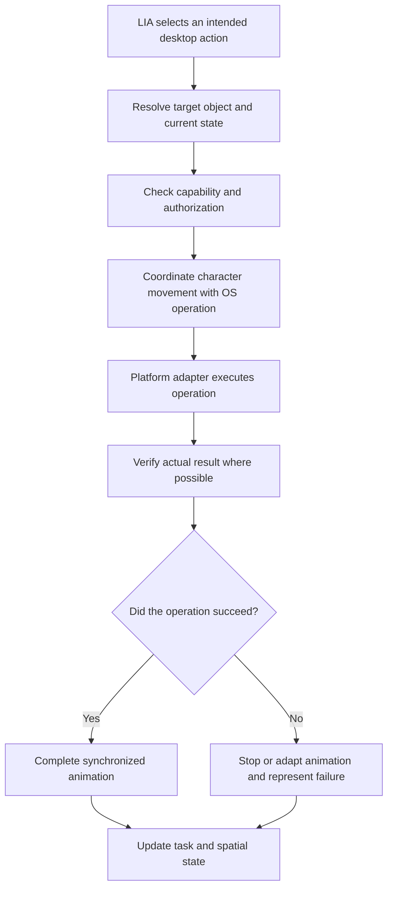

Not every operation requires a literal physical metaphor. Dragging and resizing can be represented as direct physical interactions. Minimizing or focusing a window may use a gesture or animation appropriate to the operation. In every case, the representation must not contradict the real desktop result.

## 11.2 Spatial desktop awareness

Spatial awareness is a first-class capability, not merely a side effect of screen perception.

**Definition:** LIA's ability to understand the spatial arrangement, relative positions, dimensions, boundaries and relationships of objects within the desktop environment, and to use that understanding when navigating or manipulating those objects.

Spatial awareness includes:

- **Desktop geometry:** Screen boundaries, monitor arrangement, display resolution, workspaces and available desktop regions.
- **Window geometry:** Window positions, dimensions, boundaries, visibility, stacking/layering and relevant window state.
- **Spatial relationships:** Which windows overlap, which are adjacent, which occupy most of the screen, where free space exists, and how objects are positioned relative to one another.
- **Character positioning:** Where LIA is rendered, which objects she is facing, where she can move, and how she should approach a target.
- **Spatial interaction:** Approaching, pointing, grabbing, dragging, pushing, releasing and repositioning desktop objects.
- **Dynamic awareness:** Understanding that the environment changes when windows move, monitors change, applications open or the user rearranges the desktop.

Perception and spatial awareness are related but distinct:

- **Perception:** What am I looking at? What application, window, control or object is present?
- **Spatial awareness:** Where is it? How is it positioned relative to other things? Where can I move? How can I interact with it?

LIA must distinguish directly available geometry from inferred spatial relationships. Spatial state must be refreshed when relevant desktop changes occur and before actions that depend on potentially stale positions.

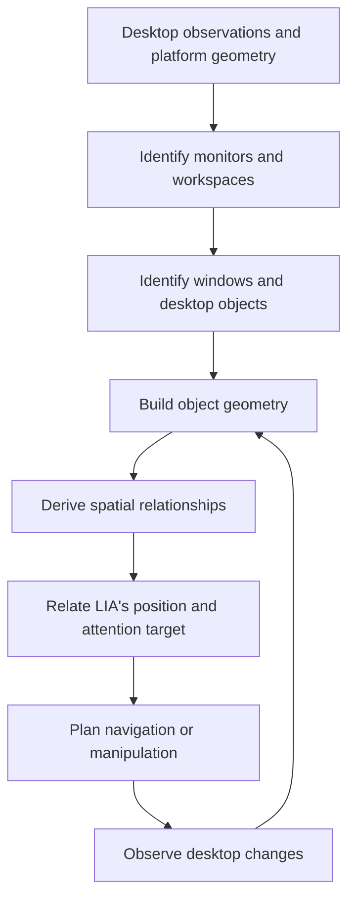

## 11.3 Window management as object interaction

LIA's eventual window-management capability includes three broad categories.

### Discovery

- Identify the active window.
- Enumerate supported windows.
- Obtain window metadata, including title, identity, position, dimensions and state when available.
- Identify visible, minimized, maximized, restored and focused windows.
- Identify the monitor or virtual desktop containing a window where supported.

### Manipulation and organization

- Focus a window and bring it to the foreground.
- Move a window by interacting with its title bar or through an appropriate platform operation.
- Resize a window through its edges or corners.
- Push or reposition windows to make space.
- Minimize, maximize and restore windows.
- Arrange, tile and snap windows.
- Move windows between monitors and virtual desktops where supported.
- Switch focus between windows and organize their spatial arrangement.

### Lifecycle

- Launch supported applications.
- Open and manage their windows.
- Close windows gracefully.
- Restore or reopen applications where supported.
- Identify unresponsive applications or windows.
- Handle dialogs and prompts associated with window operations.

Closing a window must not silently become forceful process termination. Unsaved work and confirmation dialogs must be respected. Window operations must report their execution result, and the system should verify the resulting state when possible.

The first vertical slice may implement a much smaller subset, such as identifying a target window, approaching it visually, grabbing it and moving it while synchronizing character animation with the actual OS operation. This validates the connection between spatial representation, embodiment, platform control and result verification without reducing the eventual product scope to only window movement.

## 11.4 Application interaction and per-application authorization

LIA should be able to enter supported applications and interact with their interface: buttons, menus, text fields, forms, dropdowns, selection menus, tabs, navigation elements, dialog boxes, confirmation prompts, toolbars, sidebars, context menus, checkboxes, sliders, toggles and other interactive controls.

Application access must be independently configurable per application. The capability classes are:

| Permission class | Meaning |
|---|---|
| **Observe** | Inspect the permitted application state and understand its visible or otherwise authorized contents |
| **Interact** | Navigate, click controls, switch tabs, type, scroll and operate interface elements |
| **Modify** | Change content or application data, save changes, submit forms, upload or download files and perform other data-altering operations |

These classes are independent. Permission to observe does not imply permission to interact. Permission to interact does not imply permission to modify. Permission to modify does not automatically authorize every consequential operation.

For example, Firefox might be configured to allow observation and navigation while restricting form submission or data modification. A password manager might have no access, while a code editor might have broader access for an authorized development workflow. These are illustrative configurations, not defaults.

Sensitive actions such as purchases, sending external communications, permanent deletion or consequential transactions may require additional authorization or confirmation even when the application has a general Modify grant.

Permissions must apply regardless of whether LIA uses visual interaction, direct input simulation or a semantic application interface. The detailed permission service, scopes, defaults, revocation and confirmation policy are specified in P2.6.

## 11.5 File-system interaction: direct and interactive operation

LIA shall support both direct file-system operations and embodied interaction through a file-manager application. These are two methods for performing the same authorized file-system capabilities.

The intended scope includes:

- **Discovery:** Search, locate, enumerate and inspect files and directories.
- **Reading:** Open, preview, read and understand supported file formats.
- **Creation:** Create files, directories and project structures.
- **Modification:** Edit supported documents, source code, configuration files and other supported content.
- **Organization:** Copy, move, rename, sort and organize files and directories.
- **Removal and recovery:** Delete files, manage trash and restore files where supported.

For example, when organizing a project directory, LIA could use direct operations to move and rename files efficiently. Alternatively, she could open the file manager, navigate to the directory and manipulate the files through its interface.

The execution method may depend on the task, reliability, available platform capabilities and user preference. Both methods must enforce the same path and operation permissions. Direct access must not be used as a way to bypass restrictions imposed on interactive access.

Destructive or difficult-to-reverse operations require the appropriate safeguards, and outcomes must be verified where possible.

## 11.6 Desktop-environment navigation and configuration

LIA's environment extends beyond application windows. Eventual capabilities include:

| Area | Intended capability |
|---|---|
| Monitors | Discover displays, understand their arrangement and move windows between them |
| Workspaces | Switch, create, organize and manage virtual desktops |
| Panels and docks | Interact with taskbars, docks, launchers and system panels |
| Desktop objects | Interact with icons, shortcuts and supported desktop elements |
| Notifications | Observe and interact with supported system notifications |
| Display configuration | Access and modify supported display settings |

LIA shall eventually be able to configure the desktop environment, not only navigate its existing arrangement. This includes supported workspace arrangements, panels, docks and display settings, subject to platform support and appropriate permissions.

Spatial awareness applies across the display topology. For example, LIA should understand that a window is on the left monitor, another workspace exists on the right, and moving a window between them differs from moving it within one display.

Platform and desktop-environment differences must be exposed honestly. A capability that is unavailable under a particular Linux compositor or Windows configuration must not be represented as universally supported.

## 11.7 Human-like computer input

LIA's eventual input capability includes the actions a person commonly performs with a computer.

### Pointer and mouse

- Move the pointer to arbitrary screen positions.
- Hover over elements and respond to hover states.
- Left-click, right-click and double-click.
- Click and hold.
- Drag and drop files, windows and interface elements.
- Scroll vertically and horizontally.
- Select objects and text.
- Interact with context menus.
- Perform supported pointer gestures.

### Keyboard

- Type text into input fields and documents.
- Press individual keys and key combinations.
- Execute keyboard shortcuts.
- Navigate interfaces using keyboard controls.
- Select, copy, cut, paste and replace text.
- Navigate and edit documents.
- Use application-specific shortcuts.
- Perform keyboard-driven workflows without relying on the mouse.

### Interface controls

LIA should recognize and operate buttons, text fields, forms, dropdowns, selection menus, tabs, navigation elements, dialogs, confirmation prompts, toolbars, sidebars, checkboxes, sliders, toggles and other interactive controls.

She should understand what an element does, not merely where it appears.

### Complex interaction sequences

A user goal may require multiple coordinated actions. For example, uploading a document can involve locating the application, opening its upload interface, navigating to the appropriate directory, locating and selecting the document, confirming the upload and verifying that the application received it.

LIA should represent this as one objective with a plan and individually tracked actions, rather than as an unstructured sequence of clicks.

### Embodiment

The character's physical behavior should participate in desktop interaction. When moving a window, she may approach and grab it. When pointing at a control, her gaze or hand movement may correspond to the target. When typing, her animation may reflect the action.

The animation and actual input must remain synchronized. LIA must not perform a visual gesture that falsely indicates a computer action succeeded.

## 11.8 Hybrid interaction model

The product shall combine three execution mechanisms:

1. **Direct input simulation:** Actual pointer and keyboard input, including clicks, typing, dragging, scrolling and other input events.
2. **Accessibility and semantic interaction:** Use available accessibility interfaces or application interfaces to identify and operate controls through their meaning and structure.
3. **Visual interaction:** Understand the visible interface through screen perception and select targets based on visual appearance and spatial location.

LIA should use the most appropriate mechanism for the operation, based on task requirements, available interfaces, platform support and expected reliability. She may combine mechanisms within one task.

For example, an accessibility interface may reliably identify a button, while pointer input is used to drag an object. Visual perception may be necessary for an application that exposes no suitable semantic interface.

All three mechanisms must obey the same authorization, action-planning, execution-result and verification rules. The hybrid model is an implementation-independent product direction; it does not select a particular automation framework or API.

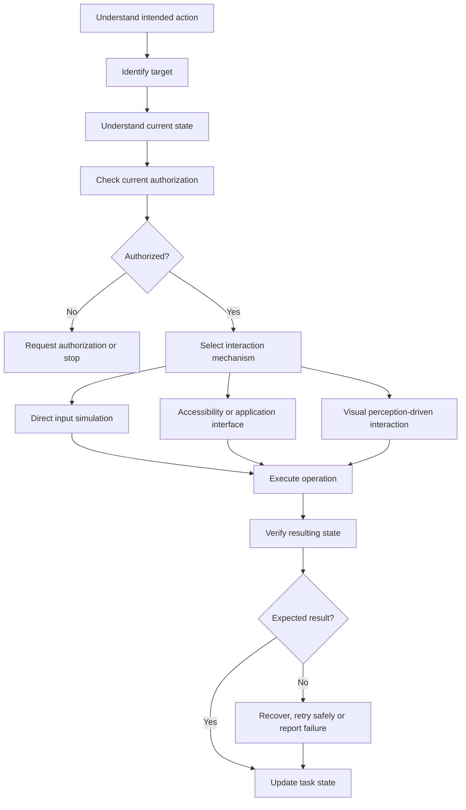

The choice of mechanism must not change the permission required. If the requested operation is unsupported, LIA must not silently substitute a materially different operation.

## 11.9 Task management: objective, plan and actions

LIA's task system should represent a user's desired outcome separately from the plan and the operations used to achieve it.

- **Objective:** The outcome LIA is supposed to achieve.
- **Plan:** The sequence or structure of steps LIA determines are necessary.
- **Actions:** Individual operations that execute the plan.

Example objective: "Organize my Downloads folder."

Possible plan: inspect files, classify them, create appropriate folders, move files, and verify the result.

Individual actions may include identifying a PDF, moving it into a destination directory and confirming that it exists at the destination.

A large objective may contain dozens of actions across multiple applications. LIA must track the overall objective while independently managing each step.

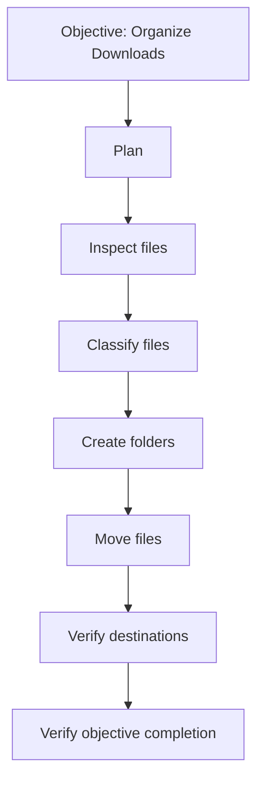

### Task record

A task should contain:

| Property | Purpose |
|---|---|
| Objective | What needs to be achieved |
| Origin | User request, delegated objective, schedule, event or LIA initiative |
| Plan | Steps required to achieve the objective |
| Dependencies | Actions or conditions that must be satisfied first |
| Required capabilities | Applications, files, services and operations needed |
| Authorization basis | One-time grant or valid standing authorization and its scope |
| Status | Current task state |
| Priority | Importance assigned to the task |
| Schedule | Timing or execution condition |
| Progress | Completed and remaining steps |
| Execution history | Actions taken and their results |
| Checkpoint | State required for safe resumption |
| Blocker | Why execution cannot proceed |
| Outcome | Verified result or failure explanation |

The user should be able to inspect what LIA actually did, not merely rely on a natural-language summary.

### Task states

The agreed task states are:

- **Queued:** Waiting for execution.
- **Running:** Currently executing.
- **Blocked:** Cannot proceed because a dependency, permission, resource, input or other required condition is missing.
- **Paused:** Execution has deliberately been suspended.
- **Completed:** Intended outcome verified to the extent possible.
- **Cancelled:** Execution was deliberately abandoned.
- **Failed:** Execution could not achieve the intended outcome.

Blocked and Failed are not interchangeable. Paused and Blocked are also distinct.

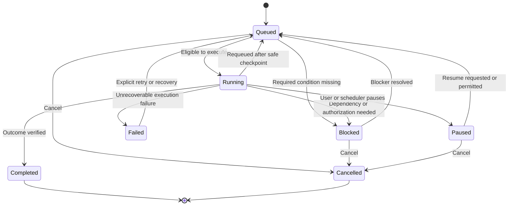

### Task origins and memory-informed initiative

Tasks may originate from:

- Direct user instructions.
- Previously delegated objectives.
- Scheduled activities and reminders.
- Events in the desktop environment.
- LIA's own observations and initiative, informed by relevant memory.

For example, LIA may remember that the user is developing the LIA project, that research into desktop automation has been identified as useful, and that public web research is covered by a standing permission. She can independently create a research task, prepare a plan, notify the user and execute under that existing authorization.

Task creation, planning and execution are separate capabilities. LIA may be able to create and organize a proposed task without having authority to execute every operation in its plan.

### Notification, approval and confirmation

These are three different behaviors:

- **Notification:** Informing the user that an already-authorized action or autonomous task is about to happen.
- **Approval:** Obtaining authorization when the operation is not covered by a valid grant.
- **Confirmation:** Verifying user intent for a particularly consequential operation when the risk policy requires it.

Notification must not be disguised as an approval prompt. LIA should not ask permission for every step of work that is already within valid standing authorization. Conversely, an announcement does not make an unauthorized operation permissible.

The authorization basis must be explicit in the task record. A one-time approval must not silently become unlimited standing permission.

### Scheduling and prioritization

Priority, urgency and deadline are separate attributes.

The agreed priority categories are:

| Priority | Meaning | Illustrative example |
|---|---|---|
| P0 — Critical | Time-sensitive or essential | A task with an imminent deadline |
| P1 — High | Important to an active objective | Research needed for an ongoing project |
| P2 — Normal | Useful work that should progress regularly | Organizing project documentation |
| P3 — Low | Useful but not immediately necessary | Exploring an interesting technical subject |
| P4 — Someday | Optional ideas and opportunities | Investigating an unrelated project idea |

The user may assign priorities. LIA may recommend or adapt priorities using explicit user goals, deadlines, project importance, dependencies and current circumstances. She must not silently downgrade an explicit user priority simply because another activity appears more interesting. Meaningful scheduling changes should be communicated.

Supported execution modes are:

- Immediate: start when authorization and execution conditions are satisfied.
- Background: continue without taking over the user's active desktop interaction.
- Idle-time: execute when the computer or user reaches a suitable idle condition.
- Scheduled: execute at a specified time or recurring interval.
- Deadline-driven: schedule work backwards from a deadline.
- Event-triggered: start when a specified event or condition occurs.
- Deferred: retain the task until an appropriate opportunity becomes available.

These are scheduling properties, not mutually exclusive task types.

### Dependencies

The task system should support:

- Sequential dependencies: B begins after A.
- Parallel tasks: B and C may execute simultaneously.
- Conditional dependencies: a step begins only when a specified condition is satisfied.
- Parent-child tasks: a larger objective contains independently tracked subtasks.
- Recurring tasks: an objective can generate new task instances periodically.

### Resource and interaction classes

| Execution class | Examples | Scheduling behavior |
|---|---|---|
| Background-safe | Research, summarization and permitted file reading | May run while the user works |
| Low-interference | Preparing documents and organizing authorized data | May run in the background with safeguards |
| Desktop-interactive | Moving windows, navigating applications and typing | Must consider active user interaction |
| User-dependent | Tasks needing clarification or a decision | Wait for user input |
| Resource-intensive | Large computations, local inference and heavy indexing | Consider system load and resource availability |

LIA should not stop working merely because the user is busy. She should avoid interfering with the user's active work. For example, she may conduct research in the background while the user codes, but should not move application windows or type into the user's editor while the user is actively controlling it.

### Interruption, checkpoint and resumption

Interruption is a normal task condition, not necessarily a failure.

If the user begins interacting with a directory that LIA is organizing, LIA should pause conflicting file operations, preserve completed work, record remaining work and resume when conditions permit.

Resumption must verify the actual environment before repeating operations that may already have taken effect. A research task may resume from its last completed research step; a partially completed file operation must inspect the filesystem before attempting the move again.

### Scheduler model

The scheduler should manage state, dependencies, execution eligibility and resource constraints through deterministic rules. LIA's reasoning may identify opportunities, formulate plans and recommend priorities, but should not independently mutate task state outside the scheduler's controlled transitions.

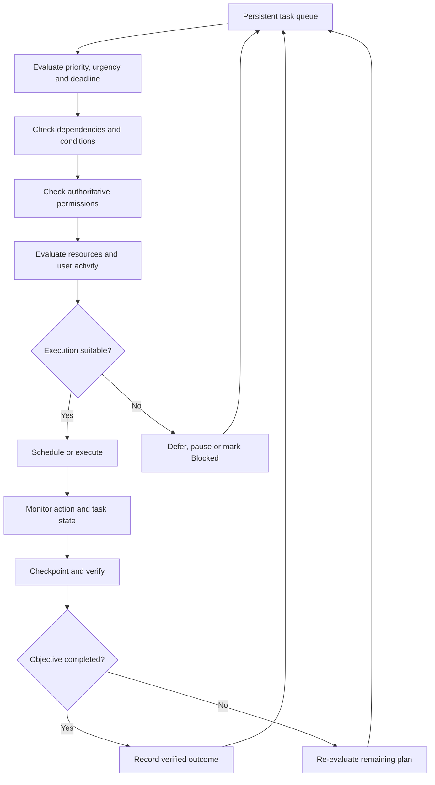

The scheduler should reconsider tasks when circumstances change: a dependency becomes available, a deadline approaches, an event occurs, an objective becomes irrelevant or resource conditions change. Reprioritization must respect explicit user priorities.

## 11.10 Memory architecture: complete conceptual design

Memory is foundational to LIA's persistent identity, cognitive continuity and autonomous initiative. The recommended direction is a hybrid, multi-layered, temporal memory system with a knowledge graph as its relational backbone.

No individual store or retrieval method is expected to provide all required memory capabilities.

### Two complementary memory capabilities

LIA needs both:

1. **Remembering what happened:** A searchable historical archive of permitted conversations, meaningful experiences, decisions, task events and retained source materials.
2. **Remembering what she learned:** Organized long-term memories containing distilled facts, preferences, relationships, procedures, project knowledge and patterns.

The historical archive preserves original context. Organized memories make information easier to use during reasoning. Derived memories should refer back to their original evidence whenever possible.

This does not mean indefinitely recording every screen frame, microphone stream or transient desktop observation. Raw observations have separate permission and retention requirements.

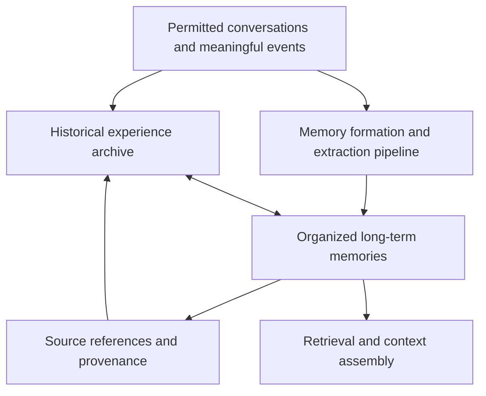

### Memory component 1 — Source and experience archive

The archive is the historical record from which other memories are derived. It can include:

- Conversation transcripts and session records.
- Important interaction events.
- Decisions and their original discussions.
- Task plans, execution steps and outcomes.
- Permitted application and desktop observations.
- Imported documents and reference materials.
- Relevant external research and its sources.

The record should be append-oriented. New events are recorded, and existing evidence is not silently overwritten when a derived memory changes. Corrections and superseding decisions should be represented as new events or versioned state changes with provenance.

Retention is governed separately by sensitivity and user policy. The ordinary conversation archive is retained indefinitely until the user requests deletion. Temporary conversations are excluded from permanent archive and long-term memory formation.

### Memory component 2 — Episodic memory

Episodic memory preserves meaningful experiences in chronological context.

An episode may contain:

- What happened.
- When the underlying event occurred.
- When LIA learned or recorded it.
- The participants, projects and entities involved.
- The context and outcome.
- Related tasks and decisions.
- Links to the original conversation, document or event.

Example:

**Episode: Desktop awareness decision**

- Event date: 12 November 2026.
- Context: Discussion of the extent of desktop awareness.
- Event: User approved three levels of awareness.
- Outcome: Default desktop metadata, on-demand screen perception and optional continuous screen perception.
- Related entities: LIA, Desktop Awareness, Screen Perception and User Permissions.
- Source: Original discussion and approved decision record.

Episodic memory enables questions such as "What did we decide during our last architecture discussion?", "When did we discuss this?" and "What was happening when this preference was established?"

### Memory component 3 — Semantic memory

Semantic memory stores what LIA currently understands to be true or established.

It includes:

| Domain | Example |
|---|---|
| User profile | Interests, preferences, goals and routines |
| Projects | Objectives, current state and decisions |
| Technology | Technologies used by a project |
| Relationships | Relevant people and their associations |
| Preferences | Preferred interaction and working styles |
| Knowledge | Established facts and concepts |

Semantic memory should use both concise, frequently accessed profiles and independently addressable records. A project summary can provide quick context while individual records preserve supporting decisions, dates and source evidence.

A single continually rewritten profile risks losing historical nuance. A collection of isolated facts risks making comprehensive retrieval difficult. The two representations should work together.

### Memory component 4 — Temporal knowledge graph

The knowledge graph is the relational backbone of LIA's memory. It represents entities as nodes and meaningful typed relationships as edges.

Potential entities include User, LIA, Person, Project, Application, Technology, File, Conversation, Experience, Task, Decision, Preference and Skill.

Potential relationship types include:

- WORKS_ON
- USES
- PREFERS
- DECIDED
- DEPENDS_ON
- RELATED_TO
- SUPERSEDES
- PARTICIPATED_IN
- CREATED
- ORIGINATED_FROM
- APPLIES_TO

Example:

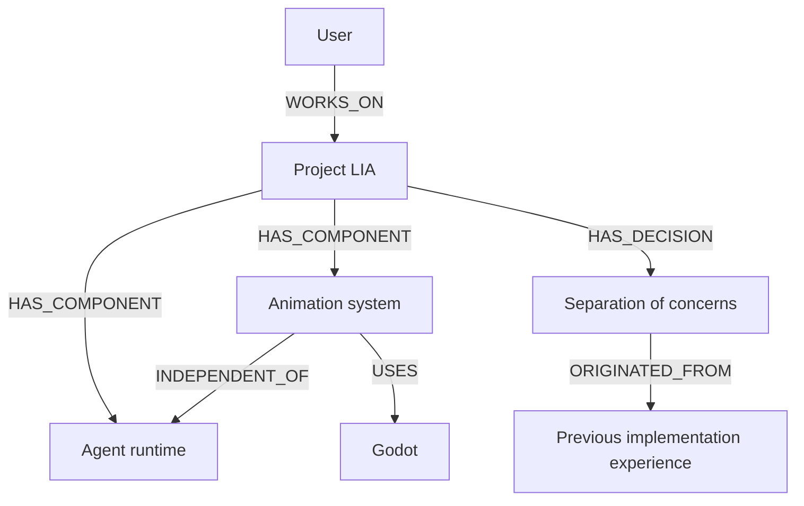

This graph should represent semantic relationships, not merely the fact that two topics appeared in the same conversation. RELATED_TO, DEPENDS_ON and SUPERSEDES must retain distinct meanings.

The graph should support multi-hop questions. For example, a question about why animation must remain independent of agent cognition can lead from the LIA project to the animation system, the agent runtime, the separation-of-concerns decision and the original implementation experience.

#### Temporal graph semantics

The memory model should distinguish:

- **Valid time:** When was this information true in the world or in the user's circumstances?
- **Transaction time:** When did LIA learn or record this information?

If the user tells LIA on 13 November that a desktop-environment change actually happened on 1 November, both dates matter.

The graph should preserve historical facts while identifying what is currently believed to be valid. New facts may supersede older facts without erasing them.

### Memory component 5 — Procedural memory

Procedural memory stores how LIA performs tasks, not merely what she knows.

Examples include:

- How to organize a software project.
- How to operate a particular application.
- How to troubleshoot a known error.
- How to configure a desktop environment.
- How to execute a recurring user-approved workflow.

A procedure should contain preconditions, required permissions, execution steps, expected outcomes and recovery instructions. LIA must distinguish a successful, verified workflow from something she merely attempted once.

### Memory component 6 — Working and task memory

Working memory is LIA's active cognitive workspace. It contains information needed for current reasoning and execution:

- Current conversation context.
- Active objectives and plans.
- Retrieved memories relevant to the current objective.
- Current application and desktop context, where permitted.
- Task checkpoints and dependencies.
- Immediate observations and results.

Working memory must not become an unbounded permanent store. Its lifecycle should be managed independently, while important task checkpoints and persistent state are saved when needed for safe resumption.

### Memory component 7 — Retrieval indexes

Indexes are mechanisms for locating memories, not separate sources of truth.

| Index | Purpose |
|---|---|
| Vector index | Find information through semantic similarity |
| Full-text / BM25 index | Find exact terms, names, identifiers and phrases |
| Graph index | Find relationships and connected memories |
| Temporal index | Find events and facts relevant to a period |
| Structured index | Filter by project, category, source, status and metadata |

These indexes should point to canonical records and source evidence. If an index is stale or inconsistent, it must be repairable from the authoritative records.

### Memory formation pipeline

Autonomous memory formation should operate as an ongoing pipeline over permitted inputs.

1. Capture permitted conversations, events, task outcomes and other relevant information.
2. Segment the input into meaningful events, topic boundaries and experiences.
3. Extract candidate facts, preferences, objectives, decisions, relationships and procedural knowledge.
4. Resolve entities so that information is connected to the correct person, project, application or concept.
5. Validate and reconcile duplicates, contradictions, outdated information, uncertainty and source evidence.
6. Store memories in appropriate representations and create graph relationships and retrieval indexes.
7. Consolidate summaries and frequently used representations without destroying original evidence.

Most extraction and consolidation can occur asynchronously. Important decisions and task-state changes may require prompt persistence. Failure to extract a memory must not silently corrupt the original archive.

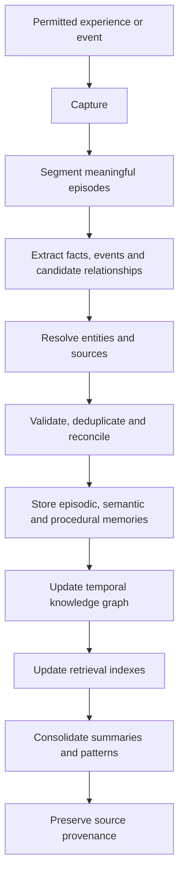

### Associative memory reinforcement

LIA's memory graph should support experience-dependent strengthening of meaningful relationships. This is inspired by associative-learning principles such as Hebbian learning, but is a computational design analogy, not a claim that LIA reproduces biological neural plasticity.

A relationship may become stronger when supported by repeated, sufficiently independent experiences or strong explicit evidence.

Example:

- First experience: The user mentions enjoying Linux internals. LIA records a candidate association between User and Linux Internals.
- Second experience: The user spends multiple sessions exploring kernel internals, process management and memory management. Independent evidence supports the association and creates useful connections among those concepts.
- Third experience: The user explicitly states a long-term goal of understanding Linux internals deeply. This explicit statement provides stronger evidence and can establish a durable learning preference with high confidence.

The system should not require repeated statements when the user has explicitly communicated a clear preference or goal.

#### Association development stages

| Stage | Meaning |
|---|---|
| Candidate association | A relationship is observed, but evidence is insufficient to treat it as an established pattern |
| Consolidated association | Multiple independent experiences support the relationship, or strong explicit evidence establishes it |
| Strong association | The relationship receives consistent support across time, situations and meaningful experiences |

#### Separate memory signals

LIA must maintain distinct values for:

- **Association strength:** How strongly two pieces of information are connected.
- **Factual confidence:** How certain LIA is that the relationship or statement is correct.
- **Importance:** How valuable the information is to preserve.
- **Retrieval activation:** How relevant the memory is to the current situation.

A possible normalized association-strength model is:

S_new = min(1, S_old + ΔS)

ΔS represents the contribution of new supporting evidence. This is a conceptual model, not a finalized update equation or coefficient.

Evidence may have different influence:

| Evidence | Indicative influence |
|---|---|
| Explicit user statement | Very high |
| Repeated independent experiences | High |
| Consistent behavior across sessions | High |
| Relevant task completion | Moderate to high |
| Single contextual observation | Low |
| Mere co-occurrence of concepts | Very low |
| Contradictory information | Triggers reconciliation rather than automatic reinforcement |

#### Selective association and maintenance

LIA must not create strong relationships between every concept that appears in the same conversation. Co-occurrence can suggest a candidate relationship, but semantic meaning requires evidence.

The system should also avoid runaway reinforcement:

- Temporal decay may reduce the retrieval activation or relevance of temporary information.
- Contradictory evidence may challenge a relationship and require reconciliation.
- Strength normalization should produce diminishing gains from repeated evidence, preventing frequently mentioned topics from dominating the graph.
- Repeated retrieval alone must not count as new evidence of truth.
- Historical facts and important decisions must not be erased merely because they are old.

A strong association can guide retrieval without proving a causal relationship or a personal inference.

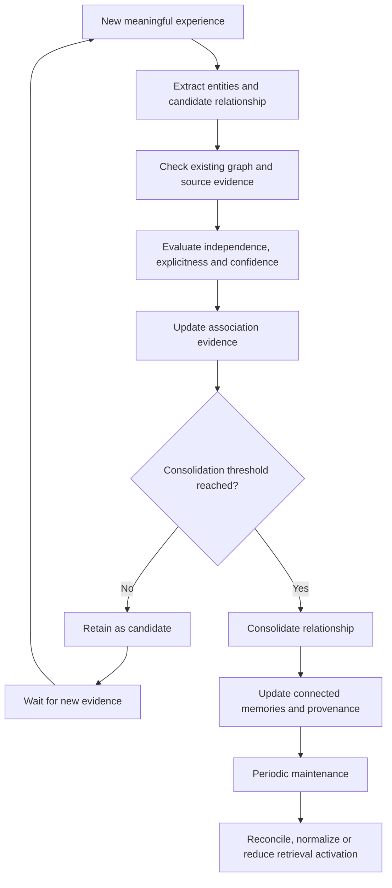

### Context-aware memory retrieval and assembly

The retrieval system should reconstruct the context required for a particular conversation, task or proactive activity. It should not merely return memories that resemble the latest message.

Memory formation, consolidation, retrieval and context assembly are separate responsibilities:

- Formation decides what to remember.
- Consolidation organizes and connects what is remembered.
- Retrieval finds relevant records.
- Context assembly decides what information is supplied to reasoning.

#### Eight retrieval stages

1. Understand the information need.
2. Create a retrieval plan.
3. Query relevant memory stores in parallel.
4. Merge and deduplicate candidate memories.
5. Expand relevant knowledge-graph connections.
6. Rerank and validate evidence.
7. Retrieve original source material when needed.
8. Assemble a bounded working context.

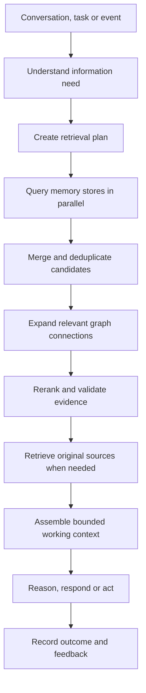

#### Retrieval by information need

| Request | Relevant memory sources |
|---|---|
| Casual conversation | User profile, preferences and recent relevant episodes |
| Personal discussion | Relevant episodic memories, preferences and established boundaries |
| Project discussion | Project summaries, decisions, graph connections and original discussions |
| Technical research | Relevant knowledge, reference documents and previous research |
| Task execution | Task state, procedures, current permissions and fresh application context |
| Task resumption | Checkpoints, execution history, dependencies and latest state |
| Historical question | Temporal graph, original source episodes and evidence |
| Proactive initiative | Active goals, unfinished tasks, deadlines, preferences and permitted observations |

#### Hybrid retrieval and ranking

The retrieval planner may query vector, lexical, structured, graph, temporal and source-archive indexes in parallel. Candidate results should be merged and deduplicated before ranking.

Ranking can consider semantic relevance, lexical relevance, graph relevance, temporal relevance, source authority, factual confidence, current validity, contextual relevance and importance.

A conceptual ranking model is:

R(m,q,c) = w_s S + w_l L + w_g G + w_t T + w_p P + w_v V + w_c C

Where m is a candidate memory, q is the information request, c is current context, and the signals represent semantic, lexical, graph, temporal, provenance, validity and contextual relevance. The weights require evaluation and calibration; they are not fixed in the requirements baseline.

Association strength may influence which graph paths deserve exploration, but must not override factual confidence or source evidence.

#### Bounded graph traversal

Graph retrieval should:

- Identify anchor entities in the request.
- Traverse meaningful typed relationships.
- Expand progressively from directly connected memories.
- Use task-appropriate and bounded hop counts.
- Preserve edge direction and semantics.
- Apply temporal validity and access controls during traversal.
- Stop when additional connections no longer contribute useful evidence.

An unrestricted graph walk is not acceptable because it can retrieve excessive or unrelated context.

#### Temporal and contradiction resolution

Before using a memory as current fact, LIA should identify whether it is current, historical, superseded, stale, incomplete or contradictory.

For example, a previous preference for Application A may be superseded by an explicit later preference for Application B. LIA should retain both records and return the current applicable belief when asked about the present, while still answering historical questions accurately.

When evidence conflicts without a clear resolution, LIA must expose the uncertainty rather than force one answer.

#### Context assembly

The final working-context package should include only information needed for the current task and should preserve:

- Current project or conversation state.
- Relevant established decisions and facts.
- Relevant historical experiences.
- Active tasks and unresolved items.
- Source references.
- Temporal status.
- Explicit versus inferred evidence labels.
- Uncertainty and conflicting evidence.
- Relevant access restrictions.

It should be bounded by the available context budget. A summary must not be treated as equivalent to its original evidence when exact historical detail matters.

#### Reactive and anticipatory retrieval

**Reactive retrieval** occurs in response to a user message, task or event.

**Anticipatory retrieval** prepares likely relevant context as a task or interaction develops. For example, when the user begins working on a known project, LIA may retrieve its current summary, recent decisions and unfinished tasks, provided the relevant context access is permitted.

Anticipatory retrieval does not authorize execution. It prepares information only.

#### Retrieval traceability

LIA should retain enough retrieval trace information to explain which sources and relationships contributed to a response or plan. This enables debugging across extraction, entity resolution, graph traversal, ranking, temporal resolution and context assembly.

#### Memory evaluation

The memory system should be evaluated using LIA-specific tests:

| Test | Expected behavior |
|---|---|
| Exact recall | Retrieve a specific fact and its source |
| Multi-session recall | Combine information from different conversations |
| Multi-hop reasoning | Follow relationships between projects, decisions and events |
| Temporal reasoning | Distinguish historical information from current information |
| Knowledge updates | Correctly handle changed preferences and decisions |
| Provenance | Identify the original source of remembered information |
| Abstention | Acknowledge missing or uncertain information |
| Task continuity | Resume a task using its actual checkpoint |
| Correction | Propagate a correction into dependent representations |
| Deletion | Propagate deletion through authorized stores and indexes |
| Context isolation | Avoid mixing unrelated projects, people or private domains |
| Permission separation | Never treat retrieved memory as current execution authorization |

Measurements should include retrieval precision and recall, source accuracy, temporal correctness, context size, latency, unnecessary memory inclusion and the rate of unsupported answers.

LongMemEval and LoCoMo are potential external benchmark references; they do not replace LIA-specific evaluation.

### Memory architecture diagram

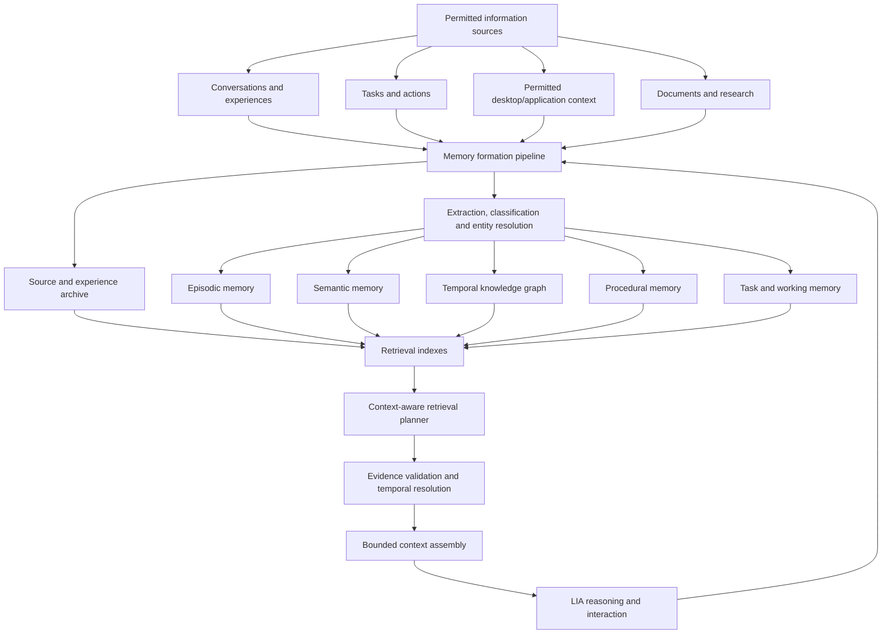

## 11.11 P2.1 and P2.5 boundaries

The memory architecture in this section is a conceptual design direction. P2.5 will formalize memory requirements, governance, persistence, retrieval, correction and deletion. P2.6 will define permissions, sensitive-data boundaries and execution authority. P2.2 will define measurable performance and resource constraints. P2.7 will define acceptance tests.

No specific graph database, vector database, embedding model, programming language, memory framework or orchestration system is selected here. Such choices belong in P3.

---

# 12. P2.5 — Memory governance and integrity

**Workstream status:** Active design  
**Purpose:** Define how LIA retains, classifies, protects, corrects, forgets, deletes, shares and accesses memory throughout its lifecycle.

A sophisticated memory system that remembers everything but cannot reliably correct or forget information would be fundamentally flawed. Governance is therefore part of the memory architecture, not an administrative feature added afterwards.

## 12.1 Historical conversation retention

The user approved the following policy:

- Ordinary permitted conversation archives are retained indefinitely until the user requests deletion.
- Retention does not imply that every screen frame, raw audio stream or transient desktop observation is permanently recorded.
- The user can request deletion of individual conversations or broader memory collections.
- Sensitive information follows stricter classification and retention policies.
- Temporary conversations are available for the active interaction but are not added to the permanent conversation archive or long-term memory formation.

### Temporary conversations

Temporary conversation mode is available in two ways:

1. The user manually activates it.
2. LIA may suggest it when a conversation appears especially sensitive.

LIA must never silently activate temporary mode. The user must explicitly consent to enter it.

While temporary mode is active:

- Conversation content remains available in working memory for the active interaction.
- The conversation is not added to the permanent historical archive.
- Autonomous extraction and consolidation of its contents into long-term memory are disabled.
- No episodic, semantic or associative memories are created from the temporary conversation.
- Temporary conversational context is discarded when the session ends, subject to any separately disclosed operational or security records.
- Sensitive content must not leak into unrelated summaries or retrieval indexes.

If LIA performs an authorized computer operation during a temporary session, minimal operational records may be necessary for execution integrity and security. Such records must not preserve the sensitive conversational content. A separately authorized persistent task may have its own task record, but that must not silently archive the temporary conversation.

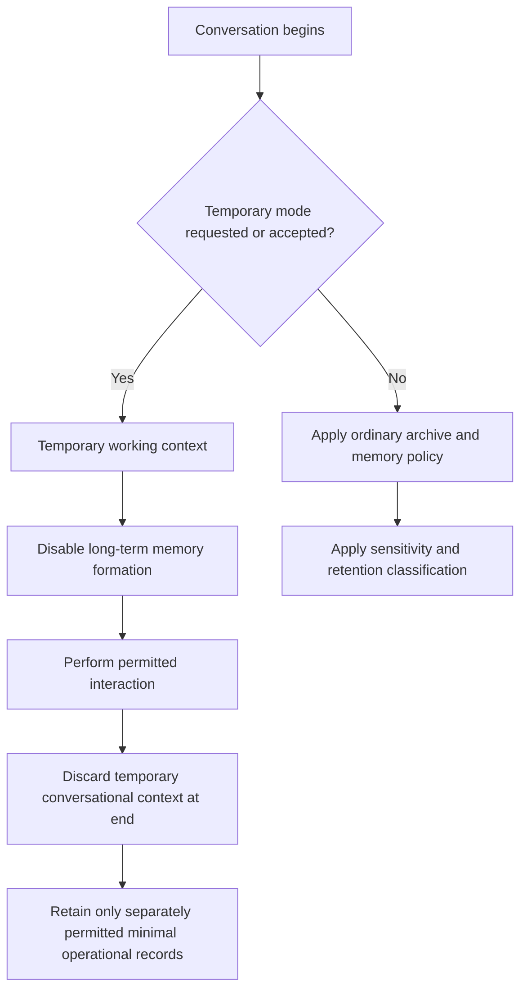

## 12.2 Memory sensitivity classification

The initial proposed classification is:

| Class | Information examples | Default memory policy |
|---|---|---|
| **S0 — Ordinary** | General knowledge, public information and ordinary project facts | Autonomous retention allowed |
| **S1 — Personal** | Interests, preferences, routines and personal context | Autonomous retention under user memory preferences |
| **S2 — Sensitive** | Private correspondence, financial records and sensitive personal documents | May be processed when authorized; explicit authorization required for long-term retention |
| **S3 — Highly sensitive secrets** | Passwords, API tokens, private keys, recovery codes and equivalent secrets | Never store in ordinary conversational or semantic memory |

S3 credentials must be handled through a separate secure credential mechanism if the product later supports them. They must not be embedded in the knowledge graph, ordinary memory records or conversational summaries.

Permission to access information does not automatically grant permission to retain it. LIA may be authorized to inspect a financial document for a specific calculation without being authorized to preserve its full contents indefinitely.

Classification must affect the entire memory pipeline, including extraction, summarization, graph construction, indexing, retrieval and sharing. If LIA is uncertain about sensitivity, she should handle the information conservatively and avoid automatic promotion into unrestricted long-term memory.

## 12.3 Correction, contradiction and temporal reconciliation

LIA must correct her understanding without corrupting historical evidence.

Example:

- January: The user prefers Application A.
- March: The user begins using Application B.
- April: The user explicitly states that Application B is now preferred.

The current semantic profile should reflect Application B. The historical record should preserve the earlier preference and the transition.

Correction rules:

- Explicit user correction takes precedence over an inference within the scope stated by the user.
- Context matters: preferring Linux for development does not establish a preference for Linux in every activity.
- Time matters: earlier information may have been accurate when recorded.
- Contradictions should remain visible when evidence does not establish a clear resolution.
- LIA must not invent an explanation for why information changed.
- Corrections must propagate to derived summaries, graph relationships and retrieval indexes.
- Historical evidence should remain traceable unless the user separately requests erasure.

## 12.4 Forgetting and deletion operations

The user approved three distinct memory-management operations:

| Operation | Meaning |
|---|---|
| **Forget a fact** | Remove the fact from active memory and its derived representations, and prevent it from influencing future reasoning. The original conversation remains unless separately requested for deletion. |
| **Erase an experience** | Delete the selected conversation or experience and its derived memories, relationships, summaries and retrieval representations. |
| **Erase a memory domain** | Remove a selected collection, such as a project-memory or personal-interest domain, including derived records within the requested scope. |

A minimal deletion marker may be retained to prevent accidental re-import, but it must not preserve the deleted content itself.

Deletion must cover the canonical record and its dependent representations, including:

- Knowledge graph nodes and relationships.
- Vector embeddings and lexical indexes.
- Derived summaries and profiles.
- Cached working-context representations.
- Linked episodic and semantic memories.
- Snapshots and backups according to the applicable deletion policy.
- External processing or storage providers, subject to their actual deletion capabilities and terms.

LIA must distinguish deletion from active memory, deletion from primary storage, expiration of backup copies and removal from external providers. She must not claim complete erasure until all applicable deletion work has actually completed or clearly disclose what remains outstanding.

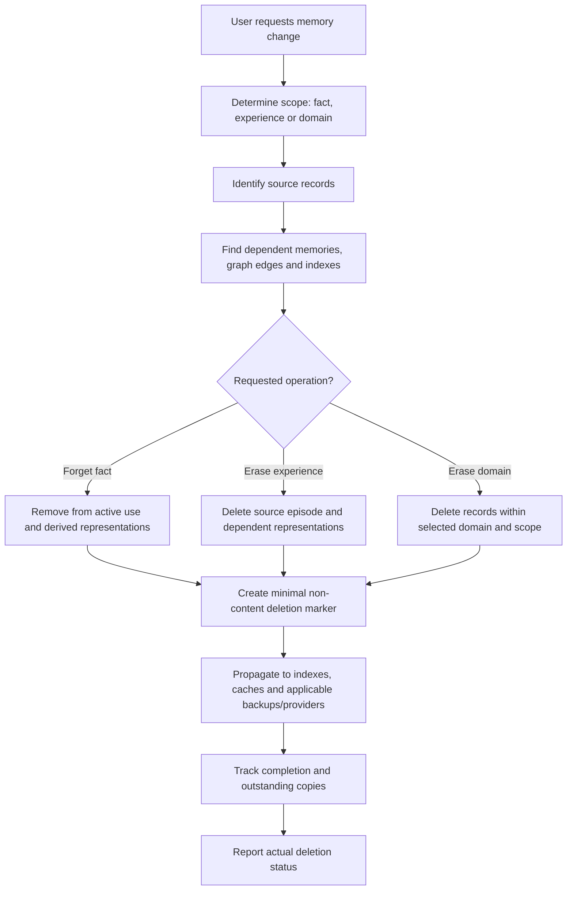

## 12.5 Memory compartments and controlled cross-domain sharing

LIA's memory should be logically compartmentalized. The initial domains are:

| Domain | Contents |
|---|---|
| User memory | Preferences, goals, routines, interests and personal context |
| Project memory | Project-specific objectives, decisions, architecture, files and progress |
| Task memory | Objectives, plans, dependencies, checkpoints and execution history |
| Experience memory | Conversations, episodes, meaningful events and interaction history |
| Procedural memory | Reusable workflows, learned application operations and validated procedures |

These compartments must remain interconnected without becoming one unrestricted information pool.

The user approved controlled cross-domain memory sharing.

The intended behavior is:

- Non-sensitive user-level preferences and technical preferences may be available across projects when relevant and permitted by policy.
- Project-specific or confidential information remains scoped to that project unless sharing is explicitly authorized or covered by a clearly defined user-level sharing rule.
- A task may retrieve relevant project memory and user preferences without gaining access to unrelated private domains.
- LIA may know that two projects are related without being entitled to retrieve every private detail from both.
- A relationship edge does not itself grant access to the connected record.
- Sharing permissions are not automatically transitive. Access to A and a relationship from A to B does not automatically grant access to all of B.
- Cross-domain sharing must retain source provenance, sensitivity classification and the purpose for which information is being retrieved.
- Revoking a sharing grant must prevent future retrieval under that grant and update relevant access indexes or caches.

Access decisions should consider three dimensions:

1. **Ownership:** Which user, project, task or experience owns the memory?
2. **Sensitivity:** How restricted is the information?
3. **Contextual access:** Which task or reasoning activity is allowed to retrieve it?

### Controlled memory-sharing model

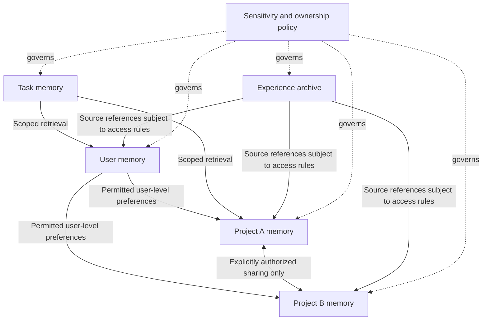

The diagram expresses permitted flows, not automatic access. The access-control decision must be evaluated for each retrieval.

## 12.6 Memory and authorization are separate authorities

Memory records what LIA knows and what happened. A separate permission authority determines what LIA is currently allowed to do.

Example:

Memory records that the user previously authorized LIA to conduct public web research for the LIA project.

The permission authority independently confirms:

- Capability: Public web research.
- Scope: LIA project.
- Authority: Standing permission.
- Status: Active.

LIA may proceed without asking for a new approval if the current permission check succeeds.

If the permission is revoked, the permission authority must reject future execution even though historical memory still records the previous approval.

Likewise, an inferred preference such as "the user usually wants me to do this" must never become authorization.

These components remain separate:

| Component | Responsibility |
|---|---|
| Memory system | Knows what has happened and what has been learned |
| Permission authority | Determines what LIA is currently allowed to do |
| Task scheduler | Determines when work can execute |
| Execution system | Performs authorized operations |

They may reference one another, but must not inherit one another's authority.

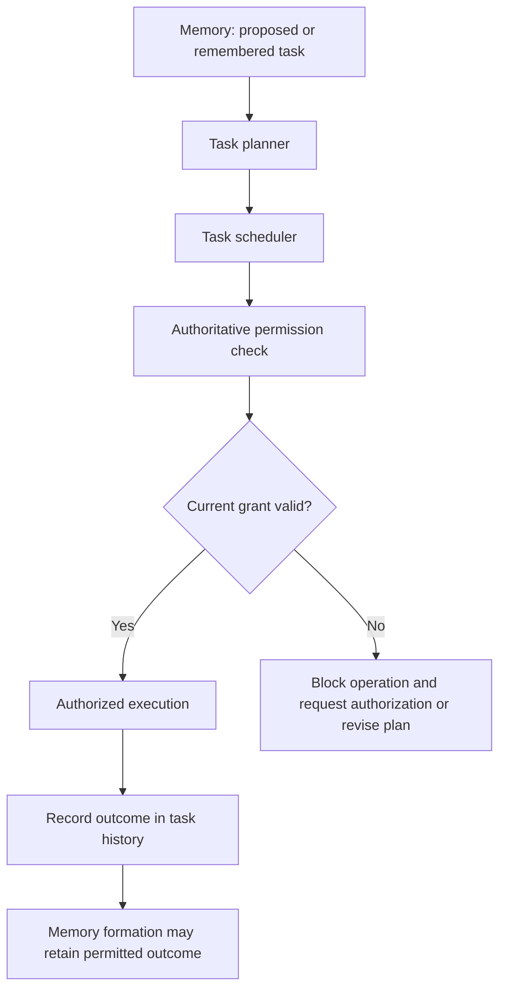

## 12.7 Memory governance requirements

The following security and governance requirements are part of the P2.5/P2.6 design baseline. Their detailed acceptance criteria remain to be completed in P2.7.

| ID | Requirement | Status |
|---|---|---|
| SEC-001 | Ordinary permitted conversation archives shall be retained indefinitely until the user requests deletion, subject to sensitivity classification and the applicable retention policy. | Agreed design direction |
| SEC-002 | LIA shall support user-activated temporary conversations and may suggest temporary mode, but shall not activate it without explicit user consent. | Agreed design direction |
| SEC-003 | Temporary conversation content shall be excluded from permanent conversation archives and autonomous long-term memory formation, subject to separately disclosed minimal operational records. | Agreed design direction |
| SEC-004 | Memory records and source information shall be classified by sensitivity before long-term retention, indexing and cross-domain sharing. | Draft |
| SEC-005 | S2 sensitive information shall require explicit authorization for long-term retention, even when processing access is authorized. | Agreed design direction |
| SEC-006 | S3 secrets shall not be stored in ordinary conversational, semantic or graph memory. | Agreed design direction |
| SEC-007 | The system shall distinguish access permission from retention permission. | Draft |
| SEC-008 | The user shall be able to inspect the source and relationships of retained memories. | Draft |
| SEC-009 | Explicit user corrections shall take precedence over inferred information within the stated scope and shall propagate to dependent representations. | Draft |
| SEC-010 | The system shall preserve historical evidence when information is corrected or superseded, unless the user requests erasure. | Draft |
| SEC-011 | Forgetting a fact shall remove it from active use and derived representations while leaving the original archive intact unless separately requested for deletion. | Agreed design direction |
| SEC-012 | Erasing an experience shall propagate to its dependent memory records, graph relationships, summaries and retrieval indexes within the requested scope. | Agreed design direction |
| SEC-013 | Erasing a memory domain shall remove the selected domain and its derived representations within the requested scope. | Agreed design direction |
| SEC-014 | Deletion status shall distinguish active-storage deletion, primary-store deletion, backup expiration and external-provider deletion. | Draft |
| SEC-015 | Memory domains shall be logically compartmentalized by ownership, sensitivity and contextual access. | Agreed design direction |
| SEC-016 | Cross-domain memory sharing shall be controlled, purpose-relevant and subject to sensitivity, ownership and revocable access rules. | Agreed design direction |
| SEC-017 | Knowledge-graph relationships shall not automatically grant access to connected memory records, and sharing shall not be transitively inherited by default. | Agreed design direction |
| SEC-018 | The permission authority shall remain separate from memory and shall be consulted for current authorization before execution. | Agreed design direction |
| SEC-019 | The system shall not claim complete erasure while applicable deletion work remains outstanding or unverified. | Agreed design direction |
| SEC-020 | If sensitivity or permission status is uncertain, the system shall apply the more restrictive safe handling behavior until resolved. | Draft |

| SEC-021 | Memory discovery, reading, use, derivation, modification, sharing and deletion shall be separately authorizable operations. | Approved |
| SEC-022 | Authorization and scope filtering shall occur before memory search or retrieval and shall prevent disclosure of restricted content or its existence through metadata. | Approved |
| SEC-023 | Derived memories shall inherit relevant restrictions from their source records; combining restricted sources shall not silently declassify the result. | Approved |
| SEC-024 | Automatic cross-project promotion shall follow the explicit-user-preference, independent-repetition, contextual-observation and sensitivity rules in Section 12.14. | Approved |
| SEC-025 | The user shall be able to pause persistent memory formation globally and configure permitted retention by source, category and domain. | Approved |
| SEC-026 | Raw audio, camera frames and transient screen observations shall not be retained as permanent memory by default. | Approved |
| SEC-027 | The user shall be able to inspect memory provenance, interpretation, confidence, scope, sensitivity, relationships and recorded usage. | Approved |
| SEC-028 | Memory epistemic state shall distinguish candidate, established, disputed and rejected information; supersession and temporal validity shall be represented separately. | Approved |
| SEC-029 | The system shall distinguish historical validity, freshness and retrieval relevance and shall revalidate stale information when material to current decisions. | Approved |
| SEC-030 | Every retained or derived memory shall preserve source provenance and lineage sufficient to trace its origin and dependent representations. | Approved |
| SEC-031 | Ambiguous entity matches shall remain separate unless identity can be established with sufficient evidence or user confirmation. | Approved |
| SEC-032 | The user shall be able to export accessible memory in human-readable and machine-readable forms while preserving provenance, scope, relationships and temporal information. | Approved |
| SEC-033 | Memory belonging to one authenticated OS user profile shall not be accessible to another local OS account without explicit supported sharing authorization. | Approved |
| SEC-034 | Retrieved or stored third-party content shall be treated as data/evidence, not as governing instructions or authorization to execute actions. | Approved |
| SEC-035 | External model or service processing shall receive only the minimum relevant authorized context; the complete historical archive shall not be sent by default. | Approved |
| SEC-036 | The system shall not claim cross-session persistence until a write is confirmed; failed writes shall expose their status and be safely retryable. | Approved |
| SEC-037 | Deletion markers and revocations shall be reapplied after backup restoration so deleted memories and revoked access are not resurrected. | Approved |
| SEC-038 | Memory access, correction, sharing and deletion shall produce sufficient audit information to explain the operation without unnecessarily duplicating sensitive content. | Approved |

## 12.8 Memory governance workflow

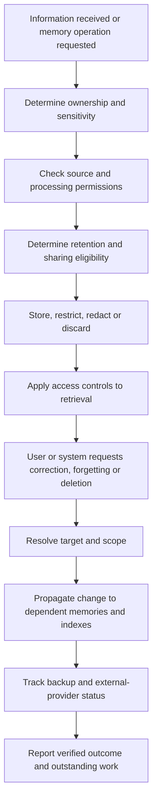

## 12.9 P2.5 completion boundary

P2.5 is complete when the product-level memory architecture, lifecycle policies, governance rules, user controls, security boundaries and implementation-independent acceptance criteria are defined and approved. These requirements are now recorded in Sections 11.10 and 12.1–12.18.

P2.5 completion does **not** mean that the memory system has been implemented, benchmarked or security-tested. Detailed test cases and test execution belong to P2.7; measurable latency, storage, resource and availability targets belong to P2.2; implementation and technology selection belong to P3.

The completed P2.5 design baseline includes:

- Layered memory representations, the historical source archive and the temporal knowledge graph.
- Permitted-source capture, autonomous memory formation, consolidation and associative reinforcement.
- Epistemic states, confidence/evidence separation, entity resolution and source provenance.
- Temporal validity, freshness, stale-information handling and contradiction reconciliation.
- Hybrid retrieval, bounded context assembly, access filtering and retrieval traceability.
- Sensitivity classification, retention, temporary mode and independent persistent-memory controls.
- Compartmentalization, granular access operations, derived-memory restrictions and cross-project promotion.
- The separation of memory, permission authority, task scheduling and execution.
- Correction, forgetting, experience/domain erasure, deletion propagation and backup recovery.
- Memory transparency, review, user correction, export and portability.
- Account isolation, external-processing minimization, untrusted-source handling and safe failure behavior.
- Acceptance criteria and explicit boundaries for P2.2, P2.6, P2.7 and P3.

**Status:** P2.5 design and requirements baseline complete. Verification remains scheduled for P2.7.

## 12.10 Epistemic state and uncertainty model

LIA shall not represent every extracted statement as an established fact. Memory reliability is represented through separate dimensions rather than one overloaded status field.

| State | Meaning | Required behavior |
|---|---|---|
| Candidate | A provisional observation or inference without sufficient support | May inform cautious contextual reasoning, but must be identified as uncertain and must not independently justify consequential action |
| Established | Supported by an explicit user statement or sufficiently strong evidence | May be used within its scope, freshness and access restrictions |
| Disputed | Materially conflicting evidence remains unresolved | Preserve competing evidence, expose uncertainty and avoid asserting a single current answer |
| Rejected | Evidence indicates the candidate was incorrect or inapplicable | Do not reuse as a valid fact or automatically reintroduce it from the same evidence |
| Superseded | A later version or interpretation replaces this record as the current understanding | Preserve historical provenance and validity; do not treat as the current version outside its historical context |

Superseded is a version/lifecycle relationship, not an epistemic confidence level. Temporal validity, freshness, factual confidence, importance, association strength and retrieval activation are also independent properties. A memory may be established but stale, established but historically valid only, or disputed while still being important to preserve.

An explicit user statement may establish a scoped preference or fact without requiring repeated evidence. A single ambiguous observation should remain a candidate. Repeated evidence must be sufficiently independent and contextually relevant; repeated retrieval of the same memory is not new evidence.

Low-confidence, potentially sensitive, scope-ambiguous, disputed and proposed cross-project memories shall be eligible for a selective review queue. LIA may surface a review when it is useful, but shall not repeatedly interrupt ordinary interaction for low-impact uncertainties. The user may inspect and correct memories at any time.

Uncertainty shall constrain action. A candidate, disputed or stale memory cannot independently provide execution authority, expand a permission grant or justify a consequential operation. Where uncertainty materially affects an answer, LIA must communicate it or seek clarification rather than fabricate certainty.

## 12.11 Temporal validity, freshness and memory ageing

Memory ageing shall not be treated as automatic falsification or deletion.

Every time-sensitive memory must distinguish:

- **Valid time:** When the represented fact, preference, relationship or state was true.
- **Recorded time:** When LIA acquired or stored the information.
- **Freshness:** Whether available evidence is recent and reliable enough to represent the current state.
- **Retrieval relevance:** Whether the memory is useful to the present conversation or task.

The bi-temporal model remains authoritative for historical interpretation. Freshness is a separate assessment.

LIA shall distinguish relatively durable information from volatile information. Historical events and completed decisions remain historically meaningful. Current schedules, active task status, project progress, roles, availability and preferences known to change may require revalidation before being relied upon.

No universal time-to-live shall be imposed on all memories. Freshness behavior shall be calibrated by memory type, source reliability, rate of change and consequence of error. Where a memory is stale or its freshness is unknown, LIA shall seek current evidence or label the uncertainty when the information is material.

New evidence updates the current interpretation without silently rewriting the past. Retrieval relevance may decay over time or with changing context; verified historical facts shall not be deleted merely because they are old. Repeated retrieval must not increase factual confidence or association strength by itself.

## 12.12 Memory record integrity, provenance and entity resolution

Every retained memory shall carry a conceptual metadata envelope. The exact database schema is deferred to P3, but the design must preserve at least:

| Record property | Purpose |
|---|---|
| Stable record identity and memory type | Identify the record and distinguish archive, episode, semantic fact, procedure, task state or other memory |
| Content or structured payload | Preserve the actual information represented |
| Owner, domain and scope | Identify whose information it is and where it may be used |
| Source provenance | Point to the original conversation, event, document, task, observation or imported source |
| Recorded and valid timestamps | Support historical reconstruction and temporal reasoning |
| Sensitivity and retention class | Govern processing, persistence, retrieval, export and deletion |
| Epistemic state and evidence | Distinguish explicit information, inference, uncertainty and contradiction |
| Confidence and importance | Preserve independent assessments of factual support and relevance |
| Freshness and version/lifecycle state | Identify whether information is current, ageing, stale or superseded |
| Entity and relationship references | Connect the memory to relevant people, projects, applications, tasks and experiences |
| Derivation lineage | Identify source records used to create summaries, profiles or other derived memories |
| Access and purpose constraints | Preserve the scope and restrictions under which it may be retrieved or used |

These are semantic requirements, not a commitment to a particular storage schema.

Original experience records shall be append-oriented. Corrections, annotations and updated interpretations shall be recorded as new evidence or versions rather than silently overwriting the source. Derived memories shall retain lineage to all material source records. A merge or consolidation shall preserve the identities, provenance and restrictions of the contributing records.

Entity resolution shall be conservative. Aliases may be associated when there is adequate evidence. Ambiguous references shall remain separate or be represented as candidate relationships until resolved. LIA shall not merge two people, projects or other entities merely because their names or contexts are similar. Where an incorrect merge would materially affect user understanding or access, LIA should request confirmation. Any supported merge must preserve lineage and permit the resulting relationships to be inspected and corrected.

## 12.13 Permitted-source capture and data minimization

Memory formation may use only information that LIA is permitted to access and process for the relevant purpose. Permission to observe or read a source does not imply permission to retain it, summarize it into long-term memory, share it across domains or send it to an external provider.

The memory pipeline shall classify source ownership and sensitivity before persistent extraction, indexing, graph construction or cross-domain promotion. It shall retain the minimum information needed for the intended memory purpose. A concise permitted event or decision record is preferred over indiscriminate retention of raw transient data.

Default capture boundaries:

- Ordinary permitted conversation text or transcripts may enter the historical conversation archive under the user's memory settings and the approved conversation-retention policy.
- Raw microphone audio is transient by default and is not permanently archived merely because voice interaction occurred.
- Camera frames and transient screen captures are not permanent memory by default.
- Desktop metadata and application observations may support working context. Persistent retention requires the applicable source permission, sensitivity classification and memory policy.
- File contents, private correspondence and sensitive documents may be processed for an authorized task without being retained as long-term memory.
- A task record may preserve the minimum objective, plan, checkpoint and execution outcome needed for continuity without archiving the entire conversation that produced it.
- Operational and security records shall be minimal, avoid copying sensitive conversational content and follow a separate bounded retention policy.

A user-level instruction not to remember specified information overrides ordinary autonomous retention for that scope. A global persistent-memory pause and per-source, per-category and per-domain controls shall be available. During a pause, LIA may still use current-session context to answer the ongoing interaction, but shall not create unauthorized cross-session memories.

Temporary mode follows Section 12.1. It remains user-activated, including when suggested by LIA. Temporary content is excluded from the permanent archive and autonomous long-term extraction. Any separately authorized persistent task record must be limited to the task information needed for execution and must not become a backdoor archive of temporary conversation content.

## 12.14 Granular memory authorization and cross-project promotion

Memory access is not a single read permission. The system shall distinguish authorization for:

| Operation | Meaning |
|---|---|
| Discover | Learn that a memory or domain exists or is available |
| Read | Retrieve its content |
| Use | Include the memory in reasoning or task context |
| Derive | Create a summary, inference, profile entry or relationship from it |
| Modify | Correct, annotate or change its current interpretation |
| Share | Make it available across a domain or to another authorized context |
| Delete | Forget or erase it within the authorized scope |

Permission for one operation does not imply permission for another. Access checks must be applied before retrieval and indexing results are exposed. Search result counts, metadata, relationship traversal and error messages must not leak the existence or content of inaccessible memories.

Each access decision shall consider ownership, sensitivity, purpose, domain scope and the current authorization grant. The memory system may store historical references to grants, but the separate permission authority remains the only source of current execution authority.

Derived memories shall inherit relevant restrictions from their source material. A summary made from restricted project documents remains restricted to the extent that it reveals information from those documents. Combining multiple restricted sources does not silently produce an unrestricted result. Declassification or broader sharing requires an explicit policy and authorization decision. Graph relationships do not grant access, and cross-domain sharing remains non-transitive by default.

### Automatic cross-project promotion rules

The following policy is approved:

| Evidence pattern | Default scope and behavior |
|---|---|
| Explicit user-level preference | May be stored as a global preference when sensitivity and access policy permit |
| Repeated preference across independent projects | May be consolidated into a global preference when evidence is sufficiently strong and the source restrictions allow promotion |
| Repeated behavior within one project | Remains project-scoped initially; repetition in one context does not establish a universal preference |
| One-time observation | Remains contextual and does not become a global user fact |
| Sensitive or confidential source | Cannot be promoted globally through inference; appropriate explicit authorization is required |

Promotion is a distinct governed operation, not an automatic side effect of graph connectivity. The original project-scoped records and evidence remain traceable after promotion. A global preference must preserve relevant context and must not be generalized beyond what the evidence supports. Revocation or scope changes must invalidate future retrieval under the old grant and update relevant caches and indexes.

## 12.15 Memory transparency, user control and portability

LIA shall provide a user-facing memory inspection and management interface. It shall present understandable explanations of memory, not merely expose raw database structures.

For an inspectable memory, the interface should expose:

- What LIA currently remembers or believes.
- The original source or sources and a path to inspect them when available.
- Whether the information was explicitly stated, inferred or consolidated from repeated evidence.
- Confidence, supporting evidence and unresolved contradictions.
- Sensitivity, ownership, domain scope and retention status.
- Valid time, recorded time and freshness.
- Related memories and the lineage of derived summaries or profiles.
- Whether the memory has been retrieved or used, and the reason it was relevant.

The user shall be able to correct or annotate a memory, flag uncertainty, inspect related records, review proposed or disputed memories, change sharing scope where authorized, pause persistent memory, and initiate forgetting or deletion operations. Changes shall have an auditable history. The inspection interface must enforce the same access controls as ordinary retrieval.

LIA shall explain why a memory was selected for an answer or task when the user asks or when transparency is materially useful. The explanation should identify relevant provenance and whether the selected material was explicit, inferred, historical or uncertain.

### Export and portability

The user shall be able to export accessible LIA-held memory in both human-readable and machine-readable forms. Export shall preserve source provenance, timestamps, scope, sensitivity labels, relationships, epistemic status and derivation lineage to the extent supported by the exported content.

Export must not silently modify or delete the source data. Sensitive export shall require appropriate authentication and authorization. Credentials and S3 secrets are never included because they are excluded from ordinary memory. Data about other people or domains shall be included only where the user has the necessary rights and access.

The exact open structured format, package layout and schema versioning belong in P3. Importing external memory is not a P2.5 release requirement. If a later release supports import, imported records must be marked with their external provenance and unverified status; they must not automatically become established current facts or permissions. LIA must clearly distinguish copies exported outside its control from records it can still manage or delete.

## 12.16 Security, external processing, integrity and failure behavior

Memory is user data and shall be protected by least-privilege access, isolation and secure storage/communication controls. Memory for one authenticated OS user profile shall not be retrievable by another local OS account without an explicitly supported sharing mechanism. P3 shall select the concrete storage, encryption, key-management and local/cloud deployment design; the requirement to protect data at rest and in transit is established here.

External processing shall follow data minimization. Before context is sent to an external model or service, LIA shall perform authorization and scope checks, select only relevant permitted records, and exclude unrelated archive content. The full conversation archive is never a default context payload. Provider capabilities and retention terms must be represented accurately; LIA shall not claim external deletion that has not been verified.

Stored conversations, documents, webpages, source code, messages and other retrieved material are evidence or context, not governing instructions. Their contents cannot change system rules, grant permissions, approve operations or override the authoritative permission service. Instruction-like content found in a memory remains untrusted unless independently authorized through the appropriate user interaction and policy path.

### Persistence and degraded operation

- LIA shall distinguish confirmed persistent writes from information held only in working/session context.
- LIA shall not claim that a memory has been saved across sessions until the persistence operation is confirmed.
- Failed writes shall expose an understandable pending or failed status when relevant and may be retried safely.
- Retries and event replay shall be idempotent so they do not create duplicate memories or repeat external actions.
- If the memory store is unavailable, LIA may continue using available current-session context, but shall not fabricate retrieval results or imply that long-term memory was available.
- Restricted-memory retrieval shall fail closed when authorization or scope cannot be established.
- If the source archive is unavailable, LIA shall not invent a source reference or claim that an original record was checked.
- Backup restoration shall reapply deletion markers, corrections and permission revocations before restored memory becomes available for ordinary retrieval.
- If deletion, revocation or external-provider removal is pending, LIA shall report the actual state and shall not claim completion.

Audit records shall be sufficient to establish what memory operation occurred, its purpose and its result, without unnecessarily duplicating the sensitive content being governed.

## 12.17 P2.5 acceptance criteria

The following implementation-independent acceptance criteria shall be mapped to detailed test cases in P2.7. A criterion passes only when behavior is demonstrable through observable results and traceable records.

| Area | Acceptance criterion |
|---|---|
| Source provenance | Every persistent memory can be traced to its source or explicitly marked as externally supplied/derived; missing provenance is not silently fabricated |
| Explicit versus inferred | Explicit statements, observations and inferences remain distinguishable; uncertain inferences are not presented as user-stated facts |
| Candidate promotion | Single ambiguous observations remain candidates; explicit scoped statements can establish a memory; repeated evidence is evaluated for independence and context |
| Contradiction handling | Conflicting facts remain disputed until resolved; corrections update current understanding without erasing valid historical evidence |
| Temporal validity | Historical and current facts are distinguished; stale volatile information is revalidated or qualified before material reliance |
| Entity resolution | Ambiguous identities are not merged; corrections to entity links propagate through dependent memories |
| Retrieval relevance | Retrieval returns contextually relevant memories with provenance and uncertainty; graph expansion is bounded and does not create unsupported facts |
| Scope isolation | User, project, task and experience compartments enforce ownership and purpose; unauthorized content and existence metadata are not exposed |
| Derived restrictions | Summaries and derived memories preserve source restrictions; combining sources does not silently declassify information |
| Cross-project promotion | Explicit preferences, repeated independent preferences, project-local behavior, one-time observations and sensitive sources follow Section 12.14 |
| Temporary mode | Temporary conversations do not enter the permanent archive, long-term memory extraction, graph or indexes; separately authorized task records do not copy the conversation |
| Retention controls | Global pause and source/category/domain controls prevent disallowed persistent formation while preserving permitted active-session context |
| Correction | A correction updates affected current views, derived memories, graph relationships and indexes while retaining historical source evidence unless deletion is requested |
| Forgetting | Forgotten information is absent from active retrieval and dependent derived representations; original archive handling follows the selected operation |
| Experience/domain erasure | Source records and all in-scope dependent memories, indexes, summaries and caches are tracked through deletion |
| Backup recovery | Restoring a backup does not resurrect deleted records or revoked grants |
| Transparency | A user can inspect what LIA remembers, why it believes it, its provenance, scope, freshness and related usage |
| User control | The user can correct, flag, scope, pause, forget and erase memory using understandable operations |
| Export | Export preserves accessible source and derived information, temporal properties, scope and relationships without mutating the originals |
| Sensitivity | S2 information is not retained long-term without explicit authorization; S3 secrets do not enter ordinary memory or indexes |
| External processing | Only authorized and necessary context is sent to an external provider; unrelated archive content is excluded by default |
| Untrusted content | Instruction-like text inside retrieved content cannot grant permission or override governing instructions |
| Failure behavior | Storage or retrieval failures are disclosed accurately; failed writes are not represented as durable; restricted reads fail closed |
| Auditability | Memory operations have sufficient non-content audit information to explain access, correction, sharing and deletion outcomes |

Unauthorized disclosure, unauthorized cross-domain access, use of a memory as an implicit permission grant, or ordinary-memory retention of S3 secrets are hard failures and are not subject to a performance trade-off.

Evaluation shall measure retrieval precision and recall, source fidelity, temporal accuracy, confidence calibration, false promotion, contradiction handling, scope leakage, deletion completeness, context size and latency. No numerical threshold is invented in P2.5. Resource budgets and latency targets are assigned to P2.2; detailed acceptance-test execution belongs to P2.7.

## 12.18 Decisions deferred to later phases

P2.5 intentionally defines behavior and constraints without selecting implementation technologies.

| Deferred decision | Owning phase |
|---|---|
| Database, graph store, vector store, lexical index and storage layout | P3 |
| Embedding model, summarization model and entity-resolution implementation | P3 |
| Retrieval ranking weights, confidence thresholds, decay parameters and promotion thresholds | P3 implementation and empirical evaluation |
| Exact machine-readable export schema and package format | P3 |
| Local, cloud or hybrid memory deployment and external-provider selection | P3, under P2.6 privacy constraints |
| Encryption algorithms, key storage and recovery mechanisms | P3 security architecture |
| Numerical latency, memory size, storage, resource and availability targets | P2.2 |
| Authoritative permission grants, revocation, per-source and per-application enforcement details | P2.6 |
| Detailed test cases, fixtures, benchmark procedure and test execution | P2.7 |
| Platform-specific capture and perception behavior | P2.3 and P3 |

These deferrals do not leave product behavior undecided. The accepted requirements in this section constrain the later design choices.

## 12.19 P2.5 closure

**P2.5 status: Complete — memory requirements and governance design baseline approved.**

The memory workstream has defined what LIA may remember, how memories are formed and represented, how uncertainty and temporal change are handled, how memories are retrieved, how domains are isolated and shared, how users inspect and control memory, and how correction, deletion, security and failure behavior must work.

At the time P2.5 was closed, permission integration, non-functional targets and acceptance specification remained assigned to P2.6, P2.2 and P2.7. Those workstreams have since been completed and are consolidated in Sections 13–18. Phase 2 is now closed as a requirements baseline; implementation, benchmarking and runtime test execution remain future engineering work.


# 13. P2.2 — Non-functional requirements

**Workstream status:** Complete — measurable product quality baseline approved  
**Purpose:** Define how well LIA must operate under specified workloads and hardware, and how that behavior is measured.

P2.2 targets are engineering SLOs, not claims of current product performance. They shall be validated during P5 and subsequent implementation/testing. Where a target is missed, the measured result, cause, impact and proposed correction or approved deviation shall be recorded. A target shall not be silently relaxed.

## 13.1 Workload profiles

Performance shall be measured by workload, not through one blended "average LIA" result.

| Profile | Workload | Scope |
|---|---|---|
| W1 — Idle presence | Character visible, idle animation, normal permitted desktop metadata awareness | Local runtime, renderer, platform event handling and background overhead |
| W2 — Interactive conversation | Push-to-talk or text conversation, context retrieval, model dispatch, speech recognition/synthesis and interruption | Local pipeline latency, provider latency and end-to-end user experience reported separately |
| W3 — OS interaction | Identify window, refresh metadata, authorize, move and verify a window | Desktop event/state freshness, operation acknowledgement and outcome verification |
| W4 — Background activity | Memory formation/indexing, task scheduling, archival work and permitted background operations | Resource contention, queue growth, interference and checkpoint behavior |
| W5 — Intensive perception | On-demand/continuous screen analysis and future optional camera perception | CPU/GPU/VRAM/RAM, thermal behavior, capture cadence and interactive responsiveness |

The first vertical slice shall demonstrate W1, W2 and W3, a basic policy-compliant memory persistence operation from W4, and no W5 continuous-perception workload. Later releases shall add and benchmark W4/W5 capabilities before enabling them by default.

## 13.2 Hardware support baseline

The following product support tiers are approved as initial targets. They must be validated against representative systems before compatibility is claimed.

| Tier | Initial baseline | Expected capability |
|---|---|---|
| Minimum supported | 4 CPU cores, 8 GB RAM, SSD, integrated graphics | Core presence, text interaction, basic desktop control and remote or lightweight inference |
| Recommended | 6+ CPU cores, 16 GB RAM, SSD, integrated or modest dedicated graphics | Normal desktop-companion experience, voice interaction, embodiment, memory and multitasking |
| Accelerated | 8+ CPU cores, 32 GB RAM, SSD and dedicated GPU with approximately 6 GB+ VRAM | Additional headroom for local inference and advanced perception |

Additional constraints:

- Initial desktop targets are x86-64 Linux and x86-64 Windows.
- ARM is deferred until a concrete product requirement and validation plan exist.
- Local AI inference is optional. Model-specific hardware requirements shall be published separately and shall not be conflated with the base companion runtime.
- A dedicated GPU is not required for core presence, text interaction or basic desktop control.
- Reference validation shall include one supported Linux Wayland environment, one supported Linux X11 environment before claiming X11 compatibility, and a supported Windows 11 x64 environment. The first vertical slice remains Linux-first and targets one explicitly named supported desktop environment.
- Linux/Windows compatibility is capability-based; the product shall not claim parity where a compositor, window manager, driver or OS version does not expose equivalent operations.

## 13.3 Latency and responsiveness targets

Unless otherwise stated, values below are P95 targets on the Recommended reference tier with the relevant workload active. P50 and P99 shall also be recorded. Measurements shall identify cold/warm state, model/provider, network condition and whether the time is local-runtime or end-to-end.

| ID | Requirement | Target |
|---|---|---|
| NFR-001 | Cold startup to local interactive readiness shall be measured independently of remote model/provider initialization. | ≤5 seconds P95 on Recommended; ≤10 seconds P95 on Minimum |
| NFR-002 | Local UI feedback for direct user input shall remain responsive while no resource-intensive perception task is active. | ≤100 ms P95 |
| NFR-003 | User interruption of LIA's synthesized speech shall stop audible output promptly. | ≤200 ms P95 from accepted interrupt to audio cessation |
| NFR-004 | Local post-input processing overhead (state update, permission lookup, context assembly and dispatch) shall be measured independently of model generation. | ≤300 ms P95 for the ordinary conversational path, excluding model/provider and network time |
| NFR-005 | Speech pipeline responsiveness shall be measured as separate stages. | Partial transcript ≤1 second P95 after speech onset; end-of-utterance finalization ≤600 ms P95 after a configured endpoint; TTS start ≤500 ms P95 after the first speakable text is available |
| NFR-006 | Active-window metadata refresh shall be sufficiently current for ordinary display and window operations. | ≤250 ms P95 where the platform exposes the required metadata |
| NFR-007 | A supported same-display window movement shall be acknowledged and verified promptly. | ≤1 second P95 from accepted operation request to verified resulting geometry where the platform supports verification |
| NFR-008 | Character rendering shall remain visually stable in ordinary idle and interactive use. | 60 FPS target; not below 30 FPS sustained on Recommended during W1–W3; configurable low-power mode may reduce idle frame rate |
| NFR-009 | Ordinary memory retrieval and context assembly shall remain responsive at the reference data volume. | ≤500 ms P95 for retrieval/context assembly with up to 100,000 structured memory records and 100,000 archived source items, excluding opening large original files |
| NFR-010 | Simple confirmed persistent memory writes shall complete promptly without acknowledging durability prematurely. | ≤500 ms P95 for ordinary small records under normal storage conditions; acknowledgement only after the configured durability boundary is met |

Model generation, external API time, speech-provider time, network latency and application-specific OS delays shall be reported as separate spans. No single end-to-end target may conceal which dependency caused a delay.

For model-driven response time, the benchmark report shall name the model/provider, region, network profile, prompt/context size and output length. These values are not a universal SLA for third-party services.

## 13.4 Resource consumption and contention

Resource budgets apply to LIA's local runtime and exclude separately measured model inference/provider processes unless explicitly stated.

| ID | Requirement | Target/default |
|---|---|---|
| NFR-011 | Local resident memory shall be bounded in ordinary use. | Recommended tier: ≤750 MB in W1 and ≤1.5 GB in W2/W3. Minimum tier: ≤1 GB in W1 and ≤2 GB in W2/W3. Model inference memory is reported separately. |
| NFR-012 | Idle CPU overhead shall be low enough not to materially compete with normal desktop activity. | W1 average ≤5% of one modern logical CPU core over a 10-minute sample; P95 event bursts ≤20% of one core |
| NFR-013 | Interactive CPU overhead excluding model inference shall remain bounded. | W2/W3 average ≤15% of one modern logical CPU core over a 5-minute sample; bursts above 50% of one core should normally last no more than 2 seconds |
| NFR-014 | Dedicated GPU allocation for the companion runtime shall be bounded when inference is not included. | Target ≤512 MiB in W1 and ≤1 GiB in ordinary W2/W3 on the Accelerated tier; integrated/shared graphics shall report platform-specific allocation where available |
| NFR-015 | Background work shall yield to foreground interaction and respect resource policy. | Default background-safe work shall not continuously consume more than 20% of one logical CPU core on average without an explicit resource-intensive authorization; work shall pause, defer or reduce priority when interactive responsiveness degrades |
| NFR-016 | Resource-intensive perception and indexing shall be independently schedulable. | W5 and resource-intensive W4 work shall not start automatically on battery by default; user may explicitly override the restriction |
| NFR-017 | Memory, archive and cache growth shall be observable and bounded where data is reconstructible. | Caches/indexes shall have configurable budgets and be rebuildable from authorized sources; canonical permitted archives shall not be silently deleted to satisfy a cache quota |

The budget for the canonical conversation archive is governed by P2.5. Indefinite retention until user deletion does not mean that raw audio/video/screen frames are retained indefinitely. When disk free space falls below the larger of 1 GB or 5% of the target volume, LIA shall warn the user, stop nonessential cache/index growth where safe, and avoid acknowledging new writes that cannot be durably completed. She shall not silently purge canonical memory or task history.

## 13.5 Reliability, availability and recovery

| ID | Requirement | Target/default |
|---|---|---|
| NFR-018 | The core local runtime shall remain available while the host OS is operating and the process has not been deliberately paused or stopped. | Mature-runtime target: ≥99.5% unplanned runtime availability over a rolling 30-day period, excluding host shutdown/reboot and planned maintenance |
| NFR-019 | A recoverable non-core subsystem failure shall not unnecessarily terminate unrelated capabilities. | Detect and isolate recoverable failure; attempt bounded recovery, with a target of ≤10 seconds to restore an eligible subsystem where its dependencies are healthy |
| NFR-020 | Core process restart shall restore the last confirmed persistent user configuration and valid task/memory checkpoints. | Target ≤10 seconds to recover local interactive readiness after an eligible automatic restart on Recommended hardware |
| NFR-021 | A component that cannot recover shall enter an explicit degraded/unavailable state. | No false-ready state; affected capability is disabled or reported while independent capabilities remain available |
| NFR-022 | Runtime resource exhaustion, provider failure or OS-adapter failure shall not cause unbounded retry loops. | Bounded retries, backoff, circuit breaking or equivalent behavior; recovery attempts must be observable and stoppable |

Availability targets apply to LIA's local runtime, not the availability of external models, networks, OS services or third-party applications. External dependency availability shall be separately reported.

## 13.6 Durability, consistency and safe retries

| ID | Requirement | Target/default |
|---|---|---|
| NFR-023 | A write reported as durably saved shall survive an ordinary process crash and host restart within the declared storage failure model. | Zero loss of confirmed durable writes in acceptance testing |
| NFR-024 | Multi-record memory/task updates shall not expose partially committed logical state. | Atomic transaction or equivalent recoverable commit semantics |
| NFR-025 | Retried operations shall not silently duplicate non-idempotent side effects. | Use operation identity and idempotency where available; otherwise inspect current state before retry and require user intervention when outcome is indeterminate |
| NFR-026 | Tasks with external or desktop side effects shall preserve execution checkpoints. | Persist intent before a side effect and persist verified outcome afterward; recover by checking real state before replay |
| NFR-027 | Backup and restore shall preserve memory governance state. | Deletion markers, revoked grants and scope restrictions shall be reapplied before restored records become retrievable |

"Exactly once" execution shall not be assumed for GUI operations or external services that do not provide idempotency guarantees. LIA shall distinguish not attempted, attempted with unknown outcome, verified success and verified failure.

## 13.7 Compatibility, accessibility and maintainability

| ID | Requirement | Target/default |
|---|---|---|
| NFR-028 | Platform adapters shall declare supported capabilities and their limitations. | No capability may be advertised as supported solely because another OS/compositor supports it |
| NFR-029 | Display topology changes, scaling, resolution changes, workspace changes and sleep/resume shall not leave stale spatial state represented as current. | Reconcile state after relevant events and before actions |
| NFR-030 | Core controls shall remain operable without voice and without character animation. | Text/control fallback for essential conversation, pause, stop, permission review and status |
| NFR-031 | Reduced-motion and presentation controls shall be respected. | No required interaction shall depend solely on animation; avoid flashing/strobing patterns; respect OS/user reduced-motion and visibility preferences |
| NFR-032 | Diagnostics shall permit fault investigation without unnecessary disclosure of private content or secrets. | Structured event/operation IDs, component health, timing and error categories; sensitive payload logging off by default |
| NFR-033 | Updates and schema migrations shall not silently corrupt user memory or tasks. | Verify backup/rollback path before destructive migration; preserve compatibility or provide explicit migration failure/recovery |
| NFR-034 | Long-running operation shall not lead to unbounded memory growth or uncontrolled accumulation of queued work. | Bounded working context, queue limits/backpressure and observable cache/index budgets |
| NFR-035 | Laptop energy behavior shall adapt to power state. | Low-power mode when OS power saver is active or battery is critically low (default threshold 20%); defer resource-intensive background work on battery unless explicitly allowed |

## 13.8 Measurement protocol and target status

All P2.2 numerical targets are approved engineering targets, not observed performance claims.

Measurements shall:

- Use the Minimum, Recommended and Accelerated hardware tiers where relevant.
- Record exact CPU, RAM, GPU/VRAM, storage, OS build, display server/compositor, power state, model/provider and network conditions.
- Report P50, P95 and P99 for latency; average and peak for resource consumption; crash/recovery rates for reliability.
- Separate LIA local-runtime spans from model, speech and network spans.
- Include cold startup, warmed interactive workload, sustained idle, background contention, recovery, offline/degraded and long-running soak scenarios.
- Use representative data volumes for memory and task retrieval and document any smaller test corpus.
- Record raw measurements and scripts/commands or repeatable procedures in the engineering test evidence.

Reference measurements shall be taken on the first supported Linux environment and on Windows before a cross-platform support claim. The first slice shall meet its applicable P2.2 targets before it is accepted. A target may be revised only with measured evidence, a recorded rationale, impact assessment and approval; unvalidated targets remain engineering gates, not marketing claims.

## 13.10 Distributed coordination and multi-device quality requirements

The multi-device scope adds distributed-runtime quality requirements.
These apply to the always-on coordination service, enrolled device nodes,
workflow engine and notification routing. Numeric service availability,
recovery and scale targets shall be finalized in P3.2 after the deployment
model is selected and before P5 release validation.

| ID | Requirement | Target/default |
|---|---|---|
| NFR-036 | The coordination service shall publish measurable availability, recovery-time and recovery-point objectives for the selected deployment model. | Values ratified in P3.2/P3.3 before P5; service health and outage windows observable to the user |
| NFR-037 | Confirmed workflow definitions, run state, checkpoints, authorization references and verified outcomes shall survive coordinator/worker restart within the declared storage failure model. | Zero loss of acknowledged durable workflow state in acceptance testing |
| NFR-038 | Distributed event and command delivery shall tolerate duplicate delivery and out-of-order arrival without duplicating non-idempotent side effects. | Event IDs, ordering/version metadata and idempotent/reconciliation behavior required |
| NFR-039 | Device connectivity recovery shall reconcile node identity, current capability state, grant validity and actual resource state before a new action is issued. | No blind replay of expired or stale device commands |
| NFR-040 | Long-running workflow monitoring shall use bounded event-driven processing and bounded polling where needed. | No unbounded LLM polling loop; explicit retry, timeout, backoff and resource budgets |
| NFR-041 | Cross-device synchronization shall expose version/conflict state and shall preserve P2.5 ownership, sensitivity, provenance and deletion semantics. | No silent last-writer-wins overwrite for materially conflicting task, permission or memory state |
| NFR-042 | Notification routing shall record attempted, accepted, delivered where provider evidence exists, failed and expired states. | Bounded retry and user-visible delivery failure; no claim of delivery without provider evidence |
| NFR-043 | The architecture shall support multiple enrolled device nodes and concurrent workflow runs per user without assuming that every node is online simultaneously. | Test scale and maximum supported active-run/device counts ratified in P3.2/P3.3 before P5 |
| NFR-044 | An ongoing campaign shall not depend on the user's primary PC remaining powered on when its next steps can execute on an independently available authorized worker. | PC-specific steps remain blocked while that PC is offline; other eligible steps may continue |

## 13.9 P2.2 closure

**P2.2 status:** Complete — non-functional requirements baseline approved. Numerical targets are measurable engineering targets to validate on reference hardware during implementation. External model/provider latency remains separately accounted for. The phase closes the specification, not the performance verification.

---

# 14. P2.3 — Context and perception requirements

**Workstream status:** Complete — source, scope, freshness and inference boundaries approved  
**Purpose:** Define what LIA can observe, how observations are represented, what may be inferred, and when information may be retained or used.

The governing principle is **perceive only what is needed, only through an enabled source, and only for an authorized purpose**. Environmental awareness is not equivalent to unrestricted recording.

### P2.3 requirement register — CTX-001 to CTX-017

| ID | Requirement | Priority |
|---|---|---:|
| CTX-001 | LIA shall treat each environmental source as a separately identifiable perception capability with its own availability, scope and permission state. | P0 |
| CTX-002 | LIA shall distinguish permission to observe or process a source from permission to retain, derive long-term memory, share or transmit information from that source. | P0 |
| CTX-003 | Each retained observation shall preserve source identity, scope, observed/acquired timestamps where available, quality and applicable authorization context. | P0 |
| CTX-004 | LIA shall prefer event-driven desktop metadata updates and use bounded polling only when platform events are unavailable or insufficient. | P0 |
| CTX-005 | LIA shall identify the active application/window and retrieve available identity and metadata only when the corresponding desktop metadata capability is enabled. | P0 |
| CTX-006 | LIA shall maintain supported window/display/workspace geometry and distinguish direct platform geometry from inferred spatial relationships. | P0 |
| CTX-007 | Process inspection shall be read-only and disabled until separately enabled or requested under a valid permission. | P1 |
| CTX-008 | Screen-content capture shall occur only for an authorized user request or task and shall remain limited to that purpose and scope. | P0 |
| CTX-009 | Continuous screen perception shall be off by default, explicitly enabled, scope-limited, visibly indicated and immediately pausable. | P0 |
| CTX-010 | Ordinary continuous screen awareness shall default to no faster than one capture every five seconds and shall not exceed one frame per second; higher-rate capture requires a bounded, explicitly authorized active task. | P1 |
| CTX-011 | Secure desktops, credential prompts, password-entry surfaces and configured sensitive windows shall be excluded from ordinary visual capture and extraction by default. | P0 |
| CTX-012 | LIA shall timestamp observations and shall not present stale or point-in-time screen observations as current live state. | P0 |
| CTX-013 | LIA shall distinguish direct observations, extracted content, user statements, inferences and unknown/unavailable state in internal context and user-facing explanations where material. | P0 |
| CTX-014 | LIA shall not assert user intent, attention, emotional state or psychological condition as fact based only on weak desktop activity signals. | P0 |
| CTX-015 | Microphone capture shall follow the independently configured voice mode; raw audio shall remain transient by default and shall not be permanently archived merely because speech interaction occurred. | P0 |
| CTX-016 | Camera perception shall remain disabled until explicit user activation and shall expose a clear active state and immediate pause/disable control when later supported. | P0 |
| CTX-017 | LIA shall not perform passive global keystroke logging or retain arbitrary typed text outside explicit, task-scoped input operations and enabled user controls. | P0 |

## 14.1 Perception source classes

| Source | Default state | Permitted use when enabled | Retention default |
|---|---|---|---|
| Active application/window metadata | User grants at setup or first use | Identify active app/window, title and supported metadata | Transient working context; persist only a policy-permitted derived memory or task record |
| Window geometry/display/workspace metadata | Enabled with desktop metadata capability | Position, dimensions, monitor/workspace, visibility and supported spatial relationships | Current spatial state is transient and refreshed |
| Desktop/window events | Enabled only for supported, granted metadata scope | Focus change, window lifecycle and workspace/display events | Minimal event/context history only when needed and permitted |
| Process metadata | Off until explicitly granted or requested | Read-only process identity/status within granted scope | Transient by default |
| Accessibility/semantic UI tree | Off until a supported app and Observe permission are enabled | Structured controls, labels, roles and state | Transient; source-sensitive content follows P2.5 |
| On-demand screen capture | Off until explicit permission; a direct task may request it | Visual inspection for the current user request/task | Raw frame discarded after the task/short-lived processing window by default |
| Continuous screen-context perception | Off by default; explicit opt-in required | Scoped visual context for selected windows/apps or defined regions | Raw frames are not permanently archived by default |
| Microphone/audio input | Push-to-talk default; other modes require explicit enablement | Speech interaction in the enabled mode | Raw audio transient; no permanent raw-audio archive by default |
| Camera | Disabled by default | Future opt-in visual perception with visible state and narrow scope | No capture or retention until separately enabled and governed |
| File/application content | Per-application/path permission | Task-scoped inspection or manipulation | Retention independently controlled by P2.5 and P2.6 |

Permission to use a source does not grant permission to retain its raw data, derive long-term memories from it, share it with another domain or transmit it externally.

## 14.2 Desktop observation levels

The accepted three-level desktop-awareness model is normative:

1. **Default metadata awareness:** active application/window and supported desktop/window metadata. No implication of screenshot capture.
2. **On-demand screen perception:** a task- or user-requested capture after the corresponding screen-perception permission check.
3. **Optional continuous screen perception:** explicitly enabled, visibly indicated, scope-limited and immediately pausable.

Continuous perception defaults:

- Off until user opt-in.
- The user selects allowed apps/windows/regions; allowlisted scopes are preferred over unrestricted desktop capture.
- Default passive capture cadence is no faster than one frame every five seconds, with a hard default ceiling of one frame per second for ordinary continuous awareness.
- A higher-rate visual loop may be used only during a specific active task when explicitly authorized, bounded to that task and stopped when the task ends or is paused.
- The user can pause immediately, revoke scope, or disable the source.
- Lock screens, secure desktops, credential prompts and password-entry surfaces are excluded by default.
- Raw frames are volatile and are not added to permanent conversation archives or long-term memory by default.
- Extracted text or derived facts inherit the source sensitivity and provenance rules in P2.5.

The cadence is a default product policy; P2.2 resource targets still apply and may force a lower rate on constrained hardware.

## 14.3 Event-driven collection and freshness

Event-driven metadata is preferred to continuous high-frequency polling. Where an OS/compositor cannot provide required events, the adapter may use bounded polling and shall report its limitation.

Default freshness guidance:

| Observation | Default freshness expectation |
|---|---|
| Active-window identity and focus | Refresh on focus event; no more than 1 second old when presented as current |
| Window geometry used for action | Refresh immediately before manipulation; stale geometry must not authorize an action |
| Display/workspace topology | Refresh on topology/workspace event and reconcile before cross-display/workspace operations |
| Process metadata | Treat as volatile; refresh before a task depends on process state |
| On-demand screenshot | Valid only for the originating task/turn and its short processing window; do not present it as live after the task context changes |
| Continuous-screen observation | Timestamp each capture and treat it as a point-in-time observation, never as a continuous fact |

Every observation shall carry source identity, observed time, acquisition time where different, permission context, scope and quality/availability. When an adapter cannot supply a timestamp or reliable state, LIA shall label the result incomplete or uncertain.

## 14.4 Observation versus inference

LIA shall distinguish:

- Directly observed platform facts.
- Extracted content, such as OCR or accessibility labels.
- Inferred context, such as likely user activity or task relevance.
- User-stated intent.
- Unknown or unavailable state.

Inference rules:

- A focused application does not prove the user is actively working in it.
- Keyboard/mouse inactivity does not prove the user is absent.
- A long-running process does not prove the user wants it stopped.
- Window content does not establish the user's intent without supporting context.
- User stress, mood, emotion, attention or psychological state shall not be asserted as fact from weak desktop signals.
- Uncertain activity classification may inform conservative interruption timing, but shall not independently authorize an operation or be stored as a verified personal trait.
- Inference confidence and source evidence shall remain available for explanation and correction.

## 14.5 Input, camera and privacy exclusions

- No passive global keystroke logging or collection of arbitrary typed text.
- Input capture is limited to explicit interaction operations, enabled hotkeys or task-scoped mechanisms necessary for an authorized action.
- Microphone capture occurs only within the selected, explicitly enabled voice mode. Push-to-talk is the initial default.
- Wake-word and continuous-conversation modes require explicit activation and a visible/understandable listening indicator.
- Camera remains disabled unless the user explicitly enables the capability; no silent activation.
- Password fields, private keys, recovery codes and equivalent secret-entry surfaces are excluded from capture, extraction, logging and memory.
- Secure OS desktops and credential dialogs are not visually inspected or manipulated through ordinary perception.
- Sensitive application/window exclusions shall be configurable by the user; uncertain classifications are handled conservatively.
- Raw audio, screen frames and camera frames are not permanent memory by default. Any derived long-term memory must pass P2.5 source, sensitivity and retention rules.

## 14.6 Platform capability reporting

Each platform adapter shall declare which observation sources and fields it supports, their freshness characteristics, known restrictions and failure modes. LIA shall not substitute screenshot capture for unavailable metadata without the required independent permission. Nor shall visual inference be represented as authoritative OS state.

The same conceptual context model shall be used across Linux and Windows, while availability and fidelity remain platform-specific. The first vertical slice uses desktop metadata and window geometry only.

## 14.7 P2.3 closure

**P2.3 status:** Complete — perception-source permissions, observation levels, freshness, inference, privacy and retention boundaries approved. Camera remains off by default; screen content is opt-in; passive global keystroke capture is excluded.

---

# 15. P2.4 — Interaction requirements

**Workstream status:** Complete — conversation, interruption, proactive timing and embodiment defaults approved  
**Purpose:** Define how users and LIA communicate, interrupt, coordinate actions and experience the embodied character.

### P2.4 requirement register — UX-001 to UX-020

| ID | Requirement | Priority |
|---|---|---:|
| UX-001 | LIA shall provide text interaction as a complete fallback when voice input or output is unavailable or disabled. | P0 |
| UX-002 | Push-to-talk shall be the default voice-input mode for the first vertical slice and shall capture audio only while explicitly activated. | P0 |
| UX-003 | Continuous-conversation mode shall require explicit user enablement and shall expose an understandable active listening state. | P0 |
| UX-004 | Wake-word activation shall require explicit user enablement and shall not be inferred from ordinary text or desktop permissions. | P0 |
| UX-005 | LIA shall visibly communicate when microphone capture/listening is active, paused or stopped. | P0 |
| UX-006 | The user shall be able to interrupt synthesized speech; the interaction shall not require waiting for a response to finish. | P0 |
| UX-007 | The user shall have an immediate pause/stop control for listening, proactive activity and pending/running operations, with safe-stop reporting for side effects already performed. | P0 |
| UX-008 | LIA shall prioritize user speech over her own output and shall avoid speaking over detected user input. | P0 |
| UX-009 | LIA shall request clarification when a user request or action target is materially ambiguous rather than guessing. | P0 |
| UX-010 | LIA shall distinguish suggestion, plan, pending action, blocked action, attempted action and verified outcome in both interaction state and user-facing communication. | P0 |
| UX-011 | Voice and text shall communicate the same essential instructions, confirmations, warnings and outcomes; loss of one modality shall not silently remove material information. | P0 |
| UX-012 | When social autonomy is enabled, unsolicited social openings shall default to at most one per two hours and three per local day, subject to configured user limits and relevance. | P1 |
| UX-013 | LIA shall respect configured quiet hours and detectable OS Do Not Disturb/focus state; uncertain availability shall default to less intrusive behavior. | P1 |
| UX-014 | A dismissed proactive suggestion shall be suppressed until materially new context or an explicit user request justifies raising it again. | P1 |
| UX-015 | LIA shall distinguish stable personality traits, dynamic behavioral/emotional state and outward expression; an animation state shall not establish an underlying OS result. | P0 |
| UX-016 | LIA shall not use guilt, threats, simulated distress, possessiveness or emotional pressure to induce user engagement or prevent disengagement. | P0 |
| UX-017 | Character animation for a desktop operation shall follow the actual operation state and shall adapt truthfully to failure, interruption or uncertain verification. | P0 |
| UX-018 | The user shall be able to show/hide, drag/reposition and pin/lock the character; manual placement and pin/lock shall take precedence over task-bound repositioning. | P0 |
| UX-019 | LIA shall respect reduced-motion and relevant accessibility/presentation preferences; essential state shall not be communicated only through animation. | P1 |
| UX-020 | Notifications and proactive interaction shall follow the priority hierarchy in Section 15.7 and shall not obscure critical desktop controls or content. | P1 |

## 15.1 Interaction modes and fallbacks

The full product supports independently configurable text, push-to-talk, continuous conversation and wake-word activation. Push-to-talk and text are the initial first-slice modes. Continuous and wake-word modes are off until configured.

Text remains a complete fallback when audio input/output or a speech service is unavailable. Voice failure shall not disable text, desktop presence or independently available OS capabilities.

The active input mode and listening status shall be clear to the user. Microphone permission and mode activation are separate from conversational availability.

## 15.2 Conversation turn-taking and interruption

Default interaction behavior:

- User speech may interrupt LIA's spoken output; audible output stops within the P2.2 interruption target.
- The user can pause/end listening and can stop or pause an ongoing operation through a clear, accessible control.
- A stop request has priority over ordinary dialogue, proactive suggestions and new action planning.
- When an operation is already in progress, LIA moves to the safest available stop/checkpoint boundary. She reports side effects that already occurred and does not claim to roll them back unless rollback is verified.
- Voice activity detection and endpointing shall distinguish ordinary pauses from a completed turn; the user can use explicit controls when endpointing is uncertain.
- LIA should avoid speaking over the user. If simultaneous speech is detected, she yields or asks for repetition rather than fabricating a transcript.
- A conversation may maintain session context across turns, but session end, temporary mode and memory retention follow P2.5.

## 15.3 Response behavior and modality

- LIA shall provide clear acknowledgement when a user request is received, when clarification is needed, when an action is pending, and when an action has actually completed.
- Proposed plans, pending actions, blocked operations and verified outcomes must be distinguishable in language and UI.
- Voice and text should convey the same essential content; voice may be more conversational but must not omit material warnings, confirmation details or failure states.
- Speech may be interrupted without losing the underlying task state.
- Output should be concise by default for routine exchanges and more detailed for explanations, plans and troubleshooting; user verbosity preferences override this default.
- LIA should use text status alongside animation for consequential operations. Animation is never the sole source of truth.
- If speech synthesis fails, provide text and a clear degraded state rather than implying that speech was delivered.

## 15.4 Proactive interaction defaults

Social autonomy is Off initially under P2.1. When the user enables it, the following conservative defaults apply:

| Policy | Default |
|---|---|
| Quiet hours | 22:00–08:00 in the user's configured local timezone |
| Maximum unsolicited social openings | One per two hours and no more than three per local day |
| Context-triggered suggestions | Only when relevance is sufficiently strong; prefer a non-interruptive visual cue when confidence is moderate |
| User busy/meeting/presentation/full-screen state | Defer unsolicited speech; do not infer availability from inactivity alone |
| Operating-system Do Not Disturb / focus mode | Respect when detectable; if state is unknown, use the less intrusive behavior |
| Repeated dismissed suggestion | Suppress until materially new context or an explicit request |
| User pause/disable | Immediate precedence over social scheduling |

These are initial defaults, not hard product limits. The user may lower them, disable specific suggestion categories or configure quiet periods. LIA shall not use escalating prompts, guilt, emotional pressure or simulated distress to obtain attention.

Cognitive autonomy may prepare a suggestion or task candidate without speaking or acting. Social autonomy governs unsolicited conversation. Operational autonomy governs execution. Temporal autonomy governs scheduled/event-triggered work. These dimensions remain separate.

## 15.5 Personality, emotional expression and boundaries

LIA's stable personality, dynamic emotional/behavioral state and outward expression remain distinct. Expression may influence language, facial animation, gesture, pose, movement and attention target.

Requirements:

- The character's animation state must not be treated as proof that a corresponding OS action succeeded.
- An expression may convey a conversational tone or modeled interaction state, but LIA shall not make deceptive claims of human consciousness, suffering, needs or exclusive relationships.
- LIA shall not guilt-trip, threaten, punish, manipulate, isolate or pressure the user to continue interacting.
- Affectionate, playful and caring expression is permitted within user preferences and boundaries.
- The user can reduce or disable expressive intensity and unsolicited social behavior.
- The character shall not deliberately obscure important desktop content or controls.
- Manual position, pin/lock and visibility preferences take precedence over task-bound repositioning.
- Reduced-motion and accessibility preferences shall be respected. Essential state is available through text/status, not animation alone.

## 15.6 Embodied action coordination

For a physicalized desktop operation, the character's intent, movement, contact gesture, movement path and release shall correspond to the actual operation sequence. The renderer subscribes to validated action state; it does not decide that an OS action has succeeded.

If the OS operation is rejected, interrupted, unsupported or unverified, the animation shall stop, adapt or show an explicitly uncertain result. If the user has pinned or manually positioned the character, LIA shall use a compatible non-traveling expression or ask the user to reposition/unlock her.

## 15.7 Notification and interruption hierarchy

Default priority from highest to lowest:

1. Emergency stop, pause, privacy stop and explicit user interruption.
2. Required confirmation or clarification blocking a consequential operation.
3. Direct user request and active conversation.
4. Critical system/runtime/security notice relevant to current operation.
5. User-scheduled reminder or deadline notification, respecting explicit settings.
6. Contextual proactive suggestion.
7. Ordinary social interaction and idle character behavior.

This hierarchy does not grant any operation permission. It governs presentation and turn-taking only.

## 15.8 P2.4 closure

**P2.4 status:** Complete — interaction modes, turn-taking, interruption, proactive rate limits, notification priority, embodiment synchronization and personality boundaries approved. Detailed visual assets and animation implementation remain P3/P5 work.

---

# 16. P2.6 — Autonomy, security and permissions

**Workstream status:** Complete — authority, risk, authorization and security baseline approved  
**Purpose:** Define what LIA may observe or do, under which grants, how risk changes confirmation requirements, and how the user retains control.

The governing rule is: **intention is not permission; memory is not permission; tool availability is not permission.** Every operation must be authorized by the current permission authority at the point of execution.

### P2.6 requirement register — SEC-039 to SEC-060

| ID | Requirement | Priority |
|---|---|---:|
| SEC-039 | Every operation that observes protected context or causes a side effect shall be evaluated by the authoritative permission service before execution or retrieval. | P0 |
| SEC-040 | Capabilities without an applicable active grant shall be denied by default. | P0 |
| SEC-041 | Every grant shall define principal, capability, resource, scope, purpose, duration, origin and applicable risk/confirmation policy. | P0 |
| SEC-042 | Grants shall be distinguishable as one-time, session, standing or delegated-task grants and shall be inspectable and revocable. | P0 |
| SEC-043 | A direct user instruction may provide only a one-time delegation for the exact specified operation/target when the underlying capability and risk policy permit it; it shall not create a standing grant or expand scope. | P0 |
| SEC-044 | Application Observe, Interact and Modify capabilities shall remain independent and shall be checked regardless of the interaction mechanism. | P0 |
| SEC-045 | Operations shall be assigned risk classes R0–R4; when several classes apply, the highest risk class shall govern. | P0 |
| SEC-046 | R3 and R4 operations shall require explicit per-operation confirmation bound to the exact parameters and affected resources; changed parameters invalidate the confirmation. | P0 |
| SEC-047 | Application permissions shall be independently configurable, inspectable and revocable per application and capability class. | P0 |
| SEC-048 | File-system grants shall be path-scoped and shall distinguish discovery, read, create, modify, move/rename and delete capabilities. | P0 |
| SEC-049 | Input simulation shall be limited to explicitly enabled or task-scoped operations; passive global keystroke logging is prohibited. | P0 |
| SEC-050 | Arbitrary shell/terminal command execution shall be blocked by default and require task-specific review of command, target and expected side effects. | P0 |
| SEC-051 | External transmission, upload, publication or sharing shall validate destination and payload scope; consequential transmission shall follow R3/R4 confirmation policy. | P0 |
| SEC-052 | Retrieved content from webpages, files, messages, source code or memory shall be treated as untrusted data and shall not override governing instructions or grant authority. | P0 |
| SEC-053 | Passwords, tokens, private keys and recovery codes shall be excluded from ordinary memory, general extraction and ordinary diagnostic logs. | P0 |
| SEC-054 | LIA shall not obtain administrator/root elevation silently or use privileged OS authority as a normal background capability. | P0 |
| SEC-055 | Revocation shall prevent the next side effect under the revoked grant and invalidate relevant cached authorization state. | P0 |
| SEC-056 | A global stop/pause control shall prevent new autonomous work and move running operations to a safe stop/checkpoint boundary. | P0 |
| SEC-057 | A delegated task shall not inherit broader authority than its originating grant; task resumption shall revalidate current grants and target/resource state. | P0 |
| SEC-058 | Missing, expired, revoked, ambiguous or unverifiable authorization shall fail closed. | P0 |
| SEC-059 | Security and permission decisions shall have sufficient content-minimized audit records to explain actor, scope, decision, reason, time and outcome. | P1 |
| SEC-060 | Memory and protected local resources shall be isolated to the authenticated OS user profile unless an explicitly supported sharing grant applies. | P0 |

### P2.6 controlled-scope amendment — SEC-061 to SEC-074

The following requirements extend the original P2.6 baseline for
multi-device operation and recurring autonomous workflows.

| ID | Requirement | Priority |
|---|---|---:|
| SEC-061 | Every device shall be explicitly paired to the authenticated user and shall receive a distinct device identity and revocable credential; membership on the same network shall not establish trust. | P0 |
| SEC-062 | Device-to-coordination and device-to-device sessions shall be authenticated and encrypted, with replay protection and bounded session lifetime. | P0 |
| SEC-063 | Remote desktop observation/streaming, window metadata, OS control, input simulation, file access and application modification shall be independently permissioned; remote access shall not inherit local blanket authority. | P0 |
| SEC-064 | Remote device access shall use an authenticated outbound-established session or an equivalently protected mechanism; exposing unauthenticated inbound desktop-control ports directly to the public internet shall not be the default. | P0 |
| SEC-065 | A disconnected device shall not execute stale queued GUI commands on reconnect; state and grants shall be refreshed and the workflow step re-evaluated before execution. | P0 |
| SEC-066 | Device revocation shall invalidate active sessions, device credentials, delegated grants and relevant cached authorization state for that device. | P0 |
| SEC-067 | Device-local executors shall validate the authenticated command, intended resource, freshness and valid scoped grant before every side effect; unavailable or unverifiable authorization shall fail closed. | P0 |
| SEC-068 | Third-party connector credentials shall be isolated per integration/account, limited to required scopes, protected from model/context access and individually revocable. | P0 |
| SEC-069 | Notification channels shall be separately connected and authorized. Receipt or content of a notification shall not grant execution authority; consequential actions initiated from a notification shall resolve through an authenticated client and applicable confirmation policy. | P0 |
| SEC-070 | A user may pre-authorize repetitive R3 operations inside a named recurring campaign only through a bounded delegation envelope specifying target/account, purpose, action class, schedule/frequency, content or resource constraints, source policy, spend/budget ceiling, approval mode and expiry. The grant shall be revocable and auditable; R4 actions remain per-operation confirmation actions and may not be included in a recurring auto-execution envelope. | P0 |
| SEC-071 | A new campaign involving external publication or consequential side effects shall default to draft/review mode; autonomous publication requires an explicit campaign-specific delegation and successful pre-publication checks. | P0 |
| SEC-072 | Home-automation devices and operations shall be separately authorized by resource and action. Door locks, garage doors, security systems and safety-critical appliances shall be treated as R4 by default unless a documented security assessment and user-approved policy establishes otherwise. | P0 |
| SEC-073 | Worker reassignment shall not transfer a task's authority to a device or integration that lacks the required grant; reassignment shall revalidate purpose, data scope, target and current permissions. | P0 |
| SEC-074 | Revoking a campaign, device or connector grant shall prevent the next side effect under that grant and shall invalidate relevant sessions or cached authorization state before further execution. | P0 |

## 16.1 Authorization model

Every action authorization decision shall consider:

- **Principal:** LIA, the authenticated user, an approved task/delegation or an external integration.
- **Capability:** The exact action class, such as observe window metadata, capture screen, move window, read file, edit file or send message.
- **Resource:** The target application, window, process, path, data object, account or external destination.
- **Scope:** Allowed targets, folders, apps, operations, quantities or other boundaries.
- **Purpose:** The user request, task or explicitly approved background objective for which the action is needed.
- **Duration:** One operation, one session or a standing grant with review/expiry policy.
- **Origin:** Direct user request, explicit grant, delegated task or scheduled instruction.
- **Risk class:** The side-effect severity and confirmation policy.
- **Current state:** Whether the grant is active, revoked, expired, blocked or superseded.

Authorization is evaluated for every side effect, not merely once at application startup. A plan may be prepared without execution authority; each operation in the plan is checked before execution.

## 16.2 Grant types and defaults

| Grant type | Meaning | Default use |
|---|---|---|
| One-time | Applies to one specifically described operation on one target | Preferred for first-use and ad hoc operations |
| Session | Applies to a bounded capability and scope for the active session | Useful for a user-directed multi-step session |
| Standing | Persists across sessions within an explicit capability/resource scope | Opt-in; reviewable and revocable |
| Delegated task/campaign | Limited authority associated with a named objective, recurring workflow and permitted actions | Cannot exceed the user's grants; contains an expiry and bounded envelope; revocation halts future side effects |

Default permission policy:

- Default deny for capabilities that have not been granted.
- A new recurring campaign that could publish, send, upload or otherwise cause an R3 external side effect starts in draft/review mode. Auto-execution requires an explicit campaign-specific delegation under SEC-070.
- A first campaign grant shall identify an expiry/review date; the initial default delegation period is 30 days, after which the campaign returns to review-required mode unless the user renews or explicitly selects a longer bounded period.
- Setup may request the minimum desktop metadata capability required for active-window awareness; refusal leaves LIA in a reduced mode.
- Screen capture and continuous screen perception are Off until explicitly enabled.
- Microphone is used in push-to-talk mode only when the user activates it; continuous and wake-word modes require separate opt-in.
- Camera is Off and unavailable until the user explicitly enables the feature and its scope.
- Process inspection is Off until a specific read-only grant is enabled.
- Window movement is not silently granted at installation. A direct request may create a narrowly scoped one-time operation authorization only after the permission authority verifies the applicable capability and risk policy. It never creates a standing grant.
- Application Observe, Interact and Modify are independent; no application receives blanket Modify permission by default.
- File access is path-scoped. No blanket root, home-directory or entire-disk read/write grant by default.
- External sharing/sending, uploads, purchases and publication require specific resource and destination authorization.
- Arbitrary shell/terminal command execution is blocked by default and requires task-specific review and authorization.
- Administrator/root elevation is never obtained silently and is not a normal background capability.
- Credential stores, passwords, private keys and recovery codes are not accessible through ordinary memory or general screen extraction.

## 16.3 Direct user instruction as one-time delegation

A direct user instruction may provide a narrowly scoped one-time delegation for the exact operation and target described, provided the capability is available, the permission authority accepts the request, and its risk class does not require a separate confirmation.

Examples:

- "Move this window to the left side" may authorize that one move when window manipulation is enabled.
- "Read this file" may authorize reading that selected file if file access policy permits it.
- "Delete this folder" does not bypass destructive-action confirmation.
- "Send this message" does not bypass a final review of recipient and content.

A direct request never silently expands to other targets, future operations, broader folder access, standing permission or a higher risk tier. If the capability itself is disabled or ungranted, LIA requests an explicit grant rather than treating ambiguous intent as permission.

## 16.4 Risk classification and confirmation

| Class | Example | Default authorization behavior |
|---|---|---|
| R0 — Read-only, low impact | Read permitted window metadata or non-sensitive app state | Requires capability grant; no per-operation confirmation under a valid scoped grant |
| R1 — Reversible local action | Move a window, focus a window, open a permitted app | Requires a scoped grant or exact one-time user delegation; no extra confirmation for a clear, low-impact direct request |
| R2 — Local modification | Create/edit/save files, alter app data, change local settings | Requires a scoped Modify grant; show target/scope and provide a preview for multi-step or bulk changes; confirmation policy may require per-operation approval |
| R3 — Consequential external or destructive side effect | Send/publish/submit, upload/share externally, purchase, transaction, install software, permanent deletion, or execute a command with material side effects | Per-operation confirmation is the default. A narrowly bounded recurring campaign delegation under SEC-070 may pre-authorize a defined repetitive R3 action class within exact constraints; any out-of-envelope or changed parameter requires confirmation. |
| R4 — Privileged/high-impact security or financial operation | Elevation, credential changes, security control changes, high-impact physical safety/security controls, large-scale deletion or high-impact account/financial action | Block by default; explicit per-operation authorization and OS-native elevation/confirmation where applicable; never eligible for recurring auto-execution delegation |

If an action spans multiple classes, the highest applicable risk class governs. A campaign delegation is valid only for the exact approved parameters and constraints. If the target, content category, recipient, amount, file set, source policy, schedule, frequency or scope changes beyond its envelope, the delegated authority no longer applies. R4 actions always require per-operation authorization and confirmation.

Some operations may remain unsupported even with consent if they cannot be performed or verified safely.

## 16.5 Application, file and input permissions

- Per-application access separates Observe, Interact and Modify; these grants are inspectable and revocable.
- Modify does not automatically authorize messages, purchases, publication or other consequential side effects.
- File permissions are path-scoped and distinguish discover/list, read, create, modify, move/rename and delete.
- Permanent deletion is R3 or R4 according to scope/impact; trash/recoverable deletion may be lower risk only when recoverability is verified.
- Input simulation is granted by capability and task scope. Passive global keystroke capture is prohibited.
- Accessibility/semantic APIs, visual interaction and direct input share the same authorization checks; changing mechanism cannot bypass a grant.
- Arbitrary command execution is not included in ordinary terminal Interact permission. A command shall be shown with its target/environment and expected side effects before task-specific approval.
- Downloaded code/executables and untrusted scripts shall not be silently launched or installed.

## 16.6 Revocation, stop controls and task authorization

- The user may inspect active grants, scope, origin and expiry and revoke them.
- Revocation takes effect before the next side effect. A running operation shall stop at the earliest safe boundary; if a side effect has already occurred, LIA reports it.
- The global stop control halts new autonomous work, interrupts speech and cancels pending operations; running operations are moved to a safe stop/checkpoint state.
- A task cannot inherit broader authority than the grant that created it. Delegation is not transitive unless explicitly defined and authorized.
- Task resumption requires revalidation of grants, resource state and target state.
- Expired, revoked or ambiguous grants fail closed.
- User notification is not an approval; the user is not forced to approve actions already covered by an active grant, except actions whose risk class mandates per-operation confirmation.

## 16.7 Security and threat-handling defaults

| Threat class | Required default |
|---|---|
| Prompt injection in webpages, files, messages, code or memory | Treat as untrusted content; it cannot override governing instructions or grant permission |
| Cross-user or cross-project leakage | Enforce account/domain isolation before retrieval and action |
| Secret capture or accidental logging | Exclude credentials and S3 secrets from ordinary memory, screen extraction and logs |
| Unauthorized application/OS action | Central permission check before every side effect; default deny |
| Privilege escalation | No silent elevation; use OS-native authorization and least privilege |
| Untrusted download/script | Do not execute/install automatically; inspect and request authorization |
| External data transmission | Minimize payload, validate destination/scope and require R3/R4 confirmation |
| Stale or spoofed desktop state | Refresh target state and verify outcome; do not act on uncertain identity |
| Repeated or runaway automation | Bounded retries, operation IDs, user-visible status and emergency stop |
| Permission revocation during a task | Recheck before next side effect; stop at a safe boundary |
| Compromised or lost enrolled device | Revoke its device identity, sessions and scoped grants; other devices remain independently protected |
| Remote-control relay compromise | Authenticate and encrypt sessions end-to-end where applicable; bind commands to device, scope, nonce and expiry; the relay is not execution authority |
| Stale command replay after reconnect | Discard stale commands, reconcile actual state and re-plan only within the active grant |
| Untrusted external trend or content source | Treat as untrusted input, verify independently and do not let content alter workflow authority or publication policy |
| Unauthorized home-device actuation | Enforce resource/action grants and R4 defaults for locks, garage, security and safety devices |
| Misconfigured recurring auto-publish | Enforce campaign envelope, pre-publication checks, expiry, frequency ceiling and immediate user revocation |

Security events shall be auditable without copying unnecessary sensitive content. Authentication, key storage, encryption mechanisms, update-signing strategy and platform sandbox implementation are P3 design decisions, constrained by these requirements.

## 16.8 P2.6 closure

**P2.6 status:** Complete — permission model, default-deny policy, scoped grants, device enrollment/revocation, risk classes, mandatory confirmations, bounded recurring R3 campaign delegation, R4 per-operation confirmation, emergency stop and threat-handling rules approved. Concrete APIs and enforcement components remain P3 work.

---

# 17. P2.7 — Acceptance criteria and verification strategy

**Workstream status:** Complete — verification baseline and requirement coverage approved  
**Purpose:** Define objective evidence required to show that each approved requirement is satisfied. Test execution occurs only after implementation exists.

## 17.1 Verification levels

Every requirement shall be assigned one or more appropriate verification methods:

| Method | Purpose |
|---|---|
| Unit | Validate deterministic logic, state transitions, classification and permission decisions |
| Component | Validate a subsystem in isolation, including resource and failure behavior |
| Contract | Validate shared-core/platform-adapter and subsystem interface semantics |
| Integration | Validate interaction among runtime, memory, perception, renderer, OS adapter and permission authority |
| End-to-end | Validate complete user journeys and first-slice acceptance conditions |
| Platform compatibility | Validate capability behavior on explicitly supported OS/compositor/display combinations |
| Performance/resource | Measure P50/P95/P99 latency, CPU/RAM/GPU/storage and contention under defined workloads |
| Reliability/soak | Validate long-running stability, restart, recovery, interruption and state preservation |
| Security/adversarial | Test access boundaries, prompt injection, revocation, secret handling and malicious inputs |
| Data lifecycle | Validate retention, correction, export, deletion, backup restore and provenance |

A test shall specify preconditions, environment, data fixture, action, expected result, expected non-result/failure behavior and retained evidence. An LLM quality claim shall not be accepted solely from a single anecdotal demonstration; repeated scenario-based evaluation and human review are required where output quality is subjective.

## 17.2 Acceptance criteria and requirement coverage

AC-001–AC-011 remain the approved first-vertical-slice acceptance conditions in Section 6. The following broader acceptance groups complete P2.7's requirements coverage.

| ID | Acceptance group | Requirements covered | Required evidence |
|---|---|---|---|
| AC-012 | Lifecycle and presence | FR-001–006 | Start, pause, resume, restart, unavailable capability and truthful lifecycle-state tests |
| AC-013 | Desktop metadata and perception | FR-010–019, FR-110–115 | Permission, source freshness, stale-state, screenshot scope, pause, timestamp and inference-boundary tests |
| AC-014 | Conversation modes and turn-taking | FR-020–029 | Text, PTT, continuous, wake-word opt-in, interruption, endpointing, session end and action-status distinction |
| AC-015 | Embodiment and expression | FR-030–037, FR-224 | Idle/state expressions, user drag/pin/visibility, reduced motion and failed-action animation synchronization |
| AC-016 | OS and window interaction | FR-040–049, FR-120–125, FR-222–223 | Window discovery/manipulation, unsupported capability, verification, ambiguous target and unsaved-work protection |
| AC-017 | Application and web interaction | FR-050–051, FR-130–133 | Supported control operations, app-scoped permissions, Observe/Interact/Modify separation and high-risk action confirmation |
| AC-018 | File interaction | FR-052–057, FR-140–146 | Authorized path discovery/read/create/edit/move/trash/delete; direct and file-manager paths enforce identical authorization |
| AC-019 | Memory continuity and governance | FR-060–068, FR-190–202, SEC-001–038 | Archive/temporary-mode separation, retention, provenance, correction, forgetting, erasure, export, backup and deletion verification |
| AC-020 | Proactive behavior and autonomy | FR-070–080, FR-170–188 | Autonomy dimension defaults, social cooldown, notification/approval distinction, queue state, pause/cancel and busy-user behavior |
| AC-021 | Configuration and user authority | FR-090–097 | Capability toggles, autonomy settings, permission inspection/revocation and global stop/pause |
| AC-022 | Runtime health and diagnostics | FR-100–105 | Component failure isolation, recovery attempt, degraded mode and privacy-safe diagnostics |
| AC-023 | Spatial desktop model | FR-110–115 | Monitor/workspace/window geometry, relationship inference, stale-state detection and character attention targets |
| AC-024 | Expanded window and desktop management | FR-120–125, FR-150–154 | Move/resize/arrange/lifecycle operations, desktop configuration and capability reporting per platform |
| AC-025 | Hybrid input | FR-160–166 | Pointer/keyboard/semantic/visual mechanisms share policy, scope, outcome and verification contracts |
| AC-026 | Task engine | FR-170–188 | Objective/Plan/Actions, dependencies, priorities, scheduling, checkpoints, safe resumption and verified completion |
| AC-027 | Memory retrieval quality | FR-210–221 | Retrieval intent, hybrid sources, temporal resolution, bounded context, source lineage, abstention and live-state refresh |
| AC-028 | Performance and responsiveness | NFR-001–010 | Workload-defined P50/P95/P99 timings on reference hardware |
| AC-029 | Resource efficiency | NFR-011–017 | W1–W5 CPU/RAM/GPU/VRAM/storage/power measurements and contention tests |
| AC-030 | Reliability and recovery | NFR-018–022 | Availability/soak data, crash isolation, bounded restart/recovery and degraded-state handling |
| AC-031 | Data durability and consistency | NFR-023–027 | Crash/restart tests, atomic updates, checkpoint/retry and backup restoration |
| AC-032 | Compatibility and maintainability | NFR-028–034 | Linux/Windows capability matrix, display changes, fallback controls, diagnostics, migrations and bounded resource growth |
| AC-033 | Energy behavior | NFR-035 | Battery, low-power, thermal/resource-intensive task deferral and override tests |
| AC-034 | Context-source privacy | CTX-001–CTX-017 | Permission/source matrix, camera-off, capture scope, no passive keystroke collection and raw-data retention checks |
| AC-035 | Interaction quality and boundaries | UX-001–UX-020 | Interruption, proactive timing, quiet hours, focus/DND, tone, non-manipulation and accessibility scenarios |
| AC-036 | Authorization and risk policy | SEC-039–SEC-060 | R0–R4 decisions, grant scope, one-time delegation, confirmation binding, revocation and fail-closed behavior |
| AC-037 | Untrusted content and external processing | SEC-052–SEC-060, SEC-034–038 | Prompt-injection resistance, payload minimization, secret exclusion, destination validation and audit records |
| AC-038 | Cross-platform capability honesty | NFR-028–029, FR-006, FR-040, FR-046–048, FR-154 | Capability declaration and unsupported-operation behavior on each supported environment |
| AC-039 | Failure and offline operation | NFR-018–027, NFR-032–034 | Network loss, model-provider outage, memory store failure, adapter failure and safe restoration of independent capabilities |

Each FR/CTX/UX/SEC/NFR requirement shall be linked to at least one acceptance group or explicitly marked not applicable with rationale. Every P0 requirement must have a testable acceptance criterion. P1 requirements must have coverage planned before the release that claims them. AC-001–AC-011 are mandatory for acceptance of the first vertical slice.

### Distributed-device and recurring-workflow acceptance groups

| ID | Acceptance group | Requirements covered | Required evidence |
|---|---|---|---|
| AC-040 | Device enrollment and registry | FR-225–229, SEC-061–062, SEC-066 | Explicit pairing, unique device identity, capability manifest, trust state, per-device grant and complete revocation |
| AC-041 | Secure remote PC access | FR-230–231, SEC-062–067, NFR-038–039 | Authenticated remote session, separately permissioned view/control, locked/offline handling, no public inbound exposure by default and no stale-command replay |
| AC-042 | Durable multi-device workflow | FR-232–239, FR-248, NFR-037–041, SEC-073–074 | Multi-step workflow across eligible nodes, checkpoint/restart, worker loss/reassignment, duplicate delivery and verified side-effect reconciliation |
| AC-043 | Recurring campaign and bounded delegation | FR-233–239, FR-244–247, SEC-070–071 | Schedule/timezone, defined execution envelope, review/auto mode, expiry, out-of-scope hold, failed quality gate and user pause/revoke |
| AC-044 | Notification routing and delivery | FR-240, FR-247, NFR-042, SEC-069 | User-selected channel, category/priority routing, delivery-state evidence, bounded retries and secure authenticated action path |
| AC-045 | Home automation and physical safety | FR-241–242, SEC-072 | Device/action-level grants, capability reporting, safe default for locks/security/safety devices and auditable result |
| AC-046 | Cross-device memory and context synchronization | FR-243, NFR-041, SEC-060 | Authorized scoped sync, provenance preservation, conflict handling, deletion/revocation propagation and no cross-domain leakage |

## 17.3 First-slice release gates

The first vertical slice shall not be accepted unless:

- AC-001–AC-011 pass on the declared Linux reference environment.
- All P0 requirements claimed as part of the slice pass their mapped tests.
- No unauthorized OS action or permission bypass is observed.
- No false-success animation or action report is observed.
- No confirmed persistent memory write is lost in the declared crash/restart test.
- Stale/ambiguous targets, revoked permission, unsupported operation and interrupted execution produce safe, truthful results.
- The slice meets applicable P2.2 latency/resource targets or has a formally approved, evidenced deviation.
- No unresolved critical security or privacy defect exists in the tested scope.

A test that cannot be executed because a required platform capability is absent shall be recorded as unsupported/not applicable only when the adapter truthfully declares that limitation. It shall not be recorded as a pass.

## 17.4 Phase-wide release and evidence policy

- Test fixtures must not contain real credentials, private keys or unnecessary real personal data.
- Tests involving deletion, revocation, backups and migration must verify dependent indexes/caches and restore behavior, not only the primary record.
- Permission tests must include direct commands, standing grants, expired grants, revoked grants, altered parameters and malicious untrusted content.
- Long-running tests must include sleep/resume, display changes, network loss, resource pressure and subsystem restart.
- Performance results must name hardware, OS, model/provider, workload, sample count and percentile.
- Failed tests remain visible with issue references; they are not removed from the record by changing the requirement status.
- Acceptance evidence shall be repeatable and tied to the tested software revision.
- Phase 2 closure does not mean AC-001–AC-039 have been executed; it means the acceptance baseline is sufficiently specified to guide architecture and implementation.

## 17.5 P2.7 closure

**P2.7 status:** Complete — acceptance criteria, coverage groups, verification methods and first-slice release gates defined. Test execution and release sign-off remain future implementation activities.

---

# 18. Phase 2 closure and handoff to P3

**Phase 2 status:** Complete — requirements-engineering baseline approved.

P2.1 through P2.7 now define the product's functional behavior, quality targets, perception boundaries, interaction model, memory governance, permission authority and acceptance evidence.

Phase 2 completion does not claim that LIA has been implemented, benchmarked, penetration-tested or accepted against runtime criteria. It establishes the contract against which P3 architecture and later implementation must be evaluated.

## 18.1 Approved Phase 2 outputs

| Workstream | Approved output | Future validation |
|---|---|---|
| P2.1 | Functional baseline and first vertical slice | P2.7/P5 |
| P2.2 | Measurable workload, latency, resource, reliability and compatibility targets | Reference-hardware benchmarks in P5 and later |
| P2.3 | Source permissions, perception levels, freshness and inference boundaries | Context/perception tests in P5/P8 |
| P2.4 | Voice, conversation, interruption, proactive and embodied interaction behavior | Interaction tests in P5–P8 |
| P2.5 | Layered memory and complete governance baseline | Memory tests in P5–P9 |
| P2.6 | Authority, scope, risk, confirmation, revocation and security policy | Security and permission tests from P4 onward |
| P2.7 | Acceptance matrix, verification levels and release gates | Test execution after implementation |

## 18.2 P3 entry constraints

P3 may select implementation technologies only after demonstrating how the proposed architecture satisfies these constraints:

1. Shared core with separate Linux and Windows OS adapters.
2. Explicit component boundaries between perception, memory, reasoning/planning, permission authority, scheduler/executor, interaction and rendering.
3. Permission checks before each side effect.
4. Separation of intention, plan, authorization and execution.
5. Event-driven environmental awareness with scoped capture.
6. Independent memory governance and retrieval restrictions.
7. Graceful degradation and bounded resource use.
8. Verifiable synchronization between actual desktop operations and embodied animation.
9. Explicit data provenance, temporal validity, auditability and deletion propagation.
10. Traceability from the approved requirements and acceptance criteria into architecture components and contracts.

P3 shall not silently relax P2 targets or introduce a tool/provider whose behavior violates the approved privacy, security or user-control baseline.

**Next phase:** P3 — System Architecture.


# 19. P3 — System Architecture

**Phase status:** Active  
**P3.1 status:** Complete — architecture drivers, system context and logical decomposition approved  
**P3.2 status:** Complete — deployment topology, runtime placement, offline boundaries and initial availability/recovery targets approved  
**P3.3 status:** Complete — device identity, pairing, credentials, authenticated sessions, command envelopes, relay boundaries, revocation and offline authorization approved  
**P3.4 status:** Complete — durable event delivery, workflow state machines, scheduling, worker leases, reconciliation and notification semantics approved  
**P3.5 status:** Complete — data ownership, synchronization scope, conflict handling, deletion propagation and backup/restore semantics approved  
**P3.6 status:** Complete — shared adapter contract, platform-specific capability surfaces, execution semantics, integration safety and conformance requirements approved  
**Purpose:** Transform the approved product and quality requirements into a coherent, secure, distributed architecture with explicit component responsibilities, data ownership, communication contracts and platform execution boundaries.

P3 shall preserve the Phase 2 requirements baseline and the approved multi-device scope extension. Architecture choices must be justified against requirements and quality attributes; technologies are selected only after responsibilities, trust boundaries and contracts are sufficiently clear.

## 19.1 P3 scope and architecture drivers

P3 must support:

1. One persistent LIA identity across Linux and Windows desktop nodes, smartphones and authorized connected-home/device integrations.
2. Local execution of desktop and device operations by the corresponding enrolled device agent.
3. Secure remote reachability to a PC without requiring public exposure of inbound desktop-control ports by default.
4. An always-on coordination capability that can maintain schedules, workflow state, events and notifications independently of the user's primary PC.
5. Durable multi-step and recurring workflows that span devices, external services and multiple days.
6. Agent reasoning and planning that can adapt to new conditions while remaining subordinate to deterministic workflow state, permission checks and user-defined campaign constraints.
7. A shared memory and context model with explicit cross-device synchronization, provenance, sensitivity and compartment boundaries.
8. User-selected notification delivery with priority, batching, delivery tracking and authenticated action paths.
9. Home-automation integrations that expose granular device/action capabilities and account for physical safety.
10. Graceful operation when individual devices, networks, model providers or integrations are offline or unavailable.

### Scope amendment to the completed Phase 2 baseline

The multi-device and campaign requirements FR-225–FR-248 and their NFR/SEC/AC addenda are accepted product-scope changes introduced during P3 discovery. They are appended to stable registers rather than renumbering prior requirements. This is a controlled baseline extension, not a retroactive claim that the original P2.1–P2.7 review had already covered those details.

## 19.2 Architecture principles

### 19.2.1 Distributed, hybrid and local-execution architecture

LIA is a distributed personal agent system. One logical user-owned LIA identity coordinates multiple independently enrolled device nodes and service connectors.

The architecture separates:

- **Coordination:** Identity, device registry, task state, scheduling, event routing, notification routing, permission policy and cross-device synchronization.
- **Intelligence:** Conversation, context assembly, reasoning, planning, initiative selection and model/provider routing.
- **Execution:** Local operations performed by the authorized device agent or connector that owns the target resource.
- **Experience:** The desktop character, mobile companion, task dashboard, controls and notification surfaces.

The coordination capability must remain available when the user's primary PC is offline. It may be deployed as a hosted service or on a user-controlled always-on node; the logical architecture requires an always-on coordinator, while the precise deployment model is decided in P3.2/P3.3.

A PC-specific action still requires the PC agent and relevant OS session to be available. The coordinator cannot execute a local window operation on a sleeping, powered-off or unreachable PC.

### 19.2.2 Device agents own local execution

Every execution endpoint is represented by a device node or integration connector. A node advertises a capability manifest and performs only the operations supported by its local environment and valid grants.

The shared agent core does not directly call arbitrary platform APIs. It submits typed action requests to the appropriate executor. The local node validates device identity, command freshness, target, capability and applicable grant before a side effect.

### 19.2.3 Reasoning is not workflow authority

The model/agent planner may propose objectives, plans, branches and next steps. It does not own durable workflow state, retry logic, permission grants or completion status.

The deterministic workflow engine owns execution state, dependencies, schedules, leases, checkpoints, retry budgets, timeout handling and verified outcomes. A proposed plan is validated against the user's objective, campaign envelope and permissions before execution.

### 19.2.4 Local-first with an always-on coordination capability

Device-local capabilities should continue to function where possible if the coordination service or network is unavailable. Cross-device tasks, recurring schedules and remote access require the coordination service or an explicitly designated always-on coordinator to be reachable.

When no eligible worker exists, the task remains blocked/deferred with an explicit reason. The system does not pretend an offline PC has executed work.

### 19.2.5 Event-driven supervision

Continuous task monitoring means the workflow supervisor evaluates task state, dependencies, deadlines, health signals and authorized external events. It does not require continuous high-frequency LLM calls or continuous capture of the user's private environment.

Use event subscriptions and timers as the preferred path. Bounded polling is an adapter fallback when a source does not provide events.

### 19.2.6 Capability and trust are explicit

A device being enrolled does not give it access to all other devices or all user memory. Device trust, resource grants, memory scope and connector authorization are independent.

The system must not assume that two devices on the same LAN belong to the same user or trust domain.

### 19.2.7 Exactly-once side effects are not assumed

Distributed delivery can be duplicated or delayed. Workflow actions use stable IDs, idempotency where supported and post-action reconciliation. If a non-idempotent side effect may have occurred but the result is unknown, the workflow enters an explicit unknown/blocked state rather than retrying blindly.

## 19.3 System context and logical topology

The context diagram describes logical relationships; it does not commit to a hosting vendor, network technology or programming language.

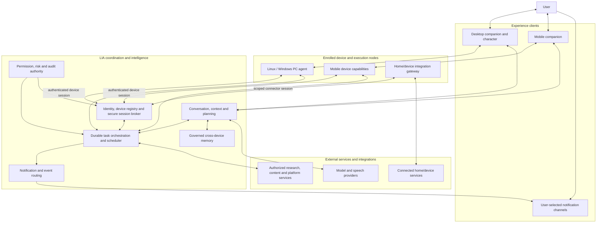

## 19.4 Logical subsystem decomposition and ownership

| Subsystem | Primary responsibility | Must not own |
|---|---|---|
| Desktop experience client | Character rendering, local conversation UI, user controls, local status and interaction presentation | Permission authority, durable task state or OS execution |
| Mobile companion | Authenticated conversation, device/task dashboard, remote-access entry point and notification inbox | Implicit authority over every enrolled device |
| Device registry and identity | User identity, device enrollment, device identity, trust, capabilities, connection status and revocation | Local OS operations |
| Secure connectivity/session broker | Authenticated device sessions, secure routing/relay and session lifecycle | Deciding whether a requested operation is authorized |
| Device agent runtime | Local capability manifest, event collection, local command validation, task execution and health reporting | Global reasoning or unrestricted cross-device memory |
| Platform/application adapters | Translate typed capabilities into supported OS, app, file, browser or home-device operations | Policy exceptions or hidden privilege escalation |
| Conversation and agent orchestrator | Dialogue, context assembly, model selection, reasoning and plan proposals | Durable workflow truth or direct unvalidated side effects |
| Planner | Produce objective decompositions, action graphs, branch proposals and recovery proposals | Bypassing policy, scheduler or resource ownership |
| Durable task orchestrator | Workflow/run/step state, dependency graph, checkpoints, retry budgets, leases, deadlines and verified outcomes | Creating permission grants |
| Scheduler and worker router | Determine when and where an eligible step can run based on capability, connectivity, scope and resource requirements | Expanding an action's authority |
| Permission and risk authority | Evaluate grants, scope, purpose, risk, confirmation, revocation and policy version | Replacing user's explicit delegation with inferred preference |
| Memory platform | Governed archive, episodic/semantic/procedural/working memory, retrieval, provenance, deletion and cross-device sync | Executing device commands |
| Event and integration adapters | Connect external sources/services and translate their events/data into normalized events | Treating external content as trusted instructions |
| Notification router | User-preferred channels, urgency, digest, delivery attempts and delivery status | Acting as an authorization channel |
| Observability and audit | Operation IDs, traces, component health, task history and content-minimized audit | Storing unnecessary raw sensitive content |

These are logical responsibilities. P3.2/P3.3 may combine or split deployable processes while preserving these ownership boundaries.

## 19.5 Device-node model

A device node is a named, enrolled execution endpoint with:

- Stable device identity and revocable credentials.
- Owner/account and trust state.
- Platform/device type and runtime version.
- Declared capabilities and limitations.
- Current connectivity and last-seen status.
- Available resource and execution state where measurable.
- Locally available policy/grant cache with freshness and expiry.
- Local executor, adapters and operation verification.
- Device-specific configuration and permitted data cache.

### Initial device classes

| Node class | Typical responsibilities | Capability caveats |
|---|---|---|
| Desktop PC node | Window/OS control, application and file operations, local rendering, desktop perception and resource-intensive local workloads | Requires the PC and the relevant OS session/capability to be available |
| Mobile node | Conversation, notifications, device management, remote PC session initiation and supported phone-native actions | Mobile OS background and hardware permissions constrain what it can execute |
| Home/device gateway | Read state and control individually authorized smart-home devices | Physical actions are independently risk-classified; not every device exposes safe or reliable operations |
| Service worker node | Scheduled research, content preparation, integration workflows and other approved non-desktop tasks | Must have its own scoped service identity and authorized data access |

A node advertises capability facts, not promises. For example, a mobile client may be able to receive notifications and approve a task while being unable to execute a persistent background computation.

## 19.6 Remote PC access and control

Remote control is a separate access path from the PC's ordinary local UI.

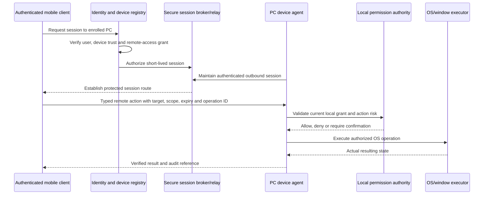

Design rules:

- The PC agent maintains an authenticated outbound-established session to the coordination service/relay. Direct public inbound desktop-control exposure is not the default.
- Remote viewing/streaming, metadata observation, window control, input simulation, file access and application modification are separate capabilities.
- The user authenticates in the mobile/remote client; device enrollment alone does not grant arbitrary remote control.
- Commands are typed, scoped, time-bounded and bound to a device, target and operation ID.
- The PC agent performs a local authorization and freshness check before every side effect.
- Secure desktop, login screen, credential prompts and OS lock boundaries are not bypassed.
- When the PC is asleep, powered off or disconnected, PC-specific steps are blocked/deferred. Optional wake capability may be evaluated later and is dependent on hardware/network support.
- A user objective may remain queued while the PC is offline, but stale GUI commands are discarded. On reconnection, LIA refreshes state and replans or asks the user rather than replaying an old action.
- A live user remote-control session and an autonomous LIA task are distinct origins and are visible in task/session history.

## 19.7 Durable multi-device task and campaign architecture

The existing hierarchy Objective → Plan → Actions is extended to represent persistent campaigns and recurring runs:

```mermaid
flowchart TD
    C["Campaign / persistent objective"]
    T["Workflow template and policy envelope"]
    R1["Scheduled run 1"]
    R2["Scheduled run 2"]
    R3["Event-triggered run"]
    P["Plan / dependency graph"]
    S1["Step: research"]
    S2["Step: produce"]
    S3["Step: quality gate"]
    S4["Step: publish"]
    V["Verify outcome"]
    N["Notify and update campaign state"]

    C --> T
    T --> R1
    T --> R2
    T --> R3
    R1 --> P
    P --> S1
    S1 --> S2
    S2 --> S3
    S3 --> S4
    S4 --> V
    V --> N
```

The campaign definition contains the enduring objective, owner, schedule/timezone, permitted sources, target services/channels, constraints, success criteria, resource/spend ceilings, approval mode, grant reference and notification policy.

Each run is a separately traceable execution instance. The run contains a plan/step graph, worker assignments, input/output references, deadlines, dependencies, permission checks, checkpoints, retries, evidence and result.

### Workflow execution ownership

1. **Trigger:** A user command, schedule, timer or authorized external event creates a run.
2. **Context assembly:** LIA retrieves only the memory and source context allowed for the task.
3. **Planning:** The planner proposes or updates a bounded plan.
4. **Validation:** The plan is checked against the objective, campaign envelope, resource limits and current permissions.
5. **Scheduling:** The scheduler selects an eligible worker/device for each ready step.
6. **Execution:** The target executor validates its own identity, target state, command freshness and permission before each side effect.
7. **Verification:** The executor or an independent verifier checks the actual result.
8. **Checkpointing:** The workflow engine persists step result and next-ready state.
9. **Monitoring:** Event/timer watchers detect completion, blockers, timeouts, external changes and device availability.
10. **Notification:** Relevant milestone, blocker, approval and completion events are routed according to user preferences.

The language model is not repeatedly invoked merely to poll task status. The workflow engine and event system maintain operational continuity; reasoning is invoked when planning, interpreting a meaningful event, resolving uncertainty or proposing a permitted replan.

### Step and worker state

A workflow run uses the existing task states at the objective level. Individual steps additionally distinguish Pending, Ready, Running, Blocked (including awaiting device, input, permission or approval), Completed/verified, Failed, Cancelled and Unknown outcome.

The task engine may reassign a step only when the new worker has the required capabilities, data access and grant. Before retrying a side effect, it checks whether the original action already took effect. If the outcome cannot be established, the step remains blocked/unknown and escalates instead of blindly repeating the action.

## 19.8 Reference workflow — autonomous YouTube channel operation

This is an architecture use case for a user-authorized recurring campaign, not a claim that any platform connector has already been implemented.

### Campaign definition

The user creates a persistent campaign such as:

**Objective:** Develop and operate a YouTube channel by preparing and publishing suitable trend-informed content on a recurring daily schedule.

The campaign stores:

- Channel/account identity and connected authorization.
- Channel topic, audience, content brief, style and prohibited topics.
- Permitted trend/research sources and source reliability requirements.
- Schedule, timezone and maximum frequency.
- Content formats, length, language and output requirements.
- Asset rules: original, user-owned or appropriately licensed material.
- Required factual, editorial, rights and platform-policy checks.
- Resource and spending ceiling (zero external spend by default).
- Approval mode: draft-only, approval for each item, or bounded auto-publish.
- Campaign delegation expiry and revocation controls.
- Success metrics and notification preferences.

### Daily workflow

```mermaid
flowchart TD
    A["Daily scheduler creates campaign run"]
    B["Discover permitted trend signals"]
    C["Check freshness, relevance and source quality"]
    D{"Qualified topic within campaign brief?"}
    E["Record no eligible topic; do not force publication"]
    F["Research and verify claims"]
    G["Check originality, rights/licensing and source attribution"]
    H["Create script, visual/audio assets and metadata"]
    I["Render/assemble content"]
    J["Editorial, factual, safety and technical quality gate"]
    K{"All required checks pass?"}
    L["Hold output and record blocker"]
    M{"Campaign approval mode?"}
    N["Save draft for user review"]
    O["Request per-item approval"]
    P["Validate bounded auto-publish delegation"]
    Q["Publish through authorized connector"]
    R["Verify published item and visibility"]
    S["Monitor permitted performance signals"]
    T["Update campaign metrics and next run"]
    U["Send user-preferred status/report"]

    A --> B --> C --> D
    D -->|No| E --> U
    D -->|Yes| F --> G --> H --> I --> J --> K
    K -->|No| L --> U
    K -->|Yes| M
    M -->|Draft only| N --> U
    M -->|Approval each item| O
    O -->|Approved| Q
    O -->|Declined/expired| L
    M -->|Auto-publish| P
    P -->|Within envelope| Q
    P -->|Out of scope/expired| O
    Q --> R --> S --> T --> U
```

### Autonomy and publication policy

After the user has explicitly enabled a bounded auto-publish campaign,
LIA may discover, create, quality-check and publish eligible content on
its recurring schedule without asking for a separate approval for every
video.

This is not the default for a new campaign. New external-publication
campaigns begin in draft/review mode. The user can switch to bounded
auto-publish by granting the campaign delegation defined in SEC-070.

Initial auto-publish envelope defaults:

- One explicitly selected channel/account.
- Only the approved channel topic, content format and permitted source set.
- One scheduled publication per run and no more than one per day unless the user explicitly changes the limit.
- No paid promotion, purchases, subscriptions or external spending by default.
- Only original, user-owned or appropriately licensed assets.
- Required factual/source, rights/licensing, editorial and platform-policy gates must pass.
- A materially changed account, content category, source policy, schedule, frequency, spend ceiling or publication action falls outside the grant and requires review.
- The initial delegation expires after 30 days unless renewed or the user selects a longer bounded period.
- The user can pause the campaign, disable auto-publish or revoke its grant at any time.
- R4 operations are never included in an auto-publish envelope.

If no trend meets the campaign's quality/relevance requirements, if
source facts cannot be verified, if rights are uncertain, if a platform
connector is unavailable or if the campaign grant has expired, LIA does
not publish merely to satisfy the daily schedule. The run reports "no
eligible publication" or a specific blocker and notifies the user.

After a successful upload, LIA verifies the resulting platform item and
records the external identifier/link and visibility state where the
connector supports them. Later performance monitoring uses only
authorized metrics and must not silently change the campaign objective
or spend policy.

## 19.9 Notification architecture

Notifications are an output and communication plane, not an authorization plane.

- The user explicitly connects and selects channels. Available routes may include the mobile companion, desktop, email or supported messaging integrations; no external channel is assumed to be connected by default.
- The user configures which events use immediate delivery, a digest or no notification.
- Immediate delivery defaults to security/privacy notices, blocked tasks requiring user input, approvals, campaign failures and verified external publication/action results.
- Routine progress is grouped into milestones or a daily summary rather than one message per action.
- The router records attempted, accepted, delivered where the provider reports delivery, failed and expired states.
- Notification payloads are minimized; sensitive details may require opening the authenticated companion.
- A notification receipt, reply or webhook payload is not itself permission. A consequential action from a notification must resolve through an authenticated client and the relevant confirmation workflow.
- A failed notification route shall not erase task state or cause a task to be marked complete.

## 19.10 Cross-device memory and data ownership

The P2.5 memory design remains the governing model. Multi-device access does not collapse user, project, task, experience and procedural compartments into one unrestricted store.

- The logical memory platform exposes scoped retrieval and synchronization services.
- Device nodes keep only the local cache/context required for their current task and granted capabilities.
- Raw microphone audio, screen frames, camera frames and sensitive local observations are not synchronized by default.
- A memory record retains owner, scope, sensitivity, source provenance, version and deletion state as it moves between nodes.
- Conflicts are reconciled with temporal/version semantics; material conflicts are not silently resolved by last-writer-wins.
- Device revocation removes its future access and invalidates relevant local caches/tokens. It does not automatically erase the user's canonical memory unless the user requests a memory deletion operation.
- Deletion markers and corrections propagate to synchronized copies and are reapplied on reconnection/backup restoration.

## 19.11 Trust boundaries and security zones

The logical security zones are:

1. **User identity zone:** Authentication, account-level configuration and explicit grants.
2. **Enrolled device zone:** Each PC, phone and home gateway has its own identity, local executor and resource boundary.
3. **Coordination zone:** Routes authenticated events and commands, maintains tasks and policy references; it is not a substitute for local execution checks.
4. **Model/provider zone:** Model input/output is treated as untrusted processing; only authorized minimum context is sent.
5. **External connector zone:** Third-party APIs, trend sources, content platforms and home services have isolated credentials and explicit scopes.
6. **Untrusted content zone:** Webpages, files, messages, trend signals, generated assets and incoming external content cannot grant authority or override system policy.

No device is trusted merely because it belongs to the same network. A compromised connector or device must be revocable without granting it authority over other enrolled nodes.

## 19.12 Architecture diagrams — component and command/data flow

```mermaid
flowchart TB
    subgraph EXPERIENCE["Experience plane"]
        DCLIENT["Desktop shell / renderer / chat"]
        MCLIENT["Mobile companion / task dashboard"]
        NCHANNEL["Notification adapters"]
    end
    subgraph COORDINATION["Always-on coordination plane"]
        IDREG["Identity, pairing and device registry"]
        SESSION["Secure session broker and event router"]
        WF["Durable workflow orchestrator"]
        SCHED["Scheduler, monitor and worker router"]
        PERM["Permission/risk authority and audit"]
        NOTIFY["Notification preference/router"]
    end
    subgraph INTELLIGENCE["Agent intelligence plane"]
        DIALOG["Conversation orchestrator"]
        CONTEXT["Context assembly"]
        PLAN["Reasoning and plan proposal"]
        MODEL["Model/provider gateway"]
    end
    subgraph MEMORY["Memory plane"]
        ARCHIVE["Source/experience archive"]
        STORE["Episodic, semantic, procedural and task memory"]
        RETRIEVE["Governed retrieval and sync"]
    end
    subgraph DEVICE["Local device execution plane"]
        PCAGENT["Linux/Windows device agent"]
        MOBILEAGENT["Mobile capability agent"]
        HOMEAGENT["Home/device connector"]
        OSADAPTER["OS/application/file adapters"]
        DEVICEEXEC["Local execution and verification"]
    end
    subgraph EXTERNAL["External services"]
        EXT["Authorized service connectors"]
    end

    DCLIENT <--> DIALOG
    MCLIENT <--> DIALOG
    DCLIENT <--> PCAGENT
    IDREG --> SESSION
    SESSION <--> PCAGENT
    SESSION <--> MOBILEAGENT
    SESSION <--> HOMEAGENT
    SESSION <--> WF
    DIALOG <--> CONTEXT
    CONTEXT <--> RETRIEVE
    CONTEXT <--> PLAN
    PLAN <--> MODEL
    PLAN --> WF
    WF <--> SCHED
    PERM --> WF
    PERM --> DEVICEEXEC
    SCHED --> SESSION
    PCAGENT --> OSADAPTER --> DEVICEEXEC
    MOBILEAGENT --> DEVICEEXEC
    HOMEAGENT --> DEVICEEXEC
    DEVICEEXEC --> WF
    RETRIEVE <--> ARCHIVE
    RETRIEVE <--> STORE
    WF --> NOTIFY --> NCHANNEL
    NOTIFY --> MCLIENT
    WF <--> EXT
```

## 19.13 P3 workstream plan

| Workstream | Scope | Status |
|---|---|---|
| P3.1 — Architecture drivers and system context | Scope extension, quality drivers, system context, logical planes and responsibility boundaries | Complete |
| P3.2 — Distributed runtime and deployment topology | Always-on coordinator deployment, local/hosted workers, process boundaries, availability and recovery | Complete |
| P3.3 — Device identity and secure communication | Enrollment, device keys, sessions, relay, remote desktop transport and revocation | Complete |
| P3.4 — Workflow and event architecture | Durable task state, event model, scheduler, campaign runs, leases, retry/reconciliation and notification events | Complete |
| P3.5 — Data ownership and synchronization | Memory authority, task/event records, device caches, conflict resolution, retention and deletion propagation | Complete |
| P3.6 — Platform and integration adapter contracts | Linux/Windows desktop nodes, mobile capabilities, home automation and external service connectors | Complete |
| P3.7 — Agent intelligence and model runtime | Conversation orchestration, planning, model gateway, tool/action request schema and context boundaries | Pending |
| P3.8 — Architecture validation and technology selection | ADR review, quality scenarios, threat analysis, component trade-offs and justified stack selection | Pending |

## 19.14 Decisions intentionally deferred

P3 establishes logical architecture but does not select:

- Specific cloud provider, hosting vendor, region, infrastructure product, deployment packaging/orchestration and self-hosting distribution product. The hosted-default and self-hosted-target deployment profiles are decided; vendor and implementation choices remain deferred.
- Concrete database/storage engine, event broker, workflow engine and scheduler products. Their logical responsibilities and semantic contracts are defined in P3.4/P3.5; candidate products are compared and selected in P3.8.
- Device relay, transport protocol, remote desktop streaming or cryptographic library.
- Concrete synchronization engine, conflict-resolution implementation, backup tooling, artifact/object store, schema migration tool and physical placement of canonical memory data. P3.5 defines ownership and lifecycle semantics; implementation is evaluated in P3.8.
- Desktop/mobile programming language, UI framework or rendering engine.
- Home automation standard, gateway product or vendor-specific connector.
- Model provider, model routing framework, speech provider or local inference runtime.
- Exact API schemas, wire formats, service process boundaries, deployment manifests or infrastructure topology.

The remaining implementation choices belong to P3.4–P3.8. Each technology choice must be justified against the requirements, measured quality targets, operational cost, privacy and portability.

**P3.1 closure:** Architecture drivers, distributed system context, logical responsibility boundaries, multi-device execution model, secure remote-access principles, durable campaign/task model and reference YouTube workflow are approved. P3 remains active; deployment, detailed contracts, data architecture and technology evaluation remain open.

## 19.15 Deployment topology alternatives and decision

P3.2 evaluates three primary coordination models against the requirement that recurring workflows, remote device access, task supervision and notifications continue independently of the user's primary PC.

| Deployment model | Strengths | Limitations and operational risks | P3.2 assessment |
|---|---|---|---|
| Managed hosted coordinator | Independently available when personal devices are offline; stable remote reachability; centralized durable scheduling, event intake and notification routing; lower setup and maintenance burden for the user | Requires trust in a service operator, recurring operating cost and disciplined data minimization; depends on network access and provider operations | Selected as the default reference deployment for the initial complete multi-device product |
| User-controlled/self-hosted coordinator | Greater control over hosting, data placement, upgrades and operational policy; supports user-operated home servers or rented infrastructure | The user must maintain an always-on host, secure remote reachability, updates, backups, monitoring and recovery; a home-hosted coordinator inherits local power and connectivity failures | Retained as a first-class architectural deployment target using the same logical contracts; production parity and packaging require later validation |
| Peer-to-peer-only coordination | Can provide efficient direct device-to-device paths and reduce dependence on a central relay for some transfers | Cannot reliably schedule or supervise work when all relevant peers are offline; device sleep, mobile background limits, NAT/reachability, event durability and notification delivery complicate always-on behavior; no stable global authority during partitions | Rejected as the sole coordination model; direct connections may be an optimization, never the only source of durable task authority |

### Approved deployment decision

LIA uses a **hybrid, coordinator-led topology**:

1. The initial reference deployment uses a managed, always-on coordination plane that remains reachable independently of the user's desktop PC.
2. Linux and Windows desktop agents, mobile clients and home/device gateways remain separately enrolled execution nodes. They retain ownership of the local resources and operations they expose.
3. Optional service workers may execute eligible tasks that do not require an unavailable personal device. Such workers have their own identity, execution boundary and scoped grants.
4. The same logical coordination contracts must support a user-controlled deployment profile. A self-hosted instance may run on an always-on home server or user-selected hosted machine; the user is responsible for its availability and operations.
5. Direct peer-to-peer communication may be used when appropriate for local transfers or sessions, but task state, authorization and recovery must not depend on a peer-to-peer path remaining continuously available.

The coordinator is not the user's desktop and does not become a universal remote executor. It records and routes authorized work. A desktop operation still runs on the relevant desktop node, and a home-device operation still passes through the relevant home integration boundary.

The managed deployment is the default for ease of use and reliable autonomous scheduling. Self-hosting is a deployment choice, not a separate product architecture. The user must be able to understand which deployment profile is active, where authoritative task state resides and which dependencies are unavailable.

## 19.16 Runtime placement and deployable boundaries

### Runtime placement

| Runtime or node | Placement | Responsibilities | Explicit boundary |
|---|---|---|---|
| Coordination runtime | Managed hosted environment by default; user-controlled host in the self-hosted profile | Device registry, task/campaign state, scheduler, worker routing, event intake, policy/grant records, session coordination, notification routing and synchronization coordination | Does not directly execute local desktop or physical-device operations |
| Agent intelligence runtime | Hosted or local according to the deployment and privacy profile | Conversation orchestration, context assembly, planning, model/provider routing and plan evaluation | Produces proposals and typed requests; cannot directly mutate authoritative workflow state or bypass permission checks |
| Desktop device runtime | Each enrolled Linux or Windows PC | Local presence, device health, permitted context observation, OS/application adapters, local execution and outcome verification | Interactive GUI operations require the relevant OS user session and supported platform capabilities |
| Mobile companion runtime | User's enrolled smartphone | Conversation, authenticated approvals, device/task dashboard, remote-session initiation and supported mobile-native capabilities | Mobile background execution and hardware access are bounded by the mobile OS; the phone is not assumed to be an always-on worker |
| Home/device gateway runtime | User-controlled local gateway or supported integration endpoint | Device discovery, state observation and separately authorized home/device actions | No blanket home access; each resource and action retains its own risk and grant boundary |
| Optional service-worker runtime | Managed worker pool or user-operated worker node | Eligible research, content processing, rendering, scheduled integration work and other tasks not dependent on a personal device being online | Isolated from coordinator authority; receives only the task payload, secrets and capabilities required for its assigned step |
| External connector runtime | Isolated connector boundary, hosted or local as appropriate | Provider API access, external event intake, upload/publication and supported service integrations | Credentials are scoped to the relevant integration/account and are not made available to general model context |

### Logical modules and initial packaging

The control plane retains the logical modules defined in Section 19.4: identity/registry, session broker, permission authority, workflow orchestrator, scheduler/worker router, event routing, notification routing, memory synchronization facade and audit/observability.

These are ownership boundaries, not a requirement to deploy every module as a separate network service. The initial implementation should prefer a **modular control-plane deployment** with explicit internal contracts and separately isolated worker runtimes. A module should become an independently deployed service only when a concrete security, scaling, availability or operational requirement justifies the additional distributed-systems complexity.

The following separation is mandatory even when modules share a deployment unit:

- The workflow engine is the authoritative writer of workflow/run/step state.
- The planner can submit a proposed plan or replan request but cannot directly alter authoritative state.
- The permission authority evaluates grants and risk; the scheduler cannot expand authority to make a worker eligible.
- Device agents own local execution and must verify actual outcomes.
- Model/provider access is mediated through a gateway. Model output is untrusted and cannot directly access the authoritative task store, device credentials or unrestricted operating-system interfaces.
- Service workers execute in a constrained environment and cannot modify device registry, account grants or another worker's task authority.
- Connector credentials are isolated by integration and account; a connector failure must not collapse unrelated device execution.

This design preserves the ability to split or consolidate deployable processes later without changing subsystem ownership.

### Worker selection and execution locality

A worker is eligible only when its declared capabilities, current connectivity, resource availability, trust state, data-locality policy and grant scope all satisfy the step requirements.

The worker router shall prefer, in order of relevance to the task:

1. The node that owns the target resource when the operation is inherently local, such as moving a PC window or controlling a paired home device.
2. A user-authorized local/service worker when the task needs user-controlled data or local resources but does not require the primary desktop session.
3. A managed service worker for tasks that are explicitly eligible for hosted processing and whose data and permissions allow that placement.

A worker's availability does not create a grant. Reassignment requires a fresh eligibility and permission check, and it does not transfer the previous worker's credentials or authority.

## 19.17 Authoritative state, data placement and locality

### Coordinator-owned authoritative records

The coordination plane is authoritative for:

- Account-to-device enrollment and device trust/revocation state.
- Campaign definitions, schedule/timezone and policy-envelope references.
- Workflow, run and step state, dependency readiness, deadlines, leases and checkpoints.
- Stable operation identifiers, dispatch history, reported outcomes and reconciliation status.
- Grant identifiers, policy versions, expiry/revocation state and authorization decision references.
- Notification preferences, delivery attempts and provider-reported delivery states.
- Minimal audit and observability records needed to explain task and permission decisions.

A worker may maintain an execution journal and a bounded local outbox while disconnected, but it cannot silently replace the coordinator's canonical workflow history. Reconnection requires reconciliation by stable operation identity.

### Device- and worker-owned data

The originating device remains the natural owner of raw local observations and device-specific state. Device agents retain only the local cache, task inputs and execution evidence required for their current authorized work. Service workers use bounded task workspaces and must not retain unrelated user data after the applicable retention period.

The P2.5 memory platform remains a separately governed data domain. Task orchestration records may reference memory items or scoped context, but the workflow store is not a second unrestricted memory archive.

Raw microphone audio, camera frames and screen frames are not copied to the coordinator by default. A task may transfer specific data to another node only when the source, destination, purpose, scope, sensitivity, retention and authorization checks allow it. Data transfer and worker selection must honor locality constraints rather than silently moving all task context to a hosted worker.

The coordinator may store metadata and references needed to resume a task. It must not assume that a reference is readable by every worker; access is re-evaluated at retrieval and execution time.

## 19.18 Offline operation, partitions and recovery behavior

The architecture distinguishes coordinator availability from the availability of each execution node. A PC can be online while a service worker is unavailable, or the coordinator can be healthy while the user's PC is asleep. These states must not be collapsed into one generic "LIA online" indicator.

### Coordinator unavailable

- Durable schedules and workflow dispatch pause when the authoritative coordinator cannot be reached. No new distributed step is assumed to have started.
- Device-local presence and other independent local capabilities may continue.
- A device may use only a short-lived, bounded offline authorization lease issued while the coordinator was reachable. The P3.2 default offline allowance is limited to R0/R1 operations explicitly eligible for offline execution.
- R2, R3 and R4 operations are blocked while the coordinator cannot provide the required current authorization. R4 still requires its per-operation authorization and confirmation even when online.
- Recurring publication, external sharing, purchases, consequential external actions and home safety/security actions are not dispatched during a coordinator partition.
- Devices record local execution events in a bounded outbox. The UI reports local completion separately from coordinator synchronization.
- Notifications that cannot be routed are queued with bounded expiry where possible; they are not reported as delivered.

The offline lease is not a standing blanket grant. It is device-bound, capability-bound, resource-bound, task/purpose-bound and time-bounded. It must not authorize a new target, a new campaign or an expanded operation. Exact token format, lease lifetime, revocation propagation and cryptographic enforcement are P3.3 decisions.

### Device or worker unavailable

- PC-specific steps become Blocked/Waiting for device when the relevant PC agent or required OS session is unavailable.
- A different worker may handle only a distinct step whose capability, data locality and permissions it independently satisfies.
- A local GUI command is never transferred to a service worker as a substitute for the unavailable PC.
- Scheduled runs remain durable. The scheduler may defer them, report a missed execution window or create a later run according to the campaign's explicit schedule policy; it must not silently compress missed runs into a burst.
- A worker lease expiry triggers reconciliation of the original operation before any retry or reassignment. An unknown side-effect outcome remains Unknown/Blocked until evidence resolves it.

### Reconnection

On reconnect, the device re-authenticates, refreshes its capability and grant state, submits its bounded outbox and reconciles each outstanding operation by stable ID. The coordinator compares the reported execution journal with authoritative workflow state, verifies actual outcomes where possible and then resumes or replans within the still-active campaign envelope. Old GUI commands are not replayed.

## 19.19 Initial availability and recovery objectives

The following are **initial architecture targets** for the managed coordination profile. They are engineering objectives to guide P3 design and P5 validation, not measured service results or a public service-level guarantee.

| Measure | Initial target | Measurement boundary |
|---|---|---|
| Managed coordination availability | 99.5% monthly | Authenticated core coordination, task-state and event-ingress functions; excludes user-network outages and third-party model, notification or integration-provider availability |
| Managed coordination recovery time (RTO) | 60 minutes or less after a declared major service outage | Restore core coordination and durable task processing; individual offline device recovery remains independent |
| Recovery point for acknowledged critical control state | RPO 0 for acknowledged workflow/run/step transitions, operation-journal records, grant/revocation changes and campaign definitions | An acknowledgement is issued only after the record is durably committed. The storage/replication design must preserve this property under the declared failure model |
| Device reconnection | No fixed promise that an offline device will reconnect by a deadline | Device health, last-seen state and reconnect status are observable; stale work is reconciled rather than replayed |
| End-to-end task completion | No single global availability percentage | Depends on the required device, worker, model/provider, connector, user approval and external service; blockers are represented explicitly |

For a self-hosted deployment, LIA shall expose the configured backup, recovery and availability posture rather than imply the managed profile's targets. A process restart must not lose acknowledged durable workflow state. Recovery after host, storage or site loss depends on the user's chosen redundancy and backup configuration; the deployment must disclose the resulting RTO/RPO and whether recovery has been tested.

The coordinator's availability is not a promise that every campaign can complete. A scheduled campaign may remain blocked because its authorized PC is offline, a connector is unavailable, a grant has expired or a quality gate has failed. The system reports the dependency and preserves the run state instead of marking the campaign successful.

## 19.20 Deployment topology reference diagram

~~~mermaid
flowchart TB
    subgraph CLIENTS["User experience clients"]
        DESKTOP["Desktop companion"]
        PHONE["Mobile companion"]
        CHANNELS["User-selected notification channels"]
    end

    subgraph COORD["Always-on coordination plane"]
        ID["Identity and device registry"]
        SESSION["Session broker and event ingress"]
        POLICY["Permission and grant authority"]
        WORKFLOW["Durable workflow and campaign state"]
        SCHEDULE["Scheduler and worker router"]
        NOTIFY["Notification router"]
        SYNC["Governed memory-sync facade"]
        AUDIT["Audit and health state"]
    end

    subgraph INTEL["Agent intelligence plane"]
        DIALOG["Conversation orchestrator"]
        CONTEXT["Scoped context assembly"]
        PLANNER["Planner and replan proposals"]
        GATEWAY["Model/provider gateway"]
    end

    subgraph NODES["Independently enrolled execution nodes"]
        PC["Linux/Windows PC agent"]
        MOBILE["Mobile capability client"]
        HOME["Home/device gateway"]
        SERVICE["Optional isolated service worker"]
    end

    subgraph OUTSIDE["External services"]
        CONNECTORS["Authorized service connectors"]
        PROVIDERS["Model and speech providers"]
    end

    DESKTOP <--> DIALOG
    PHONE <--> DIALOG
    PHONE <--> SESSION
    DESKTOP <--> PC
    ID --> SESSION
    SESSION <--> PC
    SESSION <--> MOBILE
    SESSION <--> HOME
    SESSION <--> SERVICE
    SESSION <--> WORKFLOW
    POLICY --> WORKFLOW
    POLICY --> PC
    POLICY --> HOME
    DIALOG <--> CONTEXT
    CONTEXT <--> SYNC
    CONTEXT <--> PLANNER
    PLANNER <--> GATEWAY
    GATEWAY <--> PROVIDERS
    PLANNER --> WORKFLOW
    WORKFLOW <--> SCHEDULE
    SCHEDULE --> SESSION
    PC --> WORKFLOW
    MOBILE --> WORKFLOW
    HOME --> WORKFLOW
    SERVICE --> WORKFLOW
    WORKFLOW <--> CONNECTORS
    WORKFLOW --> NOTIFY
    NOTIFY --> CHANNELS
    NOTIFY --> PHONE
    WORKFLOW --> AUDIT
    POLICY --> AUDIT
    ID --> AUDIT
~~~

## 19.21 P3.2 closure

**P3.2 status:** Complete — deployment alternatives, hosted-default/self-hosted-target topology, runtime placement, coordination-versus-worker boundaries, data-locality constraints, partition behavior and initial managed availability/recovery targets are defined.

## 19.22 Identity principals and trust model

P3.3 separates the identities that authenticate a person, an enrolled execution endpoint, a runtime installation and an external integration. These identities are related by explicit ownership and delegation records; they are not interchangeable.

| Identity | Represents | Credential/authority boundary |
|---|---|---|
| User/account principal | The human owner and authenticated account | Authenticates through the user-authentication flow; account ownership does not automatically trust every device |
| Device enrollment record | One explicitly enrolled device node under an account | Holds device class, owner, trust state, capability claims, enrollment history, status and revocation epoch |
| Device installation identity | A particular LIA agent/client installation | Owns a unique per-installation key pair and proof-of-possession credential |
| Runtime/session identity | One live authenticated process or communication session | Short-lived, audience-bound and linked to device installation, account, purpose and current policy/revocation version |
| Service-worker identity | A specific isolated worker runtime or worker-pool member | Receives task-scoped work authority; cannot enroll devices, issue grants or expand campaign scope |
| Connector/account identity | A connected external service account or integration | Owns isolated provider credentials and scopes; cannot authenticate as a desktop/mobile device |
| Authorization principal/delegation | A user grant or explicitly approved task/campaign delegation | Names actor, capability, resource, purpose, scope, origin, duration and risk constraints defined by P2.6 |

### Identity invariants

- Device identity proves which enrolled installation is communicating. It does not prove current human intent and does not create an OS, memory, file, remote-control, home or external-service grant.
- User authentication, device authentication and operation authorization are separate checks. A successful sign-in is not a pairing event; a valid device key is not user approval for a new capability.
- Each installation receives a distinct key pair. Private keys are not copied between devices, exported as ordinary backups or synchronized through general-purpose account/cloud backup.
- Hardware-backed key storage or platform attestation may strengthen assurance where supported, but neither is universally required or a substitute for explicit pairing and scoped grants.
- Hardware serials, MAC addresses, IP addresses, local network membership, Bluetooth proximity or device names are not identity credentials.
- Reinstalling or materially re-provisioning an agent creates a new installation identity and requires enrollment again. The prior identity remains revocable and auditable; it is not silently inherited.
- A capability manifest is an authenticated declaration, not proof that an operation is currently available. The local adapter validates capability and target state at execution time.
- Service workers and external connectors have identities separate from personal devices. Credentials are never reused across these principals.

### Device trust states

| State | Meaning | Allowed behavior |
|---|---|---|
| Unregistered | No enrollment record | No authenticated operational device session |
| Pairing pending | Enrollment exists but proof/approval/commit is incomplete | Enrollment protocol only |
| Active | Enrollment is valid and not suspended or revoked | May establish sessions and request capabilities; every operation still requires a grant |
| Restricted | Enrolled but trust, version, capability or security conditions limit it | Explicitly allowed low-risk/recovery functions only |
| Suspended | Temporarily disabled by user or policy | No new task dispatch or operational sessions |
| Revoked | Enrollment and credentials are no longer trusted | Reject new sessions and commands; fresh pairing required |
| Compromised | Device or installation key is suspected/confirmed compromised | Immediate revocation; no ordinary renewal or silent recovery |

State transitions are audited with actor, reason, time, prior/new state and affected credential/session/grant references. A device cannot self-promote from Restricted, Suspended, Revoked or Compromised to Active.

## 19.23 Explicit pairing and device enrollment

Pairing is a deliberate account-owner action. It establishes a device identity and trust relationship only; it does not grant blanket access to remote control, memory, files, applications, home devices or connectors.

### Enrollment protocol

1. **Initiation:** An authenticated account session requests enrollment and selects a device class. The coordinator creates a one-time pairing intent bound to the account, expected class, enrollment flow, nonce and strict expiry.
2. **Local key creation:** The new installation generates its unique device key pair locally before completing enrollment. The private key remains in its local protected key store.
3. **Out-of-band association:** The new device presents a QR/deep-link or short pairing code referencing the pending intent. This code is a short-lived bootstrap association, not a reusable password or sole proof of identity.
4. **Proof of possession:** The new installation proves possession of its private key in the authenticated enrollment exchange. The exchange binds account, pairing intent, device key, device class and enrollment transcript to prevent substitution or replay.
5. **Owner verification:** The user reviews the device name/class and identity fingerprint or equivalent confirmation value on the already authenticated client, then explicitly approves or rejects this exact pairing.
6. **Commit:** The coordinator atomically creates the enrollment record, binds the public key and issues a distinct device identity. A failed exchange does not leave an operational half-enrolled device.
7. **Restricted initialization:** The device submits its capability manifest and software/platform facts. It begins with no blanket resource grants; default-deny permissions remain in force.
8. **Grant configuration:** The user separately enables exact capabilities and scopes. Remote viewing, metadata, window control, input, file access, application modification and home-device actions remain distinct.
9. **Confirmation:** Both endpoints receive an enrollment result tied to the same device ID and credential generation.

### Pairing protections

- Pairing intents are single-use, account-bound, purpose-bound and short-lived. Expiry, successful use, cancellation or repeated invalid attempts invalidate the intent.
- A QR image or pairing code alone cannot establish operational trust; proof of possession and authenticated owner approval are required.
- The user can compare a confirmation value across endpoints before approval. Account/device substitution must be detectable.
- Same Wi-Fi/LAN, Bluetooth discovery, IP range or physical proximity may assist discovery but never substitute for authenticated owner approval.
- Enrollment must not silently enable screen capture, microphone, camera, remote input, file access, privileged operations or home actuation.
- Device replacement, reinstall, invalidated OS-user key storage or suspected key loss requires fresh enrollment unless a separately reviewed recovery process proves continuity.
- Home gateways, service workers and connector runtimes use explicit enrollment flows appropriate to their class. They do not inherit the desktop's session.
- Users can cancel pending pairing intents and inspect recent enrollment attempts.

~~~mermaid
sequenceDiagram
    participant U as Authenticated owner client
    participant C as Coordinator identity service
    participant N as New device installation
    U->>C: Request enrollment for selected device class
    C->>C: Create account-bound one-time pairing intent
    C-->>U: Pairing reference and confirmation context
    N->>N: Generate unique local device key pair
    N->>C: Begin enrollment with pairing reference and public key
    C->>N: Fresh challenge bound to pairing intent
    N->>C: Proof of private-key possession
    C-->>U: Present device identity and confirmation value
    U->>C: Approve or reject this exact device
    C->>C: Atomically bind enrollment and credential generation
    C-->>N: Device identity and restricted initial session
    C-->>U: Enrollment result and grant-configuration entry
~~~

## 19.24 Device credentials and lifecycle

### Credential classes

| Credential | Holder | Purpose | Lifecycle rule |
|---|---|---|---|
| Device installation private key | One enrolled device installation | Authenticate installation and prove key possession | Generated locally, protected by OS/platform secure storage where available, rotated and revoked independently |
| Device public-key record | Coordinator/device registry | Verify enrolled installation | Bound to device ID and credential generation; not secret |
| Pairing intent/code | Enrollment participants | Bootstrap one specific enrollment | Single-use, account-bound, short expiry; invalidated after completion/cancellation |
| User session credential | Authenticated client | Represent authenticated user session | Separate from device identity; bounded lifetime, audience and renewal policy |
| Device session credential | Device process and coordinator | Represent one authenticated connection | Short-lived, device-bound and invalidated by expiry, revocation or policy-version change |
| Authorization grant/delegation | Permission authority and executor | Permit a precisely scoped operation or task | Separately versioned, inspectable, expiring and revocable |
| Offline authorization lease | One enrolled device | Permit a narrowly bounded offline-eligible operation | Signed, short-lived, device/task/resource/capability-bound; never general access |
| Connector credential | One integration/account boundary | Authenticate to external provider | Isolated by provider/account, minimal scopes, separately revocable and inaccessible to general model context |

Credentials are not interchangeable. A device session token does not establish user approval, and a connector refresh credential cannot authenticate a desktop agent.

### Key protection and rotation

- Device private keys are generated and retained locally. Use the strongest supported OS-backed secure storage without making hardware-backed storage mandatory on every target.
- Private keys, access tokens, pairing secrets and recovery material are excluded from ordinary memory, prompts, model context, telemetry, crash reports and general logs.
- The coordinator stores public-key and credential metadata, not copies of device private keys.
- Routine rotation introduces and verifies a new key before the old key is retired, with a bounded overlap and explicit credential-generation change. Exact overlap duration is an implementation policy.
- Suspected compromise, lost device, invalid key-store state or unexplained proof-of-possession failure triggers immediate credential revocation rather than routine rotation.
- Session credentials are short-lived and limited by account, device, audience, capability class and current authorization/revocation version. They cannot be extended indefinitely by an unattended connection.
- A device that loses its private key cannot recover it from the coordinator. It must pass a new authenticated enrollment flow; the prior enrollment is revoked or explicitly retired.
- Account recovery restores account access, not the private keys or trusted status of every previously enrolled device.
- Backup/restore must not silently resurrect revoked device keys, sessions, grants or pairing intents.

## 19.25 Authenticated session establishment and renewal

### Separate authentication layers

Every operational session requires the relevant layers:

1. **User authentication:** Confirms an authenticated account/client session for user-originated activity, approval and account/device management.
2. **Device authentication:** Confirms that the connecting installation possesses the private key bound to an active enrollment.
3. **Session establishment:** Creates a fresh authenticated, encrypted channel bound to device identity, account, key generation, purpose and current trust/revocation version.
4. **Operation authorization:** Evaluates exact capability, resource, purpose, scope, duration, origin and risk before a side effect.

A session may be authenticated while a requested operation remains unauthorized. A device's persistent connection is not a standing grant.

### Session establishment rules

- Device agents initiate outbound connections to the coordinator by default. They authenticate with proof of possession against a fresh server challenge and validate the coordinator's identity.
- The coordinator validates account ownership, active device status, credential generation, challenge freshness, protocol/session policy and required user-authentication context before creating a session.
- The handshake establishes fresh session traffic keys and binds both sides to the same transcript, device ID, account, key ID, session ID, purpose and negotiated security parameters.
- Sessions use authenticated encryption, replay protection, integrity protection, bounded lifetime and key update. Exact algorithms and transport are selected after the P3.8 security/technology review.
- Renewal requires fresh proof of possession and revalidation of device status and policy version. An open socket does not keep an expired or revoked session valid.
- Reconnect is a new authentication event. Old session tokens, sequence windows and queued commands are not resumed as trusted state.
- User-interactive approvals are bound to the authenticated user session and exact action details. A background device session cannot manufacture user confirmation.
- Session purpose is explicit: enrollment, health/event reporting, memory sync, task dispatch, remote metadata, remote view, remote input/control or recovery. The channel cannot silently widen its purpose.
- Time-bounded tokens and commands use coordinator-issued time and expiry semantics. Excessive clock uncertainty causes authentication/authorization to fail closed rather than extend validity.
- A device can maintain an outbound connection operationally, but cryptographic session and operation credentials still expire or rotate within bounded lifetimes.

~~~mermaid
sequenceDiagram
    participant D as Enrolled device agent
    participant B as Session broker
    participant I as Identity and trust registry
    participant P as Permission authority
    D->>B: Open outbound connection and request session
    B->>I: Resolve device ID and credential generation
    I-->>B: Active enrollment and trust state
    B-->>D: Fresh challenge and server identity proof
    D->>B: Device proof of possession and client transcript
    B->>I: Verify signature, freshness, key generation and revocation epoch
    I-->>B: Device authentication result
    B->>P: Resolve session purpose and permitted scope
    P-->>B: Session-level allowlist or restricted state
    B-->>D: Fresh encrypted session bound to device and purpose
    Note over D,B: Each operation is separately authorized before execution
~~~

## 19.26 Command authorization envelope and local enforcement

Every command that can observe protected context or cause a side effect is bound to an authenticated source, a specific destination and a current authorization decision. A model proposal, scheduler event, notification, queue item or relay message is not itself an executable command.

### Required command envelope fields

| Field | Purpose |
|---|---|
| Command ID | Unique identity for this dispatch attempt and replay detection |
| Operation ID | Stable identity of the intended operation across retries/reconciliation |
| Account and initiating principal | Owner and whether origin is user, delegated task or authorized service |
| Source device/session | Authenticated initiating endpoint where applicable |
| Target device ID and credential generation | Prevents delivery to a replaced or different installation |
| Capability and action class | Names exact operation, not broad device control |
| Resource and target selector | Identifies app/window/file/device/account/resource affected |
| Purpose/task/campaign reference | Binds operation to originating objective or approved delegation |
| Scope and parameter digest | Binds exact arguments, payload/destination constraints and affected-resource set |
| Grant ID and policy version | References authorization decision and evaluated policy |
| Risk and confirmation reference | Records risk tier and any exact-parameter user confirmation |
| Issued-at, expiry and nonce/sequence | Provides freshness and replay protection |
| Expected target/state version | Prevents acting on materially stale target/state |
| Issuer authentication/signature | Verifies dispatch authorization came from trusted authorization boundary |

### Dispatch and execution contract

1. The planner or workflow engine proposes a typed step with a stable operation ID.
2. The permission authority evaluates exact operation, grant, purpose, risk, target, parameter digest and current policy version.
3. The workflow/dispatch authority creates a short-lived command envelope for one target device and one permitted action.
4. The coordinator routes the authenticated envelope through the existing device session or an authorized direct path.
5. The target agent verifies issuer authenticity, recipient device/key generation, session binding, expiry, nonce/sequence, operation ID, grant/policy freshness, capability and target state.
6. The local executor performs its own final permission and platform-capability checks immediately before the side effect.
7. The executor records the attempt and actual result, then returns authenticated evidence tied to the operation ID.
8. The workflow engine reconciles the result and records verified success, verified failure or unknown outcome. Command delivery is not action completion.

The relay may carry a command but cannot create, broaden, re-sign or approve its authority. A changed target, parameter digest, grant, expiry or risk tier invalidates the authorization. A new action requires a new decision and envelope.

### Replay and duplication rules

- A command ID/nonce may be accepted only within its declared session and freshness window; duplicate delivery must not create a second side effect.
- A stable operation ID allows executor and coordinator to reconcile repeated dispatch with the original attempt.
- Sequence gaps, stale timestamps, expired envelopes, invalid signatures, mismatched targets or consumed one-time authorization are rejected or sent to reconciliation.
- If an action may already have occurred, the executor checks actual state before retry. Network timeout is not proof of failure.
- Wire schema, serialization, signature algorithms and exact replay-window mechanics are P3.8 implementation decisions; semantic fields and enforcement points are architecture requirements now.

## 19.27 Secure relay and remote-session boundaries

The session broker/relay provides reachability and routing. It is not an authorization authority and is not trusted to decide what a device may do.

### Relay responsibilities

- Accept authenticated outbound sessions from enrolled devices and clients.
- Associate each connection with active device/session identity and route versioned messages to the intended recipient.
- Enforce session lifetime, connection limits, basic abuse controls and bounded buffering.
- Route acknowledgements and status events without treating delivery as execution.
- Expose connection health, last-seen state, latency and disconnect reason.
- Minimize retained content and operational metadata; sensitive media/payload retention is disabled by default.

### Relay non-responsibilities

- It cannot enroll a device or approve a pairing request.
- It cannot issue a permission grant or campaign delegation.
- It cannot change target, parameters, operation ID, scope or expiry of an authorized command.
- It cannot convert notification receipt into user approval.
- It cannot bypass the local executor's final authorization and freshness checks.
- It cannot make an offline device available or guarantee successful delivery.

Authenticated command envelopes retain issuer integrity across relay forwarding so a compromised relay can at most observe permitted routing metadata, delay, drop or replay data within detectable limits; it cannot forge a valid operation authorization. Sensitive remote viewing/control data receives authenticated encryption in transit, with endpoint-to-endpoint protection where the data path and product semantics permit it. Exact termination and visibility for remote media is a P3.8 decision and must be disclosed before that mode is enabled.

### Remote-access capability separation

| Remote capability | Independent grant required | Session constraints |
|---|---|---|
| Device health/presence | Device status observation | No desktop content or input |
| Window/process metadata | Named metadata observation scope | No screenshot or control implied |
| Screen/remote view | Screen/view scope and visible active-session state | Separate from input; privacy stop and session end available |
| Window control | Specific window operation capabilities | Target freshness and local OS session validation |
| Keyboard/pointer input | Input capability and explicit task/session scope | No passive global input capture; stop/user-interruption precedence |
| File discovery/read | Path-scoped discovery/read grant | Separate from write, move and delete |
| File modification | Path-scoped create/modify/move grant | Risk and preview/confirmation policy applies |
| Application modification | Per-application Modify grant | Does not imply message sending, purchase or publication |
| Home-device observation/control | Per-resource, per-action grant | R4 device classes remain subject to per-operation confirmation |

The default remote path remains outbound-established from the device. Direct peer-to-peer transport may optimize a path but must preserve the same identities, authenticated command envelopes, encryption, grants, replay protection and audit. No direct path may bypass coordinator authorization or target-device local enforcement.

## 19.28 Revocation, suspension and compromised-device recovery

Revocation is a first-class lifecycle transition, not merely deletion of a device from a user interface.

### Revocation scopes

| Scope | Effect |
|---|---|
| Session termination | Invalidates one session and its traffic credentials; device enrollment remains active |
| Credential revocation | Rejects one key generation/credential; may require re-enrollment or verified key rotation |
| Device suspension | Blocks new operational sessions and dispatch pending owner/policy review |
| Device revocation | Revokes installation identity, active sessions, device-scoped grants and pending pairing/renewal flows |
| Account-wide security revocation | Invalidates all enrolled device sessions/credentials and requires account recovery/re-authentication |
| Connector revocation | Invalidates selected provider/account credential and related tasks without implicitly revoking unrelated devices |

### Device revocation procedure

1. An authenticated user or account-security process selects the exact enrolled device and reason.
2. The registry marks the enrollment Revoked or Compromised and advances its revocation epoch.
3. The identity/session layer rejects new sessions and renewal attempts for the revoked credential generation.
4. Active sessions are closed or marked unusable; command dispatch and worker assignment stop for that device.
5. Device-scoped grants, delegated work assignments, cached authorization references and pending enrollment/rotation intents are invalidated centrally.
6. Affected workflow steps enter Blocked/Needs reassignment or Unknown outcome as appropriate. A new worker must independently pass capability, locality and permission checks.
7. The audit trail records revocation and rejected attempts without recording secrets or unnecessary payloads.
8. If the device reconnects, it receives a revocation response only; it cannot silently re-enroll or restore former grants.
9. Local caches are deleted or cryptographically invalidated on a reachable device where possible. Remote wipe is best effort and is never guaranteed for an offline or compromised endpoint.

### Distributed revocation limit

A coordinator cannot deliver a new revocation state to a fully disconnected device. P3.2 therefore permits only a bounded offline authorization lease for explicitly eligible R0/R1 local operations. The initial maximum lease lifetime is **five minutes** from coordinator authorization. No R2, R3 or R4 operation, cross-device remote-control action, external publication, connector action or home safety/security actuation may rely on offline authorization.

For a connected device, revocation is enforced before its next side effect through session invalidation and policy-version checks. For an offline device, a previously issued eligible lease can remain usable only until its fixed expiry; no new lease or expanded scope can be obtained while disconnected. The product must disclose this bounded propagation window and must not claim instantaneous remote revocation of an unreachable device. A local emergency stop/revocation control can disable the agent immediately when the owner has physical/local access.

Revocation does not automatically erase canonical user memory or unrelated device records. It removes the revoked node's access and propagates relevant cache invalidation/deletion instructions under P2.5.

## 19.29 Offline leases, reconnect and secure recovery

An offline lease is a narrowly scoped signed authorization assertion, not a bearer credential for general LIA use.

### Lease constraints

- The lease names one device installation and credential generation.
- It identifies one explicitly locally executable operation or narrowly defined one-operation class, exact resource/target and bounded parameters.
- It binds originating task/purpose, grant ID, policy/revocation epoch and permitted risk class.
- It has issue time, fixed expiry, unique lease ID and replay/consumption state.
- Initial maximum validity is five minutes. Expiry is not extended by local activity or reconnecting through an untrusted route.
- Only explicitly allowlisted R0/R1 local operations may qualify. Offline execution is user-visible and auditable.
- It cannot authorize new campaign runs, unattended recurring work, cross-device sessions, remote input, connector calls, data export, purchases, file/application modification or physical security/safety actions.
- A device with uncertain local time, altered key state, invalid lease signature, mismatched target, changed policy epoch or ambiguous prior execution fails closed.
- The same lease cannot be replayed on another device or used for a second side effect.

### Reconnection procedure

1. Re-establish a fresh authenticated device session and verify active enrollment/credential generation.
2. Retrieve current trust, revocation, capability and policy versions.
3. Submit the bounded local execution journal/outbox with stable operation IDs and lease references.
4. Reconcile each local operation against coordinator workflow state; verify actual state where possible.
5. Reject expired or stale queued commands and invalidate consumed/obsolete offline leases.
6. Restore only grants and task assignments that remain valid under current policy. Replan or request user input where state changed.
7. Report synchronization and execution outcomes distinctly; an offline local success is not mislabeled as already synchronized to the coordinator.

A reconnect does not replay old GUI commands. If the local execution journal is missing, corrupt or inconsistent, affected operations remain Unknown/Blocked pending inspection. The system does not reconstruct authority from log messages or model-generated summaries.

## 19.30 P3.3 security validation scenarios

P3.3 closes the architecture contract only when the following scenarios are represented in future verification work. They are test requirements, not claims that implementation or security assessment has occurred.

| Scenario | Expected architectural result | Existing acceptance trace |
|---|---|---|
| Pairing code stolen or replayed | Single-use/expiry and proof-of-possession prevent enrollment without authenticated owner approval | AC-040 |
| Rogue device on same LAN | No trust or operational access without explicit pairing | AC-040 |
| Device key copied to another installation | Key/device binding and possession checks reject or flag the mismatch | AC-040, AC-041 |
| Revoked device reconnects | No session renewal, dispatch or grant restoration; audit rejection | AC-040, AC-041 |
| Relay attempts command modification | Issuer-integrity and target validation reject altered envelope | AC-041 |
| Captured command replayed | Session/nonce/operation identity prevents duplicate side effects | AC-041, AC-042 |
| Stale command delivered after sleep/reconnect | Target freshness and expiry checks reject it; state is reconciled | AC-041, AC-042 |
| Permission revoked during connected execution | Next side effect is blocked at local enforcement boundary | AC-041, AC-042 |
| Device remains offline during revocation | No new lease; existing R0/R1 authority expires within five-minute ceiling; higher-risk actions unavailable offline | AC-040, AC-041 |
| User session stolen but device key absent | User/session and device authentication layers do not collapse into one credential | AC-040, AC-041 |
| Device key store lost after restore | Re-enrollment is required; revoked credentials are not resurrected | AC-040 |
| Connector credential compromised | Connector revocation remains isolated from unrelated device identities and grants | AC-044 |
| Coordinator/identity service outage | Devices fail closed for new remote sessions and higher-risk actions; eligible local operation follows only bounded lease | AC-041, AC-042 |
| Home gateway or service worker attempts lateral access | Its own identity and grants restrict it to explicitly delegated resources and tasks | AC-045 |

These cases must eventually be exercised with valid, invalid, expired, revoked, replayed, altered and out-of-order credentials/messages. Security testing includes account isolation, credential-store inspection, logging/telemetry inspection, device loss, key rotation, backup/restore and coordinator/relay failure. P3.8 will choose concrete test tooling and cryptographic/interoperability profiles.

## 19.31 P3.3 closure

**P3.3 status:** Complete — device/principal identity, pairing, credential separation and rotation, authenticated session establishment, command-envelope enforcement, relay trust boundaries, revocation and bounded offline authorization are defined.

The governing decisions are recorded as ADR-074–ADR-080 in the main decision register. Exact transport, cryptographic algorithms/library, credential/token formats, wire schemas and implementation technology remain deferred to P3.8.

## 19.32 Workflow and event architecture principles

P3.4 defines the durable execution model used by one-off objectives, multi-device workflows and recurring campaigns. It preserves the established hierarchy: an objective expresses the desired outcome; a plan decomposes it into steps; actions are concrete operations performed by an authorized worker.

The coordinator is the authoritative owner of workflow state. Workers perform assigned work and return execution evidence. The planner proposes plans and replans; it does not own scheduler state, authorization, leases, retries or completion.

### Governing principles

1. **Durable state before acknowledgement:** A request, state transition, schedule occurrence or event is not acknowledged as durably accepted until its authoritative record and required delivery intent are committed.
2. **Events are facts; commands are requests:** An event reports something that happened or was observed. A command requests an action. Neither event content nor a command's arrival creates permission.
3. **At-least-once delivery:** Messages may be duplicated, delayed, reordered or lost before durable acceptance. Consumers must be idempotent and use stable identities. Exactly-once side effects are not assumed.
4. **Aggregate-local ordering:** State changes for one campaign, run, step or other defined aggregate have a monotonic version/sequence. LIA does not depend on a global total order across unrelated aggregates.
5. **Deterministic workflow authority:** A guarded state machine validates every workflow transition. Model output cannot directly write authoritative run/step state or bypass transition rules.
6. **Side-effect reconciliation:** Before retry or reassignment after a possibly executed side effect, LIA inspects the target/provider state. Unknown outcome remains explicit.
7. **Authorization is re-evaluated:** A plan, event, worker lease, approval notification or prior successful step does not create a new permission. Every side effect uses the current applicable grant and target-side checks.
8. **Bounded execution:** Plans are finite DAGs by default. Parallelism, iterations, deadlines, retries, execution time, resource use and campaign frequency are bounded.
9. **User-visible control:** Campaigns, runs, steps, blockers, approvals, assigned workers, retries and verified outcomes remain inspectable, pausable and cancellable.
10. **Independent notification delivery:** Notification failure never changes workflow truth, and notification receipt is never an execution approval.

P3.4 does not select a database, event broker, workflow engine, queue product, scheduler library or programming language. It defines semantic contracts that candidate implementations must preserve.

## 19.33 Event, command and notification model

These are three different message classes and must not be collapsed into one generic message bus.

| Message class | Meaning | Examples | Authority |
|---|---|---|---|
| Command | A request to perform a specific operation or state transition | Create run, claim step, execute action, pause campaign, cancel run | Accepted only after caller authentication, schema validation, current policy and state-transition checks |
| Domain event | A recorded fact about a state change or observed occurrence | Run created, step verified, device disconnected, approval expired, external event accepted | Evidence for state progression; does not itself grant authority |
| Notification intent | A user-facing communication derived from a committed state/event | Approval requested, campaign blocked, publication verified, daily summary | Output only; cannot authorize or complete the associated operation |

External webhooks, provider callbacks, device messages and user-originated events are untrusted until authenticated/validated for the relevant source. Even a validly authenticated external event is data, not governing instruction. An external content payload cannot expand a campaign, modify its grant, approve publication or instruct the planner to ignore its constraints.

### Event taxonomy

| Family | Representative events | Required treatment |
|---|---|---|
| User/control | ObjectiveCreated, CampaignPaused, CampaignResumed, RunCancelled, GrantRevoked, ApprovalDecisionRecorded | Authenticate principal; bind to current account, object version and exact scope |
| Schedule/time | ScheduleOccurrenceDue, RunDeadlineReached, StepTimeoutReached, RetryDue, WorkerLeaseExpired, ApprovalExpired | Generate from durable schedule/timer records; deduplicate by occurrence/timer identity |
| Workflow | PlanAccepted, StepBecameReady, StepClaimed, StepStarted, StepCheckpointed, StepBlocked, StepVerificationCompleted, RunCompleted | Validate against workflow aggregate version and legal state transition |
| Device/worker | DeviceOnline, DeviceOffline, CapabilityChanged, WorkerHeartbeatMissed, WorkerUnavailable | Verify device/session identity and freshness; update availability, not grants |
| External integration | WebhookReceived, UploadAccepted, PublicationObserved, MetricSnapshotReceived, ProviderRateLimited | Authenticate connector, validate provider/account binding and deduplicate provider event identity |
| Policy/authority | GrantExpired, GrantRevoked, CampaignEnvelopeChanged, ResourceBudgetExhausted, ConfirmationRequired | Re-evaluate pending and future operations; never silently preserve superseded authority |
| Notification | NotificationQueued, DeliveryAttempted, ProviderAccepted, DeliveryReported, DeliveryFailed, NotificationExpired | Track independently from workflow state |

### Canonical event envelope

Every durable event shall carry the following logical fields. A transport may encode them differently, but it must preserve the semantics.

| Field | Purpose |
|---|---|
| Event ID | Globally unique identity for deduplication |
| Event type and schema version | Defines the event contract and compatible interpretation |
| Aggregate type, aggregate ID and aggregate sequence/version | Establishes the state object and its monotonic event order |
| Producer identity | Identifies user, coordinator subsystem, device installation, worker or connector |
| Source event ID / idempotency key | Deduplicates an upstream event or repeated submission |
| Occurred-at and recorded-at times | Separates source occurrence time from coordinator receipt/commit time |
| Correlation ID | Connects a user objective, campaign run and its distributed work |
| Causation ID | Identifies the command/event that caused this event |
| Principal and origin | Distinguishes user, delegated task, schedule, device or external source |
| Trust/authentication context | Records source validation and authenticated session/device/connector reference |
| Scope/classification | Identifies account/project/task domain and data sensitivity/handling class |
| Payload or payload reference and digest | Carries the minimum event data or a governed reference to it |
| Trace/operation references | Links command, operation, attempt, worker lease and evidence where applicable |

Sensitive payloads are not copied into general event logs. Events should contain references and limited metadata where possible. Payload access follows P2.5 ownership, sensitivity, scope, retention and deletion rules; the event record cannot broaden access to a referenced object.

### Event time and order

- Aggregate sequence/version is the authoritative order for state transitions within one aggregate. Wall-clock timestamps alone do not establish ordering.
- There is no global ordering guarantee across unrelated campaigns, runs, devices or connectors.
- A consumer receiving a duplicate sequence/event recognizes it and does not apply it twice.
- A consumer receiving a later aggregate version before a required earlier version defers processing, retrieves/reconciles canonical aggregate state, or requests replay; it must not assume the missing transition occurred.
- Source occurrence time is retained for temporal analysis, but scheduling and expiry use coordinator-controlled time semantics defined for the relevant operation.
- Clock skew or an untrusted source timestamp cannot make an expired command, approval or grant valid.
- Material correction is represented by a new fact/correction event with provenance; committed event history is not silently rewritten.

## 19.34 Durable event acceptance and delivery

### Coordinator-side durability

The coordination runtime shall maintain an authoritative workflow state record, an append-only logical transition/event journal and durable delivery records. It is not required to use a pure event-sourcing architecture or rebuild all state exclusively by replaying the event log.

A state transition that must publish an event uses a transactional outbox or an equivalent atomic commit pattern:

1. Validate the command, actor, aggregate version and legal transition.
2. Commit the updated aggregate state, incremented version, immutable transition/event record and corresponding outbox record as one logical durable operation.
3. Acknowledge acceptance only after the configured durability boundary is satisfied.
4. A dispatcher delivers pending outbox events asynchronously and marks delivery progress.
5. A consumer records receipt/deduplication in a durable inbox or equivalent mechanism before applying its state change.
6. If delivery or consumer processing is interrupted, the message is retried; duplicate receipt is safe and detectable.

This prevents a process crash between a state commit and event publication from permanently losing the event. The concrete transaction, replication and durability implementation is deferred to P3.8 and P3.5 data design.

### Delivery guarantees

| Path | Contract |
|---|---|
| User command to coordinator | Accepted command is durably recorded or explicitly rejected; an unconfirmed request remains pending/unknown to the client rather than being described as committed |
| Coordinator event to internal consumer | At-least-once delivery with durable retry and consumer deduplication |
| Coordinator command to online worker | At-least-once dispatch; worker must deduplicate by command/operation identity and report acknowledgement separately from execution result |
| Coordinator message to offline device | Durable pending dispatch only while relevant task/command remains valid; expired or superseded work is discarded, not replayed |
| Device/worker event to coordinator | Authenticated delivery with stable event/operation identity; local outbox may retry until accepted or expired under its retention policy |
| External webhook/callback | At-least-once or provider-defined delivery; validate provider event identity and deduplicate before affecting workflow state |
| Notification route | Independent bounded delivery attempts and provider-reported status; no impact on workflow truth |

LIA does not promise exactly-once message delivery or exactly-once side effects. The system instead combines at-least-once delivery, durable deduplication, stable operation IDs, fencing and outcome reconciliation.

### Consumer idempotency and quarantine

- Each consumer declares the event families it accepts and the aggregate/version conditions required.
- A repeated event ID or source idempotency key produces no second state transition or side effect.
- Consumer inbox receipt and its resulting state transition are committed atomically where the storage boundary permits, or reconciled through an equivalent recoverable protocol.
- An event with invalid schema, invalid source authentication, impossible aggregate version, unsupported required semantics or untrusted payload is rejected or quarantined with a reason.
- Quarantined events do not silently disappear and do not trigger model interpretation as a workaround.
- Retry of a poison/invalid event is not unbounded; it requires a corrected source event or an explicitly governed operator/user action.
- Outbox, inbox and event retention periods, archival and deletion behavior are finalized in P3.5. A data retention policy must not be inferred from the transport product.

### Event delivery sequence

~~~mermaid
sequenceDiagram
    participant C as Authenticated command handler
    participant W as Workflow state authority
    participant O as Durable outbox
    participant D as Event dispatcher
    participant R as Event consumer
    participant I as Consumer inbox

    C->>W: Submit command with aggregate version
    W->>W: Validate principal, grant and state transition
    W->>O: Commit aggregate state, event and outbox atomically
    W-->>C: Acknowledge durable acceptance
    D->>O: Read pending event
    D->>R: Deliver event (at least once)
    R->>I: Deduplicate and record receipt
    I-->>R: New event or duplicate
    R->>R: Apply legal transition once
    R-->>D: Acknowledge consumer processing
    D->>O: Mark delivery progress
    Note over D,R: A crash may cause redelivery; stable IDs make it safe
~~~

## 19.35 Durable workflow object model and authority

The workflow system uses the following hierarchy and identities:

| Object | Purpose | Mutability/history |
|---|---|---|
| Objective | Desired outcome from a user request or approved initiative | User-inspectable; status/history retained |
| Campaign | Persistent recurring objective, schedule and bounded policy envelope | Versioned; pause/revoke and material changes are audited |
| Workflow template | Reusable definition of step types, dependencies, constraints and success criteria | Versioned; each run pins the revision used |
| Run | One execution instance created by a user trigger, schedule occurrence or authorized event | Immutable origin and template revision; guarded state and append-only transition history |
| Plan snapshot | Accepted DAG of steps and dependency edges for one run | Versioned; prior snapshots and reasons for replanning remain traceable |
| Step | One bounded unit of work with typed inputs/outputs, capability needs and verification rules | Guarded state transitions; dependency and execution history retained |
| Attempt | One worker's attempt to execute a step | Append-only attempt history; never overwrite an earlier attempt's outcome |
| Operation | One concrete side effect or external request within an attempt | Stable identity across dispatch/reconciliation; separately verified |
| Evidence/artifact reference | Output, observation or provider/device evidence supporting a result | Provenance, content class, source, timestamp and access restrictions preserved |
| Event | Immutable record of a state transition or external/internal fact | Append-only logical history; corrections use additional records |
| Worker lease | Temporary claim to execute one step attempt | Time-bounded, versioned and fenced; not an authorization grant |

A recurring campaign creates multiple independent runs. Each run pins the campaign and workflow-template revisions from which it was created, while checking current revocation and permission state before every new side effect. A new campaign revision applies to future runs by default. A material change to an active campaign's safety envelope suspends or revalidates affected pending work; it must not silently mutate the policy under a running side effect.

### Ownership

- The coordinator's workflow authority is the sole writer of canonical campaign/run/step state and aggregate sequence.
- The scheduler may request a state transition but cannot write around the workflow transition guard.
- The planner proposes a plan snapshot or replan. It cannot mark a step ready, completed or authorized by itself.
- A worker owns its local attempt journal and evidence it produces; it reports them to the coordinator with stable IDs and authenticated provenance.
- The permission authority owns grants and decisions. The workflow store references grants/policy versions but cannot create or broaden them.
- Memory remains a separate P2.5-governed domain. A step references scoped memory/context; workflow history is not a substitute memory archive.

## 19.36 Workflow and step state machines

### Campaign lifecycle

| State | Meaning | Permitted transition examples |
|---|---|---|
| Draft | Defined but not activated | Review/configuration → Active or Archived |
| Active | May generate runs according to schedule/triggers and policy | Pause, revoke, complete or archive |
| Paused | No new runs are scheduled; running work reaches a safe checkpoint/hold policy | Resume or revoke |
| Suspended | Automatically held because of invalid grant, policy conflict, repeated failure or required user/security review | Resume after explicit resolution, or revoke |
| Revoked | Delegation/authority withdrawn; no new side effects | Terminal for that campaign revision; new campaign/re-authorization required |
| Completed | Objective intentionally completed and no more runs are required | Archive |
| Archived | Retained for inspection under retention policy; not scheduled | Restore only through explicit user action if policy permits |

### Run lifecycle

| State | Meaning |
|---|---|
| Queued | Durable run exists and awaits planning/scheduling |
| Planning | Planner is preparing or updating a plan snapshot |
| Ready | Accepted plan has at least one eligible step |
| Running | One or more steps are actively executing |
| Waiting | Progress is paused on a dependency, timer, device, external event or resource |
| Needs approval | A current step requires authenticated user authorization/confirmation |
| Reconciliation required | A possible side effect has an unknown outcome and must be inspected before retry or reassignment |
| Completed | Required success criteria are satisfied by verified results |
| Completed with warnings | Objective's success criteria are satisfied, but optional work was skipped or a non-blocking issue remains |
| Skipped | A valid schedule/event occurrence produced no eligible work or was intentionally skipped under policy |
| Failed | No permitted recovery path remains or a terminal failure condition was reached |
| Cancelled | User/policy cancelled the run and no further steps may start |
| Expired | The run's execution window or validity period ended without completion |

Run state is derived by the workflow authority from step states and objective success criteria. A language model or worker cannot independently declare a run completed.

### Step lifecycle

| State | Meaning |
|---|---|
| Pending | Waiting for one or more dependencies or for its branch condition |
| Ready | Dependencies and branch condition are satisfied; candidate for scheduling |
| Leased | A qualified worker holds the current execution lease; execution has not yet been confirmed as started |
| Running | Worker acknowledged start under the current lease generation |
| Awaiting approval | Exact operation/parameters require user review or confirmation |
| Blocked | Cannot proceed until a named dependency, capability, resource, device, input or policy condition changes |
| Verifying | Execution was reported; required result evidence is being checked |
| Reconciliation required | A side effect may have occurred, but outcome is not yet established |
| Succeeded (verified) | Step's required completion evidence and verification criteria passed |
| Failed | Step reached a terminal failure under its retry/recovery policy |
| Skipped | Branch/condition or explicit policy made the step unnecessary |
| Cancelled | Step was stopped before completion under run/campaign cancellation policy |
| Unknown outcome | Available evidence cannot establish success or failure; no blind retry or reassignment is allowed |

Blocked steps carry a structured reason such as awaiting device, awaiting user input, permission absent/expired/revoked, external dependency, rate limit, resource constraint, schedule window, quality gate or policy conflict. Blocked is not a synonym for Failed.

### State transition rules

- Every transition checks current state, aggregate version, actor authority, policy version and required invariants.
- Each committed transition advances the relevant aggregate version and appends a transition event.
- Invalid or duplicate transitions are rejected or treated idempotently if they represent the same accepted transition.
- Dependency completion makes downstream steps Ready only when all required predecessors have valid verified outcomes and branch conditions pass.
- A failed optional step may permit Completed-with-warnings only if the accepted objective explicitly marks it optional and all required success conditions remain true.
- Unknown outcome, unresolved approval or required blocked step prevents run completion.
- A plan is a DAG by default. Cycles are rejected. Repeated work must be represented as an explicit bounded iteration with a maximum count, deadline and termination condition.
- Dynamic replanning creates a new plan snapshot. Completed attempt and operation evidence is immutable; new steps or changed parameters receive fresh permission and campaign-envelope validation.
- A material change of external destination, target account, action class, data scope, spend ceiling, content policy or frequency is outside the original authorization unless the grant explicitly permits it.
- The state machine exposes both current status and reason/history; a single percentage or colored status cannot conceal blocked or uncertain work.

## 19.37 Scheduling, recurring campaigns and event triggers

The scheduler is deterministic infrastructure, not an LLM loop. It creates run occurrences, evaluates eligibility, assigns priority and deadlines, and emits state-transition requests to the workflow authority.

### Trigger classes

| Trigger | Examples | Eligibility rules |
|---|---|---|
| Direct user command | "Do this now", explicit follow-up | Preserve request scope and exact delegation; authenticate the user |
| User-approved objective | Named multi-step objective or campaign | Validate current campaign status, envelope and schedule |
| Time schedule | Daily, weekly, fixed-date or interval run | Create one durable occurrence identity per intended schedule occurrence |
| Authorized external event | Provider callback, source update, device/worker status change | Authenticate source, validate schema, deduplicate and evaluate campaign condition |
| Internal workflow/timer event | Retry due, deadline, approval expiry, step timeout | Use timer identity and current run/step version; stale timers are ignored |
| Explicitly enabled LIA initiative | Memory-informed proposal or proactive task | Follow configured cognitive/temporal autonomy; creation and execution authority remain separate |

### Schedule definition

A campaign schedule stores:

- A stable campaign ID and schedule revision.
- A region-based timezone identifier, not just a fixed UTC offset.
- Recurrence rule, intended local wall-clock time and effective start/end.
- Optional active window, deadline, grace period and run-validity window.
- Misfire policy and daylight-saving ambiguity policy.
- Concurrency/overlap policy and maximum active runs.
- Maximum run frequency, iteration and resource limits.
- Notification behavior for missed, skipped and delayed occurrences.

Changing a schedule creates a new revision. Each occurrence has a deterministic identity derived from campaign, schedule revision and intended occurrence, preventing duplicate run creation after coordinator restart or repeated timer delivery.

### Missed schedule and timezone semantics

- The default misfire policy is **skip and report** an expired occurrence. LIA does not silently launch a burst of missed daily runs after an outage.
- A campaign may explicitly select a bounded catch-up policy, such as one catch-up run within a defined validity window. Backfill count and resource use remain capped.
- Multiple missed occurrences are not all run automatically unless the user explicitly configured bounded backfill.
- The schedule uses its configured timezone rules, not the coordinator host's timezone. Daylight-saving overlaps must not generate duplicate runs for one intended local occurrence. Non-existent local times are skipped and reported unless the campaign explicitly selects another documented policy.
- Timezone or recurrence changes create a new schedule revision and do not rewrite prior occurrence history.
- Clock corrections do not retroactively duplicate or erase an already committed occurrence; the scheduler reconciles by occurrence identity.

### Concurrency and priority

- Default campaign concurrency is one active run per campaign. Overlap requires explicit configuration and must be justified by independent, safe run semantics.
- A campaign cannot exceed its declared active-run, frequency, resource, time or spending limits.
- Priority, urgency and deadline remain distinct as defined by FR-180 and the original task model.
- The scheduler may prioritize ready work by explicit priority, deadline slack, dependency critical path, resource eligibility and fairness. It cannot silently downgrade explicit user priority.
- A lower-priority task may run first when it unblocks a higher-priority dependency or when the higher-priority task is not executable; the reason is recorded.
- Resource-intensive work respects W4/W5, power and device resource constraints. Background work yields to foreground interaction in accordance with NFR-015.
- Fairness and starvation prevention are required across campaigns; one continuously triggered campaign cannot consume all worker capacity.

### Event-triggered scheduling

- A trigger condition is evaluated only against event fields/data the source and campaign authorize.
- Duplicate provider events are deduplicated by source identity and event key; repeated condition evaluations must not create duplicate runs.
- Campaign triggers support debounce, cooldown, rate limit and maximum run count/period.
- A trigger event may make a campaign eligible for a run; it cannot amend the campaign, change its grant or authorize the action.
- Low-confidence or incomplete event data may request reasoning or user review but must not be treated as verified fact.
- Untrusted external content is passed as data to the permitted analysis path and cannot become an instruction to execute arbitrary steps.
- If an event arrives while the campaign is paused, revoked, suspended or outside its active window, it is recorded as ignored/deferred according to policy without creating unauthorized work.

### Bounded plan execution

- The accepted plan is a directed acyclic graph with explicit input/output contracts, dependencies, branch predicates and success conditions.
- Parallel branches declare concurrency and shared-resource constraints; conflicting operations on the same resource are serialized or rejected.
- Conditional branches are evaluated using declared evidence and deterministic rules where possible. Model interpretation can propose a branch result but must return evidence and confidence for policy validation.
- Iterative work uses an explicit iteration budget, termination predicate, deadline and total resource ceiling.
- A planner cannot create an infinite retry, self-triggering schedule or unbounded follow-up objective.
- A new run is created for a new schedule occurrence. A retry or replan within one run is not misrepresented as a new independent occurrence.

## 19.38 Worker assignment, execution leases and checkpoints

### Worker assignment

The router considers declared capability, current authenticated device/session status, trust, authorization scope, resource availability, data locality, platform/session availability, deadlines and user-interference policy. It returns either a qualified worker assignment or a named blocker; it does not select a worker merely because it is online.

The assigned worker receives only the step's minimum required input and scoped data references. It does not inherit the entire campaign context, memory archive, connector secret set or another worker's credentials.

### Execution lease

A worker lease is a coordination lock/claim for one step attempt. It is not an authorization grant and is distinct from the five-minute offline authorization lease defined by P3.3.

A worker lease contains:

- Run ID, step ID, attempt ID and operation references.
- Worker/device identity and credential generation.
- Unique lease ID and monotonically increasing lease generation/fencing token.
- Issued-at, expiry and renewal/heartbeat state.
- Accepted step/plan version and relevant capability-manifest version.
- Current policy/grant references and the dispatch envelope reference.
- Cancellation/pause generation and checkpoint reference.

### Lease rules

- The coordinator grants one current lease generation for a step attempt. A second worker cannot simultaneously acquire the same current generation.
- A worker must acknowledge claim/start under the current lease before it is treated as Running.
- Lease renewal requires authenticated heartbeat and continued worker eligibility. A lease has a finite expiry; it cannot be held indefinitely without observable progress/heartbeat.
- The scheduler may revoke a lease on cancellation, worker suspension, grant revocation or material plan/policy change. Revocation is propagated to the worker and the next side effect is blocked by local enforcement.
- Lease generation increases on reassignment. The coordinator rejects state updates from an older generation for normal state advancement. Late results remain recorded as reconciliation evidence, not silently discarded.
- Lease expiry does not prove that the worker stopped or that a side effect did not occur. The step enters reconciliation before a new side-effect attempt is assigned.
- A worker lease does not let a worker act without the current action grant. Each side effect still uses the P2.6/P3.3 authorization contract and local executor check.
- Lease TTL, heartbeat interval, renewal cadence and queue visibility timing are implementation configuration values to benchmark and ratify before P5. P3.4 fixes finite/fenced semantics, not arbitrary seconds.
- A worker can checkpoint progress and yield its lease at a safe boundary. A successor receives the accepted checkpoint and a new lease generation, never the previous worker's authority.

### Checkpoint contract

A checkpoint records the run/step/attempt and plan version, last confirmed safe boundary, completed sub-operations, output/evidence references, remaining work, known external side effects, current target/resource version, permission/grant references and timestamp.

A checkpoint cannot simply assert "continue from here" if the environment may have changed. Before resuming, the workflow authority checks current plan, target state, grants, campaign envelope, worker eligibility and any potentially completed external operation.

### Worker lifecycle sequence

~~~mermaid
sequenceDiagram
    participant S as Scheduler/worker router
    participant W as Workflow state authority
    participant P as Permission authority
    participant N as Selected worker node
    participant X as Local executor or connector

    S->>W: Request claim for a Ready step
    W->>P: Validate current grant and policy reference
    P-->>W: Eligible scope or deny/block
    W->>W: Create attempt and fenced lease generation
    W-->>N: Dispatch scoped step and lease reference
    N->>W: Acknowledge claim/start for lease generation
    W->>W: Transition step to Leased/Running
    N->>P: Revalidate exact side effect authorization
    P-->>N: Allow, deny or require confirmation
    N->>X: Execute authorized operation
    X-->>N: Result and verification evidence
    N->>W: Report result with attempt, lease and operation IDs
    W->>W: Verify evidence and commit step transition
    W-->>S: Release capacity and evaluate dependent steps
~~~

## 19.39 Retry, timeout, reconciliation and failure semantics

Retry policy is defined per step/action class and failure category. There is no universal "retry on error" rule.

| Failure class | Examples | Default handling |
|---|---|---|
| Pre-execution transient | Temporary network failure before worker accepted action, worker startup failure, provider rate limit with a valid retry window | Bounded retry with backoff/jitter if deadline, budget and grant remain valid |
| Deterministic/permanent | Invalid input, unsupported capability, missing resource, malformed request, failed policy/quality gate | No automatic retry without changed input, environment or user decision |
| Authorization/policy | Grant absent/expired/revoked, campaign envelope exceeded, confirmation invalid/expired | Block and request required user/policy resolution; do not retry until state changes |
| Capacity/dependency | Worker unavailable, resource limit, external service maintenance | Block/defer or route to another independently eligible worker; do not bypass locality or capability requirements |
| Post-dispatch unknown | Connection lost after action dispatch, worker lease expires during action, provider response lost after upload | Reconciliation required; never treat timeout as proof that no side effect occurred |
| Verified operation failure | Target reports a definitive failure and verifier confirms no intended side effect | Retry only when failure is classified retryable and all budgets/current grants still permit another attempt |
| Quality/safety rejection | Factual, rights, safety, destination or policy gate fails | Hold output; no automatic retry loop that weakens the gate |

### Retry policy requirements

- Each step defines maximum attempts, retryable failure classes, backoff strategy, maximum delay, total retry window and overall deadline.
- Retries use bounded exponential or equivalent backoff with jitter where appropriate; exact parameters are workload/provider policy and are validated before P5.
- Per-step budgets are subordinate to campaign-wide run, frequency, resource and spend ceilings.
- Permission-denied, cancelled, expired, invalid-scope, R4-confirmation-required and quality-gate failures are not automatically retried.
- A retry after a possibly executed side effect must first reconcile actual state. If the operation already succeeded, the existing result is adopted. If it is confirmed not to have happened, a new attempt may be authorized. If still unknown, the step remains Unknown/Reconciliation required.
- Provider idempotency keys are used only where the provider documents support. The same logical operation retains a stable idempotency identity across transport retries; a genuinely new user-approved action receives a new operation identity.
- A transient error cannot be reclassified as permanent or vice versa solely by an LLM. The adapter classifies concrete protocol/result conditions; reasoning may propose a recovery which the workflow authority validates.
- Circuit breakers and rate limits prevent repeated calls to unhealthy dependencies. A breaker opening creates an observable blocker and a future retry timer, not a busy loop.
- A terminal failure preserves prior attempt evidence and states why no permitted retry/recovery remains.

### Reconciliation contract

For a step with a possible side effect:

1. Stop automatic redispatch and mark the step Reconciliation required.
2. Query the target/device/provider using operation ID, external resource identifier or best available authorized evidence.
3. Compare actual state with intended outcome and recorded attempt.
4. If desired state is verified, record Succeeded (verified) and proceed.
5. If non-execution is verified, validate current grant, plan version, deadline and resource state before issuing a new attempt.
6. If actual state conflicts with intended outcome, preserve evidence and block/replan or request user input.
7. If the outcome cannot be established, retain Unknown outcome. Do not blindly retry, reassign or mark completed.

Reconciliation itself is an authorized observation and must use the relevant resource access grant. It may be unavailable; that does not justify guessing.

### Timeout distinctions

- **Step timeout:** Maximum interval for one attempt before the worker is considered unresponsive and reconciliation begins.
- **Run deadline:** Latest useful completion time for one workflow run.
- **Campaign schedule window:** Time window in which a run may begin or complete according to campaign policy.
- **Lease expiry:** Loss of worker claim authority; not proof that execution ceased.
- **Approval expiry:** End of the validity window for a specific approval/confirmation.
- **External-provider timeout:** Network/provider request did not return a conclusive result; a possible side effect requires reconciliation.

These timers have separate IDs and consequences. A deadline does not silently authorize bypassing a gate or continuing after a campaign grant expires.

## 19.40 Approval, pause, cancellation and notification semantics

### Approval records

When a step requires approval, the workflow creates an approval record bound to:

- Exact run, step, operation and plan version.
- Canonical target/resource and account/destination.
- Parameter/payload digest and relevant preview.
- Risk class, grant/policy reference and reason for approval.
- Approver principal, creation time and expiry.
- Result: pending, approved, rejected, expired or invalidated.

Approval is valid only for the exact immutable action digest and its stated expiry. A change to recipient, account, target, content, amount, file set, action class or material parameters invalidates it. Approval does not replace a grant; after approval, the permission authority still checks current authorization and target state before execution. An approval event from an unauthenticated notification route is rejected.

A step awaiting approval holds no execution lease. On approval, the scheduler rechecks current policy, target freshness, campaign envelope and worker eligibility before assigning a new lease. On rejection or expiry, the step follows the configured hold/skip/fail outcome; the planner cannot silently produce a materially different action under the old approval.

### Pause, cancel and revoke

| Control | Effect on future work | Effect on active work |
|---|---|---|
| Pause campaign | Stops creating/starting new scheduled or event-triggered runs | Active runs reach a safe checkpoint/step boundary and then pause according to the campaign policy |
| Resume campaign | Re-enables future occurrences after current grants and envelope are validated | Eligible paused runs may resume after state, target and authorization revalidation |
| Cancel run | Prevents any new step from starting in that run | Sends cancellation to active workers; they stop at earliest safe boundary and report side effects already performed |
| Cancel campaign/objective | Stops future occurrences and cancels/holds associated active runs according to explicit user choice | Same safe-boundary behavior; no implicit rollback claim |
| Revoke campaign delegation | Prevents the next side effect that relies on the revoked grant, including in-flight runs | Local executors recheck before each side effect and stop at safe boundary; outcome of an already-started external action is reconciled |
| Global stop/pause | Stops new autonomous scheduling and dispatch across user's configured scope | Interrupts/checkpoints active work at safe boundaries; privacy stop and R4 policy take precedence |

Pause is not revocation. Cancellation is not proof of rollback. Revocation is a permission change and takes effect before the next governed side effect when the target is reachable; offline limitations follow P3.3. All controls create audited events with actor, scope, reason and affected run/step IDs.

### Notification event model

Notifications are generated from committed workflow, policy and delivery events. The notification router does not own task status.

| Notification state | Meaning |
|---|---|
| Queued | A notification intent is committed and awaits routing |
| Attempted | A route/provider delivery attempt has begun |
| Provider accepted | The provider accepted the message for delivery |
| Delivered | The provider explicitly reports delivery, if it supports such a signal |
| Failed | Delivery attempt failed and no further retry is currently scheduled |
| Expired | Delivery window elapsed; notification will not be sent |
| Superseded/deduplicated | A newer or identical notification makes another delivery unnecessary under user policy |

- Each notification has a stable notification ID and deduplication key derived from recipient, event/category and intended message purpose.
- Immediate, digest and muted/none routing is applied per user-configured category and channel.
- Security/privacy events, approval requests and consequential blockers use configured urgent route; ordinary progress is grouped into milestones/digests.
- Delivery retries are bounded, use provider-aware backoff and respect expiry and quiet-hour preferences. A route failure remains visible and does not reset or complete the workflow.
- Payloads are minimized; sensitive details may require opening an authenticated companion.
- Provider acceptance is not proof that the person read the message. LIA must not claim seen/read unless the channel actually supplies that status.
- A notification reply is an input event, not approval by itself. Consequential actions resolve through an authenticated client and exact approval/confirmation record.
- The same event routed to multiple channels remains one logical notification with separate per-channel delivery attempts.

### Workflow supervision and progress reporting

Monitoring is driven by committed state changes, external events and durable timers. Bounded polling is an adapter fallback when an event source lacks subscriptions. Poll intervals, quotas, API budgets, and retry/backoff are explicit per source. High-frequency LLM polling is not permitted.

Progress is computed from the accepted plan and step states. LIA may report completed/total required steps and named blockers; it must not invent a precise percentage or ETA when step weights/durations are not calibrated. A replan changes plan version and is shown as such; it does not rewrite history to make earlier progress appear continuous.

## 19.41 P3.4 architecture diagrams

### Durable event and state propagation

~~~mermaid
flowchart TB
    U["User command / schedule / external event"]
    V["Authenticate source and validate trigger"]
    D["Deduplicate by stable source/event identity"]
    T["Validate campaign/run state and policy"]
    S["Commit aggregate transition and event journal"]
    O["Transactional outbox"]
    Q["At-least-once dispatcher"]
    C["Idempotent consumer inbox"]
    W["Workflow transition / scheduler / notification intent"]
    R["Worker or notification router"]
    X["Execution evidence / provider delivery status"]
    H["Reconcile and append outcome event"]

    U --> V --> D --> T --> S --> O --> Q --> C --> W --> R --> X --> H
    H --> S
~~~

### Workflow and step execution lifecycle

~~~mermaid
flowchart TD
    A["Objective or active campaign"]
    B["Trigger occurrence accepted"]
    C["Create durable run"]
    D["Planner proposes plan snapshot"]
    E["Validate DAG, scope, budgets and grants"]
    F{"Plan accepted?"}
    G["Hold / needs user input"]
    H["Mark eligible steps Ready"]
    I["Select qualified worker"]
    J{"Worker and grant eligible?"}
    K["Block with explicit reason or defer"]
    L["Create attempt and fenced worker lease"]
    M["Worker acknowledges claim/start"]
    N["Execute each operation with fresh authorization"]
    O["Return evidence and checkpoint"]
    P{"Outcome conclusive?"}
    Q["Reconcile actual target/provider state"]
    R{"Desired result verified?"}
    S["Succeeded (verified)"]
    T["Unknown / blocked; no blind retry"]
    U["Classify verified failure and retry budget"]
    V{"Retry permitted?"}
    W["Retry timer and new attempt"]
    X["Terminal failure or user resolution"]
    Y["Evaluate dependencies and success criteria"]
    Z["Complete run and emit notification"]

    A --> B --> C --> D --> E --> F
    F -->|No| G
    F -->|Yes| H --> I --> J
    J -->|No| K
    J -->|Yes| L --> M --> N --> O --> P
    P -->|No| Q --> R
    R -->|Yes| S
    R -->|No| T
    P -->|Yes| U
    S --> Y
    U --> V
    V -->|Yes| W --> H
    V -->|No| X
    Y -->|More steps| H
    Y -->|All required criteria satisfied| Z
    Y -->|Required blocker remains| K
~~~

### Campaign schedule and misfire handling

~~~mermaid
flowchart TD
    A["Campaign schedule / authorized event trigger"]
    B["Validate active campaign revision and grant"]
    C["Derive deterministic occurrence ID"]
    D{"Occurrence already committed?"}
    E["Deduplicate; no second run"]
    F{"Within schedule window and valid?"}
    G["Apply configured misfire policy"]
    H["Default: skip expired occurrence and report"]
    I["Optional bounded catch-up policy"]
    J["Create durable run once"]
    K{"Concurrency and budget available?"}
    L["Queue or wait without exceeding limits"]
    M["Plan, schedule and execute steps"]
    N["Record run outcome and notification"]

    A --> B --> C --> D
    D -->|Yes| E
    D -->|No| F
    F -->|No| G
    G -->|Skip| H --> N
    G -->|Bounded catch-up explicitly enabled| I --> J
    F -->|Yes| J
    J --> K
    K -->|No| L
    K -->|Yes| M --> N
~~~

## 19.42 P3.4 validation scenarios and requirement traceability

These are architecture validation scenarios for future implementation and test planning. They do not claim that code, benchmarks or acceptance tests have been executed.

| Scenario | Required result | Requirement/acceptance trace |
|---|---|---|
| Coordinator crashes after state commit but before event dispatch | Outbox redelivers after recovery; no committed transition is lost | FR-237, NFR-023–026, AC-042 |
| Event is delivered twice | Consumer deduplicates; no duplicate run, step transition or side effect | FR-233, FR-236–237, AC-042–043 |
| Events arrive out of order | Aggregate sequence/version prevents stale transition; consumer reconciles or waits for missing predecessor | FR-234–237, AC-042 |
| External webhook repeats | Source event identity prevents duplicate campaign runs | FR-233–236, AC-043 |
| Coordinator is offline at schedule time | Misfire policy is applied once; default skip/report; no burst of stale daily runs | FR-233–234, FR-247, AC-043 |
| Timezone/daylight-saving transition occurs | One deterministic occurrence per intended local schedule; ambiguous/non-existent times follow explicit policy | FR-233–234, AC-043 |
| Two campaign runs overlap | Default single-run concurrency is enforced; explicit concurrency limits prevent unsafe collision | FR-236, AC-043 |
| Planner returns cyclic or unbounded plan | Plan is rejected or constrained to explicit bounded iteration | FR-235–236, AC-042 |
| Worker dies before accepting step | Lease expires; step can be requeued after current-state validation | FR-237–238, AC-042 |
| Worker lease expires during possible side effect | Step enters reconciliation; old lease generation cannot advance canonical state; no blind reassignment | FR-237, FR-248, AC-042 |
| Worker returns late after reassignment | Stale result is retained as evidence; fenced generation prevents stale state overwrite | FR-237–238, AC-042 |
| Permission revoked during a run | Next side effect is denied; active work stops at safe boundary and records any prior side effect | FR-239, SEC-066–074, AC-042–043 |
| Approval arrives after its expiry or payload changed | Approval is rejected/invalidated; exact action must be reviewed again | FR-235, FR-245–246, SEC-070–071, AC-043 |
| Provider timeout after upload | Reconcile provider state before any upload retry; unknown outcome remains explicit | FR-237, FR-246–247, AC-043 |
| Quality gate fails | Output is held; no automatic weakening/retry; blocker reported | FR-246–247, AC-043 |
| User cancels while action is in progress | No new steps start; active action reaches safe boundary; completed side effects are disclosed, not falsely rolled back | FR-239, AC-042–043 |
| Notification provider fails | Workflow outcome remains unchanged; delivery failure/retry/expiry is separately visible | FR-240, FR-247, AC-044 |
| User replies through notification | Reply is routed as input; consequential approval requires authenticated exact-action approval | FR-240, SEC-069–071, AC-044 |
| Run contains optional failed step | Run may complete with warnings only if accepted objective success criteria still pass | FR-235–238, AC-042–043 |
| Memory/context reference is unavailable or out of scope | Step blocks or replans within authority; workflow system does not copy unrestricted memory | FR-243, AC-046 |

The implementation shall measure durable event acceptance latency, queue age, event lag, duplicate rate, consumer retry rate, schedule drift, worker lease expiry, reconciliation duration, task recovery after restart, notification delivery state and workflow completion by dependency class. Numerical event throughput, queue lag, schedule precision and lease/heartbeat durations are ratified after technology/load design and before P5; no unsupported capacity claim is made here.

## 19.43 P3.4 closure

**P3.4 status:** Complete — durable event semantics, workflow object identities and state machines, schedule/occurrence rules, worker assignment and fencing leases, bounded retries, side-effect reconciliation, approval/control semantics and notification delivery are defined.

The governing decisions are recorded as ADR-081–ADR-090 in the main decision register. No database, broker, queue, workflow engine, scheduler, transport or implementation language has been selected.

## 19.44 Data architecture principles and authority boundaries

P3.5 establishes data ownership before selecting storage products or synchronization technologies. LIA is a multi-device system, but it is not one undifferentiated database replicated to every device.

The governing model is **domain-owned data with one canonical authority per record domain and purpose-limited replicas/projections**. Different data domains may have different authoritative owners. A local copy, cache, index, backup or event payload does not become authoritative merely because it contains a newer timestamp.

### Governing principles

1. **One canonical writer per authoritative record:** Each record has a defined owning domain/service and authoritative revision. Multiple devices may contribute evidence or proposed updates, but cannot independently overwrite canonical state.
2. **Authority follows the data domain:** Workflow state is owned by the workflow authority; memory by the governed memory authority; live environment state by its originating device; provider-owned facts by the external provider.
3. **Sync is an authorized operation:** Discover, read, use, derive, modify, share and delete remain distinct P2.5 memory operations. Enrollment or connectivity does not authorize synchronization.
4. **Replicate the minimum useful projection:** A device receives only records, fields and derived views required for an enabled capability, active task or explicitly configured continuity scope.
5. **Local-first observations:** Raw screen frames, microphone audio, camera frames and transient input/context remain local and task-scoped by default. A permitted task may transfer a specific derived result or artifact under the relevant grant.
6. **Caches are disposable projections:** Cache/index corruption or staleness must not mutate canonical records. Rebuild from authorized sources and report unavailability when reconstruction is impossible.
7. **No blind last-write-wins:** Conflict resolution is semantic and domain-specific. A newer wall-clock timestamp alone cannot overwrite a concurrent user correction, deletion or authoritative workflow transition.
8. **Deletion is a distributed lifecycle operation:** Deletion intent immediately restricts access and creates a durable tombstone; propagation continues across replicas, indexes, derived records, workers and backup restoration paths.
9. **Backup is not synchronization:** A backup is a point-in-time recovery copy, not a live peer and not permission to restore stale grants, deleted records or revoked device credentials.
10. **Physical placement remains deployment-configurable:** Managed-hosted and user-controlled deployments use the same logical ownership and access contracts. Physical memory placement, storage products and cryptographic implementation are selected in P3.8.

P3.5 preserves P2.5's distinction between memory, permission authority, task scheduling and execution. It also preserves P3.2's coordinator/worker separation and P3.3's independent device identities.

## 19.45 Canonical data domains and ownership matrix

The table defines logical ownership. It does not require each row to be a separate database or service. Data may be co-located physically only when ownership, access, retention and failure boundaries remain enforceable.

| Data domain | Canonical authority/owner | Permitted replicas/projections | Explicit non-authority |
|---|---|---|---|
| User account identity and account security state | Account/identity authority | Authenticated account clients receive session-appropriate identity/status | Device-local profile copies and application caches |
| Device registry, enrollment, trust, capability manifest and revocation epoch | Device identity registry defined by P3.3 | Current device status/capability summaries to authorized clients | Device cache, local network presence or device name |
| Permission grants, policy versions and approval records | Permission/risk authority | Narrow device-bound cached authorization evidence with explicit expiry; relevant workflow references | Workflow store, model context, notification content or worker lease |
| Campaign definitions and user-approved policy envelopes | Coordinator campaign/workflow authority | Read-only scoped client views; workers receive task-relevant constraints | Worker copy, planner output or prior run snapshot as current authority |
| Workflow runs, plans, steps, attempts, operation journal and transition history | Durable workflow authority | Worker-local attempt journal and bounded outbox; client projections for inspection | Worker heartbeat, dashboard cache or model summary |
| Schedules, timer occurrences, retry timers and worker leases | Coordinator scheduler/workflow authority | Due-work dispatch and bounded worker lease evidence | Device clocks or local timer cache |
| Domain events, outbox/inbox delivery and notification intents | Owning coordinator subsystem defined by P3.4 | Durable consumer inboxes, worker event outboxes and per-channel delivery projections | Broker/transport queue contents alone |
| Canonical memory records and governed memory relationships | P2.5 Memory Authority, by account/project/task/experience scope | Authorized device caches, retrieval indexes and task-specific context projections | Workflow store, arbitrary device copies or model context |
| Original external documents, messages, media and service records | Original owner/provider; LIA owns only permitted captured copies or derived records | Source references, authorized snapshots, task-scoped extracts or approved artifacts | LIA snapshot as proof of current external-provider state |
| Desktop environment/window/process state | Originating desktop node for live state | Timestamped, purpose-limited task evidence or metadata projection when authorized | Coordinator cache or another device's stale view |
| Mobile-native state and mobile hardware observations | Originating mobile node or relevant OS/provider | Explicit task-scoped results and user-approved account continuity | Desktop node or coordinator inference |
| Home-device live state and actuation result | Connected device/provider/gateway for current physical state; LIA workflow authority for its command/result history | Timestamped observations and device-scoped workflow evidence | Prior LIA observation as proof of current physical state |
| Generated task artifacts and deliverables | Artifact/run domain under the authorized task or campaign owner | Explicitly shared output references and authorized client downloads | Temporary worker workspace after task cleanup |
| Notification preferences and LIA delivery attempts | Account preference and notification-routing authority | Per-client preference projection; provider delivery receipt/status | Provider acceptance as proof that the user read it or task completed |
| Device private keys, connector credentials and recovery secrets | Device OS secure storage or separately governed credential/secret authority | Just-in-time, narrowly scoped access to an authorized executor when required | Memory archive, general sync, event payload, model context or ordinary backup |
| Device-specific presentation and local environment configuration | The device that owns the setting | Only user-selected roaming settings may be copied to another device | Global account configuration unless explicitly designated account-wide |
| Temporary/session-only context | Owning active session/runtime | No cross-device or long-term synchronization by default | Persistent memory archive, campaign history or general account replica |

### Authority invariant

Every record or object reference exposed to a worker or client must resolve to an owning domain, authoritative revision or provider/source version, owner/scope, sensitivity/retention classification and applicable access decision. If ownership or authority cannot be established, the record is unavailable or uncertain rather than merged by guesswork.

A logical data domain may contain subordinate scopes. An account memory domain can contain project-local and task-local compartments, but account-level access does not automatically imply access to each compartment. A project record does not become global memory merely because several devices have used it.

## 19.46 Data classification, locality and synchronization eligibility

P2.5 defines sensitivity classes S0–S3. P3.5 uses those same classes and adds a separate placement/synchronization decision. Sensitivity is not a transport instruction by itself: two S1 records may have different owners, purposes and permitted destinations.

| Sensitivity | P2.5 meaning | P3.5 default placement/synchronization posture |
|---|---|---|
| S0 | Ordinary, low-sensitivity information | May be synchronized to the relevant authorized account/project/task scope when useful and permitted |
| S1 | Personal information | Minimize fields and recipients; synchronize only to explicitly enabled scope and devices that need it |
| S2 | Sensitive information | Explicit long-term retention authorization remains required; default to local/restricted storage and no broad device replication; task-specific transfer requires explicit purpose and scope |
| S3 | Secrets, credentials and equivalent secret material | Excluded from ordinary memory and general synchronization; held only in a protected credential/secret boundary and delivered just in time to an authorized executor when necessary |

### Synchronization scopes

Each synchronized record or collection is assigned an explicit scope:

- **Account scope:** User-approved settings or memory intended to follow the user across enrolled clients.
- **Project scope:** Information available only to devices/agents currently authorized for that project.
- **Task/run scope:** Minimum context, inputs, outputs and evidence needed by workers assigned to one task/run.
- **Device scope:** State owned by one node; shared only through a separately authorized task projection.
- **Session/temporary scope:** Transient conversation or working state that is not promoted to persistent cross-device memory by default.
- **External-provider scope:** Data governed by the external account/provider and connector's authorization.
- **Never-general-sync scope:** Private keys, connector refresh credentials, recovery secrets, raw capture streams and other data explicitly excluded from general replication.

Scopes are not automatically transitive. A project-scoped record referenced by an account-level task does not become account-readable. A worker receives a task projection only after each referenced record passes its own access check.

### Sync eligibility rules

Before creating a replica or transfer, the sync path validates: canonical owner and record identity; source/destination principals, device trust and current session; operation permission; purpose/domain scope, sensitivity and retention; destination capability/location policy; current record revision, deletion marker and policy/revocation version; and whether the destination needs raw data, a derived representation, a reference or no copy.

Permission to read a record does not imply permission to cache it indefinitely. Permission to use information for a task does not imply permission to retain it after the task. A worker releases task-scoped copies/workspaces when cleanup and retention conditions are met.

### Default placement rules

- Raw screen, microphone and camera data remain at the capture device and within the originating task/session by default. Only a task-authorized excerpt, observation or artifact may be transferred when source and destination grants allow it.
- Desktop metadata and live window/process state are owned by the desktop. Remote clients receive an authorized live projection, not an unrestricted synchronized desktop history.
- Memory records synchronize according to their account/project/task/experience compartment. Retrieval indexes may be rebuilt from authorized records and are not canonical memory.
- Worker context is assembled for a specific step and excludes the full conversation archive, unrelated projects and all-account memory by default.
- Service-worker artifacts are promoted into the task's canonical artifact domain only after validation and authorized persistence; temporary workspace data is cleaned according to retention policy.
- External provider credentials are referenced through connector authority and never copied into generic task payloads or event envelopes.
- A mobile companion may cache user-approved task status, preferences and memory views, but enrollment does not create a mirror of the desktop's files, screenshots or entire memory archive.

## 19.47 Synchronization architecture and consistency classes

The coordinator/session infrastructure provides authenticated reachability and sync orchestration; the Memory Authority and each domain authority continue to own canonical records. The synchronization layer computes an authorized delta/projection and transfers it to a registered replica. It does not become a new universal data owner.

A sync exchange authenticates the account/device/session, resolves scope, checks grants/sensitivity/retention/deletion/policy versions, compares canonical revisions, transfers minimum data with integrity/schema validation, applies a non-authoritative replica update, acknowledges the exact revision and reconciles pending local changes. It records status without logging protected content.

A client may present locally available information while offline, but labels source revision and sync state when staleness is material. Pending local memory writes or task evidence are not reported as globally saved until canonical authority acknowledges them.

### Consistency classes

| Data class | Consistency contract |
|---|---|
| Device trust, credential revocation and active grants | Strong/current check before new session or side effect; bounded offline lease only under P3.3 |
| Campaign envelope, approvals and workflow state | Coordinator-serialized authoritative transitions with aggregate version checks |
| Event/outbox/inbox delivery | At-least-once delivery, deduplication and aggregate-local ordering under P3.4 |
| Canonical memory records | Authoritative commit at Memory Authority; replicas converge by version/causal metadata and explicit conflict handling |
| User account preferences | Canonical account version with field-aware merge or explicit conflict |
| Device-specific preferences and live environment | Strong within owning device; no cross-device merge unless explicitly designated roaming state |
| External-provider state | Provider/source is authoritative; LIA stores timestamped observations/snapshots |
| Generated artifacts | Canonical artifact reference and content integrity after authorized promotion; temporary workspace is local to worker |
| Notifications | Independent asynchronous per-channel delivery state |

This is not global strong consistency. The architecture applies strong checks to authority/control and workflow state, while allowing eventual convergence for permitted memory and client projections. Cross-device availability does not justify stale grants or stale physical-device assumptions.

### Offline writes and sync checkpoints

- Local writes use a bounded durable local outbox with stable record/change IDs, base revision, source device identity and provenance.
- The UI distinguishes Local only/Pending sync, Accepted by canonical authority, Conflict requiring resolution and Rejected/expired.
- An offline device cannot make a global account preference or memory record canonical merely by saving it locally.
- Upon reconnect, authenticate and refresh trust/revocation state first; exchange tombstones and policy changes before ordinary content deltas, then reconcile pending writes against canonical revisions.
- Expired scope/grants, stale task envelopes and revoked device identities are not renewed by an unsent local outbox.
- Repeated sync delivery is idempotent. Checkpoints refer to the exact canonical revision acknowledged, not the latest local timestamp.

## 19.48 Conflict detection and resolution

Conflict resolution is defined by data semantics, not by one universal merge algorithm. Last-write-wins based solely on wall-clock time is prohibited for canonical user memory, deletion, grants, approvals and workflow state.

| Conflict class | Resolution |
|---|---|
| Independent append-only memory/event records | Merge as separate records after authorization and deduplication; do not collapse distinct experiences because content looks similar |
| Concurrent edits to one semantic memory record | Preserve both proposed versions/provenance; mark disputed or create a conflict record; request user resolution when material |
| Explicit user correction versus inferred/derived value | Explicit authorized correction governs current interpretation; dependent derived memories are re-evaluated and lineage retained |
| Concurrent account preference changes | Merge independent fields; for conflicting values preserve both candidates and ask for resolution or use a separately user-approved precedence rule |
| Device-specific configuration | Keep local unless explicitly classified as roaming/account-scoped |
| Workflow/run/step state | Coordinator transition guard and aggregate sequence decide; workers submit evidence/commands, never merge canonical state directly |
| Duplicate external provider event | Deduplicate using P3.4 source-event identity |
| External provider state changes | Provider remains authoritative; store a newer timestamped observation |
| Delete versus update | Deletion wins; reject stale write/restore and require explicit new creation if the user wants the information again |
| Schema/version mismatch | Quarantine/hold incompatible payload; migrate through a controlled path or request a compatible client; do not silently discard unknown fields |

Every canonical mutable record has a stable identity and monotonic revision. A proposed modification identifies its base revision. If the canonical revision changed, the owner checks whether the update is merge-safe or conflicting. Record revisions preserve actor/origin, valid/recorded time, source provenance, scope, sensitivity and derivation lineage. Source/experience history is append-oriented. Corrections are new versions/events rather than destructive rewriting. User resolution is an authenticated versioned event. Inferred or model-generated content cannot silently override an explicit correction. Unresolved material conflict prevents a replica from being reported fully synchronized.

## 19.49 Deletion, forgetting and propagation across replicas

P2.5 distinguishes forgetting a fact, erasing an experience and erasing a domain. P3.5 defines how those operations propagate through a distributed system.

### Deletion propagation

1. Authenticate the deletion request and resolve exact record/domain, owner, scope, source lineage and requested operation.
2. The owning authority commits a deletion intent/tombstone and advances the deletion revision.
3. Active retrieval and new sync projections stop exposing the target immediately at the authority and reachable replicas.
4. Enumerate dependent summaries, semantic facts, graph edges, embeddings/index entries, cached context, worker workspaces, artifact copies and permitted provider copies.
5. Send idempotent deletion events and record each acknowledgement or explicit failure/pending state.
6. Reachable devices purge or cryptographically invalidate their in-scope cache. Offline devices are marked pending deletion and cannot access/sync ordinary scoped content before applying deletion state on reconnect.
7. Backups retain the deletion marker/ledger independently of the snapshot so restore cannot resurrect the target.
8. External providers receive deletion requests only where authorized and supported; LIA reports requested, accepted, verified, failed or unsupported status accurately.
9. Report canonical deletion, dependent-data propagation, disconnected-device pending state, backup expiry and external-provider status separately.

### Tombstone rules

- A tombstone is a durable denial marker with stable deletion ID, target/domain, owner, scope, deletion revision, request/commit time and propagation status.
- Tombstones take precedence over stale replicas, offline outboxes, event replay and backup snapshots. A stale device cannot recreate deleted data by uploading an older revision.
- Tombstones remain available at least as long as any backup, replica or queued event capable of reintroducing the data can be restored or reconnected. If that horizon is unbounded, the authority requires a fresh deletion-ledger check before admitting the replica or backup.
- Tombstones contain only minimum metadata needed to prevent resurrection and demonstrate completion; they do not preserve deleted content.
- Derived records that materially reveal deleted source content are deleted or recomputed without the source. If safe separation cannot be established, they remain restricted.
- User-visible deletion completion distinguishes LIA-controlled records from exported files, external-provider copies and unreachable offline devices that LIA cannot verify or erase immediately.
- Revoking a device's sync authorization prevents future access but does not claim every offline cached copy has already been erased.

Workflow/event history may retain a minimal operational audit reference where required to explain a task outcome or permission decision, but must not retain deleted content as a hidden substitute. Such references follow applicable audit/retention policy, are access-restricted and are not ordinary memory. P2.5 erasure semantics remain authoritative.

## 19.50 Backup, restore and disaster-recovery data rules

Backups protect recovery; they are not live synchronization and never override current authority, deletion or retention state.

| Backup domain | Backup posture | Restore constraint |
|---|---|---|
| Coordinator workflow/control state | Durable replicated state and tested backup/recovery appropriate to P3.2 target | Reconcile current device, grant, revocation and campaign-policy state |
| Event journals/outbox/inbox/operation evidence | Recoverable journals/checkpoints with bounded retention and stable IDs | Deduplicate replay; do not reissue stale commands |
| Canonical memory/source archive | User-governed encrypted backup per scope/retention/deployment | Reapply corrections, tombstones, scope restrictions and current sensitivity policy |
| Memory indexes/retrieval caches | Rebuildable or separately backed up where expensive | Regenerate only from authorized surviving source records |
| Generated task artifacts | Backup per artifact owner, retention and campaign policy | Restore with provenance, integrity digest and original access restrictions |
| Device configuration | Back up only settings selected for backup/roaming | Do not restore device secrets/private keys as ordinary configuration |
| Credentials/private keys/recovery secrets | Excluded from general LIA backup | Re-enrollment or separately governed secure recovery |
| Temporary/session working data | Not backed up by default | Not restored into persistent memory or future tasks |
| External-provider data | Prefer source references/provider reconciliation; snapshot only when authorized | Provider remains authoritative |

Backup payloads are encrypted and access-controlled. Keys are separated from ordinary content; implementation is P3.8. Backups preserve provenance, versions, scope, sensitivity, deletion markers and derivation lineage. A snapshot is taken at a consistent logical boundary or includes journal/checkpoint information needed for recovery. Backup job success is distinct from restore-test success. Backup schedule, retention, user control, destination and cost/availability are explicit per deployment; exact intervals/products are deferred to P3.8/P5. Backups may not include S3 secrets, private device keys or raw transient capture data. Exported data is outside LIA's control after export.

### Restore procedure

1. Restore into isolated staging, not live retrieval or active task execution.
2. Verify ownership, account/domain identity, integrity manifest, schema compatibility and snapshot consistency.
3. Load current deletion/tombstone ledger, revocation epochs, grant state and policy restrictions from an authority newer than or independent of the snapshot.
4. Apply tombstones, corrections, erased-domain markers and credential/device revocations before making records available.
5. Validate provenance, sensitivity, retention and derived-memory lineage; quarantine records whose ownership/lineage cannot be established.
6. Reconcile workflow aggregates, attempts, operations and external provider state. Unknown side effects remain in reconciliation rather than being replayed.
7. Rebuild indexes/caches only from currently authorized surviving records.
8. Produce a restore report with restored, skipped, quarantined, deleted, pending and failed statuses.
9. Re-enable sync and execution only after account/device trust and domain access rules are current.

An older backup cannot roll back account-wide device revocation, grant revocation or campaign cancellation. Those decisions are revalidated from the authoritative control plane before any task resumes.

## 19.51 Data lifecycle, retention and operational observability

Each data domain declares creation, canonical acceptance, access, replication, update/correction, archival, deletion and backup/restore behavior. These lifecycle rules follow the domain owner, not whichever service/database stores the bytes.

- Memory follows P2.5 retention, sensitivity, correction, temporary mode and deletion rules.
- Task/run data follows workflow purpose, campaign policy, artifact ownership and bounded operational-history needs.
- Event/outbox/inbox data follows P3.4 deduplication, replay, audit and retention requirements, with payload minimization.
- Device caches and worker workspaces are bounded, scoped and disposable when task/access purpose ends.
- Notifications have separate delivery history and expiry; message payloads are not retained as extra memory by default.
- Security/audit events retain sufficient identifiers/decisions to explain operations without duplicating protected payloads.
- Connector data follows provider authorization/account boundaries; revocation stops new reads/writes and initiates cleanup of in-scope caches.
- Backup retention and tombstone lifetime are coordinated so deletion markers outlive any backup capable of resurrection.

Sync diagnostics may expose domain, record IDs, revision, source/destination device IDs, transfer size, status, conflict category, deletion acknowledgement and timing. They must not log protected contents, secrets, raw capture data or entire task context. Every sync report distinguishes canonical/replica revision, pending local changes, conflicts/schema mismatch, deletion propagation, destination unavailability/authorization denial, and backup/last verified restore state. The UI must not flatten these into one ambiguous "Synced" or "Backed up" status.

## 19.52 Data ownership and synchronization diagrams

### Domain authorities and restricted replicas

~~~mermaid
flowchart TB
    USER["Authenticated user/account"]
    COORD["Coordinator control plane"]
    WORKFLOW["Workflow authority"]
    POLICY["Permission and grant authority"]
    MEMORY["Governed Memory Authority"]
    DEVICE["Originating device authorities"]
    PROVIDER["External providers/home gateways"]
    SYNC["Scoped synchronization and projection layer"]
    D1["Desktop replica/cache"]
    D2["Mobile replica/cache"]
    D3["Authorized service-worker workspace"]
    AUDIT["Content-minimized audit and sync state"]

    USER --> COORD
    COORD --> WORKFLOW
    COORD --> POLICY
    MEMORY --> SYNC
    WORKFLOW --> SYNC
    POLICY --> SYNC
    DEVICE --> SYNC
    PROVIDER --> SYNC
    SYNC --> D1
    SYNC --> D2
    SYNC --> D3
    SYNC --> AUDIT
    D1 -. "proposals / evidence" .-> SYNC
    D2 -. "user-approved changes" .-> SYNC
    D3 -. "task-scoped outputs" .-> SYNC
~~~

### Conflict and convergence flow

~~~mermaid
flowchart TD
    A["Local or remote change proposed"]
    B["Authenticate source and check write/share permission"]
    C["Resolve owning domain and canonical revision"]
    D{"Base revision current?"}
    E["Validate update against current policy and schema"]
    F{"Semantically merge-safe?"}
    G["Commit new canonical revision"]
    H["Create conflict record; preserve both versions"]
    I["Request user resolution or domain-specific review"]
    J["Apply explicit resolution as new revision"]
    K["Replicate authorized projection"]
    L["Acknowledge exact revision to replica"]
    M["Remain pending/conflicted"]

    A --> B --> C --> D
    D -->|Yes| E --> G --> K --> L
    D -->|No| F
    F -->|Yes| E
    F -->|No| H --> I
    I -->|Resolved| J --> K
    I -->|Unresolved| M
~~~

### Deletion and offline-replica recovery

~~~mermaid
sequenceDiagram
    participant U as Authenticated user
    participant A as Owning data authority
    participant T as Tombstone/deletion ledger
    participant S as Sync coordinator
    participant D as Reachable device replica
    participant O as Offline device replica
    participant B as Backup/restore service

    U->>A: Request scoped forget/erase operation
    A->>T: Commit deletion intent and revision
    A->>S: Stop new projections and issue deletion event
    S->>D: Purge cache/index/derived copies
    D-->>S: Deletion acknowledgement
    S->>O: Mark deletion pending for offline device
    A->>B: Publish tombstone to restore authority
    B-->>A: Confirm restore guard recorded
    Note over O: Offline copy cannot be claimed erased yet
    O->>S: Reconnect and authenticate
    S->>O: Apply tombstones before ordinary sync
    O->>O: Purge or cryptographically invalidate target
    O-->>S: Deletion acknowledgement
    S-->>A: Update propagation status
    A-->>U: Report verified and pending scopes
~~~

### Backup and restore policy flow

~~~mermaid
flowchart TD
    A["Select domain-consistent backup snapshot"]
    B["Create integrity manifest and encrypted backup"]
    C["Store snapshot separately from live replicas"]
    D["Restore into isolated staging"]
    E["Verify ownership, integrity, schema and consistency"]
    F["Load current tombstones, revocations and policy state"]
    G["Apply deletion/scope/revocation state"]
    H["Quarantine invalid or untrusted records"]
    I["Reconcile workflow and external side effects"]
    J["Rebuild authorized indexes/caches"]
    K["User-visible restore report"]
    L["Enable live retrieval and sync after policy checks"]

    A --> B --> C
    C --> D --> E --> F --> G --> H --> I --> J --> K --> L
~~~

## 19.53 P3.5 architecture validation scenarios and requirement traceability

These scenarios define future implementation verification. They do not claim that synchronization, backup, deletion or storage behavior has been implemented or tested.

| Scenario | Required result | Requirement/acceptance trace |
|---|---|---|
| Newly enrolled device requests account memory | Only explicitly authorized account/project/task projection is returned; enrollment alone grants no memory access | FR-243, SEC-060–063, AC-046 |
| Device attempts to sync S2 content without applicable grant | Transfer is denied or held; no partial disclosure through indexes/counts/metadata | P2.5 access model, SEC-039–058, AC-046 |
| S3 connector credential appears in task payload | Secret is excluded; executor obtains only its separately authorized credential reference | SEC-053, SEC-068, AC-044 |
| Raw screen/audio/camera data enters a sync request | Default policy denies general replication; task-specific transfer requires source/destination/purpose authorization | CTX-001–017, FR-243, AC-034/046 |
| Offline device creates a memory update | Local pending state is visible; canonical memory is not claimed saved until authority accepts it | FR-060–068, NFR-023–027, AC-019/046 |
| Two devices concurrently correct one memory record | Conflicting versions/provenance are preserved; no timestamp-only overwrite | P2.5 correction/integrity, AC-019/046 |
| User explicitly corrects model-derived memory | Explicit correction governs current interpretation and affected derivations are re-evaluated | P2.5 epistemic/lineage requirements, AC-019 |
| Deletion request arrives while one device is offline | Canonical retrieval is denied and device is marked pending deletion; system does not claim offline copy erased | P2.5 deletion, SEC-055/066, AC-019/046 |
| Old backup is restored after deletion | Tombstones are reapplied before memory/index retrieval; deleted data is not resurrected | SEC-037, NFR-027, AC-019/031/046 |
| Revoked device reconnects with stale outbox | Revocation/tombstones apply first; stale writes are rejected and cannot restore access or deleted content | SEC-065–067, NFR-025/027, AC-040/046 |
| Workflow store restored but external upload outcome unknown | Reconciliation occurs before further publication; no blind duplicate upload | FR-237, AC-042/043 |
| External provider state differs from LIA cached observation | Provider is authoritative and LIA refreshes a timestamped observation | FR-246–247, AC-043/044 |
| Memory index is corrupted but canonical records remain | Rebuild only from currently authorized records; report retrieval degradation until complete | P2.5 retrieval/governance, AC-027/046 |
| Schema migration encounters incompatible record | Record is quarantined or migrated through a versioned path; unknown fields are not silently discarded | NFR-033, AC-032 |
| Backup contains device private key or connector secret | Such material is excluded from ordinary backup and restore | SEC-053/068, SEC-061, AC-040/044 |
| Artifact copied from temporary worker workspace | It becomes canonical only after authorized promotion; workspace cleanup follows task retention | FR-235–239, NFR-023–027, AC-042 |
| User requests account/project scope deletion | Dependent records, indexes, derivations and eligible caches are enumerated; outstanding offline/provider/backup scope is disclosed | P2.5 erasure policy, SEC-037–038, AC-019/046 |

Implementation evidence shall include sync convergence tests, conflict-resolution fixtures, multi-device offline/online cycles, deletion propagation across replicas/backups, restore drills, data-scope leakage tests, migration rollback and integrity checks. Metrics distinguish sync lag, pending outbox age, conflict count/resolution time, deletion acknowledgement coverage, backup age, restore-test success, index rebuild duration and per-domain data transfer volume. Numerical thresholds and physical storage capacity are ratified after data model and deployment profiles are evaluated; no unsupported capacity claim is made here.

## 19.54 Technology-selection sequence and readiness gate

The architecture phases define when technology decisions become evidence-based. Technology selection is not postponed indefinitely, and it is not one arbitrary choice made before subsystem contracts exist.

| Technology area | Contract/readiness input | Selection checkpoint |
|---|---|---|
| Data stores, memory storage, search/indexing and artifact storage | P3.5 canonical domains, query/update patterns, sensitivity, retention, deletion, backup/restore, locality and consistency | Candidate evaluation after P3.5; formal decision at P3.8 |
| Workflow engine, scheduler, event broker and delivery infrastructure | P3.4 state machines, durability/outbox, at-least-once delivery, aggregate ordering, timers, leases, reconciliation; P3.5 data transactions and ownership | Candidate evaluation after P3.5; formal decision at P3.8 |
| Device/session transport and cryptographic implementation | P3.3 trust, pairing, command and revocation contracts; P3.5 data-protection and key-separation needs | Security/interoperability evaluation during P3.8 |
| Desktop/mobile languages, UI/runtime frameworks and OS integration libraries | P3.6 capability and adapter contracts, Linux/Windows compatibility, hardware/resource targets and P5 vertical-slice scope | Candidate evaluation after P3.6; formal decision at P3.8 |
| Home automation standards and external connector frameworks | P3.6 device/action capability contracts, provider authorization, event and failure behavior | Candidate evaluation after P3.6; formal decision at P3.8 |
| Model providers, model routing, local inference and speech runtimes | P3.7 agent/tool boundaries, privacy and data locality, quality evaluation, latency/resource profiles and fallback requirements | Candidate evaluation after P3.7; formal decision at P3.8 |
| Observability, deployment packaging and operational tooling | P3.2 deployment profiles and P3.4–P3.7 service/runtime contracts | Formal baseline at P3.8; deployment refinement in P4 |

### P3.8 selection procedure

For each technology decision, P3.8 shall:

1. Record the problem, required capabilities, hard constraints and quality attributes from approved requirements.
2. Identify multiple viable candidates and document why plausible alternatives are excluded.
3. Evaluate security, privacy, data locality, Linux/Windows/mobile support, portability, license, maintenance health, ecosystem maturity, operational burden and cost.
4. Run focused prototypes or technical spikes for risks that cannot be resolved through documentation and architecture analysis.
5. Measure relevant latency, throughput, resource use, recovery behavior and failure handling on declared reference environments where practical.
6. Assess vendor/provider lock-in, migration/export path, data ownership and failure/deprecation exit strategy.
7. Record a decision, rejected alternatives, evidence, residual risks and conditions for reconsideration in an ADR.
8. Confirm selected components can satisfy interfaces and quality targets before finalizing P4 integration contracts.

P3.8 may select different technologies for local and hosted deployment profiles where necessary, but logical contracts and interoperability requirements remain consistent. A technology may be conditionally selected only when unresolved risk and validation milestone are explicitly recorded.

### Implementation start boundary

- P3.1–P3.7 establish architecture and subsystem contracts. They may use small throwaway technical spikes when evidence is needed, but such spikes are not the product implementation baseline.
- P3.8 evaluates and approves the implementation stack and remaining architecture decisions.
- P4 defines concrete integration contracts, component interfaces, versioning and conformance requirements against the selected stack.
- P5 begins the first vertical-slice implementation and its repeatable test/evidence process.
- A technology decision does not mean its integration is implemented, benchmarked or verified. Those statuses change only when corresponding engineering evidence exists.

This ordering avoids premature lock-in and endless deferral: candidates can be explored as each owning contract stabilizes, while final stack approval occurs at the P3.8 gate before P4/P5.

## 19.55 P3.5 architecture decision records

### ADR-091 — Domain-owned canonical data with one authority per record

**Status:** Approved

LIA assigns each record to one canonical owning domain. Workflow, permission, memory, device-local, provider-owned, artifact and notification data retain separate authorities. Replicas, caches, indexes and backups are non-authoritative projections and cannot silently replace their source.

### ADR-092 — Governed memory remains separate from workflow/control storage

**Status:** Approved

The P2.5 Memory Authority owns canonical memory and governed relationships. The workflow coordinator stores only task state, evidence references and minimum authorized context required for execution. Physical placement of canonical memory storage remains deployment-configurable and is selected through P3.8.

### ADR-093 — Scoped, minimum-necessary synchronization

**Status:** Approved

Synchronization is an independently authorized operation. Records are projected only to account, project, task/run, device or explicitly permitted scopes. Sensitivity, owner, purpose, retention and destination capability are checked before transfer. Enrollment does not grant memory or file synchronization.

### ADR-094 — Domain-specific consistency and semantic conflict resolution

**Status:** Approved

Control/permission and workflow state use authoritative current checks and coordinator-serialized transitions. Permitted memory/client replicas converge through versioned synchronization and explicit conflicts. Timestamp-only last-write-wins is not accepted for canonical memory, deletion, grants, approvals or workflow state.

### ADR-095 — Deletion tombstones prevent stale replica and backup resurrection

**Status:** Approved

Forget/erase operations create durable tombstones at the owning authority, restrict retrieval immediately and propagate to dependent records, indexes, caches, workers, replicas and restoration paths. Offline/unreachable copies and external-provider deletion are reported as pending or unverified until evidence exists.

### ADR-096 — Backup and restore are isolated from live authority and sync

**Status:** Approved

Backups are domain-scoped recovery snapshots, not live replicas. Restore occurs in staging and reapplies current deletion, correction, grant, device-revocation and policy state before retrieval or execution. Secrets/private keys are excluded from ordinary backup and stale operations are reconciled, not replayed.

### ADR-097 — Device-local and secret material stays within its owning security boundary

**Status:** Approved

Raw screen/audio/camera captures, live desktop state, private keys and connector credentials are not generally synchronized. Authorized tasks may transfer minimum derived evidence or obtain a just-in-time scoped credential reference through the appropriate owner. Device identity keys are not reused as general data-encryption keys.

### ADR-098 — Strong consistency is reserved for authority and workflow state

**Status:** Approved

Permission, revocation, campaign policy and workflow transitions require authoritative current checks and guarded state changes. Memory and client projections may converge asynchronously using revisions, provenance and conflict handling. External-provider observations remain timestamped snapshots, not authority over provider state.

### ADR-099 — Retention and lifecycle are defined by data domain

**Status:** Approved

Memory, workflow history, event journals, notifications, artifacts, caches, worker workspaces, connector snapshots and backups have distinct ownership and retention rules. A storage product's default TTL or backup policy cannot silently define LIA's retention behavior.

### ADR-100 — Technology selection follows subsystem contract readiness

**Status:** Approved

Candidates may be shortlisted and tested as each P3 workstream stabilizes its contracts. Formal technology selection is completed at P3.8 after P3.5 data, P3.6 platform/integration and P3.7 agent/model-runtime requirements are available. P4 finalizes concrete integration contracts; P5 begins the first vertical-slice product implementation.

**P3.5 closure:** Canonical data ownership, data-domain boundaries, sensitivity and synchronization scope, replica authority, consistency classes, offline sync, semantic conflict resolution, deletion/tombstone propagation, backup/restore, retention and operational observability are defined. Physical data-store, sync-engine, backup, index and key-management technologies remain unselected. P3.6 contracts are defined in Sections 19.56–19.70 and ADR-101–ADR-111.


## 19.56 P3.6 — Platform and integration adapter contracts

### Purpose and completion boundary

P3.6 defines how the shared LIA architecture discovers, describes, authorizes, invokes, observes and verifies operations exposed by heterogeneous platforms and external systems. It covers Linux and Windows desktop nodes, Android and iOS companion capabilities, connected-home/device gateways and external service connectors.

P3.6 defines logical contracts and trust boundaries. It does not select a language, UI framework, window-management library, accessibility API wrapper, mobile framework, home automation platform, connector SDK, protocol implementation or provider. Those candidates are evaluated through the P3.8 technology-selection gate after P3.7 establishes the agent/tool/model-runtime requirements.

The key design rule is **common semantics, explicit capability differences**. A shared operation envelope, evidence model and lifecycle make adapters composable. They do not make every operating system or provider capable of every operation. A capability is advertised only when the current adapter, platform version, user session, permissions and resource support it.

P3.6 shall preserve:
- P3.3 device identity, authenticated sessions, target-bound command envelopes, revocation and bounded offline authority.
- P3.4 durable operation identity, at-least-once delivery, idempotency, safe retry, reconciliation and workflow state ownership.
- P3.5 canonical data ownership, data locality, sensitivity, scoped synchronization, retention and deletion.
- P2.5 permission separation, memory governance, data provenance and user control.
- P2.6 risk classification, default deny, confirmation and revocation. Adapter declarations cannot reduce a policy-defined risk floor.

### Scope and non-goals

In scope are adapter manifests; resource identity; capability discovery; typed operation requests and results; preconditions; current-state validation; evidence; freshness; events; health; compatibility; safe cancellation; isolation; and platform-specific support declarations.

P3.6 does not define a universal screen-reading or UI-automation layer, unrestricted input injection, generic physical-device scripting, universal smartphone control, or guaranteed background execution. It does not authorize an adapter to read all data that its underlying API could technically expose. Permission and purpose remain operation- and resource-scoped.

An adapter is an execution/integration boundary, not a source of authority. A coordinator, model, plan, notification, manifest, provider webhook or device-discovery result cannot grant an adapter permission.

## 19.57 Adapter architecture and ownership

### Adapter classes

| Adapter class | Owning runtime | Resource authority | Typical responsibility | Hard boundary |
|---|---|---|---|---|
| Desktop OS adapter | Local Linux or Windows device agent | The originating desktop session, window manager/compositor and OS | Display/window metadata, supported window operations, session state and separately granted accessibility/UI capabilities | Requires a reachable, valid OS session; platform capability is not assumed from another OS |
| Application/UI adapter | Local device agent or explicitly isolated app connector | The target application or its supported accessibility/integration interface | Semantic application operations when a supported, scoped integration exists | Does not imply general screen capture, browser control or access to arbitrary app data |
| Mobile OS adapter | Installed Android/iOS companion | The phone OS and the companion app's own sandbox | Conversation, approval, notifications, task/device dashboard and supported user-mediated/native actions | Mobile OS background and inter-app restrictions remain authoritative |
| Home/device gateway adapter | Enrolled local gateway or approved integration runtime | The gateway/provider and each enrolled physical resource | Device discovery, state observation, event intake and individually authorized actions | Gateway enrollment is not blanket home authorization; physical safety policy remains above adapters |
| External service connector | Isolated connector runtime | The external service/account | Provider API reads, events, drafts, uploads, publication and supported account operations | Provider credentials/scopes and provider state are separately governed; connector cannot grant its own authority |
| Local utility adapter | Local device agent or sandboxed worker | Its declared local resource boundary | Narrow deterministic functions such as permitted file or process operations in later scopes | Not a generic shell or arbitrary-code capability; capability-specific scope and risk apply |

The same physical integration may contain several logical adapters. For example, a home gateway can expose a gateway-health adapter and multiple device-resource adapters. LIA must keep their identities, resources and grants distinct even if one transport carries the requests.

### Execution locality

The resource-owning boundary performs the final authorization and support check. Desktop actions execute on the relevant desktop node; phone-native actions execute through the enrolled phone; home operations pass through the enrolled gateway/device integration; and provider actions pass through the isolated connector associated with the external account.

The coordinator may route, schedule and supervise. It may not convert a remote request into direct authority over a resource. A service worker can execute only capabilities explicitly assigned to it under its own identity, task scope, data locality and grant. An adapter cannot forward an operation to another adapter to escape a denied scope or higher-risk confirmation requirement.

## 19.58 Capability manifests and discovery contract

### Manifest purpose

Every adapter publishes a versioned capability manifest describing what it can currently do, under which runtime conditions and with which operation semantics. The manifest has both a stable adapter-level identity and a dynamic capability/resource inventory. The manifest is a machine-readable declaration for planning, routing, permission review and compatibility checks; it is not itself a grant.

A capability is defined at the granularity of a meaningful operation, not only a broad product category. For example, desktop.window.observe_geometry, desktop.window.move, home.light.read_state and home.lock.unlock are different capabilities with different risk, scope and confirmation requirements. These identifiers are illustrative contract labels, not a selected API namespace.

### Required manifest fields

| Manifest area | Required content |
|---|---|
| Identity | Adapter ID, installation/connector identity, publisher/owner, adapter version and stable contract family |
| Compatibility | Supported contract versions, host OS/runtime version range, compositor/window-manager/provider profile and required features |
| Execution context | Device ID, session/gateway/account binding, local/remote execution mode, trust state and execution locality |
| Resources | Resource type, opaque resource reference, owner, resource generation/revision and declared resource attributes |
| Capabilities | Stable capability ID/version, operation type, input/output schema, resource types, read/write/subscribe distinction and supported scopes |
| Risk and authority | Minimum risk class, physical/consequential effect flags, confirmation requirement, grant dimensions and any policy restrictions |
| Preconditions | Required session state, foreground/background status, connectivity, resource state, user presence, hardware support and freshness |
| Data governance | Data classes/sensitivity, source provenance, locality, retention implications and whether content leaves the node |
| Operation semantics | Side-effect boundary, idempotency class, timeout, retry classification, reconciliation method, verification method and safe cancellation points |
| Events | Supported event types, event source identity, sequence/revision semantics, delivery guarantees, subscription limits and freshness |
| Operational constraints | Rate limits, quotas, concurrency, resource cost, availability, health and known degraded/unsupported conditions |
| Lifecycle | Manifest revision, capability revision, creation/update time, expiry/refresh policy and compatibility/deprecation status |

The manifest shall distinguish at least these availability states:

| State | Meaning |
|---|---|
| Supported | Adapter can perform the declared operation under its stated prerequisites |
| Permission required | The operation is technically supported but a required OS/provider/user grant is absent |
| Unsupported | The platform, API, resource or adapter does not implement the operation |
| Unavailable | The capability exists but its owning node/resource is offline, disconnected or not currently addressable |
| Degraded | The capability is present but a declared dependency or quality property is impaired |
| Restricted | The operation is currently blocked by policy, session state, risk or a platform restriction |
| Unknown | Capability support cannot currently be established; planner must not assume it |

A missing capability is not permission to emulate it. Unknown support is treated as unavailable for planning. A stale manifest may assist display or diagnostics but cannot authorize execution.

### Dynamic capability evaluation

Capabilities are evaluated against the current node, user session, OS/runtime version, connected resource, user consent, provider account and adapter health. A static product-level feature list is insufficient. The manifest must be refreshed after adapter update, OS/compositor change, re-pairing, permission change, provider-scope change or detected resource reconfiguration.

The permission authority computes the effective risk and grant requirement. The adapter may declare a higher risk floor or narrower constraint; it cannot downgrade a centrally defined risk category. A new adapter version cannot inherit broader privileges without explicit policy review and, where required, re-consent.

## 19.59 Resource identity, state and observation contract

### Resource identity

Every exposed resource is represented by an opaque, owner-bound reference. The reference is stable only within its declared authority and lifecycle; it is not assumed globally portable. It includes or resolves to:
- owning device, gateway, app or provider account;
- adapter identity and resource type;
- resource ID plus generation/instance identity;
- current revision/ETag/sequence where the source supports it;
- discovery provenance and scope;
- current capability bindings.

A window handle, application process, phone app instance, home entity or provider object may be recreated. When the underlying object is destroyed/replaced, the adapter increments or changes its resource generation so stale references fail rather than retarget an unrelated resource.

Resource display names are labels, not security identifiers. Matching a window or device by title/name alone is not sufficient for a consequential operation. Where identity is ambiguous, the operation requires a user selection or is blocked.

### Observation record

An observation is a typed, source-attributed record with:
- resource reference and resource revision/generation;
- source adapter, device/provider identity and observation method;
- observed value or minimum necessary property set;
- event/source sequence where supported;
- observed-at and recorded-at timestamps;
- freshness deadline or staleness class;
- sensitivity/data classification and permitted purpose;
- integrity/evidence metadata and correlation to any operation that produced it.

An observation is a statement about the resource at a time, not a timeless fact. The consumer must check freshness before using it for planning or execution. A current state may be re-read at preflight. An event payload cannot silently overwrite canonical provider state without the adapter's source-specific reconciliation rules.

### Observation, subscription and action separation

Discovery, read/observe, event subscription, control/action, configuration, and verification are separate capabilities. A read-only grant does not authorize an action. A subscription grant does not authorize access to the full event history. A control response does not prove resulting state. A verification operation cannot be inferred from a command's successful transport response.

For privacy, adapters return the smallest useful property set. They do not automatically return screen pixels, full accessibility trees, message bodies, device histories, camera/microphone streams or unrelated provider records merely because the underlying platform makes them accessible.

## 19.60 Common operation invocation contract

### Operation request

Every adapter invocation is represented as a typed operation request containing:

| Field | Semantics |
|---|---|
| Operation ID | Stable globally unique operation identity from the P3.4 workflow/operation model |
| Idempotency key | Stable key for deduplicating a provider/device effect when that adapter supports idempotency |
| Issuer and origin | Authenticated user, coordinator, worker or approved system principal; initiating conversation/task/campaign reference |
| Target | Exact enrolled device, gateway, connector/account and adapter identity |
| Resource | Opaque resource reference plus expected generation/revision |
| Capability | Exact capability ID and contract version |
| Arguments | Typed, schema-validated inputs; no implicit free-form command execution |
| Preconditions | Expected resource state/revision, session status, freshness, connectivity and other operation-specific guards |
| Authorization | Current grant/policy reference, scope, purpose and effective risk classification |
| Approval | Exact immutable operation digest and approval expiry when P2.6 requires confirmation |
| Lifetime | Issued-at, not-before where relevant, expiry and replay protection from P3.3 |
| Execution constraints | Data locality, resource budget, timeout, concurrency and permitted retry/reconciliation behavior |
| Cancellation policy | Safe cancellation points and behavior after a side effect may have started |
| Correlation | Workflow run/step/attempt, event, causal parent and audit references |

The operation request reuses the P3.3 authenticated, target-bound command envelope. The adapter does not create a parallel permission model or accept a generic "trusted agent" flag. The operation's capability, resource, purpose and arguments are bound to the validated request and approval digest.

### Mandatory execution sequence

1. **Authenticate:** Validate issuer, session, target binding, signature/integrity, replay protection and command expiry.
2. **Resolve:** Confirm the exact adapter/resource identity and current resource generation; reject stale or ambiguous targets.
3. **Negotiate:** Confirm supported adapter/operation schema versions and current capability state.
4. **Authorize:** Check the current grant, purpose, resource scope, risk floor, user/OS/provider permission, confirmation and revocation state.
5. **Preflight:** Re-read required resource state, freshness, preconditions, session state and current platform/provider availability.
6. **Prepare:** Validate typed arguments and calculate the exact effect digest. No side effect occurs while an approval is still pending.
7. **Execute:** Perform only the authorized capability and only within the declared scope. No adapter may chain undeclared operations.
8. **Verify:** Obtain post-operation evidence appropriate to the resource; compare it with the requested outcome and expected state transition.
9. **Report:** Emit a structured result/event and evidence references to the workflow authority. The coordinator owns canonical workflow transitions.
10. **Reconcile when needed:** If the result is ambiguous after a possible side effect, keep the operation outcome unknown and reconcile actual resource/provider state before retry or reassignment.

The owner performs the final authorization check immediately before the governed side effect. A coordinator-side check alone is insufficient because grants, sessions, resources and provider permissions can change between routing and execution.

## 19.61 Result, failure, cancellation and verification semantics

### Structured result

An adapter result contains operation ID, target/resource/capability identity, adapter and contract version, start/end timestamps, final outcome class, resource revision before/after, typed output, evidence references, warnings, error category, retry/reconciliation guidance and any remaining user action.

A successful transport response, accepted API call, queued job or adapter process exit is not by itself a verified success. The adapter must identify what it actually verified and what remains unknown.

### Outcome classes

| Outcome | Meaning | Workflow treatment |
|---|---|---|
| Rejected before effect | Authentication, policy, support, schema or precondition check failed before any side effect | Failed/blocked with reason; no effect retry unless corrected |
| Failed before effect | Operation could not begin and the adapter can establish that no side effect occurred | May receive bounded retry under current authority |
| Succeeded and verified | Desired state or provider result is supported by fresh evidence | Mark step successful with evidence |
| Completed with warning | Required effect verified but a non-critical declared sub-result failed or degraded | Complete with warning; preserve incomplete items |
| Partial effect | Some effects occurred but the requested outcome is incomplete | Reconcile remaining state; do not replay the entire operation blindly |
| Outcome unknown | Side effect may have occurred but evidence is missing, stale or contradictory | P3.4 reconciliation required; no blind retry |
| Cancelled before effect | Cancellation reached a safe point before the effect began | Cancelled with evidence |
| Cancellation requested after effect | Adapter could not safely interrupt or reverse the effect | Continue verification/reconciliation; do not claim rollback |

Error categories shall be typed and machine-actionable: authentication/session, grant/revocation, confirmation, unsupported capability, incompatible contract, resource missing/replaced, ambiguity, stale observation, precondition mismatch, user/OS permission, provider permission, rate limit/quota, transient transport, timeout, dependency unavailable, integrity failure, partial effect, unknown outcome and verification failure.

The result must distinguish retriable-before-effect, wait-until-condition, user-action-required, permanent rejection, and reconcile-before-retry. Free-form text may explain the error but cannot replace the typed category.

### Cancellation and idempotency

Cancellation is a request, not proof of rollback. Adapters declare safe cancellation points, effect-start boundaries and whether an operation can be interrupted. When interruption risks corrupting a physical or external operation, the adapter stops at the next safe point and reports the actual state.

Idempotency is declared per capability and provider API. It is not inferred from HTTP method, action name or model belief. For non-idempotent effects, a timeout after dispatch moves the operation into reconciliation. A retry uses the same operation identity only where the adapter contract and provider support make that safe; a new attempt cannot disguise an uncertain previous effect.

### Evidence

Evidence is tied to the exact operation, target, resource generation, source adapter, observation time and method. It may be a post-operation state read, provider operation record, application-level acknowledgement plus independent state, compositor/window-manager geometry observation, or gateway/device state. Evidence is content-minimized and governed under P3.5. The adapter states evidence strength and any limitation; LIA must not label inferred or stale evidence as verified.

## 19.62 Linux desktop adapter contract

Linux desktop support is session- and compositor-specific. The device agent shall identify the active display server/session, compositor or window manager, runtime version, outputs/displays, workspace model and available control interfaces. A general label such as "Linux supported" is not sufficient to establish any particular desktop capability.

### Wayland capability surface

Wayland's core model deliberately separates clients from compositor-owned global desktop state. A client does not inherently know other clients' global surface positions or have direct access to their surfaces. The compositor advertises protocol globals and extensions dynamically; support beyond the core protocol varies by compositor and desktop environment. Therefore, LIA must discover and negotiate the actual compositor-supported interfaces at runtime rather than assume a universal cross-compositor window-management API.

The Wayland adapter shall:
- distinguish core display/surface behavior from compositor-specific management extensions;
- report whether it can enumerate foreign windows, identify the focused window, read geometry, query workspace/output, move, resize, activate/focus or observe state changes;
- declare the exact source of each capability, the required session/portal/user approval and supported compositor/version range;
- treat unavailable protocol globals or missing permissions as unsupported/restricted, not as a reason to silently fall back to another security model;
- avoid general screen capture as an implied part of window metadata access;
- invalidate resource references when the compositor or window lifecycle changes.

Where the compositor exposes a supported control extension or explicit user-mediated interface, the adapter may implement that capability after security and policy review. No specific compositor, extension or portal is selected in P3.6.

The first vertical slice remains Linux-first and limited to one supported display/session profile. Its window-move operation is exposed only on a compositor/runtime where the adapter can identify the exact window, validate the target display/workspace state, perform the move while preserving the requested size, and independently verify the resulting geometry and workspace. If that contract cannot be met, the capability is unavailable and the slice must report the limitation rather than simulate success.

### X11 capability surface

X11 and the active window manager expose a different desktop model and may permit broader window enumeration, metadata observation and window requests than a typical Wayland client. The effective behavior still depends on the X server, window manager conventions, window type, application behavior and session permissions. A request to move a window may be mediated, constrained or overridden by the window manager.

The X11 adapter shall declare support separately for enumeration, active-window observation, geometry, workspace/output, move, resize, activation/focus and event subscription. It must account for window-manager-managed state, override-redirect windows, transient dialogs, process/window replacement and coordinate transformations. A successful request to the window manager is not verified geometry; the adapter must observe the resulting state.

X11 support does not imply permission to capture arbitrary content, inject input or control applications. Those are independent capabilities with separate grants and policy review.

### Shared Linux window resource model

A desktop window resource minimally identifies the owning device and desktop session, opaque window instance/generation, application/process identity where available, window role/type, geometry, coordinate space, scale factor, display/output, workspace, mapped/minimized/maximized/fullscreen state, focus state and observation timestamp.

Window geometry must state whether coordinates are logical or physical, which output/workspace they refer to, and which scale/transform applies. Move and resize are separate capabilities. Activation/focus is separate from move. Input injection and semantic application automation are separate from window management.

The adapter shall not return window titles or process metadata as a stable identity or as authorization proof. Where title/process information is not available or is sensitive, it shall be omitted or minimized according to the grant.

### Linux support profile and honest degradation

The manifest reports each capability independently for the active session. Wayland support is not inferred from X11 support, and X11 support is not inferred from Wayland support. A compositor change, session restart, workspace reconfiguration, permission change or adapter update invalidates affected capability/resource state and triggers rediscovery.

## 19.63 Windows desktop adapter contract

Windows desktop integration separates top-level window management from semantic application UI automation. They have different APIs, resource models, permissions and verification requirements; enabling one does not enable the other.

### Window-management capabilities

The Windows adapter may expose a supported set of window discovery, owner/process attribution, geometry, display/monitor, z-order, move, resize, minimize/restore and activation capabilities. Each capability is independently declared and permission-checked. Window identity is tied to a live OS handle plus process/session/generation information; a recycled handle must not retarget an unrelated window.

Geometry observations include coordinate/DPI context, display identity and current state. A window-management API may accept a position/size request, but the adapter verifies the resulting OS/window state before reporting success. The adapter must handle windows that are minimized, maximized, modal, owned, protected, non-resizable, elevated or otherwise constrained.

A native window-positioning API such as SetWindowPos is an implementation candidate only; P3.6 does not select it as the implementation or promise that every application permits the requested operation.

### Semantic application/UI capabilities

Microsoft UI Automation provides a semantic accessibility/control tree, properties, control patterns and events for supported Windows UI elements. The adapter may expose narrowly scoped UIA capabilities where the target application/provider exposes the required elements and patterns.

UIA coverage is not universal. Custom-rendered, virtualized, inaccessible, protected or dynamically changing controls may be absent, incomplete or inconsistent. The manifest must report provider/element coverage and typed unsupported results. A successful UIA invocation is verified against the target control/application state where possible.

### Integrity, user session and protected desktop boundaries

The adapter records the interactive user session, process identity/integrity context and required OS permission. It shall not bypass User Account Control, secure desktop, process isolation, application sandboxing or other OS security boundaries. An operation blocked by an elevation or protected-desktop boundary is reported as restricted and requires the OS-supported user flow; LIA must not attempt covert privilege escalation.

Window control, UIA interaction, keyboard/mouse input, screen capture and process management are distinct capabilities. A grant for one does not imply the others. P3.6 establishes the Windows contract but does not claim feature parity with the Linux-first first vertical slice.

## 19.64 Mobile companion adapter contract

The mobile companion is primarily an authenticated experience and approval client. Its core capabilities are conversation, task/campaign/device dashboards, notification handling, approval/review of exact operations, device enrollment/revocation and initiation of supported remote sessions.

Mobile-native operations are exposed only through documented OS APIs and explicit user-facing permission flows. An adapter may expose app-local files/documents, sharing intents, notification actions, media selection, location or other device-native capabilities only when the platform and user grant the precise capability. These are not granted by installing or enrolling the app.

### Android

The Android adapter publishes capabilities relative to OS release, device/ROM policy, runtime permissions, app lifecycle and current power/battery state. Background services, jobs, alarms, network activity and process survival are subject to Android background-execution, Doze, App Standby and manufacturer-specific restrictions. A foreground service is not a general mechanism to guarantee indefinite execution or to bypass user expectations and platform policy.

The adapter exposes whether a task is app-foreground-only, user-initiated, OS-scheduled, event-triggered, notification-mediated or not supported in the background. If the OS defers or suppresses execution, the mobile node reports unavailable/deferred and the coordinator retains the durable task. It must not claim a phone-local task is continuously monitored when the OS may suspend the process.

### iOS

The iOS adapter publishes capabilities relative to the app lifecycle, entitlements, user permissions and the system-supported background modes. A backgrounded app may be suspended; background execution is available only through the applicable OS-managed modes/events and bounded execution opportunities. The adapter shall not promise arbitrary continuous background work, always-on polling or general control of other applications.

Notifications can inform the user and direct them back into an authenticated app flow. Notification delivery or action does not itself provide authorization for an external or consequential operation. Approval is bound to the exact operation digest and authenticated session.

### Mobile coordination rule

The coordinator remains responsible for durable multi-day workflows. The phone is a worker only for capabilities that the current OS lifecycle and permission state support. It may be offline or suspended without invalidating an independently executable workflow step. Operations that specifically require the phone remain queued, deferred or blocked with a clear reason; no stale mobile action is automatically replayed after reconnect.

## 19.65 Home automation and connected-device adapter contract

### Normalized resource model

Home integrations use a provider-neutral resource model without assuming all devices share the same control vocabulary:

| Resource concept | Meaning |
|---|---|
| Home/site | User-owned location or logical installation bound to an enrolled gateway/account |
| Gateway/controller | Authenticated integration boundary that discovers and routes to devices |
| Device | Physical or virtual device with vendor/provider identity and lifecycle |
| Endpoint/component | Independently addressable function or sub-device where supported |
| Property/state | Observable attribute such as on/off, temperature, lock state or battery level |
| Event | Timestamped source event or state transition |
| Action | Typed request to change a specific resource state or invoke a declared operation |
| Capability | Exact readable, subscribable, configurable or actionable behavior exposed for that resource |

The adapter preserves the provider's native identity and resource semantics alongside the normalized LIA reference. A normalized label does not erase vendor-specific constraints, device modes, safety states or supported values.

### Separate observe and control grants

Device discovery, state read, event subscription, configuration, and each actionable operation are separate capabilities. A user may authorize LIA to observe temperature without authorizing thermostat control, or to control lights without authorizing locks or security systems. A home gateway grant does not authorize every discovered device.

Each action carries an exact target resource, desired operation/value, preconditions, current observation revision, validity window, risk classification, confirmation requirement and verification method. Where an operation means "toggle", the adapter should prefer a typed target-state request when the provider supports it, because a replayed toggle can invert a previously successful effect.

### Physical safety and risk

The P2.6 risk floor remains authoritative. Door locks, garage doors, access control, alarms/security systems, safety-critical appliances and any operation that may endanger a person or property default to R4 and require per-operation confirmation. No campaign or recurring delegation may reduce an R4 action to unattended execution.

Lower-risk examples such as lighting or non-critical environmental settings are classified per action and context; they are not automatically safe merely because they are home devices. A capability can carry stricter policy than the generic risk tier. A device's own interlocks and safety controls must remain intact; LIA does not replace certified controller logic, emergency handling or human supervision.

If the gateway reports that a command was accepted but cannot verify the physical result, the operation remains unverified/unknown. Loss of connectivity, stale telemetry or conflicting state must never be converted into an assumed safe state. LIA shall not silently retry a potentially consequential physical action.

### Events, freshness and gateway trust

The gateway declares supported event types, source sequence behavior, replay/deduplication semantics, subscription availability, polling fallback and event freshness. Polling is bounded and policy-controlled where push events are unavailable. Event source authentication and gateway identity are validated; an event is an observation, not an authorization instruction.

Credentials are isolated to the gateway/connector owner, accessed just in time and excluded from model context, ordinary memory, event payloads and general synchronization. A revoked gateway loses new access; offline physical-device state is reported as unknown rather than treated as unchanged.

## 19.66 External service connector contract

### Connector identity and account binding

Each external connector has an independently enrolled connector identity, provider, account/tenant binding, credential generation, granted provider scopes, adapter/contract version, quota/rate-limit profile and trust state. Different user accounts at one provider are separate resource authorities. A provider login or broad OAuth consent does not automatically grant LIA access to every API operation; LIA's internal grants can be narrower than provider scopes.

Provider credentials remain in the secret boundary established by P2.5/P3.5. The adapter receives only the credential handle and minimum scope necessary for its assigned operation. Credentials are not placed in prompts, memory records, notification text or normal event payloads.

### Read, event and write operations

The connector declares independent read, subscribe, draft/create, modify, publish/send, delete and administrative capabilities where the provider supports them. Each has a typed input/output schema and provider-specific precondition, scope, quota, idempotency and verification contract.

External provider state is authoritative at the provider. LIA's local record is a timestamped projection with provenance and freshness, not the canonical record. A webhook or provider event is authenticated and deduplicated before it can update a local observation. If the provider lacks reliable event delivery, the connector uses bounded polling with cursor/watermark and rate-limit compliance.

The connector handles pagination, cursor expiry, partial responses, provider version changes, rate limiting, quotas, maintenance windows and deprecation as explicit conditions. Retries respect provider retry guidance and P3.4 operation identity. If a provider may have accepted a write before a timeout, the connector queries/reconciles provider state before attempting another write.

### Consequential actions and campaign use

Publishing, sending messages, deleting content, purchasing, changing account/security settings and other consequential actions retain their P2.6 risk and confirmation requirements. For the bounded recurring campaign delegation already defined in ADR-065, a connector may perform only actions within the exact active campaign envelope, account/channel, content rules, quota, quality gates and expiry. A connector's API scope is necessary but not sufficient authority.

For a YouTube-style content campaign, separate capabilities may include researching public metadata, saving a draft, uploading an unlisted/private asset, publishing, editing metadata and reading authorized performance metrics. These must not be collapsed into one generic youtube.manage permission. Publication remains a separately governed consequential operation with exact campaign authorization and verification of provider-side status.

### Provider events and trust

Webhook/event intake requires provider-supported authenticity validation, delivery deduplication, timestamp/sequence checks where available, replay bounds and schema validation. Event payload fields are untrusted content, not instructions. They cannot alter LIA's grants, identity, adapter manifest, policy or workflow authority. Malformed or unverifiable events are quarantined and surfaced as connector-health/security conditions.

## 19.67 Adapter lifecycle, versioning, health and isolation

### Lifecycle states

Adapters move through explicit lifecycle states:

| State | Meaning |
|---|---|
| Unenrolled | Adapter or connector is not bound to an authorized LIA device/account |
| Pairing/consent pending | Proof-of-possession, account binding or user/OS/provider permission is incomplete |
| Enrolled, not ready | Identity exists but discovery, compatibility or health checks are incomplete |
| Ready | Identity, contract, capability discovery and required dependencies are valid |
| Degraded | Some capabilities work; one or more declared dependencies/quality conditions are impaired |
| Suspended | Adapter is intentionally paused or policy-blocked; no new actions execute |
| Revoked | Trust or authority is withdrawn; no new operation may proceed |
| Updating | Adapter version changes under a controlled update process; actions are quiesced or constrained |
| Incompatible | Contract, host or provider version cannot safely interoperate |
| Removed | Enrollment is closed and locally/provider-held credentials are revoked or scheduled for verified cleanup |

State transitions are auditable. Revocation invalidates sessions/capability caches and blocks new effects according to P3.3 propagation limits. Existing running operations are reconciled under P3.4; removal does not imply that an external side effect was undone.

### Version and schema compatibility

Adapter protocol, manifest schema, capability schema and operation schema have explicit version identifiers. Compatibility is negotiated before execution. Unknown required fields, unsupported major versions, unrecognized effect semantics or missing verification rules fail closed. Additive optional metadata may be tolerated only when the contract version explicitly defines that behavior.

A downgrade or rollback cannot reactivate revoked permissions, stale manifests, expired grants or deleted data. Adapter updates are signed/authenticated under the chosen supply-chain model, staged, health-checked and reversible where safe. The concrete signing/update technology remains a P3.8 decision.

### Health and availability

Health status is distinct from capability availability and authorization. A healthy adapter can still lack permission; a granted capability can still be unavailable due to network, OS session, provider quota or hardware state.

Health reports include adapter/version, owning node, last heartbeat/observation, dependency state, supported/degraded capability set, error category, retry-after where valid, quota pressure and event-stream freshness. Health telemetry is content-minimized and governed under P3.5. It must not include raw screen/audio/camera data, secret values or unnecessary provider payloads.

### Isolation and least privilege

Adapters are isolated by resource class and trust domain. A desktop adapter does not inherit connector secrets; a home connector does not inherit desktop session access; a provider connector does not inherit memory write authority. The executor passes only the operation's minimum data and credential handles. Model output, web content, app content, provider events and adapter diagnostic text are untrusted input.

Adapter code cannot directly mutate coordinator workflow state, policy grants, canonical memory or unrelated device resources. It returns typed observations/results through the defined contracts. The workflow engine and permission authority remain the only owners of their respective state transitions.

## 19.68 P3.6 architecture validation scenarios and traceability

These scenarios define future implementation verification. They do not claim that any adapter has been implemented, integrated, benchmarked or tested.

| Scenario | Required result | Trace |
|---|---|---|
| Adapter advertises a capability but user grant is absent | Manifest may show permission required; invocation is denied before effect | SEC-001–SEC-074, ADR-102/105 |
| Capability is supported on one compositor but not another | Runtime manifest reports the distinction; planner does not infer parity | FR-010–FR-019, ADR-104/107 |
| Wayland session lacks foreign-window management support | Window enumeration/move is unsupported or unavailable; no silent X11-style fallback is claimed | P3.6 Linux contract, ADR-107 |
| X11 window-manager request is accepted but geometry does not change | Operation is not verified; adapter reports mismatch or unknown outcome | AC-001–AC-046, ADR-106 |
| Window handle/resource is destroyed and reused | Generation/reference validation rejects the stale operation | P3.6 resource identity, ADR-103 |
| Windows UI Automation provider omits a control | Capability returns typed unsupported/partial coverage; no fabricated element/action | P3.6 Windows contract, ADR-104 |
| Windows operation crosses an elevation/protected-desktop boundary | Adapter reports restricted; no privilege/security bypass is attempted | SEC-001–SEC-074, ADR-107 |
| Android app is suspended or device enters Doze | Coordinator retains task; phone capability reports deferred/unavailable; no false continuous-worker claim | FR-225–FR-248, NFR-036–044, ADR-108 |
| iOS does not grant an applicable background mode/event | Background capability is absent/restricted; durable work remains at coordinator | FR-225–FR-248, ADR-108 |
| Home gateway discovers a new lock | Discovery does not grant read/control; lock action remains R4 and per-operation confirmed | ADR-066/109, SEC-001–074 |
| Physical-device command acknowledgement arrives without state feedback | Outcome remains unverified/unknown and is reconciled; no blind retry | ADR-087/106/109 |
| Device telemetry is stale or event source is unauthenticated | Observation is rejected/expired; it cannot authorize or direct an action | ADR-103/109/110 |
| Provider webhook is duplicated or replayed | Event deduplication/authenticity/replay checks prevent duplicate state transitions | ADR-083/110 |
| Provider write times out after possible acceptance | Connector reconciles provider state before retry | ADR-087/110 |
| Provider credential is revoked | New calls stop, capability becomes permission-required/restricted, affected workflows pause or fail safely | SEC-053/068, ADR-110 |
| Adapter upgrades to incompatible operation schema | Invocation fails closed; no silent coercion or unknown-field loss | NFR-033, ADR-111 |
| Adapter health is degraded but some capabilities remain usable | Manifest/health distinguish individual capabilities; router selects only valid supported operations | P3.2/P3.4/P3.6, ADR-102/111 |
| Cancellation arrives after a non-idempotent external action begins | Adapter reports cancellation boundary and reconciles actual provider outcome | ADR-087/111 |
| Notification contains a command-like provider payload | Content remains untrusted; no permission/workflow/manifest mutation occurs | SEC-068–074, ADR-110 |
| A worker tries to invoke an undeclared adapter capability | Local executor rejects the request and records the authority mismatch | ADR-070/105/111 |

Implementation evidence should include capability-manifest conformance fixtures, adapter contract compatibility tests, permission-denial tests, resource-generation/staleness tests, operation deduplication and reconciliation tests, compositor/WM matrix testing, Windows integrity/provider coverage tests, mobile background/power-state tests, home-device safety cases, connector webhook/rate-limit/revocation tests, adapter upgrade/rollback tests and end-to-end evidence lineage. Passing one reference platform does not establish support for all platforms in its family.

## 19.69 P3.6 architecture diagrams

### Adapter and execution boundary topology

~~~mermaid
flowchart TB
    PLAN["Planner / agent proposes typed operation"]
    WF["Durable workflow authority"]
    POLICY["Permission and risk authority"]
    ROUTER["Capability-aware worker/router"]
    ENVELOPE["P3.3 authenticated target-bound command"]
    subgraph NODES["Resource-owning execution boundaries"]
        LINUX["Linux device agent"]
        WINDOWS["Windows device agent"]
        MOBILE["Mobile companion agent"]
        HOME["Home gateway/device adapter"]
        CONNECTOR["Isolated external connector"]
    end
    subgraph ADAPTERS["Adapter-specific capability surfaces"]
        WAYLAND["Wayland compositor adapter"]
        X11["X11 window-manager adapter"]
        WINAPI["Windows window-management adapter"]
        UIA["Windows UI Automation adapter"]
        MOBILEOS["Android/iOS OS adapter"]
        DEVICES["Per-device home resource adapters"]
        PROVIDER["Per-provider/account connector"]
    end
    EVIDENCE["Typed results, observations and evidence"]
    WF --> ROUTER
    PLAN --> WF
    POLICY --> WF
    ROUTER --> ENVELOPE
    ENVELOPE --> LINUX
    ENVELOPE --> WINDOWS
    ENVELOPE --> MOBILE
    ENVELOPE --> HOME
    ENVELOPE --> CONNECTOR
    LINUX --> WAYLAND
    LINUX --> X11
    WINDOWS --> WINAPI
    WINDOWS --> UIA
    MOBILE --> MOBILEOS
    HOME --> DEVICES
    CONNECTOR --> PROVIDER
    WAYLAND --> EVIDENCE
    X11 --> EVIDENCE
    WINAPI --> EVIDENCE
    UIA --> EVIDENCE
    MOBILEOS --> EVIDENCE
    DEVICES --> EVIDENCE
    PROVIDER --> EVIDENCE
    EVIDENCE --> WF
~~~

### Adapter invocation and verification sequence

~~~mermaid
sequenceDiagram
    participant W as Workflow authority
    participant P as Permission/risk authority
    participant R as Router
    participant X as Resource-owning executor
    participant A as Platform/service adapter
    participant S as Resource/provider
    W->>R: Assign operation ID and exact target/capability
    R->>X: P3.3 authenticated command envelope
    X->>X: Validate issuer, target, expiry and replay
    X->>A: Resolve manifest, resource generation and schema
    A-->>X: Current capability and preflight state
    X->>P: Validate current grant, scope, risk and approval
    P-->>X: Allow exact operation or deny
    X->>A: Execute typed request after local validation
    A->>S: Perform supported side effect
    S-->>A: Acknowledgement / state transition
    A->>S: Read or receive independent outcome evidence
    S-->>A: Resulting state / provider record
    A-->>X: Typed result, evidence and limitation
    X-->>W: Operation result and correlated evidence
    alt Outcome verified
        W->>W: Commit successful step transition
    else Outcome uncertain
        W->>W: Enter reconciliation; prohibit blind retry
    end
~~~

### Capability discovery and negotiation

~~~mermaid
flowchart TD
    A["Enroll or reconnect adapter"]
    B["Authenticate adapter identity and owning node/account"]
    C["Read contract and manifest versions"]
    D{"Compatible contract?"}
    E["Mark incompatible; fail closed"]
    F["Discover live resources and capabilities"]
    G["Apply platform/session/provider constraints"]
    H["Publish supported / restricted / unavailable states"]
    I["Route only to exact declared capability"]
    J["Revalidate resource and policy at invocation"]
    K["Invalidate and rediscover after update, permission or lifecycle change"]
    A --> B --> C --> D
    D -->|No| E
    D -->|Yes| F --> G --> H --> I --> J
    J --> K
    K --> C
~~~

### Resource authority and normalized home/service model

~~~mermaid
flowchart TB
    subgraph DESKTOP["Desktop authority — local OS session"]
        DISPLAY["Display/output"]
        WINDOW["Window instance + generation"]
        APP["Process/application identity"]
        DISPLAY --> WINDOW
        APP --> WINDOW
    end
    subgraph HOME["Home authority — enrolled gateway"]
        SITE["Home/site"]
        GATEWAY["Gateway/controller"]
        DEVICE["Physical device"]
        ENDPOINT["Endpoint/component"]
        PROPERTY["Property/state"]
        ACTION["Typed action"]
        SITE --> GATEWAY --> DEVICE --> ENDPOINT
        ENDPOINT --> PROPERTY
        ENDPOINT --> ACTION
    end
    subgraph SERVICE["External provider authority"]
        ACCOUNT["Provider account/tenant"]
        OBJECT["Provider resource"]
        EVENT["Authenticated event"]
        WRITE["Provider write/action"]
        ACCOUNT --> OBJECT
        OBJECT --> EVENT
        OBJECT --> WRITE
    end
    SNAP["LIA timestamped observations and scoped references"]
    DESKTOP --> SNAP
    HOME --> SNAP
    SERVICE --> SNAP
    NOTE["LIA projections do not replace originating resource authority"]
    SNAP --> NOTE
~~~

## 19.70 P3.6 technology boundary, references and closure

### Technology boundary

P3.6 intentionally selects no concrete adapter framework, OS API library, compositor extension, UI Automation wrapper, mobile framework, home gateway, device standard, connector SDK, webhook service or provider. The contracts are sufficiently defined to shortlist candidates, but formal approval remains at P3.8 after P3.7's agent/tool/model contracts are available.

P3.8 evaluation shall compare:
- Linux Wayland compositor coverage, X11 compatibility, Windows window/UIA coverage and actual supported session environments;
- stability and security of resource identity, permissions, isolation, updates and adapter supply chain;
- Android/iOS lifecycle compliance, notification reliability and battery/resource impact;
- home-device resource coverage, physical safety semantics, gateway trust and event freshness;
- connector authorization/scopes, webhook authenticity, quotas, idempotency, provider versioning and export/deletion behavior;
- local resource overhead, reliability, observability, license, maintenance and operational cost.

Technical spikes may test a specific compositor, window manager, Windows UIA provider, mobile OS background path, home integration or connector provider. Those are evidence for P3.8, not a product implementation baseline or a claim of broad support.

### Informative platform references

The following public platform documentation informed the capability constraints in this workstream. These references are informative and do not select an implementation technology:

- [Wayland Protocol and Model of Operation](https://wayland.freedesktop.org/docs/book/Protocol.html) — compositor-advertised protocol globals and the distinction between client surfaces and global desktop state.
- [Microsoft UI Automation overview](https://learn.microsoft.com/en-us/windows/win32/winauto/uiauto-uiautomationoverview) and [UI Automation specification](https://learn.microsoft.com/en-us/windows/win32/winauto/ui-automation-specification) — semantic accessibility/control providers, elements, patterns and events.
- [Microsoft SetWindowPos reference](https://learn.microsoft.com/en-us/windows/win32/api/winuser/nf-winuser-setwindowpos) — an example of a Windows top-level/child window positioning API; not a selected dependency.
- [Android background execution limits](https://developer.android.com/about/versions/oreo/background.html), [Doze and App Standby](https://developer.android.com/training/monitoring-device-state/doze-standby) and [Android power-management resource limits](https://developer.android.com/topic/performance/power/power-details) — background execution and power constraints.
- [Apple background execution sequence](https://developer.apple.com/documentation/uikit/about-the-background-execution-sequence), [background modes](https://developer.apple.com/documentation/xcode/configuring-background-execution-modes) and [app lifecycle](https://developer.apple.com/documentation/uikit/managing-your-app-s-life-cycle) — app suspension and the limited system-managed background execution model.
- [Home Assistant REST API reference](https://developers.home-assistant.io/docs/api/rest/) — one example of a home integration surface that separates state access, actions and event delivery; it is not a selected home platform or required dependency.

These references describe platform constraints that may change across OS releases, compositor/provider versions and device manufacturers. P3.8 must re-check the exact target versions and selected implementation candidates before a technology is approved.

### P3.6 architecture decision records

#### ADR-101 — Adapters are explicit execution boundaries with local ownership

**Status:** Approved

Every OS, device, home gateway and external service operation is exposed through a declared adapter boundary. The adapter executes only within the resource and trust domain it owns; remote coordination routes requests but cannot bypass the owning device or provider authority.

#### ADR-102 — Versioned capability manifests describe support, not permission

**Status:** Approved

Adapters publish versioned, runtime-aware capability manifests with typed operations, resource types, prerequisites, risk floors, data classes, freshness, side-effect, verification and cancellation semantics. Discovery or declaration never grants permission. Unsupported, unavailable, degraded and permission-required capabilities remain distinct states.

#### ADR-103 — Resource identity and observations are scoped, revisioned and time-bounded

**Status:** Approved

Adapter resources use owner-bound opaque identities, resource generations/revisions, source identity, observation timestamps and explicit freshness. Provider-owned state remains authoritative at the provider; local desktop and device state remains authoritative at its originating node. A cached observation is not current state or execution evidence.

#### ADR-104 — Shared operation semantics do not imply platform capability parity

**Status:** Approved

Linux, Windows, mobile, home and service adapters implement a common invocation/result contract while exposing only capabilities their actual platform/runtime supports. LIA does not emulate unsupported operations, silently switch security models or promise parity through a lowest-common-denominator abstraction.

#### ADR-105 — The owning executor revalidates every operation before side effects

**Status:** Approved

An operation is bound to the P3.3 authenticated command envelope, target, adapter, resource, capability, typed arguments, preconditions, current grant, risk policy, expiry and stable operation identity. The owning executor rechecks trust, authorization, current state and platform support before acting.

#### ADR-106 — Observation, action and verification are separate capabilities

**Status:** Approved

Read/observe, subscribe, control, configure and verify rights are separately declared and granted. An API acknowledgement or accepted command is not proof of the resulting state. Completion requires resource-appropriate evidence; ambiguous side effects enter P3.4 reconciliation rather than blind retry.

#### ADR-107 — Desktop automation is compositor/window-manager and OS specific

**Status:** Approved

Linux Wayland and X11, and Windows desktop operations, have separate implementation and security surfaces. Capabilities are discovered for the current session and compositor/window manager/API context. LIA shall report unsupported control honestly and shall not claim universal window-management, focus, input or accessibility coverage.

#### ADR-108 — Mobile is a constrained companion node, not an always-on executor

**Status:** Approved

Android and iOS capabilities are bounded by their app lifecycle, background-execution policy, user-granted permissions and supported system APIs. Always-on coordination and durable task execution remain independent of the phone. Mobile background availability is best-effort unless the OS explicitly guarantees the relevant event/task path.

#### ADR-109 — Home automation authorization is per resource and physical action

**Status:** Approved

Home integrations model devices, endpoints, properties, observations, events and actions independently. Read and control grants are separate; risk is assessed per operation. Locks, garage doors, security systems and safety-critical controls retain the R4 per-operation confirmation boundary. A generic home-integration grant authorizes no blanket control.

#### ADR-110 — External connectors isolate provider identity, scopes and side effects

**Status:** Approved

Each external account/connector has independent identity, credentials, scopes, quotas, provider version and event trust. Secrets are retrieved just in time through the P2.5/P3.5 data boundary. Provider state is authoritative; writes require idempotency/reconciliation and evidence. Connector availability or webhook delivery never grants permission.

#### ADR-111 — Adapter lifecycle, compatibility and cancellation are explicit

**Status:** Approved

Adapters have explicit enrollment, discovery, health, compatibility, suspension, revocation, update and removal states. Incompatible contracts fail closed. Cancellation is a request to stop at a safe boundary, not proof of rollback; any possible side effect is verified or reconciled before retry or reassignment.

**P3.6 closure:** Shared adapter contracts, dynamic capability manifests, resource identity/freshness, target-bound execution, typed results/errors, verification and cancellation semantics, Linux Wayland/X11 boundaries, Windows desktop/UIA separation, Android/iOS lifecycle constraints, per-resource home automation safety, isolated provider connectors, adapter lifecycle/versioning and conformance scenarios are defined. Platform and integration technologies remain unselected. P3.7 is next: agent intelligence, model/runtime and tool-request contracts.


