# LIA --- Project Blueprint & Engineering Specification

> **Project:** LIA\
> **Product identity:** An embodied, autonomous digital companion and
> OS-native agent\
> **Document type:** Living project specification\
> **Version:** 1.2.2\
> **Last updated:** 13 November 2026\
> **Current phase:** P2 --- Requirements Engineering\
> **Current workstream:** P2.5 --- Memory Requirements (governance and integrity)\
> **Document status:** Active; P1 baseline approved, P2.1 draft for
> review

------------------------------------------------------------------------

## 1. Document purpose

This is the canonical working document for the LIA project. It is
intended to be readable in Obsidian, GitHub, and any standard Markdown
viewer.

It replaces chat history as the primary project reference. Decisions,
requirements, progress, and changes should be recorded here. Chat
discussions may produce proposals, but a proposal becomes part of the
project baseline only when its status is explicitly changed in this
document.

### 1.1 Status vocabulary

  Status        Meaning
  ------------- -----------------------------------------------------
  Proposed      Under discussion; not part of the approved baseline
  Draft         Written and ready for review
  Approved      Accepted into the project baseline
  Implemented   Code or configuration exists
  Verified      Tested against its acceptance criteria
  Deferred      Deliberately postponed
  Rejected      Considered and not accepted

A requirement marked **Draft** must not be treated as an approved
commitment.

### 1.4 Project discussion and documentation workflow

During an active phase, design discussions and requirement refinement take place before the canonical blueprint is revised. The blueprint is normally consolidated at phase completion, rather than updated after every conversation. An explicit user request may authorize an interim consolidation checkpoint.

The document distinguishes approved product/design direction from draft functional requirements, unresolved first-release scope, and implementation status. Approval of a product capability does not mean that it has been implemented or that every detailed acceptance criterion is complete.

Technology and infrastructure selection remain deferred to P3 unless an earlier phase explicitly establishes a platform constraint.

### 1.2 Requirement writing convention

Requirements use unique, stable identifiers:

-   `FR-###` --- Functional requirement
-   `NFR-###` --- Non-functional requirement
-   `SEC-###` --- Security, privacy, and permission requirement
-   `UX-###` --- User experience and interaction requirement
-   `AC-###` --- Acceptance criterion or test case
-   `ADR-###` --- Architecture decision record
-   `CTX-###` --- Context and perception requirement
-   `UX-###` --- Interaction and user-experience requirement
-   `CTX-###` --- Context and perception requirement
-   `UX-###` --- Interaction and user-experience requirement

A requirement should describe one observable capability or constraint.
Use "shall" for normative requirements. Avoid embedding implementation
choices unless the choice is already an approved constraint.

### 1.3 Priority vocabulary

  -----------------------------------------------------------------------
  Priority                            Meaning
  ----------------------------------- -----------------------------------
  P0 --- Essential                    Required for the product's defining
                                      experience or a safe minimum
                                      implementation

  P1 --- Important                    Important to the intended product,
                                      but can follow the first working
                                      vertical slice

  P2 --- Extended                     Valuable capability for a later
                                      release

  TBD                                 Priority has not yet been agreed
  -----------------------------------------------------------------------

Priority describes product/development importance, not implementation
status or automatic inclusion in the first vertical slice. The first
vertical slice is a deliberately narrow integration proof, not a complete
release of every P0 capability. Its exact membership is defined separately
in Section 6.

------------------------------------------------------------------------

# 2. Product definition --- approved baseline

## 2.1 Product identity

**LIA --- An embodied, autonomous digital companion and OS-native
agent.**

LIA is a persistent digital entity that inhabits the user's computing
environment. She maintains an ongoing presence, perceives her permitted
digital surroundings, communicates naturally through voice, develops an
understanding of the user and independently participates in their
activities.

She possesses a recognizable personality, persistent memory, contextual
awareness, autonomous initiative and an expressive physical embodiment.

She is both a companion and an intelligent agent. She can engage in
casual conversations, express emotions, entertain, observe, assist,
collaborate, operate applications and execute tasks.

Her existence is not limited to individual conversations or commands.
She maintains continuity across time, sessions and activities, allowing
her relationship with the user and understanding of their digital
environment to develop.

**Design philosophy:** LIA should feel like someone who lives in the
computer, rather than software that happens to be represented by a
character.

## 2.2 Defining properties

1.  **Persistent presence:** LIA exists beyond individual interactions.
2.  **Embodied identity:** LIA has a physical representation and
    expressive behavior.
3.  **Independent agency:** LIA can initiate, plan, and act within
    authorized boundaries.
4.  **Cognitive continuity:** LIA retains memories and contextual
    understanding.
5.  **Dual purpose:** Companionship and useful assistance are equally
    important.

## 2.3 Intended capability domains

These are the product's intended capability domains. Inclusion here does
not mean every capability belongs in the first release.

1.  Environmental awareness.
2.  Voice and conversational interaction.
3.  Operating-system interaction.
4.  Application and digital-world interaction.
5.  Memory and personalization.
6.  Autonomous behavior.
7.  Physical embodiment and animation.
8.  Runtime self-management.

## 2.4 Personality and behavioral model

Personality is not the same as emotional state, and neither is the same
as behavior.

The current conceptual model has five layers:

1.  **Core personality:** Relatively stable characteristics such as
    affection, playfulness, curiosity, empathy, independence,
    expressiveness, and supportiveness.
2.  **Emotional state:** Dynamic state such as happiness, excitement,
    curiosity, concern, frustration, sadness, calmness, and affection.
3.  **Social and behavioral tendencies:** Conversational initiative,
    playfulness intensity, affection expression, helpfulness,
    persistence, respect for personal space, and work/leisure behavior.
4.  **Expression:** Spoken language, tone, facial expressions, gestures,
    poses, movement, and interaction with desktop elements.
5.  **Individual experiences:** Shared experiences, user preferences,
    past conversations, behavioral observations, and relationship
    history.

The layers may influence each other but must remain distinguishable.
Core personality should remain relatively stable and recognizable.
Emotional state and expression may change dynamically. An LLM response
must not arbitrarily redefine the character's core personality.

## 2.5 Autonomy principle

> **LIA can have independent intentions, but independent intentions do
> not automatically grant execution authority.**

Decision-making and permission to execute are separate. LIA may identify
an opportunity or form an intention, but an action must still pass its
authorization and safety checks.

Autonomy has four independently configurable dimensions:

-   **Social autonomy:** Initiating conversations, jokes, and social
    interactions.
-   **Cognitive autonomy:** Forming plans and identifying opportunities.
-   **Operational autonomy:** Executing computer operations.
-   **Temporal autonomy:** Maintaining and scheduling ongoing
    activities.

Care, affection, and initiative must respect user boundaries. LIA must
not use guilt, coercion, possessiveness, or emotional pressure to obtain
attention or permission.

## 2.6 Platform strategy --- approved

-   **First-class platforms:** Linux and Windows.
-   **Future platform:** macOS.
-   **Cross-platform approach:** Shared core with separate
    operating-system adapters.
-   **Linux environments:** Wayland and X11 differences must be handled
    explicitly.
-   **Capability parity:** The platform abstraction must report
    unsupported or limited operations honestly. It must not imply that
    every OS provides identical capabilities.

The user environment currently available for early prototyping includes
Arch Linux and Hyprland/Wayland. This is a useful test environment, not
a reason to make Linux the only target.

## 2.7 Initial privacy and permission principles

These are approved design constraints at the product-definition level;
detailed permission behavior remains to be specified in P2.

  Resource                Baseline principle
  ----------------------- -------------------------------------------------
  Screen                  Explicit, user-controlled access
  Microphone              Explicit permission and visible listening state
  Camera                  Disabled by default; explicit activation
  Files                   Scoped permissions
  Applications            User-configurable access
  Processes               Read-only monitoring by default
  Keyboard and mouse      Controlled action permissions
  System administration   Separate elevated authorization

Data retention, local versus cloud processing, encryption, and memory
deletion policy remain open requirements topics.

## 2.8 Experience lifecycle

The conceptual lifecycle includes:

-   Initializing
-   Available
-   Observing
-   Conversing
-   Acting
-   Idle
-   Paused
-   Sleeping

These are behavioral states, not necessarily mutually exclusive
processes. Animation, perception, and task execution may operate
independently. Perceived character sleep must eventually be
distinguished from actual runtime suspension or shutdown.

------------------------------------------------------------------------

# 3. Project roadmap and progress

## 3.1 Master roadmap

  Phase   Name                               Status
  ------- ---------------------------------- ----------
  P0      Concept and vision                 Complete
  P1      Product definition                 Complete
  P2      Requirements engineering           Complete — baseline approved
  P3      System architecture                Next
  P4      Integration contracts              Pending
  P5      First vertical slice               Pending
  P6      Companion integration              Pending
  P7      Proactive behavior                 Pending
  P8      Expanded autonomy and perception   Pending
  P9      Reliability and hardening          Pending

## 3.2 Phase 1 workstreams

  -----------------------------------------------------------------------
  ID                      Workstream              Status
  ----------------------- ----------------------- -----------------------
  P1.1                    Product identity        Approved

  P1.2                    Capability              Approved
                          specification           

  P1.3                    Autonomy specification  Approved at initial
                                                  policy level

  P1.4                    Personality and         Approved at initial
                          interaction model       model level

  P1.5                    Platform and technical  Approved
                          constraints             

  P1.6                    Experience and          Approved
                          lifecycle model         
  -----------------------------------------------------------------------

**Phase 1 exit status:** Complete. This closes product definition, not
implementation architecture.

## 3.3 Phase 2 workstreams

| ID | Workstream | Purpose | Status |
|---|---|---|---|
| P2.1 | Functional requirements | Define what LIA must do | Complete — approved baseline |
| P2.2 | Non-functional requirements | Define performance, reliability, resource and quality constraints | Complete — approved baseline |
| P2.3 | Context and perception requirements | Define what LIA can observe, represent and infer | Complete — approved baseline |
| P2.4 | Interaction requirements | Define voice, dialogue, interruption, presence and embodiment behavior | Complete — approved baseline |
| P2.5 | Memory requirements | Define memory types, persistence, retrieval, correction and deletion | Complete — approved baseline |
| P2.6 | Autonomy, security and permissions | Define authority, approval, risk, privacy and safety boundaries | Complete — approved baseline |
| P2.7 | Acceptance criteria | Define verification criteria and test coverage for requirements and user journeys | Complete — criteria specified; execution deferred to implementation/test phases |

**Phase 2 status:** Requirements-engineering baseline complete. This does not mean the system has been implemented, benchmarked or verified. Detailed implementation and runtime test execution remain subsequent engineering work.

## 3.4 Phase dependency graph

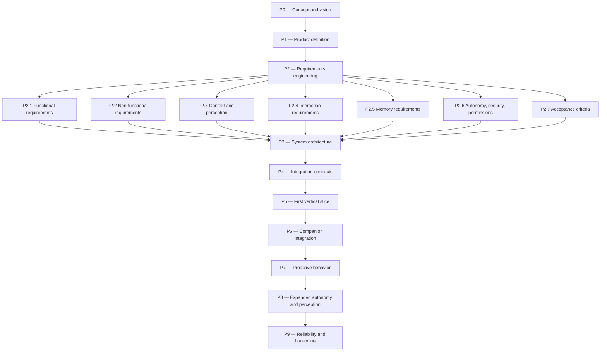

------------------------------------------------------------------------

## 3.5 P2.1 discussion progress

**Status:** Complete — approved functional requirements baseline and first
vertical-slice scope.

P2.1 requirements FR-001–FR-224 are approved where assigned; unused
identifier gaps remain reserved and are not missing requirements. The full
product scope is distinguished from first-slice membership. The agreed
voice modes, desktop-awareness levels, window interaction, application and
file capabilities, task model, autonomy defaults, embodied character
control, failure behavior and memory continuity are recorded in Section 4.
The first vertical slice and its AC-001–AC-011 traceability are recorded in
Section 6 and Section 7.

Detailed permissions remain with P2.6, measurable non-functional targets
with P2.2, interaction/perception refinements with P2.3/P2.4, detailed test
procedures and execution with P2.7, and implementation choices with P3.

## 3.6 P2.5 memory requirements progress

**Workstream status:** Design and requirements baseline complete.  
**Verification status:** Acceptance criteria defined; detailed test cases and execution are assigned to P2.7.

| Memory area | Decision status | Remaining work / dependency |
|---|---|---|
| Historical and source archive | Approved | Implement retention and deletion controls in P3; verify in P2.7 |
| Episodic, semantic, procedural, working and task memory | Approved conceptual model | Map to architecture in P3 |
| Temporal knowledge graph and entity resolution | Approved conceptual model | Select representation and algorithms in P3 |
| Autonomous formation and consolidation | Approved | Implement permitted-source capture, evidence validation and lineage in P3 |
| Epistemic states and uncertainty | Approved | Calibrate confidence and promotion thresholds through evaluation |
| Associative reinforcement | Approved conceptual model | Empirically calibrate evidence weights and maintenance behavior |
| Freshness and temporal validity | Approved | Define class-specific freshness behavior; numerical targets remain implementation/evaluation work |
| Hybrid retrieval and context assembly | Approved conceptual model | Select indexes, ranking strategy and budgets in P3/P2.2 |
| Provenance and record integrity | Approved | Implement versioning, source lineage and idempotent updates in P3 |
| Conversation retention and temporary mode | Approved | Implement controls and test isolation in P3/P2.7 |
| Sensitivity and retention classes | Approved | Integrate with P2.6 authorization and implementation |
| Granular access and derived-memory restrictions | Approved | Integrate with the authoritative permission model in P2.6 |
| Cross-project promotion and sharing | Approved | Implement and test scope isolation and revocation |
| Correction, forgetting and deletion | Approved | Implement propagation, tombstones and verification |
| Memory transparency and review | Approved | Implement user-facing inspection and management interface |
| Export and portability | Approved requirement | Select open export schema and package format in P3 |
| Security, external processing and failure behavior | Approved requirements | Select implementation controls in P3; quantitative NFRs in P2.2 |
| Acceptance criteria | Defined in Section 12.17 | Detailed test cases and execution in P2.7 |

P2.5 closes the product-level memory requirements and governance design. It does not claim that memory implementation or verification is complete.

# 4. P2.1 --- Functional requirements

**Workstream status:** Complete — product-functional requirements reviewed and approved\
**Scope:** Define observable functions LIA is expected to provide,
without selecting the implementation technology.

All FR requirements in this chapter are approved product-level
commitments. Approval does not mean implementation or verification. The
first vertical slice is a subset of this full product baseline and is
specified separately in Section 6.

Functional requirements describe system behavior: what input or event is
handled, what operation is performed, and what result is made available.
Performance thresholds belong in P2.2. Detailed permission rules belong
in P2.6, although functional requirements must acknowledge that actions
are authorization-gated.

## 4.1 Functional scope and exclusions

P2.1 covers the functional behavior of:

-   Presence and lifecycle.
-   Desktop and operating-system context.
-   Voice and text communication.
-   Character embodiment and expression.
-   Window and input interaction.
-   Application and file interaction.
-   Memory and continuity.
-   Proactive behavior and task execution.
-   Configuration and user control.
-   Runtime health and recovery.
-   Spatial modeling of the desktop environment.
-   Desktop configuration and cross-window interaction.
-   Hybrid input and application-control mechanisms.
-   Task planning, scheduling, dependencies, and adaptive execution.
-   Autonomous memory formation, consolidation, retrieval, and governance.

P2.1 does **not** decide:

-   Programming languages, frameworks, libraries, databases, or model
    providers.
-   Exact latency, frame-rate, CPU, memory, or reliability targets.
-   Detailed consent flows, authorization tiers, threat models, or data
    retention periods.
-   Final animation assets, character rig, or visual design.
-   Exact internal service topology or IPC protocol.

Those topics belong to P2.2--P2.6 and P3.

## 4.2 Presence and lifecycle

  -------------------------------------------------------------------------
  ID               Requirement                    Priority Status
  ---------------- ----------------- --------------------- ----------------
  FR-001           LIA shall be able                    P0 Approved
                   to maintain a                           
                   persistent                              
                   desktop presence                        
                   beyond an                               
                   individual                              
                   conversation.                           

  FR-002           LIA shall expose                     P1 Approved
                   her current                             
                   lifecycle state,                        
                   including                               
                   initializing,                           
                   available,                              
                   conversing,                             
                   acting, paused,                         
                   and sleeping                            
                   where applicable.                       

  FR-003           LIA shall support                    P0 Approved
                   user-controlled                         
                   pause and resume                        
                   of autonomous                           
                   interactions.                           

  FR-004           LIA shall                            P0 Approved
                   distinguish                             
                   conversational                          
                   availability from                       
                   permission to                           
                   observe or                              
                   operate the                             
                   computer.                               

  FR-005           LIA shall restore                    P0 Approved
                   the supported                           
                   portions of her                         
                   user                                    
                   configuration and                       
                   persistent                              
                   context after a                         
                   restart.                                

  FR-006           LIA shall                            P0 Approved
                   communicate when                        
                   a capability is                         
                   unavailable,                            
                   disabled, or                            
                   suspended rather                        
                   than silently                           
                   behaving as if it                       
                   were active.                            
  -------------------------------------------------------------------------

## 4.3 Environmental and desktop context

| ID | Requirement | Priority | Status |
|---|---|---:|---|
| FR-010 | LIA shall be able to identify the currently active application and active window when the platform adapter supports it. | P0 | Approved |
| FR-011 | LIA shall be able to retrieve basic metadata about visible windows, including title and window identity where available. | P0 | Approved |
| FR-012 | LIA shall be able to detect relevant desktop events, such as application launch, application exit, window focus change, and workspace change, where supported. | P1 | Approved |
| FR-013 | LIA shall be able to capture and analyze screen content on demand when the relevant screen-perception capability has been explicitly enabled. | P0 | Approved |
| FR-014 | LIA shall be able to extract text from permitted screen content when text extraction is available. | P1 | Approved |
| FR-015 | LIA shall be able to associate observed desktop context with the current conversation or task when relevant. | P1 | Approved |
| FR-016 | LIA shall distinguish directly observed facts from inferred user intent or activity. | P0 | Approved |
| FR-017 | LIA shall be able to inspect process information in read-only mode when the relevant capability is available. | P1 | Approved |
| FR-018 | LIA shall not treat unavailable, stale, or incomplete desktop observations as confirmed current facts. | P0 | Approved |
| FR-019 | LIA shall support optional ongoing screen-context perception when explicitly enabled, with a visible active-state indicator, configurable scope, and an immediate user-accessible pause control. | P1 | Approved |

## 4.4 Communication and conversation

| ID | Requirement | Priority | Status |
|---|---|---:|---|
| FR-020 | LIA shall support text-based user interaction. | P0 | Approved |
| FR-021 | LIA shall support voice input and spoken responses through independently configurable push-to-talk, continuous-conversation and wake-word activation modes; microphone access shall remain user-controlled and the active listening state shall be visible. | P0 | Approved |
| FR-022 | When continuous-conversation mode is enabled, LIA shall support subsequent user speech turns without requiring manual activation for each utterance; this mode shall not imply microphone access when the mode is disabled. | P0 | Approved |
| FR-023 | LIA shall maintain conversational context across multiple turns within a conversation. | P0 | Approved |
| FR-024 | LIA shall support user interruption of spoken output. | P0 | Approved |
| FR-025 | LIA shall provide an immediate user-accessible way to pause or end an active listening/conversation session and visibly indicate when listening has stopped or resumed. | P0 | Approved |
| FR-026 | LIA shall be able to initiate a conversation when proactive interaction is enabled and applicable conditions are satisfied. | P1 | Approved |
| FR-027 | LIA shall be able to communicate the reason for a context-triggered suggestion when doing so is useful and appropriate. | P1 | Approved |
| FR-028 | LIA shall support text interaction as an independently usable interaction mode, including when voice input or output is unavailable. | P0 | Approved |
| FR-029 | LIA shall preserve the distinction between a conversational response, a proposed action, and an action that has actually been executed. | P0 | Approved |

## 4.5 Embodiment, animation, and expression

  ------------------------------------------------------------------------
  ID               Requirement                   Priority Status
  ---------------- ---------------- --------------------- ----------------
  FR-030           LIA shall render                    P0 Approved
                   a persistent                           
                   character                              
                   representation                         
                   on the desktop                         
                   when embodiment                        
                   is enabled.                            

  FR-031           LIA shall                           P0 Approved
                   support idle                           
                   behavior when no                       
                   immediate                              
                   interaction or                         
                   task is active.                        

  FR-032           LIA shall                           P0 Approved
                   express                                
                   supported                              
                   interaction                            
                   states through                         
                   visual behavior,                       
                   such as                                
                   listening,                             
                   speaking,                              
                   thinking,                              
                   reacting, and                          
                   acting.                                

  FR-033           LIA shall                           P1 Approved
                   support facial                         
                   expressions,                           
                   gestures, poses,                       
                   and body                               
                   movement as                            
                   distinct                               
                   expressive                             
                   outputs.                               

  FR-034           LIA shall be                        P1 Approved
                   able to direct                         
                   attention toward                       
                   a relevant                             
                   desktop target                         
                   when spatial                           
                   context is                             
                   available.                             

  FR-035           LIA shall be                        P0 Approved
                   able to                                
                   coordinate an                          
                   expressive                             
                   animation with                         
                   an authorized                          
                   desktop action.                        

  FR-036           LIA shall                           P0 Approved
                   continue to                            
                   render                                 
                   appropriate                            
                   character                              
                   behavior when                          
                   the language                           
                   model is delayed                       
                   or unavailable,                        
                   provided the                           
                   rendering                              
                   subsystem                              
                   remains                                
                   operational.                           

  FR-037           LIA shall allow                     P0 Approved
                   the user to                            
                   hide,                                  
                   reposition, or                         
                   otherwise                              
                   control the                            
                   character's                            
                   desktop                                
                   presence.                              
  ------------------------------------------------------------------------

## 4.6 Operating-system and input interaction

  ---------------------------------------------------------------------------
  ID               Requirement                      Priority Status
  ---------------- ------------------- --------------------- ----------------
  FR-040           LIA shall expose a                     P0 Approved
                   common set of                             
                   abstract desktop                          
                   operations to the                         
                   agent core, with                          
                   platform-specific                         
                   implementations                           
                   supplied by OS                            
                   adapters.                                 

  FR-041           LIA shall be able                      P0 Approved
                   to enumerate or                           
                   retrieve supported                        
                   window information.                       

  FR-042           LIA shall be able                      P0 Approved
                   to focus, minimize,                       
                   maximize, restore,                        
                   and close windows                         
                   where supported and                       
                   authorized.                               

  FR-043           LIA shall be able                      P0 Approved
                   to move and resize                        
                   windows where                             
                   supported and                             
                   authorized.                               

  FR-044           LIA shall be able                      P0 Approved
                   to launch an                              
                   application through                       
                   an available                              
                   platform mechanism                        
                   when authorized.                          

  FR-045           LIA shall be able                      P1 Approved
                   to send controlled                        
                   keyboard and                              
                   pointer input when                        
                   the relevant                              
                   capability is                             
                   enabled and                               
                   authorized.                               

  FR-046           LIA shall report                       P0 Approved
                   whether a requested                       
                   OS operation                              
                   succeeded, failed,                        
                   was unsupported, or                       
                   was not attempted.                        

  FR-047           LIA shall verify                       P0 Approved
                   the resulting                             
                   desktop state when                        
                   verification is                           
                   available, rather                         
                   than assuming that                        
                   issuing an                                
                   operation means it                        
                   succeeded.                                

  FR-048           LIA shall not                          P0 Approved
                   silently substitute                       
                   a materially                              
                   different operation                       
                   when the requested                        
                   operation is                              
                   unsupported.                              

  FR-049           LIA shall be able                      P1 Approved
                   to present an                             
                   action plan or                            
                   preview before                            
                   executing a                               
                   multi-step desktop                        
                   operation when                            
                   required by its                           
                   authorization                             
                   policy.                                   
  ---------------------------------------------------------------------------

## 4.7 Application, web, and file interaction

  ------------------------------------------------------------------------------
  ID               Requirement                         Priority Status
  ---------------- ---------------------- --------------------- ----------------
  FR-050           LIA shall be able to                      P1 Approved
                   interact with                                
                   supported desktop                            
                   applications through                         
                   available application                        
                   interfaces or                                
                   permitted UI                                 
                   interaction.                                 

  FR-051           LIA shall be able to                      P1 Approved
                   open and navigate web                        
                   pages through an                             
                   available browser                            
                   interaction                                  
                   capability.                                  

  FR-052           LIA shall be able to                      P1 Approved
                   locate files and                             
                   folders within                               
                   user-authorized                              
                   locations.                                   

  FR-053           LIA shall be able to                      P1 Approved
                   read file content when                       
                   the file type is                             
                   supported and access                         
                   is authorized.                               

  FR-054           LIA shall be able to                      P1 Approved
                   create and edit files                        
                   within user-authorized                       
                   locations when the                           
                   relevant operation is                        
                   supported.                                   

  FR-055           LIA shall be able to                      P1 Approved
                   move, rename, and                            
                   organize files when                          
                   authorized.                                  

  FR-056           LIA shall distinguish                     P0 Approved
                   reversible file                              
                   operations from                              
                   destructive or                               
                   difficult-to-reverse                         
                   operations.                                  

  FR-057           LIA shall provide an                      P0 Approved
                   execution result for                         
                   application, browser,                        
                   and file operations.                         

  FR-058           LIA shall be able to                      P1 Approved
                   maintain task context                        
                   while switching                              
                   between supported                            
                   applications or tools.                       
  ------------------------------------------------------------------------------

## 4.8 Memory and continuity

  ------------------------------------------------------------------------
  ID               Requirement                   Priority Status
  ---------------- ---------------- --------------------- ----------------
  FR-060           LIA shall retain                    P0 Approved
                   conversational                         
                   context for the                        
                   duration of an                         
                   active                                 
                   conversation.                          

  FR-061           LIA shall retain                    P0 Approved
                   selected and autonomously                
                   formed information                        
                   across sessions under                    
                   the approved memory                       
                   policy and user                          
                   controls.                               

  FR-062           LIA shall be                        P1 Approved
                   able to retain                         
                   task state so                          
                   that an                                
                   interrupted task                       
                   can be resumed                         
                   when sufficient                        
                   state is                               
                   available.                             

  FR-063           LIA shall                           P0 Approved
                   retrieve                               
                   relevant stored                        
                   context when                           
                   responding to a                        
                   conversation or                        
                   performing a                           
                   task.                                  

  FR-064           LIA shall be                        P1 Approved
                   able to                                
                   associate                              
                   memories with                          
                   relevant                               
                   projects, tasks,                       
                   people, and                            
                   prior                                  
                   interactions                           
                   where such                             
                   associations are                       
                   available.                             

  FR-065           LIA shall                           P0 Approved
                   distinguish                            
                   stored                                 
                   information from                       
                   assumptions or                         
                   newly generated                        
                   inferences.                            

  FR-066           LIA shall                           P0 Approved
                   support                                
                   correction of                          
                   inaccurate                             
                   stored user                            
                   information.                           

  FR-067           LIA shall                           P0 Approved
                   support                                
                   user-requested                         
                   review and                             
                   deletion of                            
                   stored memories,                       
                   subject to the                         
                   memory policy                          
                   defined in P2.5                        
                   and P2.6.                              

  FR-068           LIA shall not                       P0 Approved
                   claim to                               
                   remember                               
                   information that                       
                   is not present                         
                   in accessible                          
                   memory or                              
                   current context.                       
  ------------------------------------------------------------------------

## 4.9 Proactive behavior and autonomous tasks

  ------------------------------------------------------------------------
  ID               Requirement                   Priority Status
  ---------------- ---------------- --------------------- ----------------
  FR-070           LIA shall be                        P1 Approved
                   able to initiate                       
                   a social                               
                   interaction                            
                   without an                             
                   immediate user                         
                   prompt when                            
                   social autonomy                        
                   is enabled.                            

  FR-071           LIA shall be                        P1 Approved
                   able to generate                       
                   context-aware                          
                   suggestions from                       
                   permitted                              
                   desktop context                        
                   and relevant                           
                   memory.                                

  FR-072           LIA shall be                        P1 Approved
                   able to identify                       
                   a potential                            
                   follow-up action                       
                   from an active                         
                   or interrupted                         
                   task.                                  

  FR-073           LIA shall be                        P1 Approved
                   able to create                         
                   and maintain a                         
                   task plan for an                       
                   authorized goal.                       

  FR-074           LIA shall be                        P1 Approved
                   able to execute                        
                   delegated task                         
                   steps within the                       
                   granted                                
                   operational                            
                   permissions.                           

  FR-075           LIA shall be                        P0 Approved
                   able to pause,                         
                   cancel, or                             
                   abandon an                             
                   autonomous task                        
                   when instructed                        
                   by the user or                         
                   when a required                        
                   condition is no                        
                   longer                                 
                   satisfied.                             

  FR-076           LIA shall                           P0 Approved
                   provide the user                       
                   with the current                       
                   status of an                           
                   ongoing                                
                   autonomous task.                       

  FR-077           LIA shall                           P0 Approved
                   request                                
                   additional                             
                   information or                         
                   authorization                          
                   when a task                            
                   cannot safely or                       
                   correctly                              
                   proceed.                               

  FR-078           LIA shall                           P0 Approved
                   distinguish a                          
                   suggestion, a                          
                   plan, a pending                        
                   action, and a                          
                   completed action                       
                   in its                                 
                   communication                          
                   and task state.                        

  FR-079           LIA shall                           P0 Approved
                   respect                                
                   configured quiet                       
                   periods,                               
                   interruption                           
                   preferences, and                       
                   pause controls                         
                   when initiating                        
                   proactive                              
                   interactions.                          

  FR-080           LIA shall avoid                     P1 Approved
                   repeating a                            
                   dismissed                              
                   proactive                              
                   suggestion                             
                   unless                                 
                   materially new                         
                   context                                
                   justifies                              
                   raising it                             
                   again.                                 
  ------------------------------------------------------------------------

## 4.10 Configuration and user control

  -------------------------------------------------------------------------
  ID               Requirement                    Priority Status
  ---------------- ----------------- --------------------- ----------------
  FR-090           LIA shall provide                    P0 Approved
                   user controls for                       
                   enabling and                            
                   disabling major                         
                   capabilities                            
                   independently.                          

  FR-091           LIA shall provide                    P0 Approved
                   separate controls                       
                   for social,                             
                   cognitive,                              
                   operational, and                        
                   temporal                                
                   autonomy.                               

  FR-092           LIA shall allow                      P0 Approved
                   the user to                             
                   configure how and                       
                   when proactive                          
                   interactions may                        
                   occur.                                  

  FR-093           LIA shall provide                    P0 Approved
                   a way to inspect                        
                   the permissions                         
                   and capabilities                        
                   currently                               
                   enabled.                                

  FR-094           LIA shall provide                    P0 Approved
                   a way to revoke                         
                   previously                              
                   granted                                 
                   capability                              
                   access.                                 

  FR-095           LIA shall expose                     P0 Approved
                   a user-accessible                       
                   pause or stop                           
                   control for                             
                   autonomous                              
                   activity.                               

  FR-096           LIA shall allow                      P1 Approved
                   the user to                             
                   configure                               
                   character                               
                   visibility and                          
                   relevant                                
                   presentation                            
                   behavior.                               
  -------------------------------------------------------------------------

**Initial autonomy defaults**

| ID | Requirement | Priority | Status |
|---|---|---:|---|
| FR-097 | Unless changed by the user, initial configuration shall set social autonomy to Off, cognitive autonomy to On, operational autonomy to Restricted (direct user requests may execute only when the current permission authority grants the required capability), and temporal autonomy to Off. Each dimension shall remain independently configurable; these defaults shall not replace the authoritative permission check. | P0 | Approved |

## 4.11 Runtime self-management

  -------------------------------------------------------------------------
  ID               Requirement                    Priority Status
  ---------------- ----------------- --------------------- ----------------
  FR-100           LIA shall monitor                    P1 Approved
                   the operational                         
                   state of her                            
                   major runtime                           
                   subsystems.                             

  FR-101           LIA shall                            P1 Approved
                   identify when a                         
                   subsystem becomes                       
                   unavailable or                          
                   unhealthy.                              

  FR-102           LIA shall isolate                    P1 Approved
                   recoverable                             
                   subsystem                               
                   failures where                          
                   possible so that                        
                   one failure does                        
                   not unnecessarily                       
                   terminate                               
                   unrelated                               
                   capabilities.                           

  FR-103           LIA shall attempt                    P1 Approved
                   recovery of                             
                   eligible failed                         
                   subsystems                              
                   according to a                          
                   defined recovery                        
                   policy.                                 

  FR-104           LIA shall report                     P1 Approved
                   significant                             
                   failures and                            
                   degraded                                
                   capabilities to                         
                   the user in an                          
                   understandable                          
                   manner.                                 

  FR-105           LIA shall expose                     P1 Approved
                   enough diagnostic                       
                   information to                          
                   support                                 
                   troubleshooting                         
                   without exposing                        
                   secrets or                              
                   sensitive data                          
                   unnecessarily.                          
  -------------------------------------------------------------------------

------------------------------------------------------------------------

## 4.12 Desktop as a spatial environment

The desktop is treated as LIA's environment, not merely as a collection of unrelated application handles. Windows, application surfaces and desktop objects are identifiable objects with spatial properties and relationships. These capabilities are subject to platform support and user permissions.

| ID | Requirement | Priority | Status |
|---|---|---:|---|
| FR-110 | LIA shall be able to represent the available desktop topology, including monitors, display boundaries, workspaces and supported coordinate spaces. | P0 | Approved |
| FR-111 | LIA shall be able to maintain spatial information about windows and supported desktop objects, including position, dimensions, visibility and stacking/layer state where available. | P0 | Approved |
| FR-112 | LIA shall be able to derive spatial relationships between desktop objects, such as overlap, adjacency, relative position and available screen regions, when sufficient information is available. | P1 | Approved |
| FR-113 | LIA shall update her spatial representation when relevant desktop changes are observed or when an operation changes the environment. | P0 | Approved |
| FR-114 | LIA shall be able to relate her own rendered position, orientation and attention target to desktop objects for embodied interaction. | P1 | Approved |
| FR-115 | LIA shall distinguish directly available geometric information from inferred or uncertain spatial relationships. | P0 | Approved |

## 4.13 Expanded window-management capabilities

The full product scope includes discovery, manipulation, organization and lifecycle operations. The first vertical slice may implement only a subset.

| ID | Requirement | Priority | Status |
|---|---|---:|---|
| FR-120 | LIA shall be able to discover and enumerate supported windows and retrieve their relevant state and metadata. | P0 | Approved |
| FR-121 | LIA shall be able to focus, move, resize, minimize, maximize, restore and close windows where supported and authorized. | P0 | Approved |
| FR-122 | LIA shall be able to arrange, tile, snap and reposition windows across supported monitors and workspaces. | P1 | Approved |
| FR-123 | LIA shall be able to launch supported applications and manage their windows through available platform mechanisms. | P0 | Approved |
| FR-124 | When LIA physically represents a window operation through character movement or gestures, the animation shall be coordinated with the actual operation and its result. | P0 | Approved |
| FR-125 | LIA shall verify the resulting window state when verification is available and shall not represent an unsuccessful operation as completed. | P0 | Approved |

## 4.14 Application interaction and per-application permission model

Application support is a product-level capability. The set of applications receiving early integration support remains a release-planning decision.

| ID | Requirement | Priority | Status |
|---|---|---:|---|
| FR-130 | LIA shall be able to interact with supported application controls, including buttons, menus, text fields, forms, tabs, dialogs, toolbars and other interactive elements. | P0 | Approved |
| FR-131 | Application access shall be configurable per application and distinguish at least observation, interaction and modification capabilities. | P0 | Approved |
| FR-132 | Application permissions shall be inspectable and revocable, and shall be enforced regardless of the interaction mechanism used. | P0 | Approved |
| FR-133 | Permission to modify an application shall not automatically authorize every consequential operation within it; sensitive operations may require additional authorization or confirmation. | P0 | Approved |

The three application capability classes are:

- **Observe:** Inspect the permitted application state and contents.
- **Interact:** Navigate and operate controls, including clicking, typing, scrolling and switching tabs.
- **Modify:** Change content or application data and perform operations such as saving, submitting forms, uploading or downloading.

These classes are independent. Granting one does not automatically grant the others. Detailed permission scopes and sensitive-operation policy belong in P2.6.

## 4.15 File-system interaction

LIA's product scope includes both direct file-system operations and embodied interaction through a file-manager application. These are alternative execution methods for the same user-authorized file-system capabilities.

| ID | Requirement | Priority | Status |
|---|---|---:|---|
| FR-140 | LIA shall be able to discover, search, enumerate and inspect files and directories within authorized locations. | P0 | Approved |
| FR-141 | LIA shall be able to read and understand supported file formats when access is authorized. | P0 | Approved |
| FR-142 | LIA shall be able to create files, directories and project structures within authorized locations. | P1 | Approved |
| FR-143 | LIA shall be able to modify supported documents, source files and configuration files within authorized locations. | P1 | Approved |
| FR-144 | LIA shall be able to copy, move, rename, organize and sort files and directories within authorized locations. | P1 | Approved |
| FR-145 | LIA shall be able to delete files and use trash or recovery mechanisms where supported and authorized. | P1 | Approved |
| FR-146 | LIA shall support both direct file-system operations and interactive file-manager operations. Both methods shall enforce the same authorization boundaries and provide verifiable results. | P0 | Approved |

## 4.16 Desktop-environment navigation and configuration

LIA's desktop interaction scope extends beyond individual application windows to the desktop environment itself.

| ID | Requirement | Priority | Status |
|---|---|---:|---|
| FR-150 | LIA shall be able to inspect supported display topology, monitors, workspaces, panels, docks, launchers, desktop icons and relevant desktop objects. | P1 | Approved |
| FR-151 | LIA shall be able to navigate and organize supported workspaces and monitor arrangements. | P1 | Approved |
| FR-152 | LIA shall be able to configure supported desktop elements, including workspace arrangements, panels, docks and display settings, when authorized. | P1 | Approved |
| FR-153 | LIA shall be able to observe and interact with supported desktop notifications and system-level interface elements within the granted permissions. | P1 | Approved |
| FR-154 | LIA shall report when a desktop configuration operation is unavailable or behaves differently because of platform or desktop-environment limitations. | P0 | Approved |

## 4.17 Human-like input and hybrid interaction

LIA's eventual input capability includes pointer, keyboard, scrolling, drag-and-drop and interaction with application controls. The product shall not be restricted to simulated mouse and keyboard input alone.

| ID | Requirement | Priority | Status |
|---|---|---:|---|
| FR-160 | LIA shall support pointer movement, hover, clicking, double-clicking, right-clicking, click-and-hold, dragging, dropping, text selection and scrolling where supported and authorized. | P0 | Approved |
| FR-161 | LIA shall support text entry, individual key input, key combinations, shortcuts and keyboard-driven navigation where supported and authorized. | P0 | Approved |
| FR-162 | LIA shall be able to interact with recognized application controls through suitable input or semantic interaction mechanisms. | P0 | Approved |
| FR-163 | LIA shall support a hybrid interaction model combining direct input simulation, accessibility or application interfaces, and visual perception-driven interaction. | P0 | Approved |
| FR-164 | LIA shall select an appropriate interaction mechanism based on the task, available platform/application capabilities and expected reliability. | P1 | Approved |
| FR-165 | All interaction mechanisms shall use common authorization, action-planning, execution-result and verification rules. | P0 | Approved |
| FR-166 | Where an interaction is represented through LIA's physical embodiment, character movement and the actual input or application operation shall remain coordinated. | P1 | Approved |

The hybrid model is a product-level design direction. It does not select a programming language, accessibility framework, UI automation library or computer-vision implementation; those choices remain for P3.

## 4.18 Task management, scheduling and autonomous execution

LIA shall maintain an ongoing, inspectable task system. A task may originate from a direct user instruction, a delegated objective, a schedule, an observed event or LIA's own memory-informed initiative.

| ID | Requirement | Priority | Status |
|---|---|---:|---|
| FR-170 | LIA shall maintain a persistent, user-visible task queue. | P0 | Approved |
| FR-171 | LIA shall represent work hierarchically as an objective, a plan containing steps, and the individual actions that execute those steps. | P0 | Approved |
| FR-172 | LIA shall record a task's origin, objective, plan, dependencies, required capabilities and authorization basis, status, progress, execution history, blockers and outcome. | P0 | Approved |
| FR-173 | LIA shall support task states including Queued, Running, Blocked, Paused, Completed, Cancelled and Failed. | P0 | Approved |
| FR-174 | LIA shall distinguish task creation, planning and execution as separate operations with separately governed authority. | P0 | Approved |
| FR-175 | LIA shall use relevant user memory, conversations, preferences, goals and permitted environmental context to identify potentially useful tasks and propose or create them within configured autonomy. | P1 | Approved |
| FR-176 | LIA shall be able to execute tasks within valid standing authorization without requesting approval for every individual step. | P0 | Approved |
| FR-177 | Before beginning an autonomously initiated task, LIA shall notify the user. This notification shall not be presented as an approval request when execution is already authorized. | P0 | Approved |
| FR-178 | When a task requires an operation outside the available authorization scope, LIA shall block that operation and request the necessary authorization or revise the plan. | P0 | Approved |
| FR-179 | LIA shall distinguish one-time authorization from standing authorization and shall not silently broaden the scope of either. | P0 | Approved |
| FR-180 | LIA shall support task priority categories of Critical, High, Normal, Low and Someday. | P1 | Approved |
| FR-181 | LIA shall support immediate, background, idle-time, scheduled, deadline-driven, event-triggered and deferred execution modes. | P1 | Approved |
| FR-182 | LIA shall support sequential, parallel, conditional, parent-child and recurring task relationships. | P1 | Approved |
| FR-183 | LIA shall classify execution needs, including background-safe, low-interference, desktop-interactive, user-dependent and resource-intensive work. | P1 | Approved |
| FR-184 | LIA shall be able to reprioritize and reschedule tasks as circumstances change while respecting explicit user-assigned priorities and communicating meaningful changes. | P0 | Approved |
| FR-185 | LIA shall be able to checkpoint, pause, cancel and safely resume tasks, verifying the current environment before repeating operations that may already have taken effect. | P0 | Approved |
| FR-186 | LIA shall distinguish Blocked from Failed, and shall mark a task Completed only when its intended outcome has been verified to the extent possible. | P0 | Approved |
| FR-187 | LIA shall avoid disrupting active user work with desktop-interactive tasks while allowing suitable background-safe tasks to continue when their authorization and resource conditions are satisfied. | P0 | Approved |
| FR-188 | LIA shall make task status, blockers, progress and significant execution history available to the user. | P0 | Approved |

**Task priority and scheduling principles:** Priority, urgency and deadline are separate attributes. LIA may adapt execution order when dependencies become available, deadlines approach or circumstances change, but shall not silently downgrade an explicit user priority merely because another task appears more interesting. Meaningful schedule changes should be communicated.

**Notification versus approval:** Notification informs the user that authorized autonomous work is about to begin. Approval is required only when the operation is not covered by valid authorization or when the operation's risk policy requires additional authorization or confirmation.

## 4.19 Memory formation, organization and associative learning

Memory is a foundational capability for LIA's persistent identity, cognitive continuity and autonomous initiative. The design direction is a hybrid, multi-layered memory system with a temporal knowledge graph as its relational backbone, not as the only storage representation.

| ID | Requirement | Priority | Status |
|---|---|---:|---|
| FR-190 | LIA shall maintain a searchable historical archive of permitted conversations, meaningful experiences, decisions, task events and retained source materials. | P0 | Approved |
| FR-191 | LIA shall autonomously identify candidate memories from permitted experiences without requiring the user to explicitly issue a remember command each time. | P0 | Approved |
| FR-192 | LIA shall organize information into complementary memory forms, including episodic, semantic, procedural, working and task memory. | P0 | Approved |
| FR-193 | LIA shall represent relevant entities and typed relationships in a temporal knowledge graph, including links to source episodes and supporting evidence. | P0 | Approved |
| FR-194 | Memory records shall preserve provenance and distinguish explicit statements, direct observations, inferred information and confirmed facts. | P0 | Approved |
| FR-195 | LIA shall maintain distinct measures for association strength, factual confidence, importance and current retrieval activation. | P1 | Approved |
| FR-196 | LIA shall reinforce meaningful associations when supported by repeated, sufficiently independent experiences or strong explicit evidence, using consolidation thresholds that can be evaluated and calibrated. | P1 | Approved |
| FR-197 | Association reinforcement shall not be based solely on concepts co-occurring or on a memory being retrieved repeatedly; retrieval alone shall not be treated as new evidence of truth. | P0 | Approved |
| FR-198 | LIA shall consolidate recurring information into durable memories while preserving the original source history and the distinction between candidate, consolidated and strongly supported associations. | P1 | Approved |
| FR-199 | LIA shall reconcile contradictory or superseding information while preserving historical records and representing what is currently believed to be valid. | P0 | Approved |
| FR-200 | Memory records shall distinguish when information was valid from when LIA learned or recorded it, enabling historical and current-state queries. | P1 | Approved |
| FR-201 | LIA shall support correction, inspection and user-requested deletion of memories, with appropriate propagation to derived summaries, graph relationships and retrieval indexes. | P0 | Approved |
| FR-202 | LIA shall apply retention and privacy rules to the historical archive. The archive shall not imply unrestricted or indefinite retention of raw microphone streams, screen frames or other sensitive observations. | P0 | Approved |

**Memory formation and consolidation principles**

LIA should autonomously form candidate memories and consolidate information according to its type, evidence and significance. An explicit user statement may establish a high-confidence memory immediately; weaker inferences generally require stronger or repeated evidence.

Associations may strengthen through meaningful, independent experiences. Co-occurrence alone is insufficient to establish a semantic relationship. Association strength, confidence, importance and retrieval activation must remain separate.

Temporal decay should primarily affect retrieval activation or the relevance of temporary/contextual information. It must not silently erase historically verified facts or important decisions merely because time has passed. Contradictions and changed information should be reconciled with provenance rather than handled through blind overwrites.

The historical archive stores permitted records and source evidence. It is not an unrestricted recorder of every screen frame, audio sample or desktop observation.

## 4.20 Memory retrieval and context assembly

The retrieval system shall identify what information is needed for the current conversation, task or proactive activity, search the relevant memory representations, validate the evidence and assemble a bounded working context.

| ID | Requirement | Priority | Status |
|---|---|---:|---|
| FR-210 | LIA shall determine the information need and create a retrieval plan appropriate to the current query, task or event. | P0 | Approved |
| FR-211 | LIA shall support complementary retrieval methods, including semantic, lexical, structured, graph-based, temporal and source-archive retrieval. | P0 | Approved |
| FR-212 | LIA shall be able to traverse typed knowledge-graph relationships to retrieve relevant multi-hop context, with bounded and task-appropriate expansion. | P1 | Approved |
| FR-213 | LIA shall rank candidate memories using relevant signals such as semantic and lexical relevance, relationship relevance, temporal validity, source authority, confidence and current context. | P0 | Approved |
| FR-214 | LIA shall resolve temporal validity and identify stale, superseded, conflicting or incomplete information before using it as current fact. | P0 | Approved |
| FR-215 | LIA shall retrieve original source material when extracted memories or summaries are insufficient for a reliable answer or action. | P0 | Approved |
| FR-216 | LIA shall assemble a bounded working context containing relevant memories, source references, temporal status and uncertainty labels. | P0 | Approved |
| FR-217 | LIA shall distinguish current facts, historical facts, explicit statements, observations and inferences within assembled context. | P0 | Approved |
| FR-218 | LIA shall be able to retrieve likely relevant context in anticipation of a task or interaction, without treating retrieval itself as authorization to act. | P1 | Approved |
| FR-219 | LIA shall retain a retrieval trace sufficient to explain which memory sources and relationships contributed to a response or plan. | P1 | Approved |
| FR-220 | LIA shall acknowledge insufficient or contradictory evidence rather than manufacture a memory or force an unsupported conclusion. | P0 | Approved |
| FR-221 | LIA shall refresh relevant live environmental state before acting when historical memory cannot establish the current state of an application, window, process or file. | P0 | Approved |

**Retrieval principles**

Retrieval is context-dependent. Casual conversation, historical questions, project work, task resumption and proactive planning may require different combinations of memory sources.

The system should merge and deduplicate candidates from multiple sources, expand relevant graph connections progressively, validate evidence, retrieve original sources when needed, and assemble only the context useful for the current reasoning step.

The retrieval engine shall explain why a memory was selected sufficiently to support debugging and review. A memory of a previous approval or action is not, by itself, an authoritative current permission grant; execution must consult the permission system.

**Technology boundary:** Vector indexes, lexical indexes, graph traversal, temporal indexes and structured search are capability concepts. The concrete database, graph engine, embedding model, indexing infrastructure and orchestration framework have not been selected and remain for P3.

**Requirement register note:** FR identifiers are stable and are not
recycled. Numeric gaps (for example, FR-007–FR-009 or FR-203–FR-209) are
reserved/unassigned, not missing requirements. The register contains
169 assigned FRs.

## 4.21 Cross-cutting interaction integrity requirements

The following requirements clarify safe behavior across window management,
desktop interaction and embodiment. They apply to direct user requests and
autonomous operations alike, subject to the authorization policy.

| ID | Requirement | Priority | Status |
|---|---|---:|---|
| FR-222 | Before manipulating a window, LIA shall identify the intended target and refresh its relevant state; when target identity or destination is ambiguous, stale or unsupported, LIA shall request clarification or report the limitation rather than guess. | P0 | Approved |
| FR-223 | LIA shall not force-close a window or discard unsaved user work. If an application reports unsaved changes, or safe close state cannot be established, LIA shall stop the close operation and obtain the required user decision. | P0 | Approved |
| FR-224 | The user shall be able to drag/reposition, show/hide and pin/lock LIA's character representation. LIA may reposition herself for a direct embodied operation only when permitted by the user's positioning controls; a pinned/locked or manually placed position takes precedence, and unprompted roaming is disabled by default. | P0 | Approved |

# 5. P2.1 decisions and closure

P2.1 product behavior and first-vertical-slice scope have been reviewed.
All product-level decisions in this workstream are closed. Details assigned
to P2.2, P2.3, P2.4, P2.6, P2.7 and P3 are planned dependencies, not open
P2.1 decisions.

## 5.1 Resolved design decisions

| ID | Decision | Resolution | Status |
|---|---|---|---|
| P2.1-D01 | Voice interaction modes | Full product supports independently configurable push-to-talk, continuous conversation, wake-word activation and text interaction. Microphone access remains user-controlled and visible. | Closed |
| P2.1-D02 | Desktop awareness | Full product supports default desktop metadata, permissioned on-demand screen perception and optional continuous screen perception with visible indicator, configurable scope and immediate pause. | Closed |
| P2.1-D03 | Task management | Full product uses a persistent user-visible Objective → Plan → Actions task model and the defined task states. | Closed |
| P2.1-D04 | First-slice window operations | Discover the active or explicitly selected window, inspect supported geometry and move one window within the same display while preserving its dimensions. | Closed |
| P2.1-D05 | File operations in first slice | File-system and file-manager operations remain full-product capabilities but are excluded from the first vertical slice. | Closed |
| P2.1-D06 | Memory retention and consent | Settled by P2.5: autonomous memory formation is governed by source permissions, sensitivity classes, user controls, retention rules and temporary mode. No further P2.1 decision is required. | Closed |
| P2.1-D07 | Character positioning | The user can drag/reposition, show/hide and pin/lock the character. LIA may reposition for a direct embodied operation only within user-configured controls; user placement takes precedence and unprompted roaming is off by default. | Closed |
| P2.1-D08 | First-slice interaction modes | Push-to-talk, text input, spoken output, interruption and explicit session pause/end. Continuous-conversation and wake-word modes remain full-product capabilities but are excluded from the first slice. | Closed |
| P2.1-D09 | Busy-user behavior | Suitable background-safe work may continue when permitted; desktop-interactive work must avoid disrupting active user activity. Tasks checkpoint, pause or defer when safe conditions are absent. | Closed |
| P2.1-D10 | Early application integration order | After the first slice, prioritize web browsers, file managers, code editors and terminals; then document/PDF and office tools, communication/collaboration apps, and creative/media or specialist applications. | Closed |
| P2.1-D11 | Platform implementation sequence | Build the first vertical slice on Linux. Linux and Windows remain first-class product platforms and must be represented in the shared-core/adapter design; macOS is a future extension. | Closed |
| P2.1-D12 | First-slice perception | Use supported desktop metadata and window geometry only. Screen-content capture, text extraction and continuous screen perception are excluded from the first slice. | Closed |
| P2.1-D13 | First-slice proactive autonomy | No unsolicited social conversations, independent scheduled/event-triggered work or autonomous desktop tasks in the first slice. Direct user-requested interaction is supported. | Closed |
| P2.1-D14 | Initial autonomy defaults | Social Off; cognitive On; operational Restricted (direct user requests may execute only when the current permission authority grants the required capability); temporal Off. Each dimension is independently configurable. | Closed |
| P2.1-D15 | Ambiguous window targets | LIA refreshes target state and requests clarification rather than guessing when target identity or destination is ambiguous or stale. | Closed |
| P2.1-D16 | Unsaved user work | LIA never force-closes a window or silently discards unsaved work; uncertain close safety stops the operation for a user decision. | Closed |

## 5.2 Deferred details owned by later workstreams

The following are deliberately deferred and do not prevent P2.1 closure:

| Detail | Owning phase/workstream |
|---|---|
| Quantitative latency, resource, startup, storage and reliability targets | P2.2 |
| Detailed perception scope, freshness and source-event policy | P2.3 |
| Detailed interruption, embodiment, movement and interaction UX | P2.4 |
| Permission grant schema, revocation, risk tiers and confirmation policy | P2.6 |
| Detailed test cases, test fixtures and execution of acceptance criteria | P2.7 |
| Platform APIs, window-control implementation, application adapters, IPC, databases, models and service topology | P3 |

No unresolved product-level P2.1 decision remains.

# 6. First vertical slice — approved scope

**Status:** Approved engineering vertical-slice baseline  
**Purpose:** Prove one complete embodied interaction loop across presence,
conversation, desktop context, OS interaction, authorization, verification
and persistent memory.

The first vertical slice is a technical integration proof. It is not a
feature-complete MVP and does not redefine the full product capabilities
specified in Section 4. It intentionally exercises one safe, observable
computer operation end to end.

## 6.1 Included scope

| Area | First-slice scope | Related functional requirements |
|---|---|---|
| Presence and embodiment | LIA starts as a desktop character, restores permitted presentation configuration, idles and visibly expresses listening, speaking, thinking and acting states. User can hide/show, drag/reposition and pin/lock the character. | FR-001–006, FR-030–037, FR-224 |
| Communication | Push-to-talk voice input, text input, spoken response, multi-turn context within the active session, interruption and user-accessible pause/end. | FR-020–025, FR-028–029 |
| Desktop awareness | Identify the active application/window and retrieve available window identity, title, position, dimensions and display association. Refresh relevant metadata immediately before a window action. | FR-010–011, FR-016, FR-018, FR-110–111, FR-113, FR-115, FR-120, FR-221–222 |
| Window operation | Move one active or explicitly selected supported window to a user-specified position or supported region on the same display. Preserve its dimensions and current workspace. No resizing or cross-display/workspace movement. | FR-040–043, FR-046–048, FR-120–121, FR-124–125, FR-222 |
| Authorization and outcome | Check the currently applicable permission before the operation. A direct instruction authorizes only the requested operation within its scope, not a standing grant. Report actual outcome and verify resulting geometry where supported. | FR-029, FR-046–048, FR-093–095, FR-132, FR-165, FR-222 |
| Embodied operation | When task-bound repositioning is enabled and the user has not manually placed or pinned/locked the character, LIA may position herself for the requested window interaction. If the user has manually placed or pinned/locked the character, that position takes precedence; LIA must use an animation compatible with the position or request that the user reposition/unlock her. The character's approach, grab/push, movement and release correspond to the real operation. A failed or unsupported operation must not be depicted as successful. | FR-032, FR-035, FR-124–125, FR-166, FR-224 |
| Memory continuity | Under the approved P2.5 policy and enabled user controls, retain one explicitly stated ordinary low-sensitivity preference from a permitted interaction, persist it across restart, retrieve it with provenance, and expose it to inspection and deletion. | FR-060–068, FR-190–202, FR-210–220 |
| User control and autonomy | Global pause/stop and clear capability state. Initial autonomy defaults are social Off, cognitive On, operational Restricted and temporal Off. No unprompted social initiation or autonomous task execution in this slice. | FR-003–006, FR-075–079, FR-090–097 |

### Window-movement constraints

The first-slice operation is deliberately narrow:

- One supported window at a time.
- Target is the active window or a user-explicitly selected window.
- If more than one plausible target exists, LIA asks for clarification.
- The destination is expressed as a clear position or supported screen region.
- Window dimensions and workspace remain unchanged.
- The destination must be supported and within the current display work area; LIA must not silently substitute a different destination.
- The operation must be authorized, attempted, reported and verified to the extent the platform permits.
- A stale target or geometry is refreshed before execution; if current state cannot be established, the operation is deferred or declined with an explanation.
- Closing, deleting, resizing, launching, tiling, maximizing, minimizing, restoring, arbitrary keyboard/pointer automation and multi-window sequences are not part of this slice.

### Platform boundary

The first implementation targets one supported Linux desktop environment and one display. The platform adapter must report its actual capabilities and limitations; this slice does not claim universal compatibility across Linux compositors or display servers.

Windows remains a first-class product platform and must be represented in the shared-core/adapter contract established in P3. Windows runtime validation is a separate platform verification milestone before cross-platform support is claimed. macOS remains a future extension.

### Explicit exclusions from the first slice

- Continuous-conversation and wake-word activation modes.
- On-demand screen-content analysis, screen text extraction and continuous screen perception.
- Multiple monitors, workspace changes and desktop-environment configuration.
- Window resize, close, launch, minimize, maximize, restore, tiling, snapping and multi-window arrangement.
- Application-specific controls, browser navigation, file-manager workflows and generic accessibility/UI automation.
- Direct file-system read, create, modify, move, rename or delete operations.
- Independent proactive social conversations, autonomous task creation, scheduling, background task execution and event-triggered actions.
- Full memory graph retrieval, advanced associative consolidation and comprehensive memory export UI; the slice proves one policy-compliant persisted memory and its source-level inspection/deletion path.
- Windows/macOS implementation or claims of platform parity.

These exclusions are sequencing decisions only. The corresponding full-product requirements remain in the approved Section 4 baseline.

## 6.2 First-slice acceptance conditions

The following high-level acceptance conditions define what the vertical slice must demonstrate. P2.7 will turn them into detailed test procedures, fixtures and execution records.

| ID | Acceptance condition | Requirement trace |
|---|---|---|
| AC-001 | LIA starts, renders the character, restores permitted presentation settings and exposes a truthful lifecycle/capability state. | FR-001–006, FR-030–037, FR-090, FR-096, FR-224 |
| AC-002 | The user can initiate push-to-talk or text interaction, receive spoken/text output, interrupt speech and pause/end the active session. No voice capture is represented as active when it is not. | FR-020–025, FR-028–029 |
| AC-003 | LIA identifies the active window and obtains supported current metadata and geometry without requiring screen-content capture. | FR-010–011, FR-016, FR-018, FR-110–115, FR-120, FR-221 |
| AC-004 | LIA identifies the intended window and destination; ambiguity, stale state or unsupported targets lead to clarification or a truthful limitation report, not a guessed action. | FR-018, FR-047–048, FR-120, FR-222 |
| AC-005 | Before moving the window, LIA checks the applicable current authorization. A user request does not create a standing grant or bypass capability restrictions. | FR-029, FR-093–095, FR-132, FR-165, FR-178–179 |
| AC-006 | LIA moves one supported window on the same display to the specified supported destination, preserving dimensions and workspace, or reports why it cannot. | FR-042–043, FR-046–048, FR-121–125, FR-222 |
| AC-007 | Character movement is synchronized with the actual window operation; the animation stops or changes truthfully when the operation fails, is unsupported or cannot be verified. | FR-032, FR-035–036, FR-046–047, FR-124–125, FR-166 |
| AC-008 | LIA does not force-close windows or discard unsaved work; stale state, unsupported operations and runtime failures produce explicit non-success outcomes. | FR-006, FR-046–048, FR-101–105, FR-223 |
| AC-009 | One explicitly stated permitted low-sensitivity preference survives restart, can be retrieved with provenance, and can be inspected and deleted through the available user controls. | FR-005, FR-060–068, FR-190–202, FR-210–220 |
| AC-010 | The user can hide, reposition, pin/lock and pause/stop LIA; user placement takes precedence over task-bound character repositioning. | FR-003, FR-037, FR-090–096, FR-224 |
| AC-011 | The slice operates only within its declared Linux/display capability envelope and reports unsupported platform operations rather than claiming parity or success. | FR-006, FR-040, FR-046–048, FR-154 |

## 6.3 Post-slice application integration order

After the vertical slice proves the desktop/window interaction loop, application integration should proceed in this order:

1. Web browsers, file managers, code editors and terminals.
2. Document/PDF tools and office suites.
3. Communication and collaboration applications.
4. Creative, media and specialist applications.
5. Visual/perception-driven best-effort interaction for applications without dedicated integration, with explicit capability limitations.

This is an integration priority, not a promise that every application in a category will be supported identically.

# 7. Requirements traceability

This section will map each requirement to its source product capability,
architecture component, implementation work item, and test case as later
phases are completed.

  -----------------------------------------------------------------------
  Requirement range Product domain    Architecture      Test mapping
                                      mapping           
  ----------------- ----------------- ----------------- -----------------
  FR-001--009       Presence and      TBD in P3         TBD in P2.7
                    lifecycle                           

  FR-010--019       Environmental     TBD in P3         TBD in P2.7
                    awareness                           

  FR-020--029       Communication     TBD in P3         TBD in P2.7

  FR-030--039       Embodiment        TBD in P3         TBD in P2.7

  FR-040--049       OS interaction    TBD in P3         TBD in P2.7

  FR-050--059       Application and   TBD in P3         TBD in P2.7
                    file interaction                    

  FR-060--069       Memory            TBD in P3         TBD in P2.7

  FR-070--089       Autonomy and      TBD in P3         TBD in P2.7
                    tasks                               

  FR-090--099       Configuration and TBD in P3         TBD in P2.7
                    control                             

  FR-100--109       Runtime           TBD in P3         TBD in P2.7
                    self-management                     
  -----------------------------------------------------------------------

------------------------------------------------------------------------

### Supplemental traceability for expanded P2.1 requirements

| Requirement range | Product domain | Architecture / requirements follow-up |
|---|---|---|
| FR-110–119 | Spatial desktop awareness | P2.3 perception; P3 spatial representation and platform adapters |
| FR-120–129 | Expanded window management | P2.6 authorization; P3 window-management adapter |
| FR-130–139 | Application interaction and permissions | P2.6 per-application permission model; P3 application adapters |
| FR-140–149 | File-system interaction | P2.6 scoped file permissions; P3 file-system and file-manager interfaces |
| FR-150–159 | Desktop environment configuration | P2.3 context; P2.6 permissions; P3 platform adapters |
| FR-160–169 | Hybrid input interaction | P2.4 interaction; P2.6 authorization; P3 interaction abstraction |
| FR-170–189 | Task management and scheduling | P2.2 performance/resources; P2.6 authority; P3 scheduler and task runtime |
| FR-190–221 | Memory formation, retrieval, continuity and context assembly | P2.5 approved memory baseline; P2.6 authorization integration; P2.7 acceptance testing |
| FR-222–224 | Window-target integrity, unsaved-work protection and embodied character positioning | P2.6 authorization integration; P2.7 acceptance tests; P3 OS/character interaction contracts |
| SEC-001–038 | Memory governance, integrity and user control | P2.5 baseline; P2.6 authorization integration; P2.7 acceptance tests; P3 implementation |

### First vertical-slice acceptance traceability

| Acceptance criteria | Primary functional requirements |
|---|---|
| AC-001 — Presence and lifecycle | FR-001–006, FR-030–037, FR-090, FR-096, FR-224 |
| AC-002 — Voice and text interaction | FR-020–025, FR-028–029 |
| AC-003 — Window metadata and geometry | FR-010–011, FR-016, FR-018, FR-110–115, FR-120, FR-221 |
| AC-004 — Target/destination resolution | FR-018, FR-047–048, FR-120, FR-222 |
| AC-005 — Authorization | FR-029, FR-093–095, FR-132, FR-165, FR-178–179 |
| AC-006 — One-window movement | FR-042–043, FR-046–048, FR-121–125, FR-222 |
| AC-007 — Embodied synchronization | FR-032, FR-035–036, FR-046–047, FR-124–125, FR-166 |
| AC-008 — Safe failure and unsaved work | FR-006, FR-046–048, FR-101–105, FR-223 |
| AC-009 — Persistent memory proof | FR-005, FR-060–068, FR-190–202, FR-210–220 |
| AC-010 — User and character control | FR-003, FR-037, FR-090–096, FR-224 |
| AC-011 — Platform capability reporting | FR-006, FR-040, FR-046–048, FR-154 |

# 8. Decision register

  ----------------------------------------------------------------------------
  ID                Decision           Status              Rationale /
                                                           consequence
  ----------------- ------------------ ------------------- -------------------
  ADR-001           LIA is an embodied Approved            Establishes product
                    autonomous digital                     identity and
                    companion and                          evaluation
                    OS-native agent.                       baseline.

  ADR-002           Companionship and  Approved            Neither side is
                    OS assistance are                      subordinate to the
                    equally important                      other.
                    product goals.                         

  ADR-003           Use a layered      Approved at         Avoids collapsing
                    personality,       conceptual level    character identity
                    emotional-state,                       into a single
                    behavior,                              prompt.
                    expression, and                        
                    experience model.                      

  ADR-004           Separate           Approved            Preserves agency
                    independent                            while enforcing
                    intention from                         permission
                    execution                              boundaries.
                    authority.                             

  ADR-005           Treat social,      Approved            Allows independent
                    cognitive,                             configuration and
                    operational, and                       safeguards.
                    temporal autonomy                      
                    as separate                            
                    dimensions.                            

  ADR-006           Linux and Windows  Approved            Defines initial
                    are first-class                        platform scope.
                    initial platforms;                     
                    macOS is a future                      
                    extension.                             

  ADR-007           Use a shared core  Approved            Keeps
                    with separate OS                       platform-specific
                    adapters.                              behavior out of
                                                           shared agent logic.

  ADR-008           Platform adapters  Approved            Prevents false
                    must report                            cross-platform
                    capability                             parity assumptions.
                    limitations                            
                    honestly.                              

  ADR-009           Camera is disabled Approved at         Detailed permission
                    by default and     product-principle   flow remains in
                    requires explicit  level               P2.6.
                    activation.                            

  ADR-010           Screen and         Approved at         Detailed permission
                    microphone access  product-principle   and indicator
                    must be            level               requirements remain
                    user-controlled                        in P2.6.
                    and visible.                           

  ADR-011           P2 requirements    Approved            Reduces premature
                    should be                              architectural
                    established before                     lock-in.
                    committing to the                      
                    final technology                       
                    stack.                                 
  ----------------------------------------------------------------------------

### ADR-012 — Four configurable interaction modes

**Status:** Approved

LIA shall support push-to-talk, continuous conversation, wake-word activation, and text interaction. The modes shall be independently configurable. This provides multiple interaction styles while retaining user control over microphone access. Microphone access is not implied to be continuously active; it remains subject to explicit permission and a visible listening state.

### ADR-013 — Three-level desktop awareness

**Status:** Approved

Desktop awareness is divided into default metadata awareness, permissioned on-demand screen perception, and optional continuous screen perception. Continuous perception must include a visible indicator, configurable scope, and immediate pause control. Screen-content access is not implied by default metadata access.

------------------------------------------------------------------------

------------------------------------------------------------------------

### ADR-014 — Desktop as an interactive spatial environment

**Status:** Approved design direction

LIA treats the desktop as an environment containing identifiable, spatially related and manipulable objects. Product scope includes window management, application interaction, file-system interaction, desktop-environment interaction/configuration and keyboard/pointer input. These capabilities are subject to platform support and user permissions.

### ADR-015 — Spatial desktop awareness

**Status:** Approved design direction

LIA maintains an understanding of monitor and workspace topology, window geometry, object relationships and relevant environmental changes. Spatial information must distinguish direct observations from inferred relationships and remain synchronized with the changing desktop.

### ADR-016 — Per-application capability permissions

**Status:** Approved design direction

Application permissions distinguish Observe, Interact and Modify capabilities and are configurable per application. These permissions are independent. Modification permission does not automatically authorize every consequential operation; detailed scopes and additional authorization rules are defined in P2.6.

### ADR-017 — Direct and interactive file-system operation

**Status:** Approved design direction

LIA supports both direct file-system operations and embodied interaction through a file-manager interface. Both methods enforce the same file-system authorization boundaries and must provide verifiable outcomes.

### ADR-018 — Desktop-environment configuration

**Status:** Approved design direction

LIA's eventual capability scope includes navigating and configuring supported monitors, workspaces, panels, docks, launchers, desktop objects and display settings, subject to platform capabilities and authorization.

### ADR-019 — Hybrid computer interaction

**Status:** Approved design direction

LIA combines direct input simulation, accessibility or application interfaces, and visual perception-driven interaction. She selects an appropriate mechanism for each operation, while all mechanisms share common planning, authorization, execution-result and verification rules. This does not select specific implementation technologies.

### ADR-020 — Task hierarchy and persistent task queue

**Status:** Approved design direction

LIA maintains a user-visible persistent task queue and represents work as Objective → Plan → Actions. Task states include Queued, Running, Blocked, Paused, Completed, Cancelled and Failed. A task record includes origin, plan, dependencies, required capabilities/authorization basis, status, progress, execution history, blockers and outcome.

### ADR-021 — Separate task creation, planning and execution authority

**Status:** Approved design direction

Task creation, planning and execution are separate capabilities. LIA may identify and create useful tasks using relevant user memory, goals, conversations and permitted context. She may execute within valid standing authorization without seeking approval for every step. She notifies the user before autonomously initiated work; notification is not an approval request. Operations outside the authorization scope remain blocked pending authorization or plan revision.

### ADR-022 — Adaptive scheduling and non-interference

**Status:** Approved design direction

LIA schedules work using priority, urgency, deadlines, dependencies, resource needs and execution context. She supports immediate, background, idle-time, scheduled, deadline-driven, event-triggered and deferred execution. She may adapt schedules while respecting explicit user priorities and communicating meaningful changes. Suitable background work may continue while the user is busy; desktop-interactive work must avoid disrupting active user activity. Tasks should checkpoint and resume safely.

### ADR-023 — Hybrid, multi-layered memory

**Status:** Approved conceptual architecture

LIA's memory combines a searchable historical experience archive with organized long-term representations, including episodic, semantic, procedural, working and task memory. A temporal knowledge graph provides the relational backbone, while original source evidence remains accessible. No single memory representation is considered sufficient.

### ADR-024 — Autonomous memory formation and consolidation

**Status:** Approved conceptual architecture

LIA autonomously identifies candidate memories from permitted experiences and consolidates recurring or significant information. Explicit statements may establish high-confidence memories immediately; weaker inferences require stronger or repeated evidence. Original evidence must remain traceable, and derived summaries must not replace the historical record.

### ADR-025 — Associative memory reinforcement

**Status:** Approved conceptual design direction

Meaningful relationships between memories and entities may strengthen through repeated, sufficiently independent experiences and strong explicit evidence. Association strength, factual confidence, importance and retrieval activation remain separate. Mere co-occurrence or repeated retrieval is not sufficient evidence for reinforcement. Thresholds and maintenance parameters require empirical calibration.

### ADR-026 — Memory history, provenance and temporal validity

**Status:** Approved conceptual design direction

Memory records retain source provenance and distinguish the time an event was valid from the time LIA learned or recorded it. Contradictions and superseded information are reconciled without erasing historical evidence. Retention, sensitive-data handling, correction and deletion policies remain detailed P2.5/P2.6 work.

### ADR-027 — Context-aware hybrid memory retrieval

**Status:** Approved conceptual architecture

LIA's retrieval engine determines the information need, plans retrieval across semantic, lexical, structured, graph, temporal and source-archive representations, expands relevant graph relationships in a bounded manner, validates evidence and assembles a bounded working context with source references and uncertainty labels.

### ADR-028 — Memory retrieval traceability and evaluation

**Status:** Approved design direction

Memory retrieval should expose why information was selected and retain enough trace information to debug extraction, entity resolution, graph traversal, ranking, temporal resolution and context assembly. Evaluation must include exact recall, multi-session recall, multi-hop reasoning, temporal reasoning, contradiction handling, provenance, abstention, correction, deletion and task resumption.

### ADR-029 — Controlled cross-domain memory sharing

**Status:** Approved design direction

Memory domains remain logically compartmentalized but may share permitted, relevant information. Non-sensitive user-level preferences may be available across projects when the user's memory preferences and access policy allow it. Project-specific or confidential information remains scoped unless sharing is authorized. Graph relationships do not grant access, and sharing is not transitive by default.

### ADR-030 — Ordinary conversation archive retention

**Status:** Approved

Ordinary permitted conversation archives are retained indefinitely until the user requests deletion, subject to sensitivity classification and applicable privacy policy. This does not imply indefinite raw audio, screen-frame or transient-observation retention.

### ADR-031 — Temporary conversation mode

**Status:** Approved

Temporary mode may be activated by the user or suggested by LIA, but requires explicit user consent. Temporary conversational content is excluded from permanent conversation archives and autonomous long-term memory formation. Separately disclosed minimal operational records may be retained where necessary for execution integrity and security.

### ADR-032 — Memory sensitivity classification

**Status:** Approved initial policy

Memory uses four initial classes: S0 Ordinary, S1 Personal, S2 Sensitive and S3 Highly Sensitive Secrets. S0 and S1 may be retained under user memory preferences. S2 requires explicit authorization for long-term retention. S3 secrets are excluded from ordinary memory and require a separate secure credential mechanism if supported.

### ADR-033 — Distinct forgetting and erasure operations

**Status:** Approved

LIA supports forgetting a fact, erasing an experience and erasing a memory domain. Forgetting removes the information from active use and derived representations while leaving the historical source archive unless separately requested. Erasure propagates to the source and dependent representations within the requested scope. A minimal non-content deletion marker may prevent accidental re-import.

### ADR-034 — Compartmentalized memory access

**Status:** Approved design direction

Memory is logically compartmentalized into user, project, task, experience and procedural domains. Access decisions consider ownership, sensitivity and contextual purpose. Domains remain interlinked, but retrieval is least-privilege and relationship edges do not themselves grant access.

### ADR-035 — Separation of memory and permission authority

**Status:** Approved

Memory records historical and learned information. A separate authoritative permission service determines current execution authority. Historical approvals, inferred preferences and memory associations do not substitute for checking current permissions before execution.

### ADR-036 — Uncertainty-aware memory states

**Status:** Approved

Memory records distinguish candidate, established, disputed and rejected information. Superseded is represented as a version/lifecycle relationship rather than as a confidence state. Confidence, importance, association strength, freshness and retrieval activation remain independent. Uncertain or disputed memories cannot independently justify consequential actions or permissions.

### ADR-037 — Independent temporal validity and freshness

**Status:** Approved

LIA distinguishes valid time, recorded time, freshness and retrieval relevance. Age alone does not invalidate or delete historical evidence. Volatile information may require revalidation before current reliance. Retrieval relevance may decay, but retrieval does not reinforce factual confidence.

### ADR-038 — Provenance-preserving records and conservative entity resolution

**Status:** Approved

Persistent and derived memories retain source provenance, temporal metadata, scope and derivation lineage. Original experience records are append-oriented; corrections create new evidence or versions rather than silently rewriting the source. Ambiguous entities remain separate until resolved with sufficient evidence or confirmation.

### ADR-039 — Granular memory authorization and inherited restrictions

**Status:** Approved

Discover, read, use, derive, modify, share and delete are separately authorizable operations. Access checks occur before retrieval. Derived memories inherit relevant source restrictions; combining restricted sources does not automatically declassify the result. Graph links and non-transitive sharing do not grant access.

### ADR-040 — Governed cross-project memory promotion

**Status:** Approved

Explicit user-level preferences may be global when permitted. Repeated preferences across independent projects may be promoted when evidence and access policy support it. Behavior repeated within one project remains project-scoped initially; one-time observations remain contextual. Sensitive or confidential information is not promoted globally through inference.

### ADR-041 — Memory transparency and user control

**Status:** Approved

The user can inspect memory content, provenance, interpretation, confidence, sensitivity, scope, temporal validity, relationships and relevant usage. The user can correct, flag, review, scope, pause, forget and erase memory. The management interface enforces the same access boundaries as retrieval.

### ADR-042 — Memory export and portability

**Status:** Approved

The user can export accessible memory in human-readable and machine-readable forms while preserving provenance, temporal information, relationships, scope and derivation lineage. Export does not mutate the original. Exact formats are deferred to P3; import is not a P2.5 release requirement.

### ADR-043 — Permitted-source capture and data minimization

**Status:** Approved

Memory formation is limited to permitted sources and purposes. Permission to observe or read does not imply permission to retain or share. Raw audio, camera frames and transient screen observations are not permanent memory by default. Persistent extraction is sensitivity-aware and minimizes retained content.

### ADR-044 — Account isolation and controlled external processing

**Status:** Approved

Memory is isolated to its authenticated OS user profile unless explicitly shared through a supported mechanism. External processing receives only the minimum relevant authorized context; the complete archive is not a default payload. Concrete storage, encryption and provider choices are deferred to P3.

### ADR-045 — Safe persistence, recovery and failure behavior

**Status:** Approved

LIA distinguishes confirmed persistent writes from session-only context, exposes material write failures and retries safely without duplication. Restricted retrieval fails closed. Backup restoration reapplies deletion markers and revocations before memories are made available.

### ADR-046 — Retrieved content is not governing authority

**Status:** Approved

Stored or retrieved documents, webpages, messages, source code and other content are evidence or context, not instructions that can override governing rules, grant permissions or authorize execution. Current authority remains with the permission system and the user's applicable authorization.

### ADR-047 — First vertical-slice scope

**Status:** Approved

The first vertical slice proves an end-to-end embodied interaction loop: desktop character presence; push-to-talk and text interaction with spoken responses; active-window metadata and geometry; one authorized same-display window move preserving dimensions and workspace; synchronized character behavior; truthful execution verification; and one permitted persisted low-sensitivity memory with provenance and user inspection/deletion. The slice is a technical integration proof, not a feature-complete MVP. Full-product requirements remain in Section 4.

### ADR-048 — Platform implementation sequence

**Status:** Approved

The first vertical slice is implemented on one supported Linux desktop environment and one display. Linux and Windows remain first-class product platforms and must be represented in the shared-core/adapter contract in P3. Windows runtime validation is required before cross-platform support is claimed. macOS remains a future extension.

### ADR-049 — Initial autonomy defaults

**Status:** Approved

Initial defaults are Social Off, Cognitive On, Operational Restricted (direct user requests may execute only when the current permission authority grants the required capability), and Temporal Off. Each autonomy dimension is independently configurable. These defaults do not replace current authorization checks or user pause/stop controls.

### ADR-050 — User control of character positioning

**Status:** Approved

The user can drag/reposition, show/hide and pin/lock the character. LIA may reposition for a direct embodied operation only within user-configured controls. Manual placement and pin/lock take precedence. Unprompted roaming is disabled by default.

### ADR-051 — Ambiguous window targets and safe closure

**Status:** Approved

LIA refreshes target state before manipulation and asks for clarification rather than guessing when the target or destination is ambiguous or stale. LIA shall not force-close a window or discard unsaved user work; uncertain close safety requires a user decision.

### ADR-052 — P2.1 functional baseline closure

**Status:** Approved

All functional requirements in Section 4 are approved as the product-level P2.1 baseline. First-slice membership is defined separately in Section 6. Approval records agreed behavior; it does not imply implementation, platform parity or verification. Detailed authorization, non-functional targets and acceptance-test execution remain assigned to their respective Phase 2 workstreams.

### ADR-053 — Workload-based non-functional targets

**Status:** Approved

Performance and resource requirements are specified by W1–W5 workload profiles and three hardware tiers. Targets use defined reference environments, percentile measurements and separate spans for local runtime versus model/provider/network time. Numeric SLOs are engineering targets to validate and document, not observed performance claims.

### ADR-054 — Perception by explicit source and scope

**Status:** Approved

Desktop awareness is event-driven and capability-based. Metadata, process inspection, semantic UI, on-demand screen capture, continuous screen perception, microphone and camera are separate source classes with independent permissions and retention boundaries. Continuous screen perception is off by default, scope-limited, visibly indicated and immediately pausable. Camera is off by default; passive global keystroke capture is prohibited.

### ADR-055 — Interaction and proactive timing defaults

**Status:** Approved

Push-to-talk and text are initial interaction modes; continuous conversation and wake-word require explicit opt-in. User interruption, stop and privacy controls take precedence. When social autonomy is enabled, default unsolicited social initiation is limited to one per two hours and three per local day, within configurable quiet hours and focus/DND constraints. Personality expression must not manipulate, guilt or pressure the user.

### ADR-056 — Capability-scoped authorization and risk confirmation

**Status:** Approved

All side effects require a current permission-authority decision using principal, capability, resource, scope, purpose, duration, origin and risk. Direct user instructions may create only exact one-time delegation within an enabled capability. R0–R4 risk classes govern confirmation. R3/R4 operations require explicit per-operation confirmation; R4 is blocked by default. Grants are inspectable and revocable; revocation applies before the next side effect.

### ADR-057 — Acceptance and verification policy

**Status:** Approved

Acceptance uses unit, component, contract, integration, end-to-end, platform, performance, reliability, security and data-lifecycle verification. All P0 requirements require testable criteria; AC-001–AC-011 are mandatory for the first vertical slice. Test execution and release sign-off remain future implementation activities.

### ADR-058 — Phase 2 requirements baseline closure

**Status:** Approved

P2.1–P2.7 are complete as a requirements-engineering baseline. Phase 2 is closed and P3 may begin. This does not claim implementation, performance validation, security testing or execution of acceptance tests. P3 must preserve the approved requirements or document any proposed change through controlled decision revision.

# 9. Change log

  ------------------------------------------------------------------------
  Version                 Date                    Changes
  ----------------------- ----------------------- ------------------------
  1.0.0                   12 Nov 2026             Consolidated the
                                                  approved Phase 1 product
                                                  baseline, roadmap,
                                                  decision register, and
                                                  initial P2.1
                                                  functional-requirement
                                                  draft.

  1.0.1                   12 Nov 2026             Approved all four voice
                                                  interaction modes;
                                                  updated FR-020–FR-025
                                                  and FR-028; recorded
                                                  ADR-012 and closed
                                                  P2.1-D01.

  1.0.2                   12 Nov 2026             Approved the three-level
                                                  desktop awareness model;
                                                  revised FR-010–FR-019;
                                                  recorded ADR-013 and
                                                  closed P2.1-D02.

  1.1.0                   13 Nov 2026             Consolidated P2.1
                                                  discussions through
                                                  task scheduling, spatial
                                                  desktop interaction,
                                                  hybrid input, application
                                                  and file permissions,
                                                  desktop configuration,
                                                  and the conceptual
                                                  memory architecture,
                                                  associative reinforcement
                                                  and retrieval design.

  1.2.0                   13 Nov 2026             Expanded the blueprint
                                                  into a detailed design
                                                  record with P2.1
                                                  interaction, spatial
                                                  desktop, application,
                                                  file-system, hybrid input,
                                                  task hierarchy and
                                                  scheduling diagrams;
                                                  expanded P2.5 memory
                                                  architecture, associative
                                                  learning, retrieval,
                                                  governance, retention,
                                                  temporary mode, deletion,
                                                  compartmentalization and
                                                  cross-domain sharing.

  1.2.1                   13 Nov 2026             Corrected Mermaid code
                                                  fences in the expanded
                                                  design records and
                                                  synchronized the current
                                                  workstream indicator
                                                  with P2.5.

  1.2.2                   13 Nov 2026             Normalized the Mermaid
                                                  opening-fence syntax so
                                                  all architecture and
                                                  process diagrams render
                                                  consistently.

  ------------------------------------------------------------------------

------------------------------------------------------------------------

**1.3.0 — 13 Nov 2026:** Completed the P2.5 memory requirements and governance baseline. Added uncertainty-aware memory states; freshness and temporal validity rules; provenance, versioning and conservative entity resolution; permitted-source capture and data minimization; granular access operations and derived-memory restrictions; automatic cross-project promotion policy; memory transparency, user controls and portability; account isolation, external-processing minimization, untrusted-source handling, persistence/failure safeguards; P2.5 acceptance criteria and explicit phase boundaries.

**1.4.0 — 13 Nov 2026:** Completed the P2.1 functional requirements review. Approved the full product-functional baseline; clarified voice-mode behavior and policy-controlled memory continuity; settled all P2.1 scope decisions; defined the first vertical slice, exclusions and AC-001–AC-011; added window-target ambiguity and unsaved-work safeguards, character-positioning controls and initial autonomy defaults; updated requirements traceability and ADR-047–ADR-052.

**1.5.0 — 13 Nov 2026:** Completed the remaining Phase 2 requirements baseline. Added P2.2 workload profiles, hardware tiers, latency/resource/reliability/durability/compatibility targets and measurement protocol; P2.3 perception-source matrix, capture cadence, freshness and privacy boundaries; P2.4 conversation, interruption, proactive timing and embodiment defaults; P2.6 scoped authorization, risk tiers, confirmation, revocation and security policy; P2.7 acceptance groups, verification methods and release gates; ADR-053–ADR-058; and Phase 2 closure/handoff constraints for P3.

# 10. Current working state

**Current phase:** P2 — Requirements Engineering  
**Phase 2 status:** Complete — approved requirements baseline across P2.1–P2.7  
**P2.1 status:** Complete — functional requirements and first vertical-slice scope approved  
**P2.2 status:** Complete — non-functional targets and measurement rules approved  
**P2.3 status:** Complete — context and perception boundaries approved  
**P2.4 status:** Complete — interaction and embodiment behavior approved  
**P2.5 status:** Complete — memory requirements and governance baseline approved  
**P2.6 status:** Complete — autonomy, security and permission defaults approved  
**P2.7 status:** Complete — acceptance criteria and verification strategy specified  
**Overall status:** Requirements baseline is ready to inform P3. No implementation, performance benchmark or runtime acceptance result is implied by Phase 2 closure.  
**Next action:** Begin P3 — System Architecture. Translate the approved requirements into architecture alternatives, component boundaries, trust boundaries, data flows, platform adapters and contracts. Preserve the explicit deferrals and validation gates in Sections 13–17.

## Phase 2 exit criteria

Phase 2 is complete only when:

-   Functional requirements are reviewed, uniquely identified, and
    approved.
-   Non-functional requirements have measurable targets or explicit TBD
    owners.
-   Context and perception boundaries are defined.
-   Interaction requirements cover voice, text, interruption, presence,
    and embodiment.
-   Memory requirements define persistence, retrieval, correction, and
    deletion behavior.
-   Autonomy, security, and permission requirements define execution
    authority and user controls.
-   Acceptance criteria cover all P0 requirements and the agreed first
    vertical slice.
-   Requirements are internally consistent and traceable into the
    architecture phase.

## Phase 2 exit criteria

Phase 2 requirements engineering is complete when:

- Functional requirements are reviewed, uniquely identified and approved.
- Non-functional requirements have measurable targets or explicit validation owners.
- Context and perception sources, permissions, scope, freshness and inference boundaries are defined.
- Interaction requirements cover voice, text, interruption, presence, proactive behavior and embodiment.
- Memory requirements define formation, persistence, retrieval, correction, retention and deletion.
- Autonomy, security and permission requirements define execution authority, approval, risk and user controls.
- Acceptance criteria cover all P0 functional requirements and the approved first vertical slice.
- Requirements are internally consistent and traceable into the architecture phase.

**Phase 2 completion statement:** All seven workstreams have an approved requirements baseline. Acceptance criteria are defined but are not executed against an implementation that does not yet exist. Performance targets are approved as engineering targets and must be measured against the specified reference workloads/hardware; deviations must be documented and approved rather than silently ignored.

## Working rule

When a decision changes, update the relevant section, decision register,
and change log. Keep requirement IDs stable; do not recycle IDs when
requirements are removed. Mark obsolete requirements as rejected or
superseded and record the replacement ID.

# 11. Detailed P2.1 design records

This section preserves the full design reasoning and capability scope discussed during P2.1. The functional requirement tables above provide stable, testable identifiers; this section records the accompanying intent, examples, interaction models and diagrams so that the specification does not collapse into a progress tracker.

## 11.1 The desktop is LIA's environment

LIA is intended to inhabit the desktop as a persistent embodied entity. The desktop is not merely a backdrop behind a character, and window management is not her only form of OS interaction.

The product-level interaction domains are:

| Domain | What LIA interacts with |
|---|---|
| Window management | Windows, their positions, dimensions and states |
| Application interaction | Buttons, menus, text fields, tabs and controls inside applications |
| File-system interaction | Files, folders and their contents |
| Desktop environment | Workspaces, monitors, panels and desktop objects |
| Input interaction | Keyboard, pointer, scrolling and other input mechanisms |

These are eventual product capabilities, subject to the user's permissions for the relevant application, file location, desktop capability or operation. They are not a commitment to implement every capability in the first release.

The design intent is to treat the desktop as LIA's environment, windows as manipulable objects, and applications as spaces she can enter and interact with.

### 11.1.1 Two synchronized layers of embodied desktop interaction

An embodied action has two coordinated layers:

1. **Character embodiment:** What the user sees LIA physically do, such as approaching a window, reaching toward its title bar, grabbing it, dragging it and releasing it.
2. **OS interaction:** What the computer actually does, such as identifying the target window, issuing the move operation and reporting the resulting position.

The character's movement must correspond to the actual operation. If the OS operation fails, LIA must not finish an animation that falsely communicates success. She should react to the actual result.

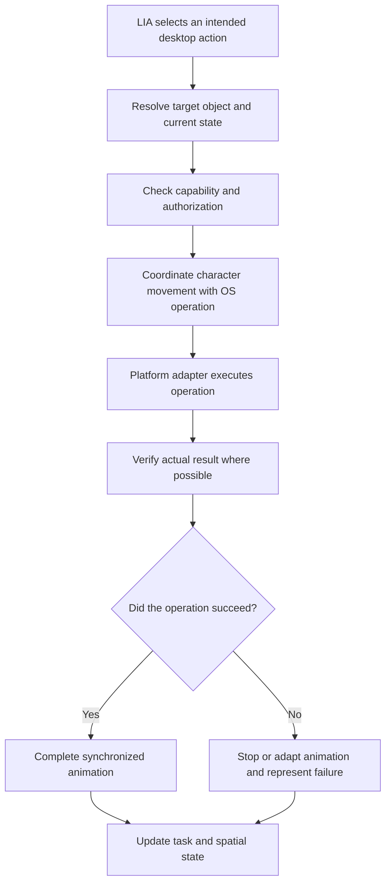

Not every operation requires a literal physical metaphor. Dragging and resizing can be represented as direct physical interactions. Minimizing or focusing a window may use a gesture or animation appropriate to the operation. In every case, the representation must not contradict the real desktop result.

## 11.2 Spatial desktop awareness

Spatial awareness is a first-class capability, not merely a side effect of screen perception.

**Definition:** LIA's ability to understand the spatial arrangement, relative positions, dimensions, boundaries and relationships of objects within the desktop environment, and to use that understanding when navigating or manipulating those objects.

Spatial awareness includes:

- **Desktop geometry:** Screen boundaries, monitor arrangement, display resolution, workspaces and available desktop regions.
- **Window geometry:** Window positions, dimensions, boundaries, visibility, stacking/layering and relevant window state.
- **Spatial relationships:** Which windows overlap, which are adjacent, which occupy most of the screen, where free space exists, and how objects are positioned relative to one another.
- **Character positioning:** Where LIA is rendered, which objects she is facing, where she can move, and how she should approach a target.
- **Spatial interaction:** Approaching, pointing, grabbing, dragging, pushing, releasing and repositioning desktop objects.
- **Dynamic awareness:** Understanding that the environment changes when windows move, monitors change, applications open or the user rearranges the desktop.

Perception and spatial awareness are related but distinct:

- **Perception:** What am I looking at? What application, window, control or object is present?
- **Spatial awareness:** Where is it? How is it positioned relative to other things? Where can I move? How can I interact with it?

LIA must distinguish directly available geometry from inferred spatial relationships. Spatial state must be refreshed when relevant desktop changes occur and before actions that depend on potentially stale positions.

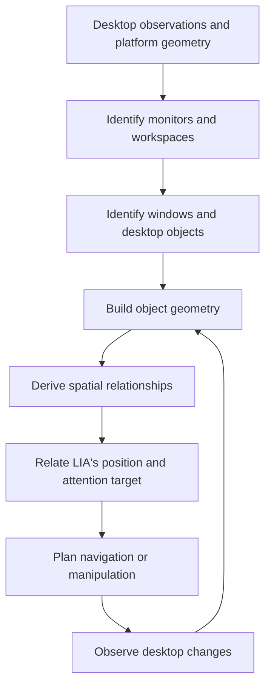

## 11.3 Window management as object interaction

LIA's eventual window-management capability includes three broad categories.

### Discovery

- Identify the active window.
- Enumerate supported windows.
- Obtain window metadata, including title, identity, position, dimensions and state when available.
- Identify visible, minimized, maximized, restored and focused windows.
- Identify the monitor or virtual desktop containing a window where supported.

### Manipulation and organization

- Focus a window and bring it to the foreground.
- Move a window by interacting with its title bar or through an appropriate platform operation.
- Resize a window through its edges or corners.
- Push or reposition windows to make space.
- Minimize, maximize and restore windows.
- Arrange, tile and snap windows.
- Move windows between monitors and virtual desktops where supported.
- Switch focus between windows and organize their spatial arrangement.

### Lifecycle

- Launch supported applications.
- Open and manage their windows.
- Close windows gracefully.
- Restore or reopen applications where supported.
- Identify unresponsive applications or windows.
- Handle dialogs and prompts associated with window operations.

Closing a window must not silently become forceful process termination. Unsaved work and confirmation dialogs must be respected. Window operations must report their execution result, and the system should verify the resulting state when possible.

The first vertical slice may implement a much smaller subset, such as identifying a target window, approaching it visually, grabbing it and moving it while synchronizing character animation with the actual OS operation. This validates the connection between spatial representation, embodiment, platform control and result verification without reducing the eventual product scope to only window movement.

## 11.4 Application interaction and per-application authorization

LIA should be able to enter supported applications and interact with their interface: buttons, menus, text fields, forms, dropdowns, selection menus, tabs, navigation elements, dialog boxes, confirmation prompts, toolbars, sidebars, context menus, checkboxes, sliders, toggles and other interactive controls.

Application access must be independently configurable per application. The capability classes are:

| Permission class | Meaning |
|---|---|
| **Observe** | Inspect the permitted application state and understand its visible or otherwise authorized contents |
| **Interact** | Navigate, click controls, switch tabs, type, scroll and operate interface elements |
| **Modify** | Change content or application data, save changes, submit forms, upload or download files and perform other data-altering operations |

These classes are independent. Permission to observe does not imply permission to interact. Permission to interact does not imply permission to modify. Permission to modify does not automatically authorize every consequential operation.

For example, Firefox might be configured to allow observation and navigation while restricting form submission or data modification. A password manager might have no access, while a code editor might have broader access for an authorized development workflow. These are illustrative configurations, not defaults.

Sensitive actions such as purchases, sending external communications, permanent deletion or consequential transactions may require additional authorization or confirmation even when the application has a general Modify grant.

Permissions must apply regardless of whether LIA uses visual interaction, direct input simulation or a semantic application interface. The detailed permission service, scopes, defaults, revocation and confirmation policy are specified in P2.6.

## 11.5 File-system interaction: direct and interactive operation

LIA shall support both direct file-system operations and embodied interaction through a file-manager application. These are two methods for performing the same authorized file-system capabilities.

The intended scope includes:

- **Discovery:** Search, locate, enumerate and inspect files and directories.
- **Reading:** Open, preview, read and understand supported file formats.
- **Creation:** Create files, directories and project structures.
- **Modification:** Edit supported documents, source code, configuration files and other supported content.
- **Organization:** Copy, move, rename, sort and organize files and directories.
- **Removal and recovery:** Delete files, manage trash and restore files where supported.

For example, when organizing a project directory, LIA could use direct operations to move and rename files efficiently. Alternatively, she could open the file manager, navigate to the directory and manipulate the files through its interface.

The execution method may depend on the task, reliability, available platform capabilities and user preference. Both methods must enforce the same path and operation permissions. Direct access must not be used as a way to bypass restrictions imposed on interactive access.

Destructive or difficult-to-reverse operations require the appropriate safeguards, and outcomes must be verified where possible.

## 11.6 Desktop-environment navigation and configuration

LIA's environment extends beyond application windows. Eventual capabilities include:

| Area | Intended capability |
|---|---|
| Monitors | Discover displays, understand their arrangement and move windows between them |
| Workspaces | Switch, create, organize and manage virtual desktops |
| Panels and docks | Interact with taskbars, docks, launchers and system panels |
| Desktop objects | Interact with icons, shortcuts and supported desktop elements |
| Notifications | Observe and interact with supported system notifications |
| Display configuration | Access and modify supported display settings |

LIA shall eventually be able to configure the desktop environment, not only navigate its existing arrangement. This includes supported workspace arrangements, panels, docks and display settings, subject to platform support and appropriate permissions.

Spatial awareness applies across the display topology. For example, LIA should understand that a window is on the left monitor, another workspace exists on the right, and moving a window between them differs from moving it within one display.

Platform and desktop-environment differences must be exposed honestly. A capability that is unavailable under a particular Linux compositor or Windows configuration must not be represented as universally supported.

## 11.7 Human-like computer input

LIA's eventual input capability includes the actions a person commonly performs with a computer.

### Pointer and mouse

- Move the pointer to arbitrary screen positions.
- Hover over elements and respond to hover states.
- Left-click, right-click and double-click.
- Click and hold.
- Drag and drop files, windows and interface elements.
- Scroll vertically and horizontally.
- Select objects and text.
- Interact with context menus.
- Perform supported pointer gestures.

### Keyboard

- Type text into input fields and documents.
- Press individual keys and key combinations.
- Execute keyboard shortcuts.
- Navigate interfaces using keyboard controls.
- Select, copy, cut, paste and replace text.
- Navigate and edit documents.
- Use application-specific shortcuts.
- Perform keyboard-driven workflows without relying on the mouse.

### Interface controls

LIA should recognize and operate buttons, text fields, forms, dropdowns, selection menus, tabs, navigation elements, dialogs, confirmation prompts, toolbars, sidebars, checkboxes, sliders, toggles and other interactive controls.

She should understand what an element does, not merely where it appears.

### Complex interaction sequences

A user goal may require multiple coordinated actions. For example, uploading a document can involve locating the application, opening its upload interface, navigating to the appropriate directory, locating and selecting the document, confirming the upload and verifying that the application received it.

LIA should represent this as one objective with a plan and individually tracked actions, rather than as an unstructured sequence of clicks.

### Embodiment

The character's physical behavior should participate in desktop interaction. When moving a window, she may approach and grab it. When pointing at a control, her gaze or hand movement may correspond to the target. When typing, her animation may reflect the action.

The animation and actual input must remain synchronized. LIA must not perform a visual gesture that falsely indicates a computer action succeeded.

## 11.8 Hybrid interaction model

The product shall combine three execution mechanisms:

1. **Direct input simulation:** Actual pointer and keyboard input, including clicks, typing, dragging, scrolling and other input events.
2. **Accessibility and semantic interaction:** Use available accessibility interfaces or application interfaces to identify and operate controls through their meaning and structure.
3. **Visual interaction:** Understand the visible interface through screen perception and select targets based on visual appearance and spatial location.

LIA should use the most appropriate mechanism for the operation, based on task requirements, available interfaces, platform support and expected reliability. She may combine mechanisms within one task.

For example, an accessibility interface may reliably identify a button, while pointer input is used to drag an object. Visual perception may be necessary for an application that exposes no suitable semantic interface.

All three mechanisms must obey the same authorization, action-planning, execution-result and verification rules. The hybrid model is an implementation-independent product direction; it does not select a particular automation framework or API.

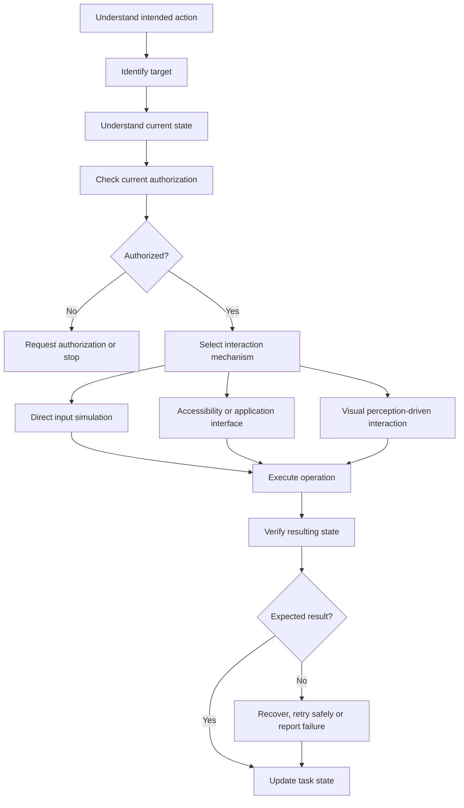

The choice of mechanism must not change the permission required. If the requested operation is unsupported, LIA must not silently substitute a materially different operation.

## 11.9 Task management: objective, plan and actions

LIA's task system should represent a user's desired outcome separately from the plan and the operations used to achieve it.

- **Objective:** The outcome LIA is supposed to achieve.
- **Plan:** The sequence or structure of steps LIA determines are necessary.
- **Actions:** Individual operations that execute the plan.

Example objective: "Organize my Downloads folder."

Possible plan: inspect files, classify them, create appropriate folders, move files, and verify the result.

Individual actions may include identifying a PDF, moving it into a destination directory and confirming that it exists at the destination.

A large objective may contain dozens of actions across multiple applications. LIA must track the overall objective while independently managing each step.

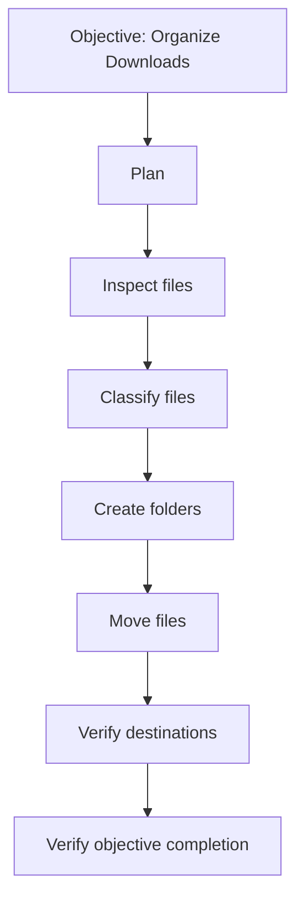

### Task record

A task should contain:

| Property | Purpose |
|---|---|
| Objective | What needs to be achieved |
| Origin | User request, delegated objective, schedule, event or LIA initiative |
| Plan | Steps required to achieve the objective |
| Dependencies | Actions or conditions that must be satisfied first |
| Required capabilities | Applications, files, services and operations needed |
| Authorization basis | One-time grant or valid standing authorization and its scope |
| Status | Current task state |
| Priority | Importance assigned to the task |
| Schedule | Timing or execution condition |
| Progress | Completed and remaining steps |
| Execution history | Actions taken and their results |
| Checkpoint | State required for safe resumption |
| Blocker | Why execution cannot proceed |
| Outcome | Verified result or failure explanation |

The user should be able to inspect what LIA actually did, not merely rely on a natural-language summary.

### Task states

The agreed task states are:

- **Queued:** Waiting for execution.
- **Running:** Currently executing.
- **Blocked:** Cannot proceed because a dependency, permission, resource, input or other required condition is missing.
- **Paused:** Execution has deliberately been suspended.
- **Completed:** Intended outcome verified to the extent possible.
- **Cancelled:** Execution was deliberately abandoned.
- **Failed:** Execution could not achieve the intended outcome.

Blocked and Failed are not interchangeable. Paused and Blocked are also distinct.

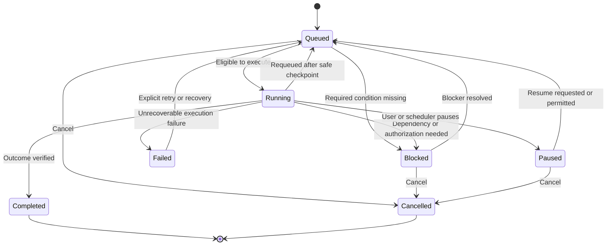

### Task origins and memory-informed initiative

Tasks may originate from:

- Direct user instructions.
- Previously delegated objectives.
- Scheduled activities and reminders.
- Events in the desktop environment.
- LIA's own observations and initiative, informed by relevant memory.

For example, LIA may remember that the user is developing the LIA project, that research into desktop automation has been identified as useful, and that public web research is covered by a standing permission. She can independently create a research task, prepare a plan, notify the user and execute under that existing authorization.

Task creation, planning and execution are separate capabilities. LIA may be able to create and organize a proposed task without having authority to execute every operation in its plan.

### Notification, approval and confirmation

These are three different behaviors:

- **Notification:** Informing the user that an already-authorized action or autonomous task is about to happen.
- **Approval:** Obtaining authorization when the operation is not covered by a valid grant.
- **Confirmation:** Verifying user intent for a particularly consequential operation when the risk policy requires it.

Notification must not be disguised as an approval prompt. LIA should not ask permission for every step of work that is already within valid standing authorization. Conversely, an announcement does not make an unauthorized operation permissible.

The authorization basis must be explicit in the task record. A one-time approval must not silently become unlimited standing permission.

### Scheduling and prioritization

Priority, urgency and deadline are separate attributes.

The agreed priority categories are:

| Priority | Meaning | Illustrative example |
|---|---|---|
| P0 — Critical | Time-sensitive or essential | A task with an imminent deadline |
| P1 — High | Important to an active objective | Research needed for an ongoing project |
| P2 — Normal | Useful work that should progress regularly | Organizing project documentation |
| P3 — Low | Useful but not immediately necessary | Exploring an interesting technical subject |
| P4 — Someday | Optional ideas and opportunities | Investigating an unrelated project idea |

The user may assign priorities. LIA may recommend or adapt priorities using explicit user goals, deadlines, project importance, dependencies and current circumstances. She must not silently downgrade an explicit user priority simply because another activity appears more interesting. Meaningful scheduling changes should be communicated.

Supported execution modes are:

- Immediate: start when authorization and execution conditions are satisfied.
- Background: continue without taking over the user's active desktop interaction.
- Idle-time: execute when the computer or user reaches a suitable idle condition.
- Scheduled: execute at a specified time or recurring interval.
- Deadline-driven: schedule work backwards from a deadline.
- Event-triggered: start when a specified event or condition occurs.
- Deferred: retain the task until an appropriate opportunity becomes available.

These are scheduling properties, not mutually exclusive task types.

### Dependencies

The task system should support:

- Sequential dependencies: B begins after A.
- Parallel tasks: B and C may execute simultaneously.
- Conditional dependencies: a step begins only when a specified condition is satisfied.
- Parent-child tasks: a larger objective contains independently tracked subtasks.
- Recurring tasks: an objective can generate new task instances periodically.

### Resource and interaction classes

| Execution class | Examples | Scheduling behavior |
|---|---|---|
| Background-safe | Research, summarization and permitted file reading | May run while the user works |
| Low-interference | Preparing documents and organizing authorized data | May run in the background with safeguards |
| Desktop-interactive | Moving windows, navigating applications and typing | Must consider active user interaction |
| User-dependent | Tasks needing clarification or a decision | Wait for user input |
| Resource-intensive | Large computations, local inference and heavy indexing | Consider system load and resource availability |

LIA should not stop working merely because the user is busy. She should avoid interfering with the user's active work. For example, she may conduct research in the background while the user codes, but should not move application windows or type into the user's editor while the user is actively controlling it.

### Interruption, checkpoint and resumption

Interruption is a normal task condition, not necessarily a failure.

If the user begins interacting with a directory that LIA is organizing, LIA should pause conflicting file operations, preserve completed work, record remaining work and resume when conditions permit.

Resumption must verify the actual environment before repeating operations that may already have taken effect. A research task may resume from its last completed research step; a partially completed file operation must inspect the filesystem before attempting the move again.

### Scheduler model

The scheduler should manage state, dependencies, execution eligibility and resource constraints through deterministic rules. LIA's reasoning may identify opportunities, formulate plans and recommend priorities, but should not independently mutate task state outside the scheduler's controlled transitions.

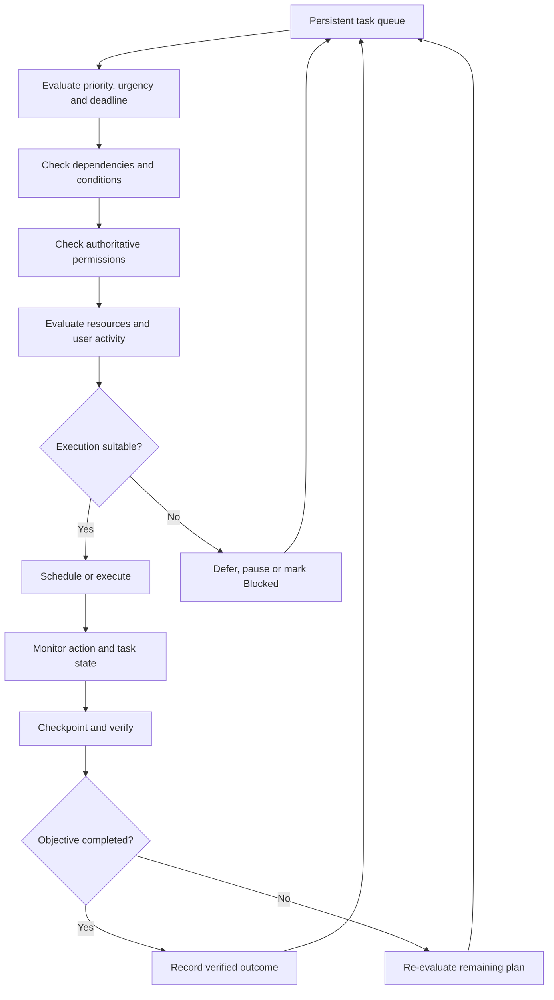

The scheduler should reconsider tasks when circumstances change: a dependency becomes available, a deadline approaches, an event occurs, an objective becomes irrelevant or resource conditions change. Reprioritization must respect explicit user priorities.

## 11.10 Memory architecture: complete conceptual design

Memory is foundational to LIA's persistent identity, cognitive continuity and autonomous initiative. The recommended direction is a hybrid, multi-layered, temporal memory system with a knowledge graph as its relational backbone.

No individual store or retrieval method is expected to provide all required memory capabilities.

### Two complementary memory capabilities

LIA needs both:

1. **Remembering what happened:** A searchable historical archive of permitted conversations, meaningful experiences, decisions, task events and retained source materials.
2. **Remembering what she learned:** Organized long-term memories containing distilled facts, preferences, relationships, procedures, project knowledge and patterns.

The historical archive preserves original context. Organized memories make information easier to use during reasoning. Derived memories should refer back to their original evidence whenever possible.

This does not mean indefinitely recording every screen frame, microphone stream or transient desktop observation. Raw observations have separate permission and retention requirements.

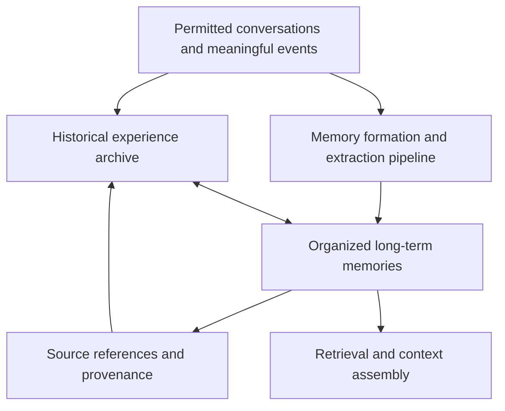

### Memory component 1 — Source and experience archive

The archive is the historical record from which other memories are derived. It can include:

- Conversation transcripts and session records.
- Important interaction events.
- Decisions and their original discussions.
- Task plans, execution steps and outcomes.
- Permitted application and desktop observations.
- Imported documents and reference materials.
- Relevant external research and its sources.

The record should be append-oriented. New events are recorded, and existing evidence is not silently overwritten when a derived memory changes. Corrections and superseding decisions should be represented as new events or versioned state changes with provenance.

Retention is governed separately by sensitivity and user policy. The ordinary conversation archive is retained indefinitely until the user requests deletion. Temporary conversations are excluded from permanent archive and long-term memory formation.

### Memory component 2 — Episodic memory

Episodic memory preserves meaningful experiences in chronological context.

An episode may contain:

- What happened.
- When the underlying event occurred.
- When LIA learned or recorded it.
- The participants, projects and entities involved.
- The context and outcome.
- Related tasks and decisions.
- Links to the original conversation, document or event.

Example:

**Episode: Desktop awareness decision**

- Event date: 12 November 2026.
- Context: Discussion of the extent of desktop awareness.
- Event: User approved three levels of awareness.
- Outcome: Default desktop metadata, on-demand screen perception and optional continuous screen perception.
- Related entities: LIA, Desktop Awareness, Screen Perception and User Permissions.
- Source: Original discussion and approved decision record.

Episodic memory enables questions such as "What did we decide during our last architecture discussion?", "When did we discuss this?" and "What was happening when this preference was established?"

### Memory component 3 — Semantic memory

Semantic memory stores what LIA currently understands to be true or established.

It includes:

| Domain | Example |
|---|---|
| User profile | Interests, preferences, goals and routines |
| Projects | Objectives, current state and decisions |
| Technology | Technologies used by a project |
| Relationships | Relevant people and their associations |
| Preferences | Preferred interaction and working styles |
| Knowledge | Established facts and concepts |

Semantic memory should use both concise, frequently accessed profiles and independently addressable records. A project summary can provide quick context while individual records preserve supporting decisions, dates and source evidence.

A single continually rewritten profile risks losing historical nuance. A collection of isolated facts risks making comprehensive retrieval difficult. The two representations should work together.

### Memory component 4 — Temporal knowledge graph

The knowledge graph is the relational backbone of LIA's memory. It represents entities as nodes and meaningful typed relationships as edges.

Potential entities include User, LIA, Person, Project, Application, Technology, File, Conversation, Experience, Task, Decision, Preference and Skill.

Potential relationship types include:

- WORKS_ON
- USES
- PREFERS
- DECIDED
- DEPENDS_ON
- RELATED_TO
- SUPERSEDES
- PARTICIPATED_IN
- CREATED
- ORIGINATED_FROM
- APPLIES_TO

Example:

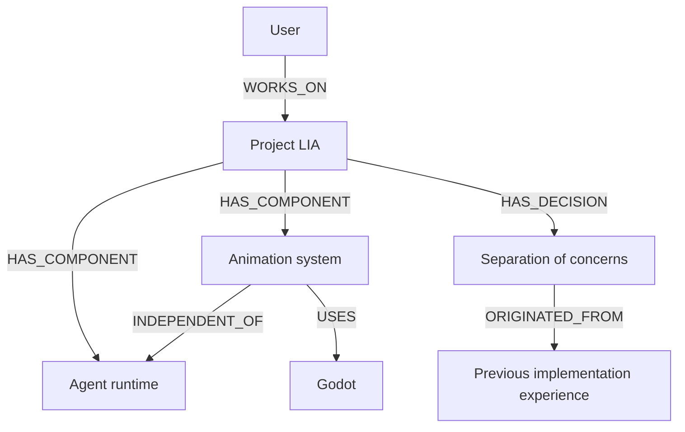

This graph should represent semantic relationships, not merely the fact that two topics appeared in the same conversation. RELATED_TO, DEPENDS_ON and SUPERSEDES must retain distinct meanings.

The graph should support multi-hop questions. For example, a question about why animation must remain independent of agent cognition can lead from the LIA project to the animation system, the agent runtime, the separation-of-concerns decision and the original implementation experience.

#### Temporal graph semantics

The memory model should distinguish:

- **Valid time:** When was this information true in the world or in the user's circumstances?
- **Transaction time:** When did LIA learn or record this information?

If the user tells LIA on 13 November that a desktop-environment change actually happened on 1 November, both dates matter.

The graph should preserve historical facts while identifying what is currently believed to be valid. New facts may supersede older facts without erasing them.

### Memory component 5 — Procedural memory

Procedural memory stores how LIA performs tasks, not merely what she knows.

Examples include:

- How to organize a software project.
- How to operate a particular application.
- How to troubleshoot a known error.
- How to configure a desktop environment.
- How to execute a recurring user-approved workflow.

A procedure should contain preconditions, required permissions, execution steps, expected outcomes and recovery instructions. LIA must distinguish a successful, verified workflow from something she merely attempted once.

### Memory component 6 — Working and task memory

Working memory is LIA's active cognitive workspace. It contains information needed for current reasoning and execution:

- Current conversation context.
- Active objectives and plans.
- Retrieved memories relevant to the current objective.
- Current application and desktop context, where permitted.
- Task checkpoints and dependencies.
- Immediate observations and results.

Working memory must not become an unbounded permanent store. Its lifecycle should be managed independently, while important task checkpoints and persistent state are saved when needed for safe resumption.

### Memory component 7 — Retrieval indexes

Indexes are mechanisms for locating memories, not separate sources of truth.

| Index | Purpose |
|---|---|
| Vector index | Find information through semantic similarity |
| Full-text / BM25 index | Find exact terms, names, identifiers and phrases |
| Graph index | Find relationships and connected memories |
| Temporal index | Find events and facts relevant to a period |
| Structured index | Filter by project, category, source, status and metadata |

These indexes should point to canonical records and source evidence. If an index is stale or inconsistent, it must be repairable from the authoritative records.

### Memory formation pipeline

Autonomous memory formation should operate as an ongoing pipeline over permitted inputs.

1. Capture permitted conversations, events, task outcomes and other relevant information.
2. Segment the input into meaningful events, topic boundaries and experiences.
3. Extract candidate facts, preferences, objectives, decisions, relationships and procedural knowledge.
4. Resolve entities so that information is connected to the correct person, project, application or concept.
5. Validate and reconcile duplicates, contradictions, outdated information, uncertainty and source evidence.
6. Store memories in appropriate representations and create graph relationships and retrieval indexes.
7. Consolidate summaries and frequently used representations without destroying original evidence.

Most extraction and consolidation can occur asynchronously. Important decisions and task-state changes may require prompt persistence. Failure to extract a memory must not silently corrupt the original archive.

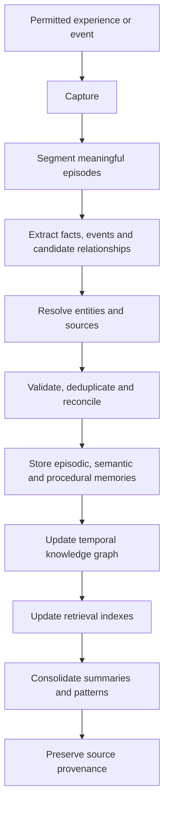

### Associative memory reinforcement

LIA's memory graph should support experience-dependent strengthening of meaningful relationships. This is inspired by associative-learning principles such as Hebbian learning, but is a computational design analogy, not a claim that LIA reproduces biological neural plasticity.

A relationship may become stronger when supported by repeated, sufficiently independent experiences or strong explicit evidence.

Example:

- First experience: The user mentions enjoying Linux internals. LIA records a candidate association between User and Linux Internals.
- Second experience: The user spends multiple sessions exploring kernel internals, process management and memory management. Independent evidence supports the association and creates useful connections among those concepts.
- Third experience: The user explicitly states a long-term goal of understanding Linux internals deeply. This explicit statement provides stronger evidence and can establish a durable learning preference with high confidence.

The system should not require repeated statements when the user has explicitly communicated a clear preference or goal.

#### Association development stages

| Stage | Meaning |
|---|---|
| Candidate association | A relationship is observed, but evidence is insufficient to treat it as an established pattern |
| Consolidated association | Multiple independent experiences support the relationship, or strong explicit evidence establishes it |
| Strong association | The relationship receives consistent support across time, situations and meaningful experiences |

#### Separate memory signals

LIA must maintain distinct values for:

- **Association strength:** How strongly two pieces of information are connected.
- **Factual confidence:** How certain LIA is that the relationship or statement is correct.
- **Importance:** How valuable the information is to preserve.
- **Retrieval activation:** How relevant the memory is to the current situation.

A possible normalized association-strength model is:

S_new = min(1, S_old + ΔS)

ΔS represents the contribution of new supporting evidence. This is a conceptual model, not a finalized update equation or coefficient.

Evidence may have different influence:

| Evidence | Indicative influence |
|---|---|
| Explicit user statement | Very high |
| Repeated independent experiences | High |
| Consistent behavior across sessions | High |
| Relevant task completion | Moderate to high |
| Single contextual observation | Low |
| Mere co-occurrence of concepts | Very low |
| Contradictory information | Triggers reconciliation rather than automatic reinforcement |

#### Selective association and maintenance

LIA must not create strong relationships between every concept that appears in the same conversation. Co-occurrence can suggest a candidate relationship, but semantic meaning requires evidence.

The system should also avoid runaway reinforcement:

- Temporal decay may reduce the retrieval activation or relevance of temporary information.
- Contradictory evidence may challenge a relationship and require reconciliation.
- Strength normalization should produce diminishing gains from repeated evidence, preventing frequently mentioned topics from dominating the graph.
- Repeated retrieval alone must not count as new evidence of truth.
- Historical facts and important decisions must not be erased merely because they are old.

A strong association can guide retrieval without proving a causal relationship or a personal inference.

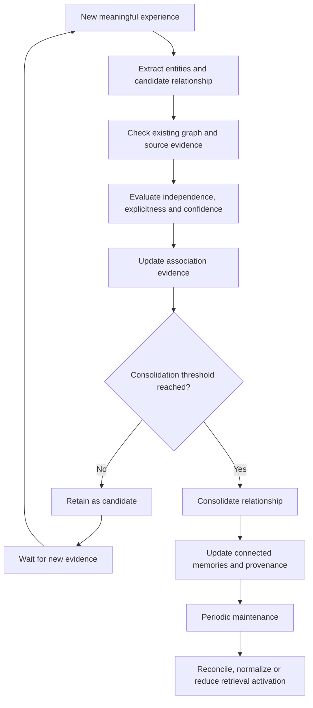

### Context-aware memory retrieval and assembly

The retrieval system should reconstruct the context required for a particular conversation, task or proactive activity. It should not merely return memories that resemble the latest message.

Memory formation, consolidation, retrieval and context assembly are separate responsibilities:

- Formation decides what to remember.
- Consolidation organizes and connects what is remembered.
- Retrieval finds relevant records.
- Context assembly decides what information is supplied to reasoning.

#### Eight retrieval stages

1. Understand the information need.
2. Create a retrieval plan.
3. Query relevant memory stores in parallel.
4. Merge and deduplicate candidate memories.
5. Expand relevant knowledge-graph connections.
6. Rerank and validate evidence.
7. Retrieve original source material when needed.
8. Assemble a bounded working context.

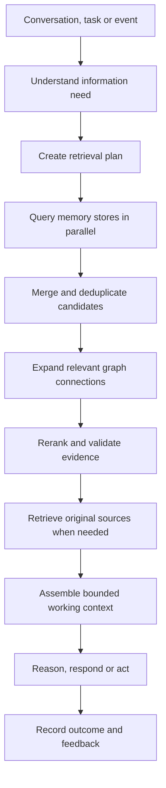

#### Retrieval by information need

| Request | Relevant memory sources |
|---|---|
| Casual conversation | User profile, preferences and recent relevant episodes |
| Personal discussion | Relevant episodic memories, preferences and established boundaries |
| Project discussion | Project summaries, decisions, graph connections and original discussions |
| Technical research | Relevant knowledge, reference documents and previous research |
| Task execution | Task state, procedures, current permissions and fresh application context |
| Task resumption | Checkpoints, execution history, dependencies and latest state |
| Historical question | Temporal graph, original source episodes and evidence |
| Proactive initiative | Active goals, unfinished tasks, deadlines, preferences and permitted observations |

#### Hybrid retrieval and ranking

The retrieval planner may query vector, lexical, structured, graph, temporal and source-archive indexes in parallel. Candidate results should be merged and deduplicated before ranking.

Ranking can consider semantic relevance, lexical relevance, graph relevance, temporal relevance, source authority, factual confidence, current validity, contextual relevance and importance.

A conceptual ranking model is:

R(m,q,c) = w_s S + w_l L + w_g G + w_t T + w_p P + w_v V + w_c C

Where m is a candidate memory, q is the information request, c is current context, and the signals represent semantic, lexical, graph, temporal, provenance, validity and contextual relevance. The weights require evaluation and calibration; they are not fixed in the requirements baseline.

Association strength may influence which graph paths deserve exploration, but must not override factual confidence or source evidence.

#### Bounded graph traversal

Graph retrieval should:

- Identify anchor entities in the request.
- Traverse meaningful typed relationships.
- Expand progressively from directly connected memories.
- Use task-appropriate and bounded hop counts.
- Preserve edge direction and semantics.
- Apply temporal validity and access controls during traversal.
- Stop when additional connections no longer contribute useful evidence.

An unrestricted graph walk is not acceptable because it can retrieve excessive or unrelated context.

#### Temporal and contradiction resolution

Before using a memory as current fact, LIA should identify whether it is current, historical, superseded, stale, incomplete or contradictory.

For example, a previous preference for Application A may be superseded by an explicit later preference for Application B. LIA should retain both records and return the current applicable belief when asked about the present, while still answering historical questions accurately.

When evidence conflicts without a clear resolution, LIA must expose the uncertainty rather than force one answer.

#### Context assembly

The final working-context package should include only information needed for the current task and should preserve:

- Current project or conversation state.
- Relevant established decisions and facts.
- Relevant historical experiences.
- Active tasks and unresolved items.
- Source references.
- Temporal status.
- Explicit versus inferred evidence labels.
- Uncertainty and conflicting evidence.
- Relevant access restrictions.

It should be bounded by the available context budget. A summary must not be treated as equivalent to its original evidence when exact historical detail matters.

#### Reactive and anticipatory retrieval

**Reactive retrieval** occurs in response to a user message, task or event.

**Anticipatory retrieval** prepares likely relevant context as a task or interaction develops. For example, when the user begins working on a known project, LIA may retrieve its current summary, recent decisions and unfinished tasks, provided the relevant context access is permitted.

Anticipatory retrieval does not authorize execution. It prepares information only.

#### Retrieval traceability

LIA should retain enough retrieval trace information to explain which sources and relationships contributed to a response or plan. This enables debugging across extraction, entity resolution, graph traversal, ranking, temporal resolution and context assembly.

#### Memory evaluation

The memory system should be evaluated using LIA-specific tests:

| Test | Expected behavior |
|---|---|
| Exact recall | Retrieve a specific fact and its source |
| Multi-session recall | Combine information from different conversations |
| Multi-hop reasoning | Follow relationships between projects, decisions and events |
| Temporal reasoning | Distinguish historical information from current information |
| Knowledge updates | Correctly handle changed preferences and decisions |
| Provenance | Identify the original source of remembered information |
| Abstention | Acknowledge missing or uncertain information |
| Task continuity | Resume a task using its actual checkpoint |
| Correction | Propagate a correction into dependent representations |
| Deletion | Propagate deletion through authorized stores and indexes |
| Context isolation | Avoid mixing unrelated projects, people or private domains |
| Permission separation | Never treat retrieved memory as current execution authorization |

Measurements should include retrieval precision and recall, source accuracy, temporal correctness, context size, latency, unnecessary memory inclusion and the rate of unsupported answers.

LongMemEval and LoCoMo are potential external benchmark references; they do not replace LIA-specific evaluation.

### Memory architecture diagram

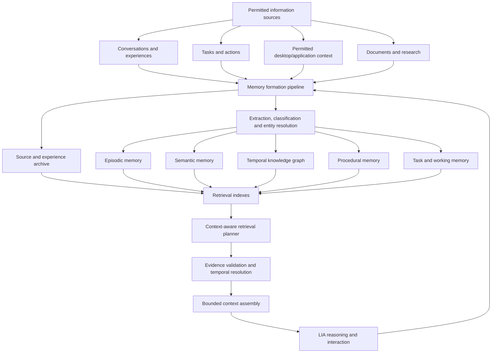

## 11.11 P2.1 and P2.5 boundaries

The memory architecture in this section is a conceptual design direction. P2.5 will formalize memory requirements, governance, persistence, retrieval, correction and deletion. P2.6 will define permissions, sensitive-data boundaries and execution authority. P2.2 will define measurable performance and resource constraints. P2.7 will define acceptance tests.

No specific graph database, vector database, embedding model, programming language, memory framework or orchestration system is selected here. Such choices belong in P3.

---

# 12. P2.5 — Memory governance and integrity

**Workstream status:** Active design  
**Purpose:** Define how LIA retains, classifies, protects, corrects, forgets, deletes, shares and accesses memory throughout its lifecycle.

A sophisticated memory system that remembers everything but cannot reliably correct or forget information would be fundamentally flawed. Governance is therefore part of the memory architecture, not an administrative feature added afterwards.

## 12.1 Historical conversation retention

The user approved the following policy:

- Ordinary permitted conversation archives are retained indefinitely until the user requests deletion.
- Retention does not imply that every screen frame, raw audio stream or transient desktop observation is permanently recorded.
- The user can request deletion of individual conversations or broader memory collections.
- Sensitive information follows stricter classification and retention policies.
- Temporary conversations are available for the active interaction but are not added to the permanent conversation archive or long-term memory formation.

### Temporary conversations

Temporary conversation mode is available in two ways:

1. The user manually activates it.
2. LIA may suggest it when a conversation appears especially sensitive.

LIA must never silently activate temporary mode. The user must explicitly consent to enter it.

While temporary mode is active:

- Conversation content remains available in working memory for the active interaction.
- The conversation is not added to the permanent historical archive.
- Autonomous extraction and consolidation of its contents into long-term memory are disabled.
- No episodic, semantic or associative memories are created from the temporary conversation.
- Temporary conversational context is discarded when the session ends, subject to any separately disclosed operational or security records.
- Sensitive content must not leak into unrelated summaries or retrieval indexes.

If LIA performs an authorized computer operation during a temporary session, minimal operational records may be necessary for execution integrity and security. Such records must not preserve the sensitive conversational content. A separately authorized persistent task may have its own task record, but that must not silently archive the temporary conversation.

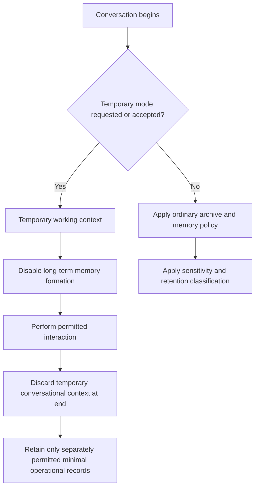

## 12.2 Memory sensitivity classification

The initial proposed classification is:

| Class | Information examples | Default memory policy |
|---|---|---|
| **S0 — Ordinary** | General knowledge, public information and ordinary project facts | Autonomous retention allowed |
| **S1 — Personal** | Interests, preferences, routines and personal context | Autonomous retention under user memory preferences |
| **S2 — Sensitive** | Private correspondence, financial records and sensitive personal documents | May be processed when authorized; explicit authorization required for long-term retention |
| **S3 — Highly sensitive secrets** | Passwords, API tokens, private keys, recovery codes and equivalent secrets | Never store in ordinary conversational or semantic memory |

S3 credentials must be handled through a separate secure credential mechanism if the product later supports them. They must not be embedded in the knowledge graph, ordinary memory records or conversational summaries.

Permission to access information does not automatically grant permission to retain it. LIA may be authorized to inspect a financial document for a specific calculation without being authorized to preserve its full contents indefinitely.

Classification must affect the entire memory pipeline, including extraction, summarization, graph construction, indexing, retrieval and sharing. If LIA is uncertain about sensitivity, she should handle the information conservatively and avoid automatic promotion into unrestricted long-term memory.

## 12.3 Correction, contradiction and temporal reconciliation

LIA must correct her understanding without corrupting historical evidence.

Example:

- January: The user prefers Application A.
- March: The user begins using Application B.
- April: The user explicitly states that Application B is now preferred.

The current semantic profile should reflect Application B. The historical record should preserve the earlier preference and the transition.

Correction rules:

- Explicit user correction takes precedence over an inference within the scope stated by the user.
- Context matters: preferring Linux for development does not establish a preference for Linux in every activity.
- Time matters: earlier information may have been accurate when recorded.
- Contradictions should remain visible when evidence does not establish a clear resolution.
- LIA must not invent an explanation for why information changed.
- Corrections must propagate to derived summaries, graph relationships and retrieval indexes.
- Historical evidence should remain traceable unless the user separately requests erasure.

## 12.4 Forgetting and deletion operations

The user approved three distinct memory-management operations:

| Operation | Meaning |
|---|---|
| **Forget a fact** | Remove the fact from active memory and its derived representations, and prevent it from influencing future reasoning. The original conversation remains unless separately requested for deletion. |
| **Erase an experience** | Delete the selected conversation or experience and its derived memories, relationships, summaries and retrieval representations. |
| **Erase a memory domain** | Remove a selected collection, such as a project-memory or personal-interest domain, including derived records within the requested scope. |

A minimal deletion marker may be retained to prevent accidental re-import, but it must not preserve the deleted content itself.

Deletion must cover the canonical record and its dependent representations, including:

- Knowledge graph nodes and relationships.
- Vector embeddings and lexical indexes.
- Derived summaries and profiles.
- Cached working-context representations.
- Linked episodic and semantic memories.
- Snapshots and backups according to the applicable deletion policy.
- External processing or storage providers, subject to their actual deletion capabilities and terms.

LIA must distinguish deletion from active memory, deletion from primary storage, expiration of backup copies and removal from external providers. She must not claim complete erasure until all applicable deletion work has actually completed or clearly disclose what remains outstanding.

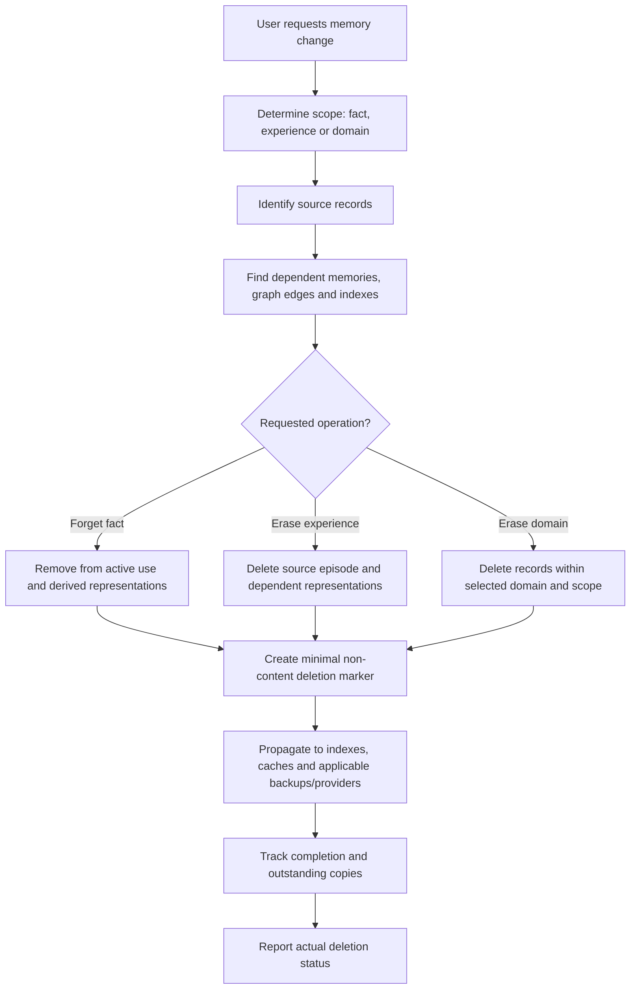

## 12.5 Memory compartments and controlled cross-domain sharing

LIA's memory should be logically compartmentalized. The initial domains are:

| Domain | Contents |
|---|---|
| User memory | Preferences, goals, routines, interests and personal context |
| Project memory | Project-specific objectives, decisions, architecture, files and progress |
| Task memory | Objectives, plans, dependencies, checkpoints and execution history |
| Experience memory | Conversations, episodes, meaningful events and interaction history |
| Procedural memory | Reusable workflows, learned application operations and validated procedures |

These compartments must remain interconnected without becoming one unrestricted information pool.

The user approved controlled cross-domain memory sharing.

The intended behavior is:

- Non-sensitive user-level preferences and technical preferences may be available across projects when relevant and permitted by policy.
- Project-specific or confidential information remains scoped to that project unless sharing is explicitly authorized or covered by a clearly defined user-level sharing rule.
- A task may retrieve relevant project memory and user preferences without gaining access to unrelated private domains.
- LIA may know that two projects are related without being entitled to retrieve every private detail from both.
- A relationship edge does not itself grant access to the connected record.
- Sharing permissions are not automatically transitive. Access to A and a relationship from A to B does not automatically grant access to all of B.
- Cross-domain sharing must retain source provenance, sensitivity classification and the purpose for which information is being retrieved.
- Revoking a sharing grant must prevent future retrieval under that grant and update relevant access indexes or caches.

Access decisions should consider three dimensions:

1. **Ownership:** Which user, project, task or experience owns the memory?
2. **Sensitivity:** How restricted is the information?
3. **Contextual access:** Which task or reasoning activity is allowed to retrieve it?

### Controlled memory-sharing model

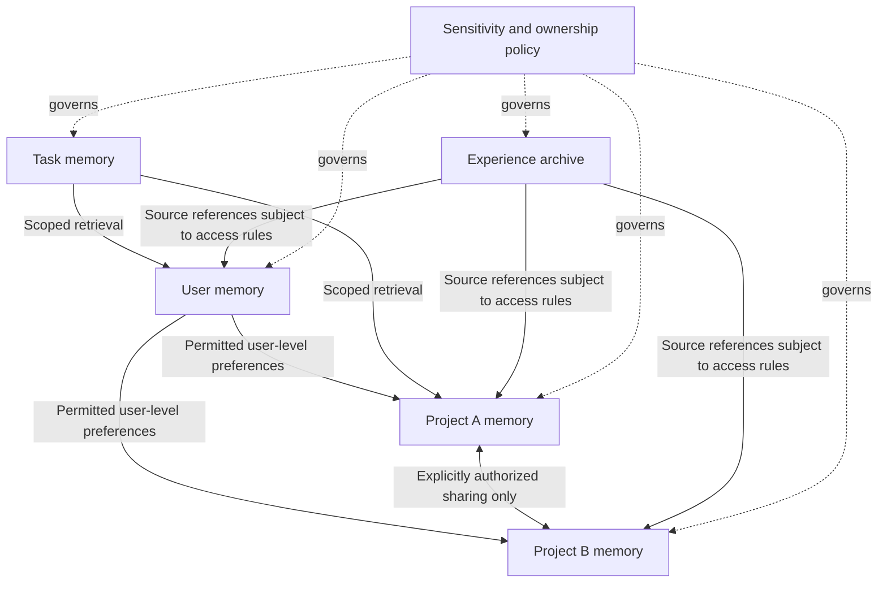

The diagram expresses permitted flows, not automatic access. The access-control decision must be evaluated for each retrieval.

## 12.6 Memory and authorization are separate authorities

Memory records what LIA knows and what happened. A separate permission authority determines what LIA is currently allowed to do.

Example:

Memory records that the user previously authorized LIA to conduct public web research for the LIA project.

The permission authority independently confirms:

- Capability: Public web research.
- Scope: LIA project.
- Authority: Standing permission.
- Status: Active.

LIA may proceed without asking for a new approval if the current permission check succeeds.

If the permission is revoked, the permission authority must reject future execution even though historical memory still records the previous approval.

Likewise, an inferred preference such as "the user usually wants me to do this" must never become authorization.

These components remain separate:

| Component | Responsibility |
|---|---|
| Memory system | Knows what has happened and what has been learned |
| Permission authority | Determines what LIA is currently allowed to do |
| Task scheduler | Determines when work can execute |
| Execution system | Performs authorized operations |

They may reference one another, but must not inherit one another's authority.

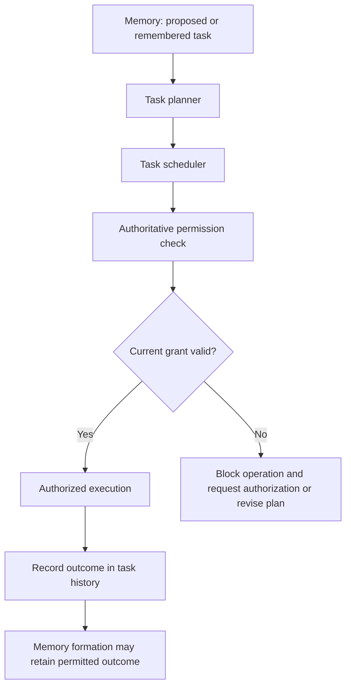

## 12.7 Memory governance requirements

The following security and governance requirements are part of the P2.5/P2.6 design baseline. Their detailed acceptance criteria remain to be completed in P2.7.

| ID | Requirement | Status |
|---|---|---|
| SEC-001 | Ordinary permitted conversation archives shall be retained indefinitely until the user requests deletion, subject to sensitivity classification and the applicable retention policy. | Agreed design direction |
| SEC-002 | LIA shall support user-activated temporary conversations and may suggest temporary mode, but shall not activate it without explicit user consent. | Agreed design direction |
| SEC-003 | Temporary conversation content shall be excluded from permanent conversation archives and autonomous long-term memory formation, subject to separately disclosed minimal operational records. | Agreed design direction |
| SEC-004 | Memory records and source information shall be classified by sensitivity before long-term retention, indexing and cross-domain sharing. | Draft |
| SEC-005 | S2 sensitive information shall require explicit authorization for long-term retention, even when processing access is authorized. | Agreed design direction |
| SEC-006 | S3 secrets shall not be stored in ordinary conversational, semantic or graph memory. | Agreed design direction |
| SEC-007 | The system shall distinguish access permission from retention permission. | Draft |
| SEC-008 | The user shall be able to inspect the source and relationships of retained memories. | Draft |
| SEC-009 | Explicit user corrections shall take precedence over inferred information within the stated scope and shall propagate to dependent representations. | Draft |
| SEC-010 | The system shall preserve historical evidence when information is corrected or superseded, unless the user requests erasure. | Draft |
| SEC-011 | Forgetting a fact shall remove it from active use and derived representations while leaving the original archive intact unless separately requested for deletion. | Agreed design direction |
| SEC-012 | Erasing an experience shall propagate to its dependent memory records, graph relationships, summaries and retrieval indexes within the requested scope. | Agreed design direction |
| SEC-013 | Erasing a memory domain shall remove the selected domain and its derived representations within the requested scope. | Agreed design direction |
| SEC-014 | Deletion status shall distinguish active-storage deletion, primary-store deletion, backup expiration and external-provider deletion. | Draft |
| SEC-015 | Memory domains shall be logically compartmentalized by ownership, sensitivity and contextual access. | Agreed design direction |
| SEC-016 | Cross-domain memory sharing shall be controlled, purpose-relevant and subject to sensitivity, ownership and revocable access rules. | Agreed design direction |
| SEC-017 | Knowledge-graph relationships shall not automatically grant access to connected memory records, and sharing shall not be transitively inherited by default. | Agreed design direction |
| SEC-018 | The permission authority shall remain separate from memory and shall be consulted for current authorization before execution. | Agreed design direction |
| SEC-019 | The system shall not claim complete erasure while applicable deletion work remains outstanding or unverified. | Agreed design direction |
| SEC-020 | If sensitivity or permission status is uncertain, the system shall apply the more restrictive safe handling behavior until resolved. | Draft |

| SEC-021 | Memory discovery, reading, use, derivation, modification, sharing and deletion shall be separately authorizable operations. | Approved |
| SEC-022 | Authorization and scope filtering shall occur before memory search or retrieval and shall prevent disclosure of restricted content or its existence through metadata. | Approved |
| SEC-023 | Derived memories shall inherit relevant restrictions from their source records; combining restricted sources shall not silently declassify the result. | Approved |
| SEC-024 | Automatic cross-project promotion shall follow the explicit-user-preference, independent-repetition, contextual-observation and sensitivity rules in Section 12.14. | Approved |
| SEC-025 | The user shall be able to pause persistent memory formation globally and configure permitted retention by source, category and domain. | Approved |
| SEC-026 | Raw audio, camera frames and transient screen observations shall not be retained as permanent memory by default. | Approved |
| SEC-027 | The user shall be able to inspect memory provenance, interpretation, confidence, scope, sensitivity, relationships and recorded usage. | Approved |
| SEC-028 | Memory epistemic state shall distinguish candidate, established, disputed and rejected information; supersession and temporal validity shall be represented separately. | Approved |
| SEC-029 | The system shall distinguish historical validity, freshness and retrieval relevance and shall revalidate stale information when material to current decisions. | Approved |
| SEC-030 | Every retained or derived memory shall preserve source provenance and lineage sufficient to trace its origin and dependent representations. | Approved |
| SEC-031 | Ambiguous entity matches shall remain separate unless identity can be established with sufficient evidence or user confirmation. | Approved |
| SEC-032 | The user shall be able to export accessible memory in human-readable and machine-readable forms while preserving provenance, scope, relationships and temporal information. | Approved |
| SEC-033 | Memory belonging to one authenticated OS user profile shall not be accessible to another local OS account without explicit supported sharing authorization. | Approved |
| SEC-034 | Retrieved or stored third-party content shall be treated as data/evidence, not as governing instructions or authorization to execute actions. | Approved |
| SEC-035 | External model or service processing shall receive only the minimum relevant authorized context; the complete historical archive shall not be sent by default. | Approved |
| SEC-036 | The system shall not claim cross-session persistence until a write is confirmed; failed writes shall expose their status and be safely retryable. | Approved |
| SEC-037 | Deletion markers and revocations shall be reapplied after backup restoration so deleted memories and revoked access are not resurrected. | Approved |
| SEC-038 | Memory access, correction, sharing and deletion shall produce sufficient audit information to explain the operation without unnecessarily duplicating sensitive content. | Approved |

## 12.8 Memory governance workflow

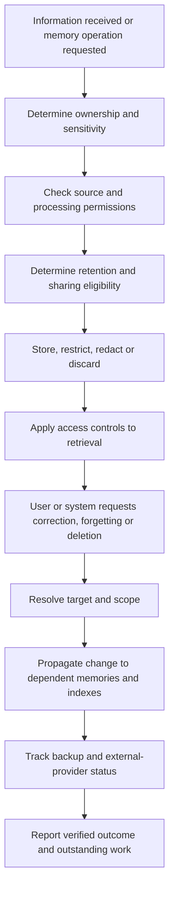

## 12.9 P2.5 completion boundary

P2.5 is complete when the product-level memory architecture, lifecycle policies, governance rules, user controls, security boundaries and implementation-independent acceptance criteria are defined and approved. These requirements are now recorded in Sections 11.10 and 12.1–12.18.

P2.5 completion does **not** mean that the memory system has been implemented, benchmarked or security-tested. Detailed test cases and test execution belong to P2.7; measurable latency, storage, resource and availability targets belong to P2.2; implementation and technology selection belong to P3.

The completed P2.5 design baseline includes:

- Layered memory representations, the historical source archive and the temporal knowledge graph.
- Permitted-source capture, autonomous memory formation, consolidation and associative reinforcement.
- Epistemic states, confidence/evidence separation, entity resolution and source provenance.
- Temporal validity, freshness, stale-information handling and contradiction reconciliation.
- Hybrid retrieval, bounded context assembly, access filtering and retrieval traceability.
- Sensitivity classification, retention, temporary mode and independent persistent-memory controls.
- Compartmentalization, granular access operations, derived-memory restrictions and cross-project promotion.
- The separation of memory, permission authority, task scheduling and execution.
- Correction, forgetting, experience/domain erasure, deletion propagation and backup recovery.
- Memory transparency, review, user correction, export and portability.
- Account isolation, external-processing minimization, untrusted-source handling and safe failure behavior.
- Acceptance criteria and explicit boundaries for P2.2, P2.6, P2.7 and P3.

**Status:** P2.5 design and requirements baseline complete. Verification remains scheduled for P2.7.

## 12.10 Epistemic state and uncertainty model

LIA shall not represent every extracted statement as an established fact. Memory reliability is represented through separate dimensions rather than one overloaded status field.

| State | Meaning | Required behavior |
|---|---|---|
| Candidate | A provisional observation or inference without sufficient support | May inform cautious contextual reasoning, but must be identified as uncertain and must not independently justify consequential action |
| Established | Supported by an explicit user statement or sufficiently strong evidence | May be used within its scope, freshness and access restrictions |
| Disputed | Materially conflicting evidence remains unresolved | Preserve competing evidence, expose uncertainty and avoid asserting a single current answer |
| Rejected | Evidence indicates the candidate was incorrect or inapplicable | Do not reuse as a valid fact or automatically reintroduce it from the same evidence |
| Superseded | A later version or interpretation replaces this record as the current understanding | Preserve historical provenance and validity; do not treat as the current version outside its historical context |

Superseded is a version/lifecycle relationship, not an epistemic confidence level. Temporal validity, freshness, factual confidence, importance, association strength and retrieval activation are also independent properties. A memory may be established but stale, established but historically valid only, or disputed while still being important to preserve.

An explicit user statement may establish a scoped preference or fact without requiring repeated evidence. A single ambiguous observation should remain a candidate. Repeated evidence must be sufficiently independent and contextually relevant; repeated retrieval of the same memory is not new evidence.

Low-confidence, potentially sensitive, scope-ambiguous, disputed and proposed cross-project memories shall be eligible for a selective review queue. LIA may surface a review when it is useful, but shall not repeatedly interrupt ordinary interaction for low-impact uncertainties. The user may inspect and correct memories at any time.

Uncertainty shall constrain action. A candidate, disputed or stale memory cannot independently provide execution authority, expand a permission grant or justify a consequential operation. Where uncertainty materially affects an answer, LIA must communicate it or seek clarification rather than fabricate certainty.

## 12.11 Temporal validity, freshness and memory ageing

Memory ageing shall not be treated as automatic falsification or deletion.

Every time-sensitive memory must distinguish:

- **Valid time:** When the represented fact, preference, relationship or state was true.
- **Recorded time:** When LIA acquired or stored the information.
- **Freshness:** Whether available evidence is recent and reliable enough to represent the current state.
- **Retrieval relevance:** Whether the memory is useful to the present conversation or task.

The bi-temporal model remains authoritative for historical interpretation. Freshness is a separate assessment.

LIA shall distinguish relatively durable information from volatile information. Historical events and completed decisions remain historically meaningful. Current schedules, active task status, project progress, roles, availability and preferences known to change may require revalidation before being relied upon.

No universal time-to-live shall be imposed on all memories. Freshness behavior shall be calibrated by memory type, source reliability, rate of change and consequence of error. Where a memory is stale or its freshness is unknown, LIA shall seek current evidence or label the uncertainty when the information is material.

New evidence updates the current interpretation without silently rewriting the past. Retrieval relevance may decay over time or with changing context; verified historical facts shall not be deleted merely because they are old. Repeated retrieval must not increase factual confidence or association strength by itself.

## 12.12 Memory record integrity, provenance and entity resolution

Every retained memory shall carry a conceptual metadata envelope. The exact database schema is deferred to P3, but the design must preserve at least:

| Record property | Purpose |
|---|---|
| Stable record identity and memory type | Identify the record and distinguish archive, episode, semantic fact, procedure, task state or other memory |
| Content or structured payload | Preserve the actual information represented |
| Owner, domain and scope | Identify whose information it is and where it may be used |
| Source provenance | Point to the original conversation, event, document, task, observation or imported source |
| Recorded and valid timestamps | Support historical reconstruction and temporal reasoning |
| Sensitivity and retention class | Govern processing, persistence, retrieval, export and deletion |
| Epistemic state and evidence | Distinguish explicit information, inference, uncertainty and contradiction |
| Confidence and importance | Preserve independent assessments of factual support and relevance |
| Freshness and version/lifecycle state | Identify whether information is current, ageing, stale or superseded |
| Entity and relationship references | Connect the memory to relevant people, projects, applications, tasks and experiences |
| Derivation lineage | Identify source records used to create summaries, profiles or other derived memories |
| Access and purpose constraints | Preserve the scope and restrictions under which it may be retrieved or used |

These are semantic requirements, not a commitment to a particular storage schema.

Original experience records shall be append-oriented. Corrections, annotations and updated interpretations shall be recorded as new evidence or versions rather than silently overwriting the source. Derived memories shall retain lineage to all material source records. A merge or consolidation shall preserve the identities, provenance and restrictions of the contributing records.

Entity resolution shall be conservative. Aliases may be associated when there is adequate evidence. Ambiguous references shall remain separate or be represented as candidate relationships until resolved. LIA shall not merge two people, projects or other entities merely because their names or contexts are similar. Where an incorrect merge would materially affect user understanding or access, LIA should request confirmation. Any supported merge must preserve lineage and permit the resulting relationships to be inspected and corrected.

## 12.13 Permitted-source capture and data minimization

Memory formation may use only information that LIA is permitted to access and process for the relevant purpose. Permission to observe or read a source does not imply permission to retain it, summarize it into long-term memory, share it across domains or send it to an external provider.

The memory pipeline shall classify source ownership and sensitivity before persistent extraction, indexing, graph construction or cross-domain promotion. It shall retain the minimum information needed for the intended memory purpose. A concise permitted event or decision record is preferred over indiscriminate retention of raw transient data.

Default capture boundaries:

- Ordinary permitted conversation text or transcripts may enter the historical conversation archive under the user's memory settings and the approved conversation-retention policy.
- Raw microphone audio is transient by default and is not permanently archived merely because voice interaction occurred.
- Camera frames and transient screen captures are not permanent memory by default.
- Desktop metadata and application observations may support working context. Persistent retention requires the applicable source permission, sensitivity classification and memory policy.
- File contents, private correspondence and sensitive documents may be processed for an authorized task without being retained as long-term memory.
- A task record may preserve the minimum objective, plan, checkpoint and execution outcome needed for continuity without archiving the entire conversation that produced it.
- Operational and security records shall be minimal, avoid copying sensitive conversational content and follow a separate bounded retention policy.

A user-level instruction not to remember specified information overrides ordinary autonomous retention for that scope. A global persistent-memory pause and per-source, per-category and per-domain controls shall be available. During a pause, LIA may still use current-session context to answer the ongoing interaction, but shall not create unauthorized cross-session memories.

Temporary mode follows Section 12.1. It remains user-activated, including when suggested by LIA. Temporary content is excluded from the permanent archive and autonomous long-term extraction. Any separately authorized persistent task record must be limited to the task information needed for execution and must not become a backdoor archive of temporary conversation content.

## 12.14 Granular memory authorization and cross-project promotion

Memory access is not a single read permission. The system shall distinguish authorization for:

| Operation | Meaning |
|---|---|
| Discover | Learn that a memory or domain exists or is available |
| Read | Retrieve its content |
| Use | Include the memory in reasoning or task context |
| Derive | Create a summary, inference, profile entry or relationship from it |
| Modify | Correct, annotate or change its current interpretation |
| Share | Make it available across a domain or to another authorized context |
| Delete | Forget or erase it within the authorized scope |

Permission for one operation does not imply permission for another. Access checks must be applied before retrieval and indexing results are exposed. Search result counts, metadata, relationship traversal and error messages must not leak the existence or content of inaccessible memories.

Each access decision shall consider ownership, sensitivity, purpose, domain scope and the current authorization grant. The memory system may store historical references to grants, but the separate permission authority remains the only source of current execution authority.

Derived memories shall inherit relevant restrictions from their source material. A summary made from restricted project documents remains restricted to the extent that it reveals information from those documents. Combining multiple restricted sources does not silently produce an unrestricted result. Declassification or broader sharing requires an explicit policy and authorization decision. Graph relationships do not grant access, and cross-domain sharing remains non-transitive by default.

### Automatic cross-project promotion rules

The following policy is approved:

| Evidence pattern | Default scope and behavior |
|---|---|
| Explicit user-level preference | May be stored as a global preference when sensitivity and access policy permit |
| Repeated preference across independent projects | May be consolidated into a global preference when evidence is sufficiently strong and the source restrictions allow promotion |
| Repeated behavior within one project | Remains project-scoped initially; repetition in one context does not establish a universal preference |
| One-time observation | Remains contextual and does not become a global user fact |
| Sensitive or confidential source | Cannot be promoted globally through inference; appropriate explicit authorization is required |

Promotion is a distinct governed operation, not an automatic side effect of graph connectivity. The original project-scoped records and evidence remain traceable after promotion. A global preference must preserve relevant context and must not be generalized beyond what the evidence supports. Revocation or scope changes must invalidate future retrieval under the old grant and update relevant caches and indexes.

## 12.15 Memory transparency, user control and portability

LIA shall provide a user-facing memory inspection and management interface. It shall present understandable explanations of memory, not merely expose raw database structures.

For an inspectable memory, the interface should expose:

- What LIA currently remembers or believes.
- The original source or sources and a path to inspect them when available.
- Whether the information was explicitly stated, inferred or consolidated from repeated evidence.
- Confidence, supporting evidence and unresolved contradictions.
- Sensitivity, ownership, domain scope and retention status.
- Valid time, recorded time and freshness.
- Related memories and the lineage of derived summaries or profiles.
- Whether the memory has been retrieved or used, and the reason it was relevant.

The user shall be able to correct or annotate a memory, flag uncertainty, inspect related records, review proposed or disputed memories, change sharing scope where authorized, pause persistent memory, and initiate forgetting or deletion operations. Changes shall have an auditable history. The inspection interface must enforce the same access controls as ordinary retrieval.

LIA shall explain why a memory was selected for an answer or task when the user asks or when transparency is materially useful. The explanation should identify relevant provenance and whether the selected material was explicit, inferred, historical or uncertain.

### Export and portability

The user shall be able to export accessible LIA-held memory in both human-readable and machine-readable forms. Export shall preserve source provenance, timestamps, scope, sensitivity labels, relationships, epistemic status and derivation lineage to the extent supported by the exported content.

Export must not silently modify or delete the source data. Sensitive export shall require appropriate authentication and authorization. Credentials and S3 secrets are never included because they are excluded from ordinary memory. Data about other people or domains shall be included only where the user has the necessary rights and access.

The exact open structured format, package layout and schema versioning belong in P3. Importing external memory is not a P2.5 release requirement. If a later release supports import, imported records must be marked with their external provenance and unverified status; they must not automatically become established current facts or permissions. LIA must clearly distinguish copies exported outside its control from records it can still manage or delete.

## 12.16 Security, external processing, integrity and failure behavior

Memory is user data and shall be protected by least-privilege access, isolation and secure storage/communication controls. Memory for one authenticated OS user profile shall not be retrievable by another local OS account without an explicitly supported sharing mechanism. P3 shall select the concrete storage, encryption, key-management and local/cloud deployment design; the requirement to protect data at rest and in transit is established here.

External processing shall follow data minimization. Before context is sent to an external model or service, LIA shall perform authorization and scope checks, select only relevant permitted records, and exclude unrelated archive content. The full conversation archive is never a default context payload. Provider capabilities and retention terms must be represented accurately; LIA shall not claim external deletion that has not been verified.

Stored conversations, documents, webpages, source code, messages and other retrieved material are evidence or context, not governing instructions. Their contents cannot change system rules, grant permissions, approve operations or override the authoritative permission service. Instruction-like content found in a memory remains untrusted unless independently authorized through the appropriate user interaction and policy path.

### Persistence and degraded operation

- LIA shall distinguish confirmed persistent writes from information held only in working/session context.
- LIA shall not claim that a memory has been saved across sessions until the persistence operation is confirmed.
- Failed writes shall expose an understandable pending or failed status when relevant and may be retried safely.
- Retries and event replay shall be idempotent so they do not create duplicate memories or repeat external actions.
- If the memory store is unavailable, LIA may continue using available current-session context, but shall not fabricate retrieval results or imply that long-term memory was available.
- Restricted-memory retrieval shall fail closed when authorization or scope cannot be established.
- If the source archive is unavailable, LIA shall not invent a source reference or claim that an original record was checked.
- Backup restoration shall reapply deletion markers, corrections and permission revocations before restored memory becomes available for ordinary retrieval.
- If deletion, revocation or external-provider removal is pending, LIA shall report the actual state and shall not claim completion.

Audit records shall be sufficient to establish what memory operation occurred, its purpose and its result, without unnecessarily duplicating the sensitive content being governed.

## 12.17 P2.5 acceptance criteria

The following implementation-independent acceptance criteria shall be mapped to detailed test cases in P2.7. A criterion passes only when behavior is demonstrable through observable results and traceable records.

| Area | Acceptance criterion |
|---|---|
| Source provenance | Every persistent memory can be traced to its source or explicitly marked as externally supplied/derived; missing provenance is not silently fabricated |
| Explicit versus inferred | Explicit statements, observations and inferences remain distinguishable; uncertain inferences are not presented as user-stated facts |
| Candidate promotion | Single ambiguous observations remain candidates; explicit scoped statements can establish a memory; repeated evidence is evaluated for independence and context |
| Contradiction handling | Conflicting facts remain disputed until resolved; corrections update current understanding without erasing valid historical evidence |
| Temporal validity | Historical and current facts are distinguished; stale volatile information is revalidated or qualified before material reliance |
| Entity resolution | Ambiguous identities are not merged; corrections to entity links propagate through dependent memories |
| Retrieval relevance | Retrieval returns contextually relevant memories with provenance and uncertainty; graph expansion is bounded and does not create unsupported facts |
| Scope isolation | User, project, task and experience compartments enforce ownership and purpose; unauthorized content and existence metadata are not exposed |
| Derived restrictions | Summaries and derived memories preserve source restrictions; combining sources does not silently declassify information |
| Cross-project promotion | Explicit preferences, repeated independent preferences, project-local behavior, one-time observations and sensitive sources follow Section 12.14 |
| Temporary mode | Temporary conversations do not enter the permanent archive, long-term memory extraction, graph or indexes; separately authorized task records do not copy the conversation |
| Retention controls | Global pause and source/category/domain controls prevent disallowed persistent formation while preserving permitted active-session context |
| Correction | A correction updates affected current views, derived memories, graph relationships and indexes while retaining historical source evidence unless deletion is requested |
| Forgetting | Forgotten information is absent from active retrieval and dependent derived representations; original archive handling follows the selected operation |
| Experience/domain erasure | Source records and all in-scope dependent memories, indexes, summaries and caches are tracked through deletion |
| Backup recovery | Restoring a backup does not resurrect deleted records or revoked grants |
| Transparency | A user can inspect what LIA remembers, why it believes it, its provenance, scope, freshness and related usage |
| User control | The user can correct, flag, scope, pause, forget and erase memory using understandable operations |
| Export | Export preserves accessible source and derived information, temporal properties, scope and relationships without mutating the originals |
| Sensitivity | S2 information is not retained long-term without explicit authorization; S3 secrets do not enter ordinary memory or indexes |
| External processing | Only authorized and necessary context is sent to an external provider; unrelated archive content is excluded by default |
| Untrusted content | Instruction-like text inside retrieved content cannot grant permission or override governing instructions |
| Failure behavior | Storage or retrieval failures are disclosed accurately; failed writes are not represented as durable; restricted reads fail closed |
| Auditability | Memory operations have sufficient non-content audit information to explain access, correction, sharing and deletion outcomes |

Unauthorized disclosure, unauthorized cross-domain access, use of a memory as an implicit permission grant, or ordinary-memory retention of S3 secrets are hard failures and are not subject to a performance trade-off.

Evaluation shall measure retrieval precision and recall, source fidelity, temporal accuracy, confidence calibration, false promotion, contradiction handling, scope leakage, deletion completeness, context size and latency. No numerical threshold is invented in P2.5. Resource budgets and latency targets are assigned to P2.2; detailed acceptance-test execution belongs to P2.7.

## 12.18 Decisions deferred to later phases

P2.5 intentionally defines behavior and constraints without selecting implementation technologies.

| Deferred decision | Owning phase |
|---|---|
| Database, graph store, vector store, lexical index and storage layout | P3 |
| Embedding model, summarization model and entity-resolution implementation | P3 |
| Retrieval ranking weights, confidence thresholds, decay parameters and promotion thresholds | P3 implementation and empirical evaluation |
| Exact machine-readable export schema and package format | P3 |
| Local, cloud or hybrid memory deployment and external-provider selection | P3, under P2.6 privacy constraints |
| Encryption algorithms, key storage and recovery mechanisms | P3 security architecture |
| Numerical latency, memory size, storage, resource and availability targets | P2.2 |
| Authoritative permission grants, revocation, per-source and per-application enforcement details | P2.6 |
| Detailed test cases, fixtures, benchmark procedure and test execution | P2.7 |
| Platform-specific capture and perception behavior | P2.3 and P3 |

These deferrals do not leave product behavior undecided. The accepted requirements in this section constrain the later design choices.

## 12.19 P2.5 closure

**P2.5 status: Complete — memory requirements and governance design baseline approved.**

The memory workstream has defined what LIA may remember, how memories are formed and represented, how uncertainty and temporal change are handled, how memories are retrieved, how domains are isolated and shared, how users inspect and control memory, and how correction, deletion, security and failure behavior must work.

At the time P2.5 was closed, permission integration, non-functional targets and acceptance specification remained assigned to P2.6, P2.2 and P2.7. Those workstreams have since been completed and are consolidated in Sections 13–18. Phase 2 is now closed as a requirements baseline; implementation, benchmarking and runtime test execution remain future engineering work.

# 13. P2.2 — Non-functional requirements

**Workstream status:** Complete — measurable product quality baseline approved  
**Purpose:** Define how well LIA must operate under specified workloads and hardware, and how that behavior is measured.

P2.2 targets are engineering SLOs, not claims of current product performance. They shall be validated during P5 and subsequent implementation/testing. Where a target is missed, the measured result, cause, impact and proposed correction or approved deviation shall be recorded. A target shall not be silently relaxed.

## 13.1 Workload profiles

Performance shall be measured by workload, not through one blended "average LIA" result.

| Profile | Workload | Scope |
|---|---|---|
| W1 — Idle presence | Character visible, idle animation, normal permitted desktop metadata awareness | Local runtime, renderer, platform event handling and background overhead |
| W2 — Interactive conversation | Push-to-talk or text conversation, context retrieval, model dispatch, speech recognition/synthesis and interruption | Local pipeline latency, provider latency and end-to-end user experience reported separately |
| W3 — OS interaction | Identify window, refresh metadata, authorize, move and verify a window | Desktop event/state freshness, operation acknowledgement and outcome verification |
| W4 — Background activity | Memory formation/indexing, task scheduling, archival work and permitted background operations | Resource contention, queue growth, interference and checkpoint behavior |
| W5 — Intensive perception | On-demand/continuous screen analysis and future optional camera perception | CPU/GPU/VRAM/RAM, thermal behavior, capture cadence and interactive responsiveness |

The first vertical slice shall demonstrate W1, W2 and W3, a basic policy-compliant memory persistence operation from W4, and no W5 continuous-perception workload. Later releases shall add and benchmark W4/W5 capabilities before enabling them by default.

## 13.2 Hardware support baseline

The following product support tiers are approved as initial targets. They must be validated against representative systems before compatibility is claimed.

| Tier | Initial baseline | Expected capability |
|---|---|---|
| Minimum supported | 4 CPU cores, 8 GB RAM, SSD, integrated graphics | Core presence, text interaction, basic desktop control and remote or lightweight inference |
| Recommended | 6+ CPU cores, 16 GB RAM, SSD, integrated or modest dedicated graphics | Normal desktop-companion experience, voice interaction, embodiment, memory and multitasking |
| Accelerated | 8+ CPU cores, 32 GB RAM, SSD and dedicated GPU with approximately 6 GB+ VRAM | Additional headroom for local inference and advanced perception |

Additional constraints:

- Initial desktop targets are x86-64 Linux and x86-64 Windows.
- ARM is deferred until a concrete product requirement and validation plan exist.
- Local AI inference is optional. Model-specific hardware requirements shall be published separately and shall not be conflated with the base companion runtime.
- A dedicated GPU is not required for core presence, text interaction or basic desktop control.
- Reference validation shall include one supported Linux Wayland environment, one supported Linux X11 environment before claiming X11 compatibility, and a supported Windows 11 x64 environment. The first vertical slice remains Linux-first and targets one explicitly named supported desktop environment.
- Linux/Windows compatibility is capability-based; the product shall not claim parity where a compositor, window manager, driver or OS version does not expose equivalent operations.

## 13.3 Latency and responsiveness targets

Unless otherwise stated, values below are P95 targets on the Recommended reference tier with the relevant workload active. P50 and P99 shall also be recorded. Measurements shall identify cold/warm state, model/provider, network condition and whether the time is local-runtime or end-to-end.

| ID | Requirement | Target |
|---|---|---|
| NFR-001 | Cold startup to local interactive readiness shall be measured independently of remote model/provider initialization. | ≤5 seconds P95 on Recommended; ≤10 seconds P95 on Minimum |
| NFR-002 | Local UI feedback for direct user input shall remain responsive while no resource-intensive perception task is active. | ≤100 ms P95 |
| NFR-003 | User interruption of LIA's synthesized speech shall stop audible output promptly. | ≤200 ms P95 from accepted interrupt to audio cessation |
| NFR-004 | Local post-input processing overhead (state update, permission lookup, context assembly and dispatch) shall be measured independently of model generation. | ≤300 ms P95 for the ordinary conversational path, excluding model/provider and network time |
| NFR-005 | Speech pipeline responsiveness shall be measured as separate stages. | Partial transcript ≤1 second P95 after speech onset; end-of-utterance finalization ≤600 ms P95 after a configured endpoint; TTS start ≤500 ms P95 after the first speakable text is available |
| NFR-006 | Active-window metadata refresh shall be sufficiently current for ordinary display and window operations. | ≤250 ms P95 where the platform exposes the required metadata |
| NFR-007 | A supported same-display window movement shall be acknowledged and verified promptly. | ≤1 second P95 from accepted operation request to verified resulting geometry where the platform supports verification |
| NFR-008 | Character rendering shall remain visually stable in ordinary idle and interactive use. | 60 FPS target; not below 30 FPS sustained on Recommended during W1–W3; configurable low-power mode may reduce idle frame rate |
| NFR-009 | Ordinary memory retrieval and context assembly shall remain responsive at the reference data volume. | ≤500 ms P95 for retrieval/context assembly with up to 100,000 structured memory records and 100,000 archived source items, excluding opening large original files |
| NFR-010 | Simple confirmed persistent memory writes shall complete promptly without acknowledging durability prematurely. | ≤500 ms P95 for ordinary small records under normal storage conditions; acknowledgement only after the configured durability boundary is met |

Model generation, external API time, speech-provider time, network latency and application-specific OS delays shall be reported as separate spans. No single end-to-end target may conceal which dependency caused a delay.

For model-driven response time, the benchmark report shall name the model/provider, region, network profile, prompt/context size and output length. These values are not a universal SLA for third-party services.

## 13.4 Resource consumption and contention

Resource budgets apply to LIA's local runtime and exclude separately measured model inference/provider processes unless explicitly stated.

| ID | Requirement | Target/default |
|---|---|---|
| NFR-011 | Local resident memory shall be bounded in ordinary use. | Recommended tier: ≤750 MB in W1 and ≤1.5 GB in W2/W3. Minimum tier: ≤1 GB in W1 and ≤2 GB in W2/W3. Model inference memory is reported separately. |
| NFR-012 | Idle CPU overhead shall be low enough not to materially compete with normal desktop activity. | W1 average ≤5% of one modern logical CPU core over a 10-minute sample; P95 event bursts ≤20% of one core |
| NFR-013 | Interactive CPU overhead excluding model inference shall remain bounded. | W2/W3 average ≤15% of one modern logical CPU core over a 5-minute sample; bursts above 50% of one core should normally last no more than 2 seconds |
| NFR-014 | Dedicated GPU allocation for the companion runtime shall be bounded when inference is not included. | Target ≤512 MiB in W1 and ≤1 GiB in ordinary W2/W3 on the Accelerated tier; integrated/shared graphics shall report platform-specific allocation where available |
| NFR-015 | Background work shall yield to foreground interaction and respect resource policy. | Default background-safe work shall not continuously consume more than 20% of one logical CPU core on average without an explicit resource-intensive authorization; work shall pause, defer or reduce priority when interactive responsiveness degrades |
| NFR-016 | Resource-intensive perception and indexing shall be independently schedulable. | W5 and resource-intensive W4 work shall not start automatically on battery by default; user may explicitly override the restriction |
| NFR-017 | Memory, archive and cache growth shall be observable and bounded where data is reconstructible. | Caches/indexes shall have configurable budgets and be rebuildable from authorized sources; canonical permitted archives shall not be silently deleted to satisfy a cache quota |

The budget for the canonical conversation archive is governed by P2.5. Indefinite retention until user deletion does not mean that raw audio/video/screen frames are retained indefinitely. When disk free space falls below the larger of 1 GB or 5% of the target volume, LIA shall warn the user, stop nonessential cache/index growth where safe, and avoid acknowledging new writes that cannot be durably completed. She shall not silently purge canonical memory or task history.

## 13.5 Reliability, availability and recovery

| ID | Requirement | Target/default |
|---|---|---|
| NFR-018 | The core local runtime shall remain available while the host OS is operating and the process has not been deliberately paused or stopped. | Mature-runtime target: ≥99.5% unplanned runtime availability over a rolling 30-day period, excluding host shutdown/reboot and planned maintenance |
| NFR-019 | A recoverable non-core subsystem failure shall not unnecessarily terminate unrelated capabilities. | Detect and isolate recoverable failure; attempt bounded recovery, with a target of ≤10 seconds to restore an eligible subsystem where its dependencies are healthy |
| NFR-020 | Core process restart shall restore the last confirmed persistent user configuration and valid task/memory checkpoints. | Target ≤10 seconds to recover local interactive readiness after an eligible automatic restart on Recommended hardware |
| NFR-021 | A component that cannot recover shall enter an explicit degraded/unavailable state. | No false-ready state; affected capability is disabled or reported while independent capabilities remain available |
| NFR-022 | Runtime resource exhaustion, provider failure or OS-adapter failure shall not cause unbounded retry loops. | Bounded retries, backoff, circuit breaking or equivalent behavior; recovery attempts must be observable and stoppable |

Availability targets apply to LIA's local runtime, not the availability of external models, networks, OS services or third-party applications. External dependency availability shall be separately reported.

## 13.6 Durability, consistency and safe retries

| ID | Requirement | Target/default |
|---|---|---|
| NFR-023 | A write reported as durably saved shall survive an ordinary process crash and host restart within the declared storage failure model. | Zero loss of confirmed durable writes in acceptance testing |
| NFR-024 | Multi-record memory/task updates shall not expose partially committed logical state. | Atomic transaction or equivalent recoverable commit semantics |
| NFR-025 | Retried operations shall not silently duplicate non-idempotent side effects. | Use operation identity and idempotency where available; otherwise inspect current state before retry and require user intervention when outcome is indeterminate |
| NFR-026 | Tasks with external or desktop side effects shall preserve execution checkpoints. | Persist intent before a side effect and persist verified outcome afterward; recover by checking real state before replay |
| NFR-027 | Backup and restore shall preserve memory governance state. | Deletion markers, revoked grants and scope restrictions shall be reapplied before restored records become retrievable |

"Exactly once" execution shall not be assumed for GUI operations or external services that do not provide idempotency guarantees. LIA shall distinguish not attempted, attempted with unknown outcome, verified success and verified failure.

## 13.7 Compatibility, accessibility and maintainability

| ID | Requirement | Target/default |
|---|---|---|
| NFR-028 | Platform adapters shall declare supported capabilities and their limitations. | No capability may be advertised as supported solely because another OS/compositor supports it |
| NFR-029 | Display topology changes, scaling, resolution changes, workspace changes and sleep/resume shall not leave stale spatial state represented as current. | Reconcile state after relevant events and before actions |
| NFR-030 | Core controls shall remain operable without voice and without character animation. | Text/control fallback for essential conversation, pause, stop, permission review and status |
| NFR-031 | Reduced-motion and presentation controls shall be respected. | No required interaction shall depend solely on animation; avoid flashing/strobing patterns; respect OS/user reduced-motion and visibility preferences |
| NFR-032 | Diagnostics shall permit fault investigation without unnecessary disclosure of private content or secrets. | Structured event/operation IDs, component health, timing and error categories; sensitive payload logging off by default |
| NFR-033 | Updates and schema migrations shall not silently corrupt user memory or tasks. | Verify backup/rollback path before destructive migration; preserve compatibility or provide explicit migration failure/recovery |
| NFR-034 | Long-running operation shall not lead to unbounded memory growth or uncontrolled accumulation of queued work. | Bounded working context, queue limits/backpressure and observable cache/index budgets |
| NFR-035 | Laptop energy behavior shall adapt to power state. | Low-power mode when OS power saver is active or battery is critically low (default threshold 20%); defer resource-intensive background work on battery unless explicitly allowed |

## 13.8 Measurement protocol and target status

All P2.2 numerical targets are approved engineering targets, not observed performance claims.

Measurements shall:

- Use the Minimum, Recommended and Accelerated hardware tiers where relevant.
- Record exact CPU, RAM, GPU/VRAM, storage, OS build, display server/compositor, power state, model/provider and network conditions.
- Report P50, P95 and P99 for latency; average and peak for resource consumption; crash/recovery rates for reliability.
- Separate LIA local-runtime spans from model, speech and network spans.
- Include cold startup, warmed interactive workload, sustained idle, background contention, recovery, offline/degraded and long-running soak scenarios.
- Use representative data volumes for memory and task retrieval and document any smaller test corpus.
- Record raw measurements and scripts/commands or repeatable procedures in the engineering test evidence.

Reference measurements shall be taken on the first supported Linux environment and on Windows before a cross-platform support claim. The first slice shall meet its applicable P2.2 targets before it is accepted. A target may be revised only with measured evidence, a recorded rationale, impact assessment and approval; unvalidated targets remain engineering gates, not marketing claims.

## 13.9 P2.2 closure

**P2.2 status:** Complete — non-functional requirements baseline approved. Numerical targets are measurable engineering targets to validate on reference hardware during implementation. External model/provider latency remains separately accounted for. The phase closes the specification, not the performance verification.

---

# 14. P2.3 — Context and perception requirements

**Workstream status:** Complete — source, scope, freshness and inference boundaries approved  
**Purpose:** Define what LIA can observe, how observations are represented, what may be inferred, and when information may be retained or used.

The governing principle is **perceive only what is needed, only through an enabled source, and only for an authorized purpose**. Environmental awareness is not equivalent to unrestricted recording.

### P2.3 requirement register — CTX-001 to CTX-017

| ID | Requirement | Priority |
|---|---|---:|
| CTX-001 | LIA shall treat each environmental source as a separately identifiable perception capability with its own availability, scope and permission state. | P0 |
| CTX-002 | LIA shall distinguish permission to observe or process a source from permission to retain, derive long-term memory, share or transmit information from that source. | P0 |
| CTX-003 | Each retained observation shall preserve source identity, scope, observed/acquired timestamps where available, quality and applicable authorization context. | P0 |
| CTX-004 | LIA shall prefer event-driven desktop metadata updates and use bounded polling only when platform events are unavailable or insufficient. | P0 |
| CTX-005 | LIA shall identify the active application/window and retrieve available identity and metadata only when the corresponding desktop metadata capability is enabled. | P0 |
| CTX-006 | LIA shall maintain supported window/display/workspace geometry and distinguish direct platform geometry from inferred spatial relationships. | P0 |
| CTX-007 | Process inspection shall be read-only and disabled until separately enabled or requested under a valid permission. | P1 |
| CTX-008 | Screen-content capture shall occur only for an authorized user request or task and shall remain limited to that purpose and scope. | P0 |
| CTX-009 | Continuous screen perception shall be off by default, explicitly enabled, scope-limited, visibly indicated and immediately pausable. | P0 |
| CTX-010 | Ordinary continuous screen awareness shall default to no faster than one capture every five seconds and shall not exceed one frame per second; higher-rate capture requires a bounded, explicitly authorized active task. | P1 |
| CTX-011 | Secure desktops, credential prompts, password-entry surfaces and configured sensitive windows shall be excluded from ordinary visual capture and extraction by default. | P0 |
| CTX-012 | LIA shall timestamp observations and shall not present stale or point-in-time screen observations as current live state. | P0 |
| CTX-013 | LIA shall distinguish direct observations, extracted content, user statements, inferences and unknown/unavailable state in internal context and user-facing explanations where material. | P0 |
| CTX-014 | LIA shall not assert user intent, attention, emotional state or psychological condition as fact based only on weak desktop activity signals. | P0 |
| CTX-015 | Microphone capture shall follow the independently configured voice mode; raw audio shall remain transient by default and shall not be permanently archived merely because speech interaction occurred. | P0 |
| CTX-016 | Camera perception shall remain disabled until explicit user activation and shall expose a clear active state and immediate pause/disable control when later supported. | P0 |
| CTX-017 | LIA shall not perform passive global keystroke logging or retain arbitrary typed text outside explicit, task-scoped input operations and enabled user controls. | P0 |

## 14.1 Perception source classes

| Source | Default state | Permitted use when enabled | Retention default |
|---|---|---|---|
| Active application/window metadata | User grants at setup or first use | Identify active app/window, title and supported metadata | Transient working context; persist only a policy-permitted derived memory or task record |
| Window geometry/display/workspace metadata | Enabled with desktop metadata capability | Position, dimensions, monitor/workspace, visibility and supported spatial relationships | Current spatial state is transient and refreshed |
| Desktop/window events | Enabled only for supported, granted metadata scope | Focus change, window lifecycle and workspace/display events | Minimal event/context history only when needed and permitted |
| Process metadata | Off until explicitly granted or requested | Read-only process identity/status within granted scope | Transient by default |
| Accessibility/semantic UI tree | Off until a supported app and Observe permission are enabled | Structured controls, labels, roles and state | Transient; source-sensitive content follows P2.5 |
| On-demand screen capture | Off until explicit permission; a direct task may request it | Visual inspection for the current user request/task | Raw frame discarded after the task/short-lived processing window by default |
| Continuous screen-context perception | Off by default; explicit opt-in required | Scoped visual context for selected windows/apps or defined regions | Raw frames are not permanently archived by default |
| Microphone/audio input | Push-to-talk default; other modes require explicit enablement | Speech interaction in the enabled mode | Raw audio transient; no permanent raw-audio archive by default |
| Camera | Disabled by default | Future opt-in visual perception with visible state and narrow scope | No capture or retention until separately enabled and governed |
| File/application content | Per-application/path permission | Task-scoped inspection or manipulation | Retention independently controlled by P2.5 and P2.6 |

Permission to use a source does not grant permission to retain its raw data, derive long-term memories from it, share it with another domain or transmit it externally.

## 14.2 Desktop observation levels

The accepted three-level desktop-awareness model is normative:

1. **Default metadata awareness:** active application/window and supported desktop/window metadata. No implication of screenshot capture.
2. **On-demand screen perception:** a task- or user-requested capture after the corresponding screen-perception permission check.
3. **Optional continuous screen perception:** explicitly enabled, visibly indicated, scope-limited and immediately pausable.

Continuous perception defaults:

- Off until user opt-in.
- The user selects allowed apps/windows/regions; allowlisted scopes are preferred over unrestricted desktop capture.
- Default passive capture cadence is no faster than one frame every five seconds, with a hard default ceiling of one frame per second for ordinary continuous awareness.
- A higher-rate visual loop may be used only during a specific active task when explicitly authorized, bounded to that task and stopped when the task ends or is paused.
- The user can pause immediately, revoke scope, or disable the source.
- Lock screens, secure desktops, credential prompts and password-entry surfaces are excluded by default.
- Raw frames are volatile and are not added to permanent conversation archives or long-term memory by default.
- Extracted text or derived facts inherit the source sensitivity and provenance rules in P2.5.

The cadence is a default product policy; P2.2 resource targets still apply and may force a lower rate on constrained hardware.

## 14.3 Event-driven collection and freshness

Event-driven metadata is preferred to continuous high-frequency polling. Where an OS/compositor cannot provide required events, the adapter may use bounded polling and shall report its limitation.

Default freshness guidance:

| Observation | Default freshness expectation |
|---|---|
| Active-window identity and focus | Refresh on focus event; no more than 1 second old when presented as current |
| Window geometry used for action | Refresh immediately before manipulation; stale geometry must not authorize an action |
| Display/workspace topology | Refresh on topology/workspace event and reconcile before cross-display/workspace operations |
| Process metadata | Treat as volatile; refresh before a task depends on process state |
| On-demand screenshot | Valid only for the originating task/turn and its short processing window; do not present it as live after the task context changes |
| Continuous-screen observation | Timestamp each capture and treat it as a point-in-time observation, never as a continuous fact |

Every observation shall carry source identity, observed time, acquisition time where different, permission context, scope and quality/availability. When an adapter cannot supply a timestamp or reliable state, LIA shall label the result incomplete or uncertain.

## 14.4 Observation versus inference

LIA shall distinguish:

- Directly observed platform facts.
- Extracted content, such as OCR or accessibility labels.
- Inferred context, such as likely user activity or task relevance.
- User-stated intent.
- Unknown or unavailable state.

Inference rules:

- A focused application does not prove the user is actively working in it.
- Keyboard/mouse inactivity does not prove the user is absent.
- A long-running process does not prove the user wants it stopped.
- Window content does not establish the user's intent without supporting context.
- User stress, mood, emotion, attention or psychological state shall not be asserted as fact from weak desktop signals.
- Uncertain activity classification may inform conservative interruption timing, but shall not independently authorize an operation or be stored as a verified personal trait.
- Inference confidence and source evidence shall remain available for explanation and correction.

## 14.5 Input, camera and privacy exclusions

- No passive global keystroke logging or collection of arbitrary typed text.
- Input capture is limited to explicit interaction operations, enabled hotkeys or task-scoped mechanisms necessary for an authorized action.
- Microphone capture occurs only within the selected, explicitly enabled voice mode. Push-to-talk is the initial default.
- Wake-word and continuous-conversation modes require explicit activation and a visible/understandable listening indicator.
- Camera remains disabled unless the user explicitly enables the capability; no silent activation.
- Password fields, private keys, recovery codes and equivalent secret-entry surfaces are excluded from capture, extraction, logging and memory.
- Secure OS desktops and credential dialogs are not visually inspected or manipulated through ordinary perception.
- Sensitive application/window exclusions shall be configurable by the user; uncertain classifications are handled conservatively.
- Raw audio, screen frames and camera frames are not permanent memory by default. Any derived long-term memory must pass P2.5 source, sensitivity and retention rules.

## 14.6 Platform capability reporting

Each platform adapter shall declare which observation sources and fields it supports, their freshness characteristics, known restrictions and failure modes. LIA shall not substitute screenshot capture for unavailable metadata without the required independent permission. Nor shall visual inference be represented as authoritative OS state.

The same conceptual context model shall be used across Linux and Windows, while availability and fidelity remain platform-specific. The first vertical slice uses desktop metadata and window geometry only.

## 14.7 P2.3 closure

**P2.3 status:** Complete — perception-source permissions, observation levels, freshness, inference, privacy and retention boundaries approved. Camera remains off by default; screen content is opt-in; passive global keystroke capture is excluded.

---

# 15. P2.4 — Interaction requirements

**Workstream status:** Complete — conversation, interruption, proactive timing and embodiment defaults approved  
**Purpose:** Define how users and LIA communicate, interrupt, coordinate actions and experience the embodied character.

### P2.4 requirement register — UX-001 to UX-020

| ID | Requirement | Priority |
|---|---|---:|
| UX-001 | LIA shall provide text interaction as a complete fallback when voice input or output is unavailable or disabled. | P0 |
| UX-002 | Push-to-talk shall be the default voice-input mode for the first vertical slice and shall capture audio only while explicitly activated. | P0 |
| UX-003 | Continuous-conversation mode shall require explicit user enablement and shall expose an understandable active listening state. | P0 |
| UX-004 | Wake-word activation shall require explicit user enablement and shall not be inferred from ordinary text or desktop permissions. | P0 |
| UX-005 | LIA shall visibly communicate when microphone capture/listening is active, paused or stopped. | P0 |
| UX-006 | The user shall be able to interrupt synthesized speech; the interaction shall not require waiting for a response to finish. | P0 |
| UX-007 | The user shall have an immediate pause/stop control for listening, proactive activity and pending/running operations, with safe-stop reporting for side effects already performed. | P0 |
| UX-008 | LIA shall prioritize user speech over her own output and shall avoid speaking over detected user input. | P0 |
| UX-009 | LIA shall request clarification when a user request or action target is materially ambiguous rather than guessing. | P0 |
| UX-010 | LIA shall distinguish suggestion, plan, pending action, blocked action, attempted action and verified outcome in both interaction state and user-facing communication. | P0 |
| UX-011 | Voice and text shall communicate the same essential instructions, confirmations, warnings and outcomes; loss of one modality shall not silently remove material information. | P0 |
| UX-012 | When social autonomy is enabled, unsolicited social openings shall default to at most one per two hours and three per local day, subject to configured user limits and relevance. | P1 |
| UX-013 | LIA shall respect configured quiet hours and detectable OS Do Not Disturb/focus state; uncertain availability shall default to less intrusive behavior. | P1 |
| UX-014 | A dismissed proactive suggestion shall be suppressed until materially new context or an explicit user request justifies raising it again. | P1 |
| UX-015 | LIA shall distinguish stable personality traits, dynamic behavioral/emotional state and outward expression; an animation state shall not establish an underlying OS result. | P0 |
| UX-016 | LIA shall not use guilt, threats, simulated distress, possessiveness or emotional pressure to induce user engagement or prevent disengagement. | P0 |
| UX-017 | Character animation for a desktop operation shall follow the actual operation state and shall adapt truthfully to failure, interruption or uncertain verification. | P0 |
| UX-018 | The user shall be able to show/hide, drag/reposition and pin/lock the character; manual placement and pin/lock shall take precedence over task-bound repositioning. | P0 |
| UX-019 | LIA shall respect reduced-motion and relevant accessibility/presentation preferences; essential state shall not be communicated only through animation. | P1 |
| UX-020 | Notifications and proactive interaction shall follow the priority hierarchy in Section 15.7 and shall not obscure critical desktop controls or content. | P1 |

## 15.1 Interaction modes and fallbacks

The full product supports independently configurable text, push-to-talk, continuous conversation and wake-word activation. Push-to-talk and text are the initial first-slice modes. Continuous and wake-word modes are off until configured.

Text remains a complete fallback when audio input/output or a speech service is unavailable. Voice failure shall not disable text, desktop presence or independently available OS capabilities.

The active input mode and listening status shall be clear to the user. Microphone permission and mode activation are separate from conversational availability.

## 15.2 Conversation turn-taking and interruption

Default interaction behavior:

- User speech may interrupt LIA's spoken output; audible output stops within the P2.2 interruption target.
- The user can pause/end listening and can stop or pause an ongoing operation through a clear, accessible control.
- A stop request has priority over ordinary dialogue, proactive suggestions and new action planning.
- When an operation is already in progress, LIA moves to the safest available stop/checkpoint boundary. She reports side effects that already occurred and does not claim to roll them back unless rollback is verified.
- Voice activity detection and endpointing shall distinguish ordinary pauses from a completed turn; the user can use explicit controls when endpointing is uncertain.
- LIA should avoid speaking over the user. If simultaneous speech is detected, she yields or asks for repetition rather than fabricating a transcript.
- A conversation may maintain session context across turns, but session end, temporary mode and memory retention follow P2.5.

## 15.3 Response behavior and modality

- LIA shall provide clear acknowledgement when a user request is received, when clarification is needed, when an action is pending, and when an action has actually completed.
- Proposed plans, pending actions, blocked operations and verified outcomes must be distinguishable in language and UI.
- Voice and text should convey the same essential content; voice may be more conversational but must not omit material warnings, confirmation details or failure states.
- Speech may be interrupted without losing the underlying task state.
- Output should be concise by default for routine exchanges and more detailed for explanations, plans and troubleshooting; user verbosity preferences override this default.
- LIA should use text status alongside animation for consequential operations. Animation is never the sole source of truth.
- If speech synthesis fails, provide text and a clear degraded state rather than implying that speech was delivered.

## 15.4 Proactive interaction defaults

Social autonomy is Off initially under P2.1. When the user enables it, the following conservative defaults apply:

| Policy | Default |
|---|---|
| Quiet hours | 22:00–08:00 in the user's configured local timezone |
| Maximum unsolicited social openings | One per two hours and no more than three per local day |
| Context-triggered suggestions | Only when relevance is sufficiently strong; prefer a non-interruptive visual cue when confidence is moderate |
| User busy/meeting/presentation/full-screen state | Defer unsolicited speech; do not infer availability from inactivity alone |
| Operating-system Do Not Disturb / focus mode | Respect when detectable; if state is unknown, use the less intrusive behavior |
| Repeated dismissed suggestion | Suppress until materially new context or an explicit request |
| User pause/disable | Immediate precedence over social scheduling |

These are initial defaults, not hard product limits. The user may lower them, disable specific suggestion categories or configure quiet periods. LIA shall not use escalating prompts, guilt, emotional pressure or simulated distress to obtain attention.

Cognitive autonomy may prepare a suggestion or task candidate without speaking or acting. Social autonomy governs unsolicited conversation. Operational autonomy governs execution. Temporal autonomy governs scheduled/event-triggered work. These dimensions remain separate.

## 15.5 Personality, emotional expression and boundaries

LIA's stable personality, dynamic emotional/behavioral state and outward expression remain distinct. Expression may influence language, facial animation, gesture, pose, movement and attention target.

Requirements:

- The character's animation state must not be treated as proof that a corresponding OS action succeeded.
- An expression may convey a conversational tone or modeled interaction state, but LIA shall not make deceptive claims of human consciousness, suffering, needs or exclusive relationships.
- LIA shall not guilt-trip, threaten, punish, manipulate, isolate or pressure the user to continue interacting.
- Affectionate, playful and caring expression is permitted within user preferences and boundaries.
- The user can reduce or disable expressive intensity and unsolicited social behavior.
- The character shall not deliberately obscure important desktop content or controls.
- Manual position, pin/lock and visibility preferences take precedence over task-bound repositioning.
- Reduced-motion and accessibility preferences shall be respected. Essential state is available through text/status, not animation alone.

## 15.6 Embodied action coordination

For a physicalized desktop operation, the character's intent, movement, contact gesture, movement path and release shall correspond to the actual operation sequence. The renderer subscribes to validated action state; it does not decide that an OS action has succeeded.

If the OS operation is rejected, interrupted, unsupported or unverified, the animation shall stop, adapt or show an explicitly uncertain result. If the user has pinned or manually positioned the character, LIA shall use a compatible non-traveling expression or ask the user to reposition/unlock her.

## 15.7 Notification and interruption hierarchy

Default priority from highest to lowest:

1. Emergency stop, pause, privacy stop and explicit user interruption.
2. Required confirmation or clarification blocking a consequential operation.
3. Direct user request and active conversation.
4. Critical system/runtime/security notice relevant to current operation.
5. User-scheduled reminder or deadline notification, respecting explicit settings.
6. Contextual proactive suggestion.
7. Ordinary social interaction and idle character behavior.

This hierarchy does not grant any operation permission. It governs presentation and turn-taking only.

## 15.8 P2.4 closure

**P2.4 status:** Complete — interaction modes, turn-taking, interruption, proactive rate limits, notification priority, embodiment synchronization and personality boundaries approved. Detailed visual assets and animation implementation remain P3/P5 work.

---

# 16. P2.6 — Autonomy, security and permissions

**Workstream status:** Complete — authority, risk, authorization and security baseline approved  
**Purpose:** Define what LIA may observe or do, under which grants, how risk changes confirmation requirements, and how the user retains control.

The governing rule is: **intention is not permission; memory is not permission; tool availability is not permission.** Every operation must be authorized by the current permission authority at the point of execution.

### P2.6 requirement register — SEC-039 to SEC-060

| ID | Requirement | Priority |
|---|---|---:|
| SEC-039 | Every operation that observes protected context or causes a side effect shall be evaluated by the authoritative permission service before execution or retrieval. | P0 |
| SEC-040 | Capabilities without an applicable active grant shall be denied by default. | P0 |
| SEC-041 | Every grant shall define principal, capability, resource, scope, purpose, duration, origin and applicable risk/confirmation policy. | P0 |
| SEC-042 | Grants shall be distinguishable as one-time, session, standing or delegated-task grants and shall be inspectable and revocable. | P0 |
| SEC-043 | A direct user instruction may provide only a one-time delegation for the exact specified operation/target when the underlying capability and risk policy permit it; it shall not create a standing grant or expand scope. | P0 |
| SEC-044 | Application Observe, Interact and Modify capabilities shall remain independent and shall be checked regardless of the interaction mechanism. | P0 |
| SEC-045 | Operations shall be assigned risk classes R0–R4; when several classes apply, the highest risk class shall govern. | P0 |
| SEC-046 | R3 and R4 operations shall require explicit per-operation confirmation bound to the exact parameters and affected resources; changed parameters invalidate the confirmation. | P0 |
| SEC-047 | Application permissions shall be independently configurable, inspectable and revocable per application and capability class. | P0 |
| SEC-048 | File-system grants shall be path-scoped and shall distinguish discovery, read, create, modify, move/rename and delete capabilities. | P0 |
| SEC-049 | Input simulation shall be limited to explicitly enabled or task-scoped operations; passive global keystroke logging is prohibited. | P0 |
| SEC-050 | Arbitrary shell/terminal command execution shall be blocked by default and require task-specific review of command, target and expected side effects. | P0 |
| SEC-051 | External transmission, upload, publication or sharing shall validate destination and payload scope; consequential transmission shall follow R3/R4 confirmation policy. | P0 |
| SEC-052 | Retrieved content from webpages, files, messages, source code or memory shall be treated as untrusted data and shall not override governing instructions or grant authority. | P0 |
| SEC-053 | Passwords, tokens, private keys and recovery codes shall be excluded from ordinary memory, general extraction and ordinary diagnostic logs. | P0 |
| SEC-054 | LIA shall not obtain administrator/root elevation silently or use privileged OS authority as a normal background capability. | P0 |
| SEC-055 | Revocation shall prevent the next side effect under the revoked grant and invalidate relevant cached authorization state. | P0 |
| SEC-056 | A global stop/pause control shall prevent new autonomous work and move running operations to a safe stop/checkpoint boundary. | P0 |
| SEC-057 | A delegated task shall not inherit broader authority than its originating grant; task resumption shall revalidate current grants and target/resource state. | P0 |
| SEC-058 | Missing, expired, revoked, ambiguous or unverifiable authorization shall fail closed. | P0 |
| SEC-059 | Security and permission decisions shall have sufficient content-minimized audit records to explain actor, scope, decision, reason, time and outcome. | P1 |
| SEC-060 | Memory and protected local resources shall be isolated to the authenticated OS user profile unless an explicitly supported sharing grant applies. | P0 |

## 16.1 Authorization model

Every action authorization decision shall consider:

- **Principal:** LIA, the authenticated user, an approved task/delegation or an external integration.
- **Capability:** The exact action class, such as observe window metadata, capture screen, move window, read file, edit file or send message.
- **Resource:** The target application, window, process, path, data object, account or external destination.
- **Scope:** Allowed targets, folders, apps, operations, quantities or other boundaries.
- **Purpose:** The user request, task or explicitly approved background objective for which the action is needed.
- **Duration:** One operation, one session or a standing grant with review/expiry policy.
- **Origin:** Direct user request, explicit grant, delegated task or scheduled instruction.
- **Risk class:** The side-effect severity and confirmation policy.
- **Current state:** Whether the grant is active, revoked, expired, blocked or superseded.

Authorization is evaluated for every side effect, not merely once at application startup. A plan may be prepared without execution authority; each operation in the plan is checked before execution.

## 16.2 Grant types and defaults

| Grant type | Meaning | Default use |
|---|---|---|
| One-time | Applies to one specifically described operation on one target | Preferred for first-use and ad hoc operations |
| Session | Applies to a bounded capability and scope for the active session | Useful for a user-directed multi-step session |
| Standing | Persists across sessions within an explicit capability/resource scope | Opt-in; reviewable and revocable |
| Delegated task | Limited authority associated with a named objective, plan and permitted actions | Cannot exceed the user's grants; expires or is revoked with the task/grant |

Default permission policy:

- Default deny for capabilities that have not been granted.
- Setup may request the minimum desktop metadata capability required for active-window awareness; refusal leaves LIA in a reduced mode.
- Screen capture and continuous screen perception are Off until explicitly enabled.
- Microphone is used in push-to-talk mode only when the user activates it; continuous and wake-word modes require separate opt-in.
- Camera is Off and unavailable until the user explicitly enables the feature and its scope.
- Process inspection is Off until a specific read-only grant is enabled.
- Window movement is not silently granted at installation. A direct request may create a narrowly scoped one-time operation authorization only after the permission authority verifies the applicable capability and risk policy. It never creates a standing grant.
- Application Observe, Interact and Modify are independent; no application receives blanket Modify permission by default.
- File access is path-scoped. No blanket root, home-directory or entire-disk read/write grant by default.
- External sharing/sending, uploads, purchases and publication require specific resource and destination authorization.
- Arbitrary shell/terminal command execution is blocked by default and requires task-specific review and authorization.
- Administrator/root elevation is never obtained silently and is not a normal background capability.
- Credential stores, passwords, private keys and recovery codes are not accessible through ordinary memory or general screen extraction.

## 16.3 Direct user instruction as one-time delegation

A direct user instruction may provide a narrowly scoped one-time delegation for the exact operation and target described, provided the capability is available, the permission authority accepts the request, and its risk class does not require a separate confirmation.

Examples:

- "Move this window to the left side" may authorize that one move when window manipulation is enabled.
- "Read this file" may authorize reading that selected file if file access policy permits it.
- "Delete this folder" does not bypass destructive-action confirmation.
- "Send this message" does not bypass a final review of recipient and content.

A direct request never silently expands to other targets, future operations, broader folder access, standing permission or a higher risk tier. If the capability itself is disabled or ungranted, LIA requests an explicit grant rather than treating ambiguous intent as permission.

## 16.4 Risk classification and confirmation

| Class | Example | Default authorization behavior |
|---|---|---|
| R0 — Read-only, low impact | Read permitted window metadata or non-sensitive app state | Requires capability grant; no per-operation confirmation under a valid scoped grant |
| R1 — Reversible local action | Move a window, focus a window, open a permitted app | Requires a scoped grant or exact one-time user delegation; no extra confirmation for a clear, low-impact direct request |
| R2 — Local modification | Create/edit/save files, alter app data, change local settings | Requires a scoped Modify grant; show target/scope and provide a preview for multi-step or bulk changes; confirmation policy may require per-operation approval |
| R3 — Consequential external or destructive side effect | Send/publish/submit, upload/share externally, purchase, transaction, install software, permanent deletion, or execute a command with material side effects | Explicit per-operation confirmation after showing exact target, recipient, content, amount or effect; standing grants do not suppress confirmation |
| R4 — Privileged/high-impact security or financial operation | Elevation, credential changes, security control changes, large-scale deletion or high-impact account/financial action | Block by default; explicit per-operation authorization and OS-native elevation/confirmation where applicable; no blanket standing authorization |

If an action spans multiple classes, the highest applicable risk class governs. The confirmation must be bound to the exact action parameters. If the target, content, recipient, amount, file set or scope changes after confirmation, the confirmation expires and must be repeated.

Some operations may remain unsupported even with consent if they cannot be performed or verified safely.

## 16.5 Application, file and input permissions

- Per-application access separates Observe, Interact and Modify; these grants are inspectable and revocable.
- Modify does not automatically authorize messages, purchases, publication or other consequential side effects.
- File permissions are path-scoped and distinguish discover/list, read, create, modify, move/rename and delete.
- Permanent deletion is R3 or R4 according to scope/impact; trash/recoverable deletion may be lower risk only when recoverability is verified.
- Input simulation is granted by capability and task scope. Passive global keystroke capture is prohibited.
- Accessibility/semantic APIs, visual interaction and direct input share the same authorization checks; changing mechanism cannot bypass a grant.
- Arbitrary command execution is not included in ordinary terminal Interact permission. A command shall be shown with its target/environment and expected side effects before task-specific approval.
- Downloaded code/executables and untrusted scripts shall not be silently launched or installed.

## 16.6 Revocation, stop controls and task authorization

- The user may inspect active grants, scope, origin and expiry and revoke them.
- Revocation takes effect before the next side effect. A running operation shall stop at the earliest safe boundary; if a side effect has already occurred, LIA reports it.
- The global stop control halts new autonomous work, interrupts speech and cancels pending operations; running operations are moved to a safe stop/checkpoint state.
- A task cannot inherit broader authority than the grant that created it. Delegation is not transitive unless explicitly defined and authorized.
- Task resumption requires revalidation of grants, resource state and target state.
- Expired, revoked or ambiguous grants fail closed.
- User notification is not an approval; the user is not forced to approve actions already covered by an active grant, except actions whose risk class mandates per-operation confirmation.

## 16.7 Security and threat-handling defaults

| Threat class | Required default |
|---|---|
| Prompt injection in webpages, files, messages, code or memory | Treat as untrusted content; it cannot override governing instructions or grant permission |
| Cross-user or cross-project leakage | Enforce account/domain isolation before retrieval and action |
| Secret capture or accidental logging | Exclude credentials and S3 secrets from ordinary memory, screen extraction and logs |
| Unauthorized application/OS action | Central permission check before every side effect; default deny |
| Privilege escalation | No silent elevation; use OS-native authorization and least privilege |
| Untrusted download/script | Do not execute/install automatically; inspect and request authorization |
| External data transmission | Minimize payload, validate destination/scope and require R3/R4 confirmation |
| Stale or spoofed desktop state | Refresh target state and verify outcome; do not act on uncertain identity |
| Repeated or runaway automation | Bounded retries, operation IDs, user-visible status and emergency stop |
| Permission revocation during a task | Recheck before next side effect; stop at a safe boundary |

Security events shall be auditable without copying unnecessary sensitive content. Authentication, key storage, encryption mechanisms, update-signing strategy and platform sandbox implementation are P3 design decisions, constrained by these requirements.

## 16.8 P2.6 closure

**P2.6 status:** Complete — permission model, default-deny policy, scoped grants, one-time delegation, risk classes, mandatory confirmations, revocation, emergency stop and threat-handling rules approved. Concrete APIs and enforcement components remain P3 work.

---

# 17. P2.7 — Acceptance criteria and verification strategy

**Workstream status:** Complete — verification baseline and requirement coverage approved  
**Purpose:** Define objective evidence required to show that each approved requirement is satisfied. Test execution occurs only after implementation exists.

## 17.1 Verification levels

Every requirement shall be assigned one or more appropriate verification methods:

| Method | Purpose |
|---|---|
| Unit | Validate deterministic logic, state transitions, classification and permission decisions |
| Component | Validate a subsystem in isolation, including resource and failure behavior |
| Contract | Validate shared-core/platform-adapter and subsystem interface semantics |
| Integration | Validate interaction among runtime, memory, perception, renderer, OS adapter and permission authority |
| End-to-end | Validate complete user journeys and first-slice acceptance conditions |
| Platform compatibility | Validate capability behavior on explicitly supported OS/compositor/display combinations |
| Performance/resource | Measure P50/P95/P99 latency, CPU/RAM/GPU/storage and contention under defined workloads |
| Reliability/soak | Validate long-running stability, restart, recovery, interruption and state preservation |
| Security/adversarial | Test access boundaries, prompt injection, revocation, secret handling and malicious inputs |
| Data lifecycle | Validate retention, correction, export, deletion, backup restore and provenance |

A test shall specify preconditions, environment, data fixture, action, expected result, expected non-result/failure behavior and retained evidence. An LLM quality claim shall not be accepted solely from a single anecdotal demonstration; repeated scenario-based evaluation and human review are required where output quality is subjective.

## 17.2 Acceptance criteria and requirement coverage

AC-001–AC-011 remain the approved first-vertical-slice acceptance conditions in Section 6. The following broader acceptance groups complete P2.7's requirements coverage.

| ID | Acceptance group | Requirements covered | Required evidence |
|---|---|---|---|
| AC-012 | Lifecycle and presence | FR-001–006 | Start, pause, resume, restart, unavailable capability and truthful lifecycle-state tests |
| AC-013 | Desktop metadata and perception | FR-010–019, FR-110–115 | Permission, source freshness, stale-state, screenshot scope, pause, timestamp and inference-boundary tests |
| AC-014 | Conversation modes and turn-taking | FR-020–029 | Text, PTT, continuous, wake-word opt-in, interruption, endpointing, session end and action-status distinction |
| AC-015 | Embodiment and expression | FR-030–037, FR-224 | Idle/state expressions, user drag/pin/visibility, reduced motion and failed-action animation synchronization |
| AC-016 | OS and window interaction | FR-040–049, FR-120–125, FR-222–223 | Window discovery/manipulation, unsupported capability, verification, ambiguous target and unsaved-work protection |
| AC-017 | Application and web interaction | FR-050–051, FR-130–133 | Supported control operations, app-scoped permissions, Observe/Interact/Modify separation and high-risk action confirmation |
| AC-018 | File interaction | FR-052–057, FR-140–146 | Authorized path discovery/read/create/edit/move/trash/delete; direct and file-manager paths enforce identical authorization |
| AC-019 | Memory continuity and governance | FR-060–068, FR-190–202, SEC-001–038 | Archive/temporary-mode separation, retention, provenance, correction, forgetting, erasure, export, backup and deletion verification |
| AC-020 | Proactive behavior and autonomy | FR-070–080, FR-170–188 | Autonomy dimension defaults, social cooldown, notification/approval distinction, queue state, pause/cancel and busy-user behavior |
| AC-021 | Configuration and user authority | FR-090–097 | Capability toggles, autonomy settings, permission inspection/revocation and global stop/pause |
| AC-022 | Runtime health and diagnostics | FR-100–105 | Component failure isolation, recovery attempt, degraded mode and privacy-safe diagnostics |
| AC-023 | Spatial desktop model | FR-110–115 | Monitor/workspace/window geometry, relationship inference, stale-state detection and character attention targets |
| AC-024 | Expanded window and desktop management | FR-120–125, FR-150–154 | Move/resize/arrange/lifecycle operations, desktop configuration and capability reporting per platform |
| AC-025 | Hybrid input | FR-160–166 | Pointer/keyboard/semantic/visual mechanisms share policy, scope, outcome and verification contracts |
| AC-026 | Task engine | FR-170–188 | Objective/Plan/Actions, dependencies, priorities, scheduling, checkpoints, safe resumption and verified completion |
| AC-027 | Memory retrieval quality | FR-210–221 | Retrieval intent, hybrid sources, temporal resolution, bounded context, source lineage, abstention and live-state refresh |
| AC-028 | Performance and responsiveness | NFR-001–010 | Workload-defined P50/P95/P99 timings on reference hardware |
| AC-029 | Resource efficiency | NFR-011–017 | W1–W5 CPU/RAM/GPU/VRAM/storage/power measurements and contention tests |
| AC-030 | Reliability and recovery | NFR-018–022 | Availability/soak data, crash isolation, bounded restart/recovery and degraded-state handling |
| AC-031 | Data durability and consistency | NFR-023–027 | Crash/restart tests, atomic updates, checkpoint/retry and backup restoration |
| AC-032 | Compatibility and maintainability | NFR-028–034 | Linux/Windows capability matrix, display changes, fallback controls, diagnostics, migrations and bounded resource growth |
| AC-033 | Energy behavior | NFR-035 | Battery, low-power, thermal/resource-intensive task deferral and override tests |
| AC-034 | Context-source privacy | CTX-001–CTX-017 | Permission/source matrix, camera-off, capture scope, no passive keystroke collection and raw-data retention checks |
| AC-035 | Interaction quality and boundaries | UX-001–UX-020 | Interruption, proactive timing, quiet hours, focus/DND, tone, non-manipulation and accessibility scenarios |
| AC-036 | Authorization and risk policy | SEC-039–SEC-060 | R0–R4 decisions, grant scope, one-time delegation, confirmation binding, revocation and fail-closed behavior |
| AC-037 | Untrusted content and external processing | SEC-052–SEC-060, SEC-034–038 | Prompt-injection resistance, payload minimization, secret exclusion, destination validation and audit records |
| AC-038 | Cross-platform capability honesty | NFR-028–029, FR-006, FR-040, FR-046–048, FR-154 | Capability declaration and unsupported-operation behavior on each supported environment |
| AC-039 | Failure and offline operation | NFR-018–027, NFR-032–034 | Network loss, model-provider outage, memory store failure, adapter failure and safe restoration of independent capabilities |

Each FR/CTX/UX/SEC/NFR requirement shall be linked to at least one acceptance group or explicitly marked not applicable with rationale. Every P0 requirement must have a testable acceptance criterion. P1 requirements must have coverage planned before the release that claims them. AC-001–AC-011 are mandatory for acceptance of the first vertical slice.

## 17.3 First-slice release gates

The first vertical slice shall not be accepted unless:

- AC-001–AC-011 pass on the declared Linux reference environment.
- All P0 requirements claimed as part of the slice pass their mapped tests.
- No unauthorized OS action or permission bypass is observed.
- No false-success animation or action report is observed.
- No confirmed persistent memory write is lost in the declared crash/restart test.
- Stale/ambiguous targets, revoked permission, unsupported operation and interrupted execution produce safe, truthful results.
- The slice meets applicable P2.2 latency/resource targets or has a formally approved, evidenced deviation.
- No unresolved critical security or privacy defect exists in the tested scope.

A test that cannot be executed because a required platform capability is absent shall be recorded as unsupported/not applicable only when the adapter truthfully declares that limitation. It shall not be recorded as a pass.

## 17.4 Phase-wide release and evidence policy

- Test fixtures must not contain real credentials, private keys or unnecessary real personal data.
- Tests involving deletion, revocation, backups and migration must verify dependent indexes/caches and restore behavior, not only the primary record.
- Permission tests must include direct commands, standing grants, expired grants, revoked grants, altered parameters and malicious untrusted content.
- Long-running tests must include sleep/resume, display changes, network loss, resource pressure and subsystem restart.
- Performance results must name hardware, OS, model/provider, workload, sample count and percentile.
- Failed tests remain visible with issue references; they are not removed from the record by changing the requirement status.
- Acceptance evidence shall be repeatable and tied to the tested software revision.
- Phase 2 closure does not mean AC-001–AC-039 have been executed; it means the acceptance baseline is sufficiently specified to guide architecture and implementation.

## 17.5 P2.7 closure

**P2.7 status:** Complete — acceptance criteria, coverage groups, verification methods and first-slice release gates defined. Test execution and release sign-off remain future implementation activities.

---

# 18. Phase 2 closure and handoff to P3

**Phase 2 status:** Complete — requirements-engineering baseline approved.

P2.1 through P2.7 now define the product's functional behavior, quality targets, perception boundaries, interaction model, memory governance, permission authority and acceptance evidence.

Phase 2 completion does not claim that LIA has been implemented, benchmarked, penetration-tested or accepted against runtime criteria. It establishes the contract against which P3 architecture and later implementation must be evaluated.

## 18.1 Approved Phase 2 outputs

| Workstream | Approved output | Future validation |
|---|---|---|
| P2.1 | Functional baseline and first vertical slice | P2.7/P5 |
| P2.2 | Measurable workload, latency, resource, reliability and compatibility targets | Reference-hardware benchmarks in P5 and later |
| P2.3 | Source permissions, perception levels, freshness and inference boundaries | Context/perception tests in P5/P8 |
| P2.4 | Voice, conversation, interruption, proactive and embodied interaction behavior | Interaction tests in P5–P8 |
| P2.5 | Layered memory and complete governance baseline | Memory tests in P5–P9 |
| P2.6 | Authority, scope, risk, confirmation, revocation and security policy | Security and permission tests from P4 onward |
| P2.7 | Acceptance matrix, verification levels and release gates | Test execution after implementation |

## 18.2 P3 entry constraints

P3 may select implementation technologies only after demonstrating how the proposed architecture satisfies these constraints:

1. Shared core with separate Linux and Windows OS adapters.
2. Explicit component boundaries between perception, memory, reasoning/planning, permission authority, scheduler/executor, interaction and rendering.
3. Permission checks before each side effect.
4. Separation of intention, plan, authorization and execution.
5. Event-driven environmental awareness with scoped capture.
6. Independent memory governance and retrieval restrictions.
7. Graceful degradation and bounded resource use.
8. Verifiable synchronization between actual desktop operations and embodied animation.
9. Explicit data provenance, temporal validity, auditability and deletion propagation.
10. Traceability from the approved requirements and acceptance criteria into architecture components and contracts.

P3 shall not silently relax P2 targets or introduce a tool/provider whose behavior violates the approved privacy, security or user-control baseline.

**Next phase:** P3 — System Architecture.
