# LIA --- Project Blueprint & Engineering Specification

> **Project:** LIA\
> **Product identity:** An embodied, autonomous digital companion and
> OS-native agent\
> **Document type:** Living project specification\
> **Version:** 1.2.1\
> **Last updated:** 13 November 2026\
> **Current phase:** P2 --- Requirements Engineering\
> **Current workstream:** P2.5 --- Memory Requirements (governance and integrity)\
> **Document status:** Active; P1 baseline approved, P2.1 draft for
> review

------------------------------------------------------------------------

## 1. Document purpose

This is the canonical working document for the LIA project. It is
intended to be readable in Obsidian, GitHub, and any standard Markdown
viewer.

It replaces chat history as the primary project reference. Decisions,
requirements, progress, and changes should be recorded here. Chat
discussions may produce proposals, but a proposal becomes part of the
project baseline only when its status is explicitly changed in this
document.

### 1.1 Status vocabulary

  Status        Meaning
  ------------- -----------------------------------------------------
  Proposed      Under discussion; not part of the approved baseline
  Draft         Written and ready for review
  Approved      Accepted into the project baseline
  Implemented   Code or configuration exists
  Verified      Tested against its acceptance criteria
  Deferred      Deliberately postponed
  Rejected      Considered and not accepted

A requirement marked **Draft** must not be treated as an approved
commitment.

### 1.4 Project discussion and documentation workflow

During an active phase, design discussions and requirement refinement take place before the canonical blueprint is revised. The blueprint is normally consolidated at phase completion, rather than updated after every conversation. An explicit user request may authorize an interim consolidation checkpoint.

The document distinguishes approved product/design direction from draft functional requirements, unresolved first-release scope, and implementation status. Approval of a product capability does not mean that it has been implemented or that every detailed acceptance criterion is complete.

Technology and infrastructure selection remain deferred to P3 unless an earlier phase explicitly establishes a platform constraint.

### 1.2 Requirement writing convention

Requirements use unique, stable identifiers:

-   `FR-###` --- Functional requirement
-   `NFR-###` --- Non-functional requirement
-   `SEC-###` --- Security, privacy, and permission requirement
-   `UX-###` --- User experience and interaction requirement
-   `AC-###` --- Acceptance criterion or test case
-   `ADR-###` --- Architecture decision record

A requirement should describe one observable capability or constraint.
Use "shall" for normative requirements. Avoid embedding implementation
choices unless the choice is already an approved constraint.

### 1.3 Priority vocabulary

  -----------------------------------------------------------------------
  Priority                            Meaning
  ----------------------------------- -----------------------------------
  P0 --- Essential                    Required for the product's defining
                                      experience or a safe minimum
                                      implementation

  P1 --- Important                    Important to the intended product,
                                      but can follow the first working
                                      vertical slice

  P2 --- Extended                     Valuable capability for a later
                                      release

  TBD                                 Priority has not yet been agreed
  -----------------------------------------------------------------------

Priority describes product/development importance, not implementation
status.

------------------------------------------------------------------------

# 2. Product definition --- approved baseline

## 2.1 Product identity

**LIA --- An embodied, autonomous digital companion and OS-native
agent.**

LIA is a persistent digital entity that inhabits the user's computing
environment. She maintains an ongoing presence, perceives her permitted
digital surroundings, communicates naturally through voice, develops an
understanding of the user and independently participates in their
activities.

She possesses a recognizable personality, persistent memory, contextual
awareness, autonomous initiative and an expressive physical embodiment.

She is both a companion and an intelligent agent. She can engage in
casual conversations, express emotions, entertain, observe, assist,
collaborate, operate applications and execute tasks.

Her existence is not limited to individual conversations or commands.
She maintains continuity across time, sessions and activities, allowing
her relationship with the user and understanding of their digital
environment to develop.

**Design philosophy:** LIA should feel like someone who lives in the
computer, rather than software that happens to be represented by a
character.

## 2.2 Defining properties

1.  **Persistent presence:** LIA exists beyond individual interactions.
2.  **Embodied identity:** LIA has a physical representation and
    expressive behavior.
3.  **Independent agency:** LIA can initiate, plan, and act within
    authorized boundaries.
4.  **Cognitive continuity:** LIA retains memories and contextual
    understanding.
5.  **Dual purpose:** Companionship and useful assistance are equally
    important.

## 2.3 Intended capability domains

These are the product's intended capability domains. Inclusion here does
not mean every capability belongs in the first release.

1.  Environmental awareness.
2.  Voice and conversational interaction.
3.  Operating-system interaction.
4.  Application and digital-world interaction.
5.  Memory and personalization.
6.  Autonomous behavior.
7.  Physical embodiment and animation.
8.  Runtime self-management.

## 2.4 Personality and behavioral model

Personality is not the same as emotional state, and neither is the same
as behavior.

The current conceptual model has five layers:

1.  **Core personality:** Relatively stable characteristics such as
    affection, playfulness, curiosity, empathy, independence,
    expressiveness, and supportiveness.
2.  **Emotional state:** Dynamic state such as happiness, excitement,
    curiosity, concern, frustration, sadness, calmness, and affection.
3.  **Social and behavioral tendencies:** Conversational initiative,
    playfulness intensity, affection expression, helpfulness,
    persistence, respect for personal space, and work/leisure behavior.
4.  **Expression:** Spoken language, tone, facial expressions, gestures,
    poses, movement, and interaction with desktop elements.
5.  **Individual experiences:** Shared experiences, user preferences,
    past conversations, behavioral observations, and relationship
    history.

The layers may influence each other but must remain distinguishable.
Core personality should remain relatively stable and recognizable.
Emotional state and expression may change dynamically. An LLM response
must not arbitrarily redefine the character's core personality.

## 2.5 Autonomy principle

> **LIA can have independent intentions, but independent intentions do
> not automatically grant execution authority.**

Decision-making and permission to execute are separate. LIA may identify
an opportunity or form an intention, but an action must still pass its
authorization and safety checks.

Autonomy has four independently configurable dimensions:

-   **Social autonomy:** Initiating conversations, jokes, and social
    interactions.
-   **Cognitive autonomy:** Forming plans and identifying opportunities.
-   **Operational autonomy:** Executing computer operations.
-   **Temporal autonomy:** Maintaining and scheduling ongoing
    activities.

Care, affection, and initiative must respect user boundaries. LIA must
not use guilt, coercion, possessiveness, or emotional pressure to obtain
attention or permission.

## 2.6 Platform strategy --- approved

-   **First-class platforms:** Linux and Windows.
-   **Future platform:** macOS.
-   **Cross-platform approach:** Shared core with separate
    operating-system adapters.
-   **Linux environments:** Wayland and X11 differences must be handled
    explicitly.
-   **Capability parity:** The platform abstraction must report
    unsupported or limited operations honestly. It must not imply that
    every OS provides identical capabilities.

The user environment currently available for early prototyping includes
Arch Linux and Hyprland/Wayland. This is a useful test environment, not
a reason to make Linux the only target.

## 2.7 Initial privacy and permission principles

These are approved design constraints at the product-definition level;
detailed permission behavior remains to be specified in P2.

  Resource                Baseline principle
  ----------------------- -------------------------------------------------
  Screen                  Explicit, user-controlled access
  Microphone              Explicit permission and visible listening state
  Camera                  Disabled by default; explicit activation
  Files                   Scoped permissions
  Applications            User-configurable access
  Processes               Read-only monitoring by default
  Keyboard and mouse      Controlled action permissions
  System administration   Separate elevated authorization

Data retention, local versus cloud processing, encryption, and memory
deletion policy remain open requirements topics.

## 2.8 Experience lifecycle

The conceptual lifecycle includes:

-   Initializing
-   Available
-   Observing
-   Conversing
-   Acting
-   Idle
-   Paused
-   Sleeping

These are behavioral states, not necessarily mutually exclusive
processes. Animation, perception, and task execution may operate
independently. Perceived character sleep must eventually be
distinguished from actual runtime suspension or shutdown.

------------------------------------------------------------------------

# 3. Project roadmap and progress

## 3.1 Master roadmap

  Phase   Name                               Status
  ------- ---------------------------------- ----------
  P0      Concept and vision                 Complete
  P1      Product definition                 Complete
  P2      Requirements engineering           Active
  P3      System architecture                Pending
  P4      Integration contracts              Pending
  P5      First vertical slice               Pending
  P6      Companion integration              Pending
  P7      Proactive behavior                 Pending
  P8      Expanded autonomy and perception   Pending
  P9      Reliability and hardening          Pending

## 3.2 Phase 1 workstreams

  -----------------------------------------------------------------------
  ID                      Workstream              Status
  ----------------------- ----------------------- -----------------------
  P1.1                    Product identity        Approved

  P1.2                    Capability              Approved
                          specification           

  P1.3                    Autonomy specification  Approved at initial
                                                  policy level

  P1.4                    Personality and         Approved at initial
                          interaction model       model level

  P1.5                    Platform and technical  Approved
                          constraints             

  P1.6                    Experience and          Approved
                          lifecycle model         
  -----------------------------------------------------------------------

**Phase 1 exit status:** Complete. This closes product definition, not
implementation architecture.

## 3.3 Phase 2 workstreams

  -----------------------------------------------------------------------
  ID                Workstream        Purpose           Status
  ----------------- ----------------- ----------------- -----------------
  P2.1              Functional        Define what LIA   Draft --- detailed design baseline expanded
                    requirements      must do           

  P2.2              Non-functional    Define            Pending
                    requirements      performance,      
                                      reliability,      
                                      resource, and     
                                      quality           
                                      constraints       

  P2.3              Context and       Define what LIA   Pending
                    perception        can observe,      
                    requirements      represent, and    
                                      infer             

  P2.4              Interaction       Define voice,     Pending
                    requirements      dialogue,         
                                      interruptions,    
                                      presence, and     
                                      embodiment        
                                      behavior          

  P2.5              Memory            Define memory     Draft --- active
                    requirements      types,            
                                      persistence,      
                                      retrieval,        
                                      correction, and   
                                      deletion          

  P2.6              Autonomy,         Define authority, Pending
                    security, and     approval, risk,   
                    permissions       privacy, and      
                                      safety boundaries 

  P2.7              Acceptance        Define measurable Pending
                    criteria          verification for  
                                      requirements and  
                                      user journeys     
  -----------------------------------------------------------------------

## 3.4 Phase dependency graph

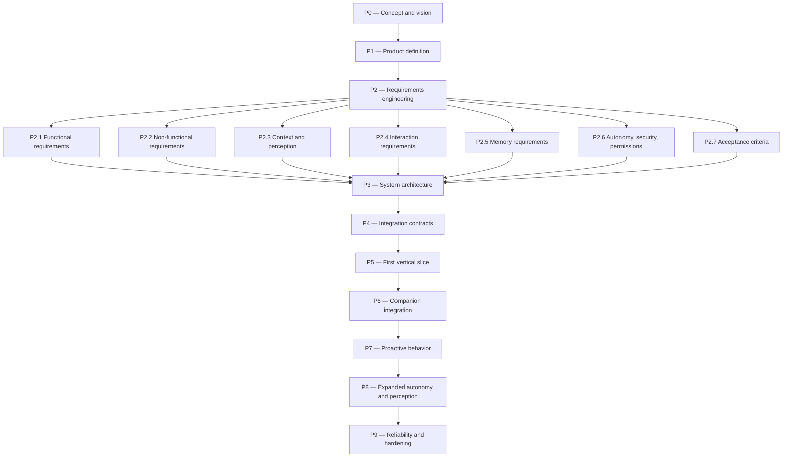

------------------------------------------------------------------------

## 3.5 P2.1 discussion progress

This tracker records design direction established during P2.1 discussions. "Agreed direction" means the product-level capability has been accepted; its detailed requirements may still be Draft and require formal review and acceptance criteria.

| Functional area | Discussion status | Remaining work |
|---|---|---|
| Voice and communication | Agreed direction | Final interaction requirements and P2.7 tests |
| Environmental awareness | Agreed direction | Detailed perception boundaries, privacy and performance |
| Window management | Full product scope agreed | Select first vertical-slice operations |
| Spatial desktop awareness | Agreed direction | Formal geometry, relationship and freshness requirements |
| Application interaction | Agreed direction | Define initial application integrations |
| Per-application permissions | Three capability classes agreed | Detailed grants, scope and sensitive-action rules in P2.6 |
| File-system interaction | Direct and file-manager interaction both agreed | Define first-slice scope and detailed safeguards |
| Desktop environment | Navigation and configuration agreed | Platform-specific capability requirements |
| Input interaction | Full input scope and hybrid model agreed | Select first-slice scope and detailed interruption behavior |
| Task management and scheduling | Conceptual model agreed | Formal requirements, policies and acceptance tests |
| Memory and continuity | Hybrid architecture direction agreed | Governance, retention, correction, deletion and tests |
| Embodiment and character behavior | Initial conceptual model established | Detailed interaction and animation requirements |
| Runtime self-management | Product scope identified | Detailed functional review |

## 3.6 P2.5 memory requirements progress

P2.5 has moved into active design. The following product-level directions have been accepted during discussion. Formal requirement wording, implementation-independent acceptance criteria and detailed policy edge cases are still being developed.

| Memory area | Design status | Remaining work |
|---|---|---|
| Autonomous memory formation | Agreed | Define capture boundaries, extraction quality and failure handling |
| Historical archive | Agreed | Define archive schema, access controls and deletion verification |
| Episodic and semantic memory | Agreed | Formalize memory records and consolidation behavior |
| Procedural and working memory | Agreed | Define lifecycle and task integration |
| Temporal knowledge graph | Agreed | Define entity resolution, edge semantics and temporal validity |
| Associative reinforcement | Agreed conceptually | Calibrate evidence thresholds, reinforcement and decay |
| Hybrid retrieval | Agreed conceptually | Define retrieval policies, ranking, evidence validation and context budgets |
| Conversation retention | Agreed | Ordinary permitted conversation archive retained indefinitely until user deletion |
| Temporary conversations | Agreed | Manual activation and LIA suggestion, with explicit user consent |
| Sensitivity classes | Agreed as initial policy | Define classification, processing and retention controls |
| Correction and contradiction handling | Agreed direction | Define propagation, authority and temporal reconciliation |
| Forgetting and erasure | Agreed direction | Define deletion scope, propagation and completion reporting |
| Compartmentalization | Agreed | Define domain boundaries and access-control rules |
| Cross-domain sharing | Agreed direction | Define explicit sharing, defaults, revocation and non-transitive access |
| Memory/permission separation | Agreed | Define authoritative permission checks and audit behavior |

# 4. P2.1 --- Functional requirements

**Workstream status:** In progress — requirements under review\
**Scope:** Define observable functions LIA is expected to provide,
without selecting the implementation technology.

Functional requirements describe system behavior: what input or event is
handled, what operation is performed, and what result is made available.
Performance thresholds belong in P2.2. Detailed permission rules belong
in P2.6, although functional requirements must acknowledge that actions
are authorization-gated.

## 4.1 Functional scope and exclusions

P2.1 covers the functional behavior of:

-   Presence and lifecycle.
-   Desktop and operating-system context.
-   Voice and text communication.
-   Character embodiment and expression.
-   Window and input interaction.
-   Application and file interaction.
-   Memory and continuity.
-   Proactive behavior and task execution.
-   Configuration and user control.
-   Runtime health and recovery.
-   Spatial modeling of the desktop environment.
-   Desktop configuration and cross-window interaction.
-   Hybrid input and application-control mechanisms.
-   Task planning, scheduling, dependencies, and adaptive execution.
-   Autonomous memory formation, consolidation, retrieval, and governance.

P2.1 does **not** decide:

-   Programming languages, frameworks, libraries, databases, or model
    providers.
-   Exact latency, frame-rate, CPU, memory, or reliability targets.
-   Detailed consent flows, authorization tiers, threat models, or data
    retention periods.
-   Final animation assets, character rig, or visual design.
-   Exact internal service topology or IPC protocol.

Those topics belong to P2.2--P2.6 and P3.

## 4.2 Presence and lifecycle

  -------------------------------------------------------------------------
  ID               Requirement                    Priority Status
  ---------------- ----------------- --------------------- ----------------
  FR-001           LIA shall be able                    P0 Draft
                   to maintain a                           
                   persistent                              
                   desktop presence                        
                   beyond an                               
                   individual                              
                   conversation.                           

  FR-002           LIA shall expose                     P1 Draft
                   her current                             
                   lifecycle state,                        
                   including                               
                   initializing,                           
                   available,                              
                   conversing,                             
                   acting, paused,                         
                   and sleeping                            
                   where applicable.                       

  FR-003           LIA shall support                    P0 Draft
                   user-controlled                         
                   pause and resume                        
                   of autonomous                           
                   interactions.                           

  FR-004           LIA shall                            P0 Draft
                   distinguish                             
                   conversational                          
                   availability from                       
                   permission to                           
                   observe or                              
                   operate the                             
                   computer.                               

  FR-005           LIA shall restore                    P0 Draft
                   the supported                           
                   portions of her                         
                   user                                    
                   configuration and                       
                   persistent                              
                   context after a                         
                   restart.                                

  FR-006           LIA shall                            P0 Draft
                   communicate when                        
                   a capability is                         
                   unavailable,                            
                   disabled, or                            
                   suspended rather                        
                   than silently                           
                   behaving as if it                       
                   were active.                            
  -------------------------------------------------------------------------

## 4.3 Environmental and desktop context

| ID | Requirement | Priority | Status |
|---|---|---:|---|
| FR-010 | LIA shall be able to identify the currently active application and active window when the platform adapter supports it. | P0 | Approved |
| FR-011 | LIA shall be able to retrieve basic metadata about visible windows, including title and window identity where available. | P0 | Approved |
| FR-012 | LIA shall be able to detect relevant desktop events, such as application launch, application exit, window focus change, and workspace change, where supported. | P1 | Draft |
| FR-013 | LIA shall be able to capture and analyze screen content on demand when the relevant screen-perception capability has been explicitly enabled. | P0 | Approved |
| FR-014 | LIA shall be able to extract text from permitted screen content when text extraction is available. | P1 | Draft |
| FR-015 | LIA shall be able to associate observed desktop context with the current conversation or task when relevant. | P1 | Draft |
| FR-016 | LIA shall distinguish directly observed facts from inferred user intent or activity. | P0 | Draft |
| FR-017 | LIA shall be able to inspect process information in read-only mode when the relevant capability is available. | P1 | Draft |
| FR-018 | LIA shall not treat unavailable, stale, or incomplete desktop observations as confirmed current facts. | P0 | Draft |
| FR-019 | LIA shall support optional ongoing screen-context perception when explicitly enabled, with a visible active-state indicator, configurable scope, and an immediate user-accessible pause control. | P1 | Approved |

## 4.4 Communication and conversation

| ID | Requirement | Priority | Status |
|---|---|---:|---|
| FR-020 | LIA shall support text-based user interaction. | P0 | Approved |
| FR-021 | LIA shall support voice input and spoken responses. | P0 | Approved |
| FR-022 | LIA shall support a continuous conversational session in which the user can speak subsequent turns without manually activating every utterance. | P0 | Approved |
| FR-023 | LIA shall maintain conversational context across multiple turns within a conversation. | P0 | Approved |
| FR-024 | LIA shall support user interruption of spoken output. | P0 | Approved |
| FR-025 | LIA shall provide a way for the user to end or pause an active listening/conversation session. | P0 | Approved |
| FR-026 | LIA shall be able to initiate a conversation when proactive interaction is enabled and applicable conditions are satisfied. | P1 | Draft |
| FR-027 | LIA shall be able to communicate the reason for a context-triggered suggestion when doing so is useful and appropriate. | P1 | Draft |
| FR-028 | LIA shall support text interaction as an independently usable interaction mode, including when voice input or output is unavailable. | P0 | Approved |
| FR-029 | LIA shall preserve the distinction between a conversational response, a proposed action, and an action that has actually been executed. | P0 | Draft |

## 4.5 Embodiment, animation, and expression

  ------------------------------------------------------------------------
  ID               Requirement                   Priority Status
  ---------------- ---------------- --------------------- ----------------
  FR-030           LIA shall render                    P0 Draft
                   a persistent                           
                   character                              
                   representation                         
                   on the desktop                         
                   when embodiment                        
                   is enabled.                            

  FR-031           LIA shall                           P0 Draft
                   support idle                           
                   behavior when no                       
                   immediate                              
                   interaction or                         
                   task is active.                        

  FR-032           LIA shall                           P0 Draft
                   express                                
                   supported                              
                   interaction                            
                   states through                         
                   visual behavior,                       
                   such as                                
                   listening,                             
                   speaking,                              
                   thinking,                              
                   reacting, and                          
                   acting.                                

  FR-033           LIA shall                           P1 Draft
                   support facial                         
                   expressions,                           
                   gestures, poses,                       
                   and body                               
                   movement as                            
                   distinct                               
                   expressive                             
                   outputs.                               

  FR-034           LIA shall be                        P1 Draft
                   able to direct                         
                   attention toward                       
                   a relevant                             
                   desktop target                         
                   when spatial                           
                   context is                             
                   available.                             

  FR-035           LIA shall be                        P0 Draft
                   able to                                
                   coordinate an                          
                   expressive                             
                   animation with                         
                   an authorized                          
                   desktop action.                        

  FR-036           LIA shall                           P0 Draft
                   continue to                            
                   render                                 
                   appropriate                            
                   character                              
                   behavior when                          
                   the language                           
                   model is delayed                       
                   or unavailable,                        
                   provided the                           
                   rendering                              
                   subsystem                              
                   remains                                
                   operational.                           

  FR-037           LIA shall allow                     P0 Draft
                   the user to                            
                   hide,                                  
                   reposition, or                         
                   otherwise                              
                   control the                            
                   character's                            
                   desktop                                
                   presence.                              
  ------------------------------------------------------------------------

## 4.6 Operating-system and input interaction

  ---------------------------------------------------------------------------
  ID               Requirement                      Priority Status
  ---------------- ------------------- --------------------- ----------------
  FR-040           LIA shall expose a                     P0 Draft
                   common set of                             
                   abstract desktop                          
                   operations to the                         
                   agent core, with                          
                   platform-specific                         
                   implementations                           
                   supplied by OS                            
                   adapters.                                 

  FR-041           LIA shall be able                      P0 Draft
                   to enumerate or                           
                   retrieve supported                        
                   window information.                       

  FR-042           LIA shall be able                      P0 Draft
                   to focus, minimize,                       
                   maximize, restore,                        
                   and close windows                         
                   where supported and                       
                   authorized.                               

  FR-043           LIA shall be able                      P0 Draft
                   to move and resize                        
                   windows where                             
                   supported and                             
                   authorized.                               

  FR-044           LIA shall be able                      P0 Draft
                   to launch an                              
                   application through                       
                   an available                              
                   platform mechanism                        
                   when authorized.                          

  FR-045           LIA shall be able                      P1 Draft
                   to send controlled                        
                   keyboard and                              
                   pointer input when                        
                   the relevant                              
                   capability is                             
                   enabled and                               
                   authorized.                               

  FR-046           LIA shall report                       P0 Draft
                   whether a requested                       
                   OS operation                              
                   succeeded, failed,                        
                   was unsupported, or                       
                   was not attempted.                        

  FR-047           LIA shall verify                       P0 Draft
                   the resulting                             
                   desktop state when                        
                   verification is                           
                   available, rather                         
                   than assuming that                        
                   issuing an                                
                   operation means it                        
                   succeeded.                                

  FR-048           LIA shall not                          P0 Draft
                   silently substitute                       
                   a materially                              
                   different operation                       
                   when the requested                        
                   operation is                              
                   unsupported.                              

  FR-049           LIA shall be able                      P1 Draft
                   to present an                             
                   action plan or                            
                   preview before                            
                   executing a                               
                   multi-step desktop                        
                   operation when                            
                   required by its                           
                   authorization                             
                   policy.                                   
  ---------------------------------------------------------------------------

## 4.7 Application, web, and file interaction

  ------------------------------------------------------------------------------
  ID               Requirement                         Priority Status
  ---------------- ---------------------- --------------------- ----------------
  FR-050           LIA shall be able to                      P1 Draft
                   interact with                                
                   supported desktop                            
                   applications through                         
                   available application                        
                   interfaces or                                
                   permitted UI                                 
                   interaction.                                 

  FR-051           LIA shall be able to                      P1 Draft
                   open and navigate web                        
                   pages through an                             
                   available browser                            
                   interaction                                  
                   capability.                                  

  FR-052           LIA shall be able to                      P1 Draft
                   locate files and                             
                   folders within                               
                   user-authorized                              
                   locations.                                   

  FR-053           LIA shall be able to                      P1 Draft
                   read file content when                       
                   the file type is                             
                   supported and access                         
                   is authorized.                               

  FR-054           LIA shall be able to                      P1 Draft
                   create and edit files                        
                   within user-authorized                       
                   locations when the                           
                   relevant operation is                        
                   supported.                                   

  FR-055           LIA shall be able to                      P1 Draft
                   move, rename, and                            
                   organize files when                          
                   authorized.                                  

  FR-056           LIA shall distinguish                     P0 Draft
                   reversible file                              
                   operations from                              
                   destructive or                               
                   difficult-to-reverse                         
                   operations.                                  

  FR-057           LIA shall provide an                      P0 Draft
                   execution result for                         
                   application, browser,                        
                   and file operations.                         

  FR-058           LIA shall be able to                      P1 Draft
                   maintain task context                        
                   while switching                              
                   between supported                            
                   applications or tools.                       
  ------------------------------------------------------------------------------

## 4.8 Memory and continuity

  ------------------------------------------------------------------------
  ID               Requirement                   Priority Status
  ---------------- ---------------- --------------------- ----------------
  FR-060           LIA shall retain                    P0 Draft
                   conversational                         
                   context for the                        
                   duration of an                         
                   active                                 
                   conversation.                          

  FR-061           LIA shall be                        P0 Draft
                   able to retain                         
                   selected                               
                   user-approved                          
                   information                            
                   across sessions.                       

  FR-062           LIA shall be                        P1 Draft
                   able to retain                         
                   task state so                          
                   that an                                
                   interrupted task                       
                   can be resumed                         
                   when sufficient                        
                   state is                               
                   available.                             

  FR-063           LIA shall                           P0 Draft
                   retrieve                               
                   relevant stored                        
                   context when                           
                   responding to a                        
                   conversation or                        
                   performing a                           
                   task.                                  

  FR-064           LIA shall be                        P1 Draft
                   able to                                
                   associate                              
                   memories with                          
                   relevant                               
                   projects, tasks,                       
                   people, and                            
                   prior                                  
                   interactions                           
                   where such                             
                   associations are                       
                   available.                             

  FR-065           LIA shall                           P0 Draft
                   distinguish                            
                   stored                                 
                   information from                       
                   assumptions or                         
                   newly generated                        
                   inferences.                            

  FR-066           LIA shall                           P0 Draft
                   support                                
                   correction of                          
                   inaccurate                             
                   stored user                            
                   information.                           

  FR-067           LIA shall                           P0 Draft
                   support                                
                   user-requested                         
                   review and                             
                   deletion of                            
                   stored memories,                       
                   subject to the                         
                   memory policy                          
                   defined in P2.5                        
                   and P2.6.                              

  FR-068           LIA shall not                       P0 Draft
                   claim to                               
                   remember                               
                   information that                       
                   is not present                         
                   in accessible                          
                   memory or                              
                   current context.                       
  ------------------------------------------------------------------------

## 4.9 Proactive behavior and autonomous tasks

  ------------------------------------------------------------------------
  ID               Requirement                   Priority Status
  ---------------- ---------------- --------------------- ----------------
  FR-070           LIA shall be                        P1 Draft
                   able to initiate                       
                   a social                               
                   interaction                            
                   without an                             
                   immediate user                         
                   prompt when                            
                   social autonomy                        
                   is enabled.                            

  FR-071           LIA shall be                        P1 Draft
                   able to generate                       
                   context-aware                          
                   suggestions from                       
                   permitted                              
                   desktop context                        
                   and relevant                           
                   memory.                                

  FR-072           LIA shall be                        P1 Draft
                   able to identify                       
                   a potential                            
                   follow-up action                       
                   from an active                         
                   or interrupted                         
                   task.                                  

  FR-073           LIA shall be                        P1 Draft
                   able to create                         
                   and maintain a                         
                   task plan for an                       
                   authorized goal.                       

  FR-074           LIA shall be                        P1 Draft
                   able to execute                        
                   delegated task                         
                   steps within the                       
                   granted                                
                   operational                            
                   permissions.                           

  FR-075           LIA shall be                        P0 Draft
                   able to pause,                         
                   cancel, or                             
                   abandon an                             
                   autonomous task                        
                   when instructed                        
                   by the user or                         
                   when a required                        
                   condition is no                        
                   longer                                 
                   satisfied.                             

  FR-076           LIA shall                           P0 Draft
                   provide the user                       
                   with the current                       
                   status of an                           
                   ongoing                                
                   autonomous task.                       

  FR-077           LIA shall                           P0 Draft
                   request                                
                   additional                             
                   information or                         
                   authorization                          
                   when a task                            
                   cannot safely or                       
                   correctly                              
                   proceed.                               

  FR-078           LIA shall                           P0 Draft
                   distinguish a                          
                   suggestion, a                          
                   plan, a pending                        
                   action, and a                          
                   completed action                       
                   in its                                 
                   communication                          
                   and task state.                        

  FR-079           LIA shall                           P0 Draft
                   respect                                
                   configured quiet                       
                   periods,                               
                   interruption                           
                   preferences, and                       
                   pause controls                         
                   when initiating                        
                   proactive                              
                   interactions.                          

  FR-080           LIA shall avoid                     P1 Draft
                   repeating a                            
                   dismissed                              
                   proactive                              
                   suggestion                             
                   unless                                 
                   materially new                         
                   context                                
                   justifies                              
                   raising it                             
                   again.                                 
  ------------------------------------------------------------------------

## 4.10 Configuration and user control

  -------------------------------------------------------------------------
  ID               Requirement                    Priority Status
  ---------------- ----------------- --------------------- ----------------
  FR-090           LIA shall provide                    P0 Draft
                   user controls for                       
                   enabling and                            
                   disabling major                         
                   capabilities                            
                   independently.                          

  FR-091           LIA shall provide                    P0 Draft
                   separate controls                       
                   for social,                             
                   cognitive,                              
                   operational, and                        
                   temporal                                
                   autonomy.                               

  FR-092           LIA shall allow                      P0 Draft
                   the user to                             
                   configure how and                       
                   when proactive                          
                   interactions may                        
                   occur.                                  

  FR-093           LIA shall provide                    P0 Draft
                   a way to inspect                        
                   the permissions                         
                   and capabilities                        
                   currently                               
                   enabled.                                

  FR-094           LIA shall provide                    P0 Draft
                   a way to revoke                         
                   previously                              
                   granted                                 
                   capability                              
                   access.                                 

  FR-095           LIA shall expose                     P0 Draft
                   a user-accessible                       
                   pause or stop                           
                   control for                             
                   autonomous                              
                   activity.                               

  FR-096           LIA shall allow                      P1 Draft
                   the user to                             
                   configure                               
                   character                               
                   visibility and                          
                   relevant                                
                   presentation                            
                   behavior.                               
  -------------------------------------------------------------------------

## 4.11 Runtime self-management

  -------------------------------------------------------------------------
  ID               Requirement                    Priority Status
  ---------------- ----------------- --------------------- ----------------
  FR-100           LIA shall monitor                    P1 Draft
                   the operational                         
                   state of her                            
                   major runtime                           
                   subsystems.                             

  FR-101           LIA shall                            P1 Draft
                   identify when a                         
                   subsystem becomes                       
                   unavailable or                          
                   unhealthy.                              

  FR-102           LIA shall isolate                    P1 Draft
                   recoverable                             
                   subsystem                               
                   failures where                          
                   possible so that                        
                   one failure does                        
                   not unnecessarily                       
                   terminate                               
                   unrelated                               
                   capabilities.                           

  FR-103           LIA shall attempt                    P1 Draft
                   recovery of                             
                   eligible failed                         
                   subsystems                              
                   according to a                          
                   defined recovery                        
                   policy.                                 

  FR-104           LIA shall report                     P1 Draft
                   significant                             
                   failures and                            
                   degraded                                
                   capabilities to                         
                   the user in an                          
                   understandable                          
                   manner.                                 

  FR-105           LIA shall expose                     P1 Draft
                   enough diagnostic                       
                   information to                          
                   support                                 
                   troubleshooting                         
                   without exposing                        
                   secrets or                              
                   sensitive data                          
                   unnecessarily.                          
  -------------------------------------------------------------------------

------------------------------------------------------------------------

## 4.12 Desktop as a spatial environment

The desktop is treated as LIA's environment, not merely as a collection of unrelated application handles. Windows, application surfaces and desktop objects are identifiable objects with spatial properties and relationships. These capabilities are subject to platform support and user permissions.

| ID | Requirement | Priority | Status |
|---|---|---:|---|
| FR-110 | LIA shall be able to represent the available desktop topology, including monitors, display boundaries, workspaces and supported coordinate spaces. | P0 | Draft |
| FR-111 | LIA shall be able to maintain spatial information about windows and supported desktop objects, including position, dimensions, visibility and stacking/layer state where available. | P0 | Draft |
| FR-112 | LIA shall be able to derive spatial relationships between desktop objects, such as overlap, adjacency, relative position and available screen regions, when sufficient information is available. | P1 | Draft |
| FR-113 | LIA shall update her spatial representation when relevant desktop changes are observed or when an operation changes the environment. | P0 | Draft |
| FR-114 | LIA shall be able to relate her own rendered position, orientation and attention target to desktop objects for embodied interaction. | P1 | Draft |
| FR-115 | LIA shall distinguish directly available geometric information from inferred or uncertain spatial relationships. | P0 | Draft |

## 4.13 Expanded window-management capabilities

The full product scope includes discovery, manipulation, organization and lifecycle operations. The first vertical slice may implement only a subset.

| ID | Requirement | Priority | Status |
|---|---|---:|---|
| FR-120 | LIA shall be able to discover and enumerate supported windows and retrieve their relevant state and metadata. | P0 | Draft |
| FR-121 | LIA shall be able to focus, move, resize, minimize, maximize, restore and close windows where supported and authorized. | P0 | Draft |
| FR-122 | LIA shall be able to arrange, tile, snap and reposition windows across supported monitors and workspaces. | P1 | Draft |
| FR-123 | LIA shall be able to launch supported applications and manage their windows through available platform mechanisms. | P0 | Draft |
| FR-124 | When LIA physically represents a window operation through character movement or gestures, the animation shall be coordinated with the actual operation and its result. | P0 | Draft |
| FR-125 | LIA shall verify the resulting window state when verification is available and shall not represent an unsuccessful operation as completed. | P0 | Draft |

## 4.14 Application interaction and per-application permission model

Application support is a product-level capability. The set of applications receiving early integration support remains a release-planning decision.

| ID | Requirement | Priority | Status |
|---|---|---:|---|
| FR-130 | LIA shall be able to interact with supported application controls, including buttons, menus, text fields, forms, tabs, dialogs, toolbars and other interactive elements. | P0 | Draft |
| FR-131 | Application access shall be configurable per application and distinguish at least observation, interaction and modification capabilities. | P0 | Draft |
| FR-132 | Application permissions shall be inspectable and revocable, and shall be enforced regardless of the interaction mechanism used. | P0 | Draft |
| FR-133 | Permission to modify an application shall not automatically authorize every consequential operation within it; sensitive operations may require additional authorization or confirmation. | P0 | Draft |

The three application capability classes are:

- **Observe:** Inspect the permitted application state and contents.
- **Interact:** Navigate and operate controls, including clicking, typing, scrolling and switching tabs.
- **Modify:** Change content or application data and perform operations such as saving, submitting forms, uploading or downloading.

These classes are independent. Granting one does not automatically grant the others. Detailed permission scopes and sensitive-operation policy belong in P2.6.

## 4.15 File-system interaction

LIA's product scope includes both direct file-system operations and embodied interaction through a file-manager application. These are alternative execution methods for the same user-authorized file-system capabilities.

| ID | Requirement | Priority | Status |
|---|---|---:|---|
| FR-140 | LIA shall be able to discover, search, enumerate and inspect files and directories within authorized locations. | P0 | Draft |
| FR-141 | LIA shall be able to read and understand supported file formats when access is authorized. | P0 | Draft |
| FR-142 | LIA shall be able to create files, directories and project structures within authorized locations. | P1 | Draft |
| FR-143 | LIA shall be able to modify supported documents, source files and configuration files within authorized locations. | P1 | Draft |
| FR-144 | LIA shall be able to copy, move, rename, organize and sort files and directories within authorized locations. | P1 | Draft |
| FR-145 | LIA shall be able to delete files and use trash or recovery mechanisms where supported and authorized. | P1 | Draft |
| FR-146 | LIA shall support both direct file-system operations and interactive file-manager operations. Both methods shall enforce the same authorization boundaries and provide verifiable results. | P0 | Draft |

## 4.16 Desktop-environment navigation and configuration

LIA's desktop interaction scope extends beyond individual application windows to the desktop environment itself.

| ID | Requirement | Priority | Status |
|---|---|---:|---|
| FR-150 | LIA shall be able to inspect supported display topology, monitors, workspaces, panels, docks, launchers, desktop icons and relevant desktop objects. | P1 | Draft |
| FR-151 | LIA shall be able to navigate and organize supported workspaces and monitor arrangements. | P1 | Draft |
| FR-152 | LIA shall be able to configure supported desktop elements, including workspace arrangements, panels, docks and display settings, when authorized. | P1 | Draft |
| FR-153 | LIA shall be able to observe and interact with supported desktop notifications and system-level interface elements within the granted permissions. | P1 | Draft |
| FR-154 | LIA shall report when a desktop configuration operation is unavailable or behaves differently because of platform or desktop-environment limitations. | P0 | Draft |

## 4.17 Human-like input and hybrid interaction

LIA's eventual input capability includes pointer, keyboard, scrolling, drag-and-drop and interaction with application controls. The product shall not be restricted to simulated mouse and keyboard input alone.

| ID | Requirement | Priority | Status |
|---|---|---:|---|
| FR-160 | LIA shall support pointer movement, hover, clicking, double-clicking, right-clicking, click-and-hold, dragging, dropping, text selection and scrolling where supported and authorized. | P0 | Draft |
| FR-161 | LIA shall support text entry, individual key input, key combinations, shortcuts and keyboard-driven navigation where supported and authorized. | P0 | Draft |
| FR-162 | LIA shall be able to interact with recognized application controls through suitable input or semantic interaction mechanisms. | P0 | Draft |
| FR-163 | LIA shall support a hybrid interaction model combining direct input simulation, accessibility or application interfaces, and visual perception-driven interaction. | P0 | Draft |
| FR-164 | LIA shall select an appropriate interaction mechanism based on the task, available platform/application capabilities and expected reliability. | P1 | Draft |
| FR-165 | All interaction mechanisms shall use common authorization, action-planning, execution-result and verification rules. | P0 | Draft |
| FR-166 | Where an interaction is represented through LIA's physical embodiment, character movement and the actual input or application operation shall remain coordinated. | P1 | Draft |

The hybrid model is a product-level design direction. It does not select a programming language, accessibility framework, UI automation library or computer-vision implementation; those choices remain for P3.

## 4.18 Task management, scheduling and autonomous execution

LIA shall maintain an ongoing, inspectable task system. A task may originate from a direct user instruction, a delegated objective, a schedule, an observed event or LIA's own memory-informed initiative.

| ID | Requirement | Priority | Status |
|---|---|---:|---|
| FR-170 | LIA shall maintain a persistent, user-visible task queue. | P0 | Draft |
| FR-171 | LIA shall represent work hierarchically as an objective, a plan containing steps, and the individual actions that execute those steps. | P0 | Draft |
| FR-172 | LIA shall record a task's origin, objective, plan, dependencies, required capabilities and authorization basis, status, progress, execution history, blockers and outcome. | P0 | Draft |
| FR-173 | LIA shall support task states including Queued, Running, Blocked, Paused, Completed, Cancelled and Failed. | P0 | Draft |
| FR-174 | LIA shall distinguish task creation, planning and execution as separate operations with separately governed authority. | P0 | Draft |
| FR-175 | LIA shall use relevant user memory, conversations, preferences, goals and permitted environmental context to identify potentially useful tasks and propose or create them within configured autonomy. | P1 | Draft |
| FR-176 | LIA shall be able to execute tasks within valid standing authorization without requesting approval for every individual step. | P0 | Draft |
| FR-177 | Before beginning an autonomously initiated task, LIA shall notify the user. This notification shall not be presented as an approval request when execution is already authorized. | P0 | Draft |
| FR-178 | When a task requires an operation outside the available authorization scope, LIA shall block that operation and request the necessary authorization or revise the plan. | P0 | Draft |
| FR-179 | LIA shall distinguish one-time authorization from standing authorization and shall not silently broaden the scope of either. | P0 | Draft |
| FR-180 | LIA shall support task priority categories of Critical, High, Normal, Low and Someday. | P1 | Draft |
| FR-181 | LIA shall support immediate, background, idle-time, scheduled, deadline-driven, event-triggered and deferred execution modes. | P1 | Draft |
| FR-182 | LIA shall support sequential, parallel, conditional, parent-child and recurring task relationships. | P1 | Draft |
| FR-183 | LIA shall classify execution needs, including background-safe, low-interference, desktop-interactive, user-dependent and resource-intensive work. | P1 | Draft |
| FR-184 | LIA shall be able to reprioritize and reschedule tasks as circumstances change while respecting explicit user-assigned priorities and communicating meaningful changes. | P0 | Draft |
| FR-185 | LIA shall be able to checkpoint, pause, cancel and safely resume tasks, verifying the current environment before repeating operations that may already have taken effect. | P0 | Draft |
| FR-186 | LIA shall distinguish Blocked from Failed, and shall mark a task Completed only when its intended outcome has been verified to the extent possible. | P0 | Draft |
| FR-187 | LIA shall avoid disrupting active user work with desktop-interactive tasks while allowing suitable background-safe tasks to continue when their authorization and resource conditions are satisfied. | P0 | Draft |
| FR-188 | LIA shall make task status, blockers, progress and significant execution history available to the user. | P0 | Draft |

**Task priority and scheduling principles:** Priority, urgency and deadline are separate attributes. LIA may adapt execution order when dependencies become available, deadlines approach or circumstances change, but shall not silently downgrade an explicit user priority merely because another task appears more interesting. Meaningful schedule changes should be communicated.

**Notification versus approval:** Notification informs the user that authorized autonomous work is about to begin. Approval is required only when the operation is not covered by valid authorization or when the operation's risk policy requires additional authorization or confirmation.

## 4.19 Memory formation, organization and associative learning

Memory is a foundational capability for LIA's persistent identity, cognitive continuity and autonomous initiative. The design direction is a hybrid, multi-layered memory system with a temporal knowledge graph as its relational backbone, not as the only storage representation.

| ID | Requirement | Priority | Status |
|---|---|---:|---|
| FR-190 | LIA shall maintain a searchable historical archive of permitted conversations, meaningful experiences, decisions, task events and retained source materials. | P0 | Draft |
| FR-191 | LIA shall autonomously identify candidate memories from permitted experiences without requiring the user to explicitly issue a remember command each time. | P0 | Draft |
| FR-192 | LIA shall organize information into complementary memory forms, including episodic, semantic, procedural, working and task memory. | P0 | Draft |
| FR-193 | LIA shall represent relevant entities and typed relationships in a temporal knowledge graph, including links to source episodes and supporting evidence. | P0 | Draft |
| FR-194 | Memory records shall preserve provenance and distinguish explicit statements, direct observations, inferred information and confirmed facts. | P0 | Draft |
| FR-195 | LIA shall maintain distinct measures for association strength, factual confidence, importance and current retrieval activation. | P1 | Draft |
| FR-196 | LIA shall reinforce meaningful associations when supported by repeated, sufficiently independent experiences or strong explicit evidence, using consolidation thresholds that can be evaluated and calibrated. | P1 | Draft |
| FR-197 | Association reinforcement shall not be based solely on concepts co-occurring or on a memory being retrieved repeatedly; retrieval alone shall not be treated as new evidence of truth. | P0 | Draft |
| FR-198 | LIA shall consolidate recurring information into durable memories while preserving the original source history and the distinction between candidate, consolidated and strongly supported associations. | P1 | Draft |
| FR-199 | LIA shall reconcile contradictory or superseding information while preserving historical records and representing what is currently believed to be valid. | P0 | Draft |
| FR-200 | Memory records shall distinguish when information was valid from when LIA learned or recorded it, enabling historical and current-state queries. | P1 | Draft |
| FR-201 | LIA shall support correction, inspection and user-requested deletion of memories, with appropriate propagation to derived summaries, graph relationships and retrieval indexes. | P0 | Draft |
| FR-202 | LIA shall apply retention and privacy rules to the historical archive. The archive shall not imply unrestricted or indefinite retention of raw microphone streams, screen frames or other sensitive observations. | P0 | Draft |

**Memory formation and consolidation principles**

LIA should autonomously form candidate memories and consolidate information according to its type, evidence and significance. An explicit user statement may establish a high-confidence memory immediately; weaker inferences generally require stronger or repeated evidence.

Associations may strengthen through meaningful, independent experiences. Co-occurrence alone is insufficient to establish a semantic relationship. Association strength, confidence, importance and retrieval activation must remain separate.

Temporal decay should primarily affect retrieval activation or the relevance of temporary/contextual information. It must not silently erase historically verified facts or important decisions merely because time has passed. Contradictions and changed information should be reconciled with provenance rather than handled through blind overwrites.

The historical archive stores permitted records and source evidence. It is not an unrestricted recorder of every screen frame, audio sample or desktop observation.

## 4.20 Memory retrieval and context assembly

The retrieval system shall identify what information is needed for the current conversation, task or proactive activity, search the relevant memory representations, validate the evidence and assemble a bounded working context.

| ID | Requirement | Priority | Status |
|---|---|---:|---|
| FR-210 | LIA shall determine the information need and create a retrieval plan appropriate to the current query, task or event. | P0 | Draft |
| FR-211 | LIA shall support complementary retrieval methods, including semantic, lexical, structured, graph-based, temporal and source-archive retrieval. | P0 | Draft |
| FR-212 | LIA shall be able to traverse typed knowledge-graph relationships to retrieve relevant multi-hop context, with bounded and task-appropriate expansion. | P1 | Draft |
| FR-213 | LIA shall rank candidate memories using relevant signals such as semantic and lexical relevance, relationship relevance, temporal validity, source authority, confidence and current context. | P0 | Draft |
| FR-214 | LIA shall resolve temporal validity and identify stale, superseded, conflicting or incomplete information before using it as current fact. | P0 | Draft |
| FR-215 | LIA shall retrieve original source material when extracted memories or summaries are insufficient for a reliable answer or action. | P0 | Draft |
| FR-216 | LIA shall assemble a bounded working context containing relevant memories, source references, temporal status and uncertainty labels. | P0 | Draft |
| FR-217 | LIA shall distinguish current facts, historical facts, explicit statements, observations and inferences within assembled context. | P0 | Draft |
| FR-218 | LIA shall be able to retrieve likely relevant context in anticipation of a task or interaction, without treating retrieval itself as authorization to act. | P1 | Draft |
| FR-219 | LIA shall retain a retrieval trace sufficient to explain which memory sources and relationships contributed to a response or plan. | P1 | Draft |
| FR-220 | LIA shall acknowledge insufficient or contradictory evidence rather than manufacture a memory or force an unsupported conclusion. | P0 | Draft |
| FR-221 | LIA shall refresh relevant live environmental state before acting when historical memory cannot establish the current state of an application, window, process or file. | P0 | Draft |

**Retrieval principles**

Retrieval is context-dependent. Casual conversation, historical questions, project work, task resumption and proactive planning may require different combinations of memory sources.

The system should merge and deduplicate candidates from multiple sources, expand relevant graph connections progressively, validate evidence, retrieve original sources when needed, and assemble only the context useful for the current reasoning step.

The retrieval engine shall explain why a memory was selected sufficiently to support debugging and review. A memory of a previous approval or action is not, by itself, an authoritative current permission grant; execution must consult the permission system.

**Technology boundary:** Vector indexes, lexical indexes, graph traversal, temporal indexes and structured search are capability concepts. The concrete database, graph engine, embedding model, indexing infrastructure and orchestration framework have not been selected and remain for P3.

# 5. P2.1 review questions and decisions to resolve

This section tracks unresolved decisions. Product-level design direction can be approved while first-release scope and detailed acceptance criteria remain open.

## 5.1 Resolved design decisions

- **P2.1-D01 — Voice modes:** Push-to-talk, continuous conversation, wake-word activation and text interaction are all supported as independently configurable modes. See ADR-012.
- **P2.1-D02 — Desktop awareness:** Default metadata awareness, on-demand screen perception and optional continuous screen perception are supported as distinct levels. Continuous perception requires a visible indicator, configurable scope and immediate pause control. See ADR-013.
- **P2.1-D03 — Task queue:** A persistent, user-visible task queue with Queued, Running, Blocked, Paused, Completed, Cancelled and Failed states is part of the product direction. Objectives, plans and individual actions are represented separately.
- **P2.1-D09 — Busy-user behavior:** Suitable background-safe work may continue while the user is busy. Desktop-interactive work should avoid disrupting active user activity. Tasks should be paused, checkpointed or deferred when safe execution conditions are not satisfied. Exact thresholds and interruption rules remain for P2.2 and P2.4.

## 5.2 Remaining decisions

| ID | Question | Why it matters | Status |
|---|---|---|---|
| P2.1-D04 | Which window operations belong in the first vertical slice? The full product scope includes discovery, focus, move, resize, minimize, maximize, restore, close, launch and window arrangement. | Selects a small but convincing first implementation. | Open |
| P2.1-D05 | Should file-system operations be included in the first vertical slice, or should the first OS action remain limited to window interaction? | Controls risk and scope of the first working loop. | Open |
| P2.1-D06 | Which memory categories or data classes require explicit user approval before retention, and which may be autonomously retained under standing memory preferences? | Autonomous memory formation is approved, but sensitivity, retention and consent boundaries remain to be defined in P2.5/P2.6. | Open |
| P2.1-D07 | Should the character itself be user-draggable, and under what conditions may LIA reposition herself? | Defines control of LIA's own desktop position and spatial behavior. | Open |
| P2.1-D08 | Which input and interaction capabilities belong in the first vertical slice? The full product uses a hybrid model. | Separates eventual capability from initial implementation scope. | Open |
| P2.1-D10 | Which application categories should receive early integration support? | Prevents the first release from implicitly promising support for every application. | Open |

# 6. Candidate first vertical slice

This is a proposed integration target, not a finalized release
commitment.

The first vertical slice should prove one complete interaction loop
across the major subsystems without attempting the entire product:

1.  LIA appears as a desktop character and performs idle animation.
2.  The user initiates a voice conversation.
3.  LIA listens, responds, and speaks.
4.  The character's expressions and body language react to the
    interaction.
5.  LIA obtains basic desktop context, such as the active window,
    through the platform adapter.
6.  The user asks LIA to perform one supported window operation.
7.  LIA checks authorization, performs the operation, verifies the
    result where possible, and coordinates the character's movement or
    expression with the operation.
8.  LIA retains one appropriate conversational or task detail across a
    restart.

The exact operation and memory behavior remain subject to P2.1 review
and later acceptance criteria.

------------------------------------------------------------------------

# 7. Requirements traceability

This section will map each requirement to its source product capability,
architecture component, implementation work item, and test case as later
phases are completed.

  -----------------------------------------------------------------------
  Requirement range Product domain    Architecture      Test mapping
                                      mapping           
  ----------------- ----------------- ----------------- -----------------
  FR-001--009       Presence and      TBD in P3         TBD in P2.7
                    lifecycle                           

  FR-010--019       Environmental     TBD in P3         TBD in P2.7
                    awareness                           

  FR-020--029       Communication     TBD in P3         TBD in P2.7

  FR-030--039       Embodiment        TBD in P3         TBD in P2.7

  FR-040--049       OS interaction    TBD in P3         TBD in P2.7

  FR-050--059       Application and   TBD in P3         TBD in P2.7
                    file interaction                    

  FR-060--069       Memory            TBD in P3         TBD in P2.7

  FR-070--089       Autonomy and      TBD in P3         TBD in P2.7
                    tasks                               

  FR-090--099       Configuration and TBD in P3         TBD in P2.7
                    control                             

  FR-100--109       Runtime           TBD in P3         TBD in P2.7
                    self-management                     
  -----------------------------------------------------------------------

------------------------------------------------------------------------

### Supplemental traceability for expanded P2.1 requirements

| Requirement range | Product domain | Architecture / requirements follow-up |
|---|---|---|
| FR-110–119 | Spatial desktop awareness | P2.3 perception; P3 spatial representation and platform adapters |
| FR-120–129 | Expanded window management | P2.6 authorization; P3 window-management adapter |
| FR-130–139 | Application interaction and permissions | P2.6 per-application permission model; P3 application adapters |
| FR-140–149 | File-system interaction | P2.6 scoped file permissions; P3 file-system and file-manager interfaces |
| FR-150–159 | Desktop environment configuration | P2.3 context; P2.6 permissions; P3 platform adapters |
| FR-160–169 | Hybrid input interaction | P2.4 interaction; P2.6 authorization; P3 interaction abstraction |
| FR-170–189 | Task management and scheduling | P2.2 performance/resources; P2.6 authority; P3 scheduler and task runtime |
| FR-190–209 | Memory formation, retrieval and context assembly | P2.5 memory specification; P2.6 privacy/governance; P2.7 evaluation |

# 8. Decision register

  ----------------------------------------------------------------------------
  ID                Decision           Status              Rationale /
                                                           consequence
  ----------------- ------------------ ------------------- -------------------
  ADR-001           LIA is an embodied Approved            Establishes product
                    autonomous digital                     identity and
                    companion and                          evaluation
                    OS-native agent.                       baseline.

  ADR-002           Companionship and  Approved            Neither side is
                    OS assistance are                      subordinate to the
                    equally important                      other.
                    product goals.                         

  ADR-003           Use a layered      Approved at         Avoids collapsing
                    personality,       conceptual level    character identity
                    emotional-state,                       into a single
                    behavior,                              prompt.
                    expression, and                        
                    experience model.                      

  ADR-004           Separate           Approved            Preserves agency
                    independent                            while enforcing
                    intention from                         permission
                    execution                              boundaries.
                    authority.                             

  ADR-005           Treat social,      Approved            Allows independent
                    cognitive,                             configuration and
                    operational, and                       safeguards.
                    temporal autonomy                      
                    as separate                            
                    dimensions.                            

  ADR-006           Linux and Windows  Approved            Defines initial
                    are first-class                        platform scope.
                    initial platforms;                     
                    macOS is a future                      
                    extension.                             

  ADR-007           Use a shared core  Approved            Keeps
                    with separate OS                       platform-specific
                    adapters.                              behavior out of
                                                           shared agent logic.

  ADR-008           Platform adapters  Approved            Prevents false
                    must report                            cross-platform
                    capability                             parity assumptions.
                    limitations                            
                    honestly.                              

  ADR-009           Camera is disabled Approved at         Detailed permission
                    by default and     product-principle   flow remains in
                    requires explicit  level               P2.6.
                    activation.                            

  ADR-010           Screen and         Approved at         Detailed permission
                    microphone access  product-principle   and indicator
                    must be            level               requirements remain
                    user-controlled                        in P2.6.
                    and visible.                           

  ADR-011           P2 requirements    Approved            Reduces premature
                    should be                              architectural
                    established before                     lock-in.
                    committing to the                      
                    final technology                       
                    stack.                                 
  ----------------------------------------------------------------------------

### ADR-012 — Four configurable interaction modes

**Status:** Approved

LIA shall support push-to-talk, continuous conversation, wake-word activation, and text interaction. The modes shall be independently configurable. This provides multiple interaction styles while retaining user control over microphone access. Microphone access is not implied to be continuously active; it remains subject to explicit permission and a visible listening state.

### ADR-013 — Three-level desktop awareness

**Status:** Approved

Desktop awareness is divided into default metadata awareness, permissioned on-demand screen perception, and optional continuous screen perception. Continuous perception must include a visible indicator, configurable scope, and immediate pause control. Screen-content access is not implied by default metadata access.

------------------------------------------------------------------------

------------------------------------------------------------------------

### ADR-014 — Desktop as an interactive spatial environment

**Status:** Approved design direction

LIA treats the desktop as an environment containing identifiable, spatially related and manipulable objects. Product scope includes window management, application interaction, file-system interaction, desktop-environment interaction/configuration and keyboard/pointer input. These capabilities are subject to platform support and user permissions.

### ADR-015 — Spatial desktop awareness

**Status:** Approved design direction

LIA maintains an understanding of monitor and workspace topology, window geometry, object relationships and relevant environmental changes. Spatial information must distinguish direct observations from inferred relationships and remain synchronized with the changing desktop.

### ADR-016 — Per-application capability permissions

**Status:** Approved design direction

Application permissions distinguish Observe, Interact and Modify capabilities and are configurable per application. These permissions are independent. Modification permission does not automatically authorize every consequential operation; detailed scopes and additional authorization rules are defined in P2.6.

### ADR-017 — Direct and interactive file-system operation

**Status:** Approved design direction

LIA supports both direct file-system operations and embodied interaction through a file-manager interface. Both methods enforce the same file-system authorization boundaries and must provide verifiable outcomes.

### ADR-018 — Desktop-environment configuration

**Status:** Approved design direction

LIA's eventual capability scope includes navigating and configuring supported monitors, workspaces, panels, docks, launchers, desktop objects and display settings, subject to platform capabilities and authorization.

### ADR-019 — Hybrid computer interaction

**Status:** Approved design direction

LIA combines direct input simulation, accessibility or application interfaces, and visual perception-driven interaction. She selects an appropriate mechanism for each operation, while all mechanisms share common planning, authorization, execution-result and verification rules. This does not select specific implementation technologies.

### ADR-020 — Task hierarchy and persistent task queue

**Status:** Approved design direction

LIA maintains a user-visible persistent task queue and represents work as Objective → Plan → Actions. Task states include Queued, Running, Blocked, Paused, Completed, Cancelled and Failed. A task record includes origin, plan, dependencies, required capabilities/authorization basis, status, progress, execution history, blockers and outcome.

### ADR-021 — Separate task creation, planning and execution authority

**Status:** Approved design direction

Task creation, planning and execution are separate capabilities. LIA may identify and create useful tasks using relevant user memory, goals, conversations and permitted context. She may execute within valid standing authorization without seeking approval for every step. She notifies the user before autonomously initiated work; notification is not an approval request. Operations outside the authorization scope remain blocked pending authorization or plan revision.

### ADR-022 — Adaptive scheduling and non-interference

**Status:** Approved design direction

LIA schedules work using priority, urgency, deadlines, dependencies, resource needs and execution context. She supports immediate, background, idle-time, scheduled, deadline-driven, event-triggered and deferred execution. She may adapt schedules while respecting explicit user priorities and communicating meaningful changes. Suitable background work may continue while the user is busy; desktop-interactive work must avoid disrupting active user activity. Tasks should checkpoint and resume safely.

### ADR-023 — Hybrid, multi-layered memory

**Status:** Approved conceptual architecture

LIA's memory combines a searchable historical experience archive with organized long-term representations, including episodic, semantic, procedural, working and task memory. A temporal knowledge graph provides the relational backbone, while original source evidence remains accessible. No single memory representation is considered sufficient.

### ADR-024 — Autonomous memory formation and consolidation

**Status:** Approved conceptual architecture

LIA autonomously identifies candidate memories from permitted experiences and consolidates recurring or significant information. Explicit statements may establish high-confidence memories immediately; weaker inferences require stronger or repeated evidence. Original evidence must remain traceable, and derived summaries must not replace the historical record.

### ADR-025 — Associative memory reinforcement

**Status:** Approved conceptual design direction

Meaningful relationships between memories and entities may strengthen through repeated, sufficiently independent experiences and strong explicit evidence. Association strength, factual confidence, importance and retrieval activation remain separate. Mere co-occurrence or repeated retrieval is not sufficient evidence for reinforcement. Thresholds and maintenance parameters require empirical calibration.

### ADR-026 — Memory history, provenance and temporal validity

**Status:** Approved conceptual design direction

Memory records retain source provenance and distinguish the time an event was valid from the time LIA learned or recorded it. Contradictions and superseded information are reconciled without erasing historical evidence. Retention, sensitive-data handling, correction and deletion policies remain detailed P2.5/P2.6 work.

### ADR-027 — Context-aware hybrid memory retrieval

**Status:** Approved conceptual architecture

LIA's retrieval engine determines the information need, plans retrieval across semantic, lexical, structured, graph, temporal and source-archive representations, expands relevant graph relationships in a bounded manner, validates evidence and assembles a bounded working context with source references and uncertainty labels.

### ADR-028 — Memory retrieval traceability and evaluation

**Status:** Approved design direction

Memory retrieval should expose why information was selected and retain enough trace information to debug extraction, entity resolution, graph traversal, ranking, temporal resolution and context assembly. Evaluation must include exact recall, multi-session recall, multi-hop reasoning, temporal reasoning, contradiction handling, provenance, abstention, correction, deletion and task resumption.

### ADR-029 — Controlled cross-domain memory sharing

**Status:** Approved design direction

Memory domains remain logically compartmentalized but may share permitted, relevant information. Non-sensitive user-level preferences may be available across projects when the user's memory preferences and access policy allow it. Project-specific or confidential information remains scoped unless sharing is authorized. Graph relationships do not grant access, and sharing is not transitive by default.

### ADR-030 — Ordinary conversation archive retention

**Status:** Approved

Ordinary permitted conversation archives are retained indefinitely until the user requests deletion, subject to sensitivity classification and applicable privacy policy. This does not imply indefinite raw audio, screen-frame or transient-observation retention.

### ADR-031 — Temporary conversation mode

**Status:** Approved

Temporary mode may be activated by the user or suggested by LIA, but requires explicit user consent. Temporary conversational content is excluded from permanent conversation archives and autonomous long-term memory formation. Separately disclosed minimal operational records may be retained where necessary for execution integrity and security.

### ADR-032 — Memory sensitivity classification

**Status:** Approved initial policy

Memory uses four initial classes: S0 Ordinary, S1 Personal, S2 Sensitive and S3 Highly Sensitive Secrets. S0 and S1 may be retained under user memory preferences. S2 requires explicit authorization for long-term retention. S3 secrets are excluded from ordinary memory and require a separate secure credential mechanism if supported.

### ADR-033 — Distinct forgetting and erasure operations

**Status:** Approved

LIA supports forgetting a fact, erasing an experience and erasing a memory domain. Forgetting removes the information from active use and derived representations while leaving the historical source archive unless separately requested. Erasure propagates to the source and dependent representations within the requested scope. A minimal non-content deletion marker may prevent accidental re-import.

### ADR-034 — Compartmentalized memory access

**Status:** Approved design direction

Memory is logically compartmentalized into user, project, task, experience and procedural domains. Access decisions consider ownership, sensitivity and contextual purpose. Domains remain interlinked, but retrieval is least-privilege and relationship edges do not themselves grant access.

### ADR-035 — Separation of memory and permission authority

**Status:** Approved

Memory records historical and learned information. A separate authoritative permission service determines current execution authority. Historical approvals, inferred preferences and memory associations do not substitute for checking current permissions before execution.

# 9. Change log

  ------------------------------------------------------------------------
  Version                 Date                    Changes
  ----------------------- ----------------------- ------------------------
  1.0.0                   12 Nov 2026             Consolidated the
                                                  approved Phase 1 product
                                                  baseline, roadmap,
                                                  decision register, and
                                                  initial P2.1
                                                  functional-requirement
                                                  draft.

  1.0.1                   12 Nov 2026             Approved all four voice
                                                  interaction modes;
                                                  updated FR-020–FR-025
                                                  and FR-028; recorded
                                                  ADR-012 and closed
                                                  P2.1-D01.

  1.0.2                   12 Nov 2026             Approved the three-level
                                                  desktop awareness model;
                                                  revised FR-010–FR-019;
                                                  recorded ADR-013 and
                                                  closed P2.1-D02.

  1.1.0                   13 Nov 2026             Consolidated P2.1
                                                  discussions through
                                                  task scheduling, spatial
                                                  desktop interaction,
                                                  hybrid input, application
                                                  and file permissions,
                                                  desktop configuration,
                                                  and the conceptual
                                                  memory architecture,
                                                  associative reinforcement
                                                  and retrieval design.

  1.2.0                   13 Nov 2026             Expanded the blueprint
                                                  into a detailed design
                                                  record with P2.1
                                                  interaction, spatial
                                                  desktop, application,
                                                  file-system, hybrid input,
                                                  task hierarchy and
                                                  scheduling diagrams;
                                                  expanded P2.5 memory
                                                  architecture, associative
                                                  learning, retrieval,
                                                  governance, retention,
                                                  temporary mode, deletion,
                                                  compartmentalization and
                                                  cross-domain sharing.

  1.2.1                   13 Nov 2026             Corrected Mermaid code
                                                  fences in the expanded
                                                  design records and
                                                  synchronized the current
                                                  workstream indicator
                                                  with P2.5.

  ------------------------------------------------------------------------

------------------------------------------------------------------------

# 10. Current working state

**Current phase:** P2 --- Requirements Engineering\
**Active workstream:** P2.5 --- Memory Requirements (governance and integrity)\
**Current status:** P2.1 detailed design record consolidated; P2.5 governance and integrity design recorded, with formal requirements and acceptance criteria still under review\
**Next action:** Continue P2.5 with access-control edge cases, memory correction/deletion verification and governance acceptance criteria. Then complete the remaining P2.1 reviews, P2.2–P2.7 requirements and phase-wide traceability. Do not move to technology selection yet.

## Phase 2 exit criteria

Phase 2 is complete only when:

-   Functional requirements are reviewed, uniquely identified, and
    approved.
-   Non-functional requirements have measurable targets or explicit TBD
    owners.
-   Context and perception boundaries are defined.
-   Interaction requirements cover voice, text, interruption, presence,
    and embodiment.
-   Memory requirements define persistence, retrieval, correction, and
    deletion behavior.
-   Autonomy, security, and permission requirements define execution
    authority and user controls.
-   Acceptance criteria cover all P0 requirements and the agreed first
    vertical slice.
-   Requirements are internally consistent and traceable into the
    architecture phase.

## Working rule

When a decision changes, update the relevant section, decision register,
and change log. Keep requirement IDs stable; do not recycle IDs when
requirements are removed. Mark obsolete requirements as rejected or
superseded and record the replacement ID.

# 11. Detailed P2.1 design records

This section preserves the full design reasoning and capability scope discussed during P2.1. The functional requirement tables above provide stable, testable identifiers; this section records the accompanying intent, examples, interaction models and diagrams so that the specification does not collapse into a progress tracker.

## 11.1 The desktop is LIA's environment

LIA is intended to inhabit the desktop as a persistent embodied entity. The desktop is not merely a backdrop behind a character, and window management is not her only form of OS interaction.

The product-level interaction domains are:

| Domain | What LIA interacts with |
|---|---|
| Window management | Windows, their positions, dimensions and states |
| Application interaction | Buttons, menus, text fields, tabs and controls inside applications |
| File-system interaction | Files, folders and their contents |
| Desktop environment | Workspaces, monitors, panels and desktop objects |
| Input interaction | Keyboard, pointer, scrolling and other input mechanisms |

These are eventual product capabilities, subject to the user's permissions for the relevant application, file location, desktop capability or operation. They are not a commitment to implement every capability in the first release.

The design intent is to treat the desktop as LIA's environment, windows as manipulable objects, and applications as spaces she can enter and interact with.

### 11.1.1 Two synchronized layers of embodied desktop interaction

An embodied action has two coordinated layers:

1. **Character embodiment:** What the user sees LIA physically do, such as approaching a window, reaching toward its title bar, grabbing it, dragging it and releasing it.
2. **OS interaction:** What the computer actually does, such as identifying the target window, issuing the move operation and reporting the resulting position.

The character's movement must correspond to the actual operation. If the OS operation fails, LIA must not finish an animation that falsely communicates success. She should react to the actual result.

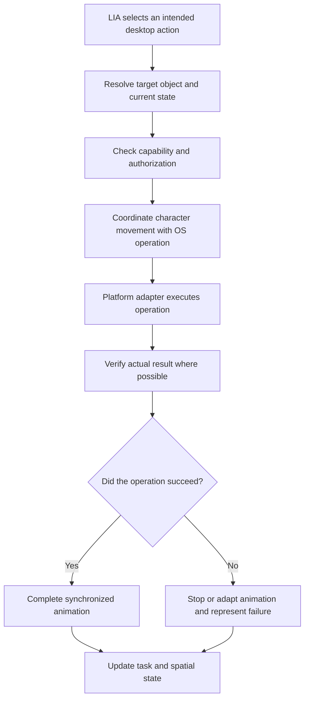

Not every operation requires a literal physical metaphor. Dragging and resizing can be represented as direct physical interactions. Minimizing or focusing a window may use a gesture or animation appropriate to the operation. In every case, the representation must not contradict the real desktop result.

## 11.2 Spatial desktop awareness

Spatial awareness is a first-class capability, not merely a side effect of screen perception.

**Definition:** LIA's ability to understand the spatial arrangement, relative positions, dimensions, boundaries and relationships of objects within the desktop environment, and to use that understanding when navigating or manipulating those objects.

Spatial awareness includes:

- **Desktop geometry:** Screen boundaries, monitor arrangement, display resolution, workspaces and available desktop regions.
- **Window geometry:** Window positions, dimensions, boundaries, visibility, stacking/layering and relevant window state.
- **Spatial relationships:** Which windows overlap, which are adjacent, which occupy most of the screen, where free space exists, and how objects are positioned relative to one another.
- **Character positioning:** Where LIA is rendered, which objects she is facing, where she can move, and how she should approach a target.
- **Spatial interaction:** Approaching, pointing, grabbing, dragging, pushing, releasing and repositioning desktop objects.
- **Dynamic awareness:** Understanding that the environment changes when windows move, monitors change, applications open or the user rearranges the desktop.

Perception and spatial awareness are related but distinct:

- **Perception:** What am I looking at? What application, window, control or object is present?
- **Spatial awareness:** Where is it? How is it positioned relative to other things? Where can I move? How can I interact with it?

LIA must distinguish directly available geometry from inferred spatial relationships. Spatial state must be refreshed when relevant desktop changes occur and before actions that depend on potentially stale positions.

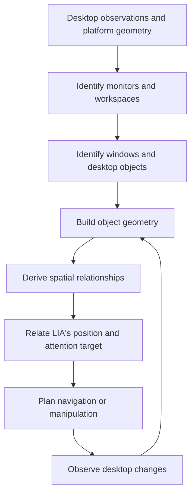

## 11.3 Window management as object interaction

LIA's eventual window-management capability includes three broad categories.

### Discovery

- Identify the active window.
- Enumerate supported windows.
- Obtain window metadata, including title, identity, position, dimensions and state when available.
- Identify visible, minimized, maximized, restored and focused windows.
- Identify the monitor or virtual desktop containing a window where supported.

### Manipulation and organization

- Focus a window and bring it to the foreground.
- Move a window by interacting with its title bar or through an appropriate platform operation.
- Resize a window through its edges or corners.
- Push or reposition windows to make space.
- Minimize, maximize and restore windows.
- Arrange, tile and snap windows.
- Move windows between monitors and virtual desktops where supported.
- Switch focus between windows and organize their spatial arrangement.

### Lifecycle

- Launch supported applications.
- Open and manage their windows.
- Close windows gracefully.
- Restore or reopen applications where supported.
- Identify unresponsive applications or windows.
- Handle dialogs and prompts associated with window operations.

Closing a window must not silently become forceful process termination. Unsaved work and confirmation dialogs must be respected. Window operations must report their execution result, and the system should verify the resulting state when possible.

The first vertical slice may implement a much smaller subset, such as identifying a target window, approaching it visually, grabbing it and moving it while synchronizing character animation with the actual OS operation. This validates the connection between spatial representation, embodiment, platform control and result verification without reducing the eventual product scope to only window movement.

## 11.4 Application interaction and per-application authorization

LIA should be able to enter supported applications and interact with their interface: buttons, menus, text fields, forms, dropdowns, selection menus, tabs, navigation elements, dialog boxes, confirmation prompts, toolbars, sidebars, context menus, checkboxes, sliders, toggles and other interactive controls.

Application access must be independently configurable per application. The capability classes are:

| Permission class | Meaning |
|---|---|
| **Observe** | Inspect the permitted application state and understand its visible or otherwise authorized contents |
| **Interact** | Navigate, click controls, switch tabs, type, scroll and operate interface elements |
| **Modify** | Change content or application data, save changes, submit forms, upload or download files and perform other data-altering operations |

These classes are independent. Permission to observe does not imply permission to interact. Permission to interact does not imply permission to modify. Permission to modify does not automatically authorize every consequential operation.

For example, Firefox might be configured to allow observation and navigation while restricting form submission or data modification. A password manager might have no access, while a code editor might have broader access for an authorized development workflow. These are illustrative configurations, not defaults.

Sensitive actions such as purchases, sending external communications, permanent deletion or consequential transactions may require additional authorization or confirmation even when the application has a general Modify grant.

Permissions must apply regardless of whether LIA uses visual interaction, direct input simulation or a semantic application interface. The detailed permission service, scopes, defaults, revocation and confirmation policy are specified in P2.6.

## 11.5 File-system interaction: direct and interactive operation

LIA shall support both direct file-system operations and embodied interaction through a file-manager application. These are two methods for performing the same authorized file-system capabilities.

The intended scope includes:

- **Discovery:** Search, locate, enumerate and inspect files and directories.
- **Reading:** Open, preview, read and understand supported file formats.
- **Creation:** Create files, directories and project structures.
- **Modification:** Edit supported documents, source code, configuration files and other supported content.
- **Organization:** Copy, move, rename, sort and organize files and directories.
- **Removal and recovery:** Delete files, manage trash and restore files where supported.

For example, when organizing a project directory, LIA could use direct operations to move and rename files efficiently. Alternatively, she could open the file manager, navigate to the directory and manipulate the files through its interface.

The execution method may depend on the task, reliability, available platform capabilities and user preference. Both methods must enforce the same path and operation permissions. Direct access must not be used as a way to bypass restrictions imposed on interactive access.

Destructive or difficult-to-reverse operations require the appropriate safeguards, and outcomes must be verified where possible.

## 11.6 Desktop-environment navigation and configuration

LIA's environment extends beyond application windows. Eventual capabilities include:

| Area | Intended capability |
|---|---|
| Monitors | Discover displays, understand their arrangement and move windows between them |
| Workspaces | Switch, create, organize and manage virtual desktops |
| Panels and docks | Interact with taskbars, docks, launchers and system panels |
| Desktop objects | Interact with icons, shortcuts and supported desktop elements |
| Notifications | Observe and interact with supported system notifications |
| Display configuration | Access and modify supported display settings |

LIA shall eventually be able to configure the desktop environment, not only navigate its existing arrangement. This includes supported workspace arrangements, panels, docks and display settings, subject to platform support and appropriate permissions.

Spatial awareness applies across the display topology. For example, LIA should understand that a window is on the left monitor, another workspace exists on the right, and moving a window between them differs from moving it within one display.

Platform and desktop-environment differences must be exposed honestly. A capability that is unavailable under a particular Linux compositor or Windows configuration must not be represented as universally supported.

## 11.7 Human-like computer input

LIA's eventual input capability includes the actions a person commonly performs with a computer.

### Pointer and mouse

- Move the pointer to arbitrary screen positions.
- Hover over elements and respond to hover states.
- Left-click, right-click and double-click.
- Click and hold.
- Drag and drop files, windows and interface elements.
- Scroll vertically and horizontally.
- Select objects and text.
- Interact with context menus.
- Perform supported pointer gestures.

### Keyboard

- Type text into input fields and documents.
- Press individual keys and key combinations.
- Execute keyboard shortcuts.
- Navigate interfaces using keyboard controls.
- Select, copy, cut, paste and replace text.
- Navigate and edit documents.
- Use application-specific shortcuts.
- Perform keyboard-driven workflows without relying on the mouse.

### Interface controls

LIA should recognize and operate buttons, text fields, forms, dropdowns, selection menus, tabs, navigation elements, dialogs, confirmation prompts, toolbars, sidebars, checkboxes, sliders, toggles and other interactive controls.

She should understand what an element does, not merely where it appears.

### Complex interaction sequences

A user goal may require multiple coordinated actions. For example, uploading a document can involve locating the application, opening its upload interface, navigating to the appropriate directory, locating and selecting the document, confirming the upload and verifying that the application received it.

LIA should represent this as one objective with a plan and individually tracked actions, rather than as an unstructured sequence of clicks.

### Embodiment

The character's physical behavior should participate in desktop interaction. When moving a window, she may approach and grab it. When pointing at a control, her gaze or hand movement may correspond to the target. When typing, her animation may reflect the action.

The animation and actual input must remain synchronized. LIA must not perform a visual gesture that falsely indicates a computer action succeeded.

## 11.8 Hybrid interaction model

The product shall combine three execution mechanisms:

1. **Direct input simulation:** Actual pointer and keyboard input, including clicks, typing, dragging, scrolling and other input events.
2. **Accessibility and semantic interaction:** Use available accessibility interfaces or application interfaces to identify and operate controls through their meaning and structure.
3. **Visual interaction:** Understand the visible interface through screen perception and select targets based on visual appearance and spatial location.

LIA should use the most appropriate mechanism for the operation, based on task requirements, available interfaces, platform support and expected reliability. She may combine mechanisms within one task.

For example, an accessibility interface may reliably identify a button, while pointer input is used to drag an object. Visual perception may be necessary for an application that exposes no suitable semantic interface.

All three mechanisms must obey the same authorization, action-planning, execution-result and verification rules. The hybrid model is an implementation-independent product direction; it does not select a particular automation framework or API.

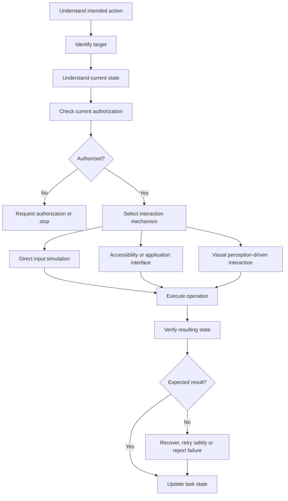

The choice of mechanism must not change the permission required. If the requested operation is unsupported, LIA must not silently substitute a materially different operation.

## 11.9 Task management: objective, plan and actions

LIA's task system should represent a user's desired outcome separately from the plan and the operations used to achieve it.

- **Objective:** The outcome LIA is supposed to achieve.
- **Plan:** The sequence or structure of steps LIA determines are necessary.
- **Actions:** Individual operations that execute the plan.

Example objective: "Organize my Downloads folder."

Possible plan: inspect files, classify them, create appropriate folders, move files, and verify the result.

Individual actions may include identifying a PDF, moving it into a destination directory and confirming that it exists at the destination.

A large objective may contain dozens of actions across multiple applications. LIA must track the overall objective while independently managing each step.

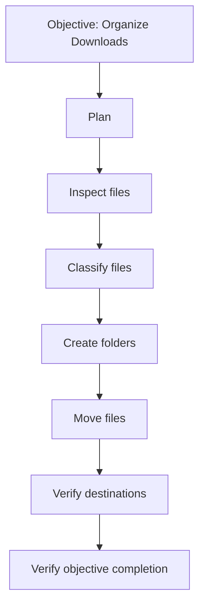

### Task record

A task should contain:

| Property | Purpose |
|---|---|
| Objective | What needs to be achieved |
| Origin | User request, delegated objective, schedule, event or LIA initiative |
| Plan | Steps required to achieve the objective |
| Dependencies | Actions or conditions that must be satisfied first |
| Required capabilities | Applications, files, services and operations needed |
| Authorization basis | One-time grant or valid standing authorization and its scope |
| Status | Current task state |
| Priority | Importance assigned to the task |
| Schedule | Timing or execution condition |
| Progress | Completed and remaining steps |
| Execution history | Actions taken and their results |
| Checkpoint | State required for safe resumption |
| Blocker | Why execution cannot proceed |
| Outcome | Verified result or failure explanation |

The user should be able to inspect what LIA actually did, not merely rely on a natural-language summary.

### Task states

The agreed task states are:

- **Queued:** Waiting for execution.
- **Running:** Currently executing.
- **Blocked:** Cannot proceed because a dependency, permission, resource, input or other required condition is missing.
- **Paused:** Execution has deliberately been suspended.
- **Completed:** Intended outcome verified to the extent possible.
- **Cancelled:** Execution was deliberately abandoned.
- **Failed:** Execution could not achieve the intended outcome.

Blocked and Failed are not interchangeable. Paused and Blocked are also distinct.

```mermaid
stateDiagram-v2
    [*] --> Queued
    Queued --> Running: Eligible to execute
    Queued --> Blocked: Required condition missing
    Running --> Blocked: Dependency or authorization needed
    Running --> Paused: User or scheduler pauses
    Running --> Completed: Outcome verified
    Running --> Failed: Unrecoverable execution failure
    Running --> Queued: Requeued after safe checkpoint
    Blocked --> Queued: Blocker resolved
    Paused --> Queued: Resume requested or permitted
    Queued --> Cancelled: Cancel
    Blocked --> Cancelled: Cancel
    Paused --> Cancelled: Cancel
    Failed --> Queued: Explicit retry or recovery
    Completed --> [*]
    Cancelled --> [*]
```

### Task origins and memory-informed initiative

Tasks may originate from:

- Direct user instructions.
- Previously delegated objectives.
- Scheduled activities and reminders.
- Events in the desktop environment.
- LIA's own observations and initiative, informed by relevant memory.

For example, LIA may remember that the user is developing the LIA project, that research into desktop automation has been identified as useful, and that public web research is covered by a standing permission. She can independently create a research task, prepare a plan, notify the user and execute under that existing authorization.

Task creation, planning and execution are separate capabilities. LIA may be able to create and organize a proposed task without having authority to execute every operation in its plan.

### Notification, approval and confirmation

These are three different behaviors:

- **Notification:** Informing the user that an already-authorized action or autonomous task is about to happen.
- **Approval:** Obtaining authorization when the operation is not covered by a valid grant.
- **Confirmation:** Verifying user intent for a particularly consequential operation when the risk policy requires it.

Notification must not be disguised as an approval prompt. LIA should not ask permission for every step of work that is already within valid standing authorization. Conversely, an announcement does not make an unauthorized operation permissible.

The authorization basis must be explicit in the task record. A one-time approval must not silently become unlimited standing permission.

### Scheduling and prioritization

Priority, urgency and deadline are separate attributes.

The agreed priority categories are:

| Priority | Meaning | Illustrative example |
|---|---|---|
| P0 — Critical | Time-sensitive or essential | A task with an imminent deadline |
| P1 — High | Important to an active objective | Research needed for an ongoing project |
| P2 — Normal | Useful work that should progress regularly | Organizing project documentation |
| P3 — Low | Useful but not immediately necessary | Exploring an interesting technical subject |
| P4 — Someday | Optional ideas and opportunities | Investigating an unrelated project idea |

The user may assign priorities. LIA may recommend or adapt priorities using explicit user goals, deadlines, project importance, dependencies and current circumstances. She must not silently downgrade an explicit user priority simply because another activity appears more interesting. Meaningful scheduling changes should be communicated.

Supported execution modes are:

- Immediate: start when authorization and execution conditions are satisfied.
- Background: continue without taking over the user's active desktop interaction.
- Idle-time: execute when the computer or user reaches a suitable idle condition.
- Scheduled: execute at a specified time or recurring interval.
- Deadline-driven: schedule work backwards from a deadline.
- Event-triggered: start when a specified event or condition occurs.
- Deferred: retain the task until an appropriate opportunity becomes available.

These are scheduling properties, not mutually exclusive task types.

### Dependencies

The task system should support:

- Sequential dependencies: B begins after A.
- Parallel tasks: B and C may execute simultaneously.
- Conditional dependencies: a step begins only when a specified condition is satisfied.
- Parent-child tasks: a larger objective contains independently tracked subtasks.
- Recurring tasks: an objective can generate new task instances periodically.

### Resource and interaction classes

| Execution class | Examples | Scheduling behavior |
|---|---|---|
| Background-safe | Research, summarization and permitted file reading | May run while the user works |
| Low-interference | Preparing documents and organizing authorized data | May run in the background with safeguards |
| Desktop-interactive | Moving windows, navigating applications and typing | Must consider active user interaction |
| User-dependent | Tasks needing clarification or a decision | Wait for user input |
| Resource-intensive | Large computations, local inference and heavy indexing | Consider system load and resource availability |

LIA should not stop working merely because the user is busy. She should avoid interfering with the user's active work. For example, she may conduct research in the background while the user codes, but should not move application windows or type into the user's editor while the user is actively controlling it.

### Interruption, checkpoint and resumption

Interruption is a normal task condition, not necessarily a failure.

If the user begins interacting with a directory that LIA is organizing, LIA should pause conflicting file operations, preserve completed work, record remaining work and resume when conditions permit.

Resumption must verify the actual environment before repeating operations that may already have taken effect. A research task may resume from its last completed research step; a partially completed file operation must inspect the filesystem before attempting the move again.

### Scheduler model

The scheduler should manage state, dependencies, execution eligibility and resource constraints through deterministic rules. LIA's reasoning may identify opportunities, formulate plans and recommend priorities, but should not independently mutate task state outside the scheduler's controlled transitions.

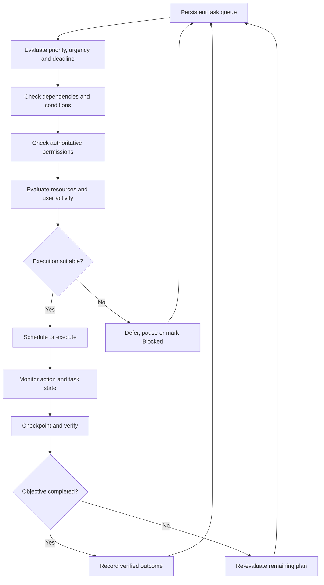

The scheduler should reconsider tasks when circumstances change: a dependency becomes available, a deadline approaches, an event occurs, an objective becomes irrelevant or resource conditions change. Reprioritization must respect explicit user priorities.

## 11.10 Memory architecture: complete conceptual design

Memory is foundational to LIA's persistent identity, cognitive continuity and autonomous initiative. The recommended direction is a hybrid, multi-layered, temporal memory system with a knowledge graph as its relational backbone.

No individual store or retrieval method is expected to provide all required memory capabilities.

### Two complementary memory capabilities

LIA needs both:

1. **Remembering what happened:** A searchable historical archive of permitted conversations, meaningful experiences, decisions, task events and retained source materials.
2. **Remembering what she learned:** Organized long-term memories containing distilled facts, preferences, relationships, procedures, project knowledge and patterns.

The historical archive preserves original context. Organized memories make information easier to use during reasoning. Derived memories should refer back to their original evidence whenever possible.

This does not mean indefinitely recording every screen frame, microphone stream or transient desktop observation. Raw observations have separate permission and retention requirements.

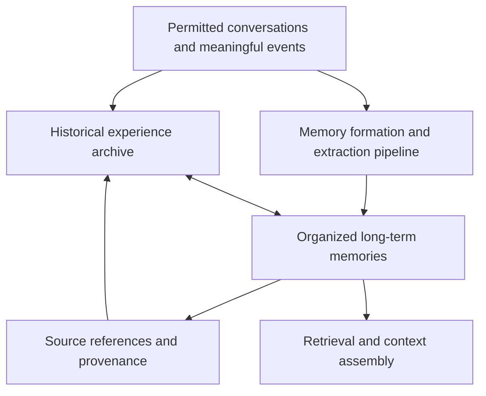

### Memory component 1 — Source and experience archive

The archive is the historical record from which other memories are derived. It can include:

- Conversation transcripts and session records.
- Important interaction events.
- Decisions and their original discussions.
- Task plans, execution steps and outcomes.
- Permitted application and desktop observations.
- Imported documents and reference materials.
- Relevant external research and its sources.

The record should be append-oriented. New events are recorded, and existing evidence is not silently overwritten when a derived memory changes. Corrections and superseding decisions should be represented as new events or versioned state changes with provenance.

Retention is governed separately by sensitivity and user policy. The ordinary conversation archive is retained indefinitely until the user requests deletion. Temporary conversations are excluded from permanent archive and long-term memory formation.

### Memory component 2 — Episodic memory

Episodic memory preserves meaningful experiences in chronological context.

An episode may contain:

- What happened.
- When the underlying event occurred.
- When LIA learned or recorded it.
- The participants, projects and entities involved.
- The context and outcome.
- Related tasks and decisions.
- Links to the original conversation, document or event.

Example:

**Episode: Desktop awareness decision**

- Event date: 12 November 2026.
- Context: Discussion of the extent of desktop awareness.
- Event: User approved three levels of awareness.
- Outcome: Default desktop metadata, on-demand screen perception and optional continuous screen perception.
- Related entities: LIA, Desktop Awareness, Screen Perception and User Permissions.
- Source: Original discussion and approved decision record.

Episodic memory enables questions such as "What did we decide during our last architecture discussion?", "When did we discuss this?" and "What was happening when this preference was established?"

### Memory component 3 — Semantic memory

Semantic memory stores what LIA currently understands to be true or established.

It includes:

| Domain | Example |
|---|---|
| User profile | Interests, preferences, goals and routines |
| Projects | Objectives, current state and decisions |
| Technology | Technologies used by a project |
| Relationships | Relevant people and their associations |
| Preferences | Preferred interaction and working styles |
| Knowledge | Established facts and concepts |

Semantic memory should use both concise, frequently accessed profiles and independently addressable records. A project summary can provide quick context while individual records preserve supporting decisions, dates and source evidence.

A single continually rewritten profile risks losing historical nuance. A collection of isolated facts risks making comprehensive retrieval difficult. The two representations should work together.

### Memory component 4 — Temporal knowledge graph

The knowledge graph is the relational backbone of LIA's memory. It represents entities as nodes and meaningful typed relationships as edges.

Potential entities include User, LIA, Person, Project, Application, Technology, File, Conversation, Experience, Task, Decision, Preference and Skill.

Potential relationship types include:

- WORKS_ON
- USES
- PREFERS
- DECIDED
- DEPENDS_ON
- RELATED_TO
- SUPERSEDES
- PARTICIPATED_IN
- CREATED
- ORIGINATED_FROM
- APPLIES_TO

Example:

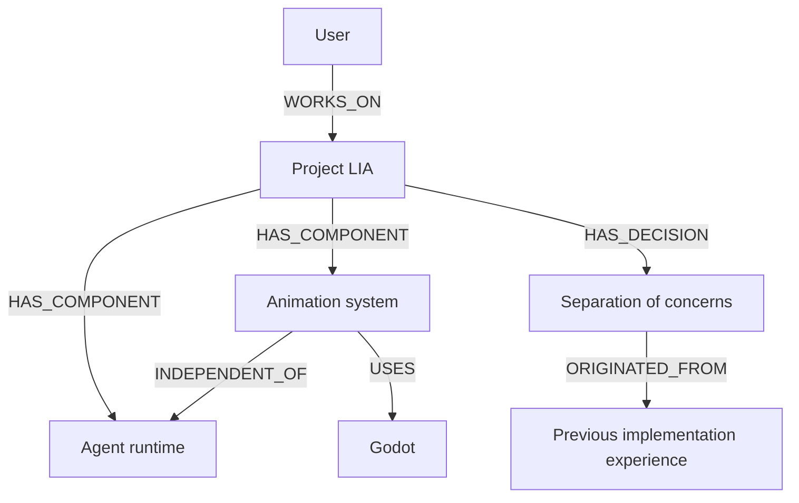

This graph should represent semantic relationships, not merely the fact that two topics appeared in the same conversation. RELATED_TO, DEPENDS_ON and SUPERSEDES must retain distinct meanings.

The graph should support multi-hop questions. For example, a question about why animation must remain independent of agent cognition can lead from the LIA project to the animation system, the agent runtime, the separation-of-concerns decision and the original implementation experience.

#### Temporal graph semantics

The memory model should distinguish:

- **Valid time:** When was this information true in the world or in the user's circumstances?
- **Transaction time:** When did LIA learn or record this information?

If the user tells LIA on 13 November that a desktop-environment change actually happened on 1 November, both dates matter.

The graph should preserve historical facts while identifying what is currently believed to be valid. New facts may supersede older facts without erasing them.

### Memory component 5 — Procedural memory

Procedural memory stores how LIA performs tasks, not merely what she knows.

Examples include:

- How to organize a software project.
- How to operate a particular application.
- How to troubleshoot a known error.
- How to configure a desktop environment.
- How to execute a recurring user-approved workflow.

A procedure should contain preconditions, required permissions, execution steps, expected outcomes and recovery instructions. LIA must distinguish a successful, verified workflow from something she merely attempted once.

### Memory component 6 — Working and task memory

Working memory is LIA's active cognitive workspace. It contains information needed for current reasoning and execution:

- Current conversation context.
- Active objectives and plans.
- Retrieved memories relevant to the current objective.
- Current application and desktop context, where permitted.
- Task checkpoints and dependencies.
- Immediate observations and results.

Working memory must not become an unbounded permanent store. Its lifecycle should be managed independently, while important task checkpoints and persistent state are saved when needed for safe resumption.

### Memory component 7 — Retrieval indexes

Indexes are mechanisms for locating memories, not separate sources of truth.

| Index | Purpose |
|---|---|
| Vector index | Find information through semantic similarity |
| Full-text / BM25 index | Find exact terms, names, identifiers and phrases |
| Graph index | Find relationships and connected memories |
| Temporal index | Find events and facts relevant to a period |
| Structured index | Filter by project, category, source, status and metadata |

These indexes should point to canonical records and source evidence. If an index is stale or inconsistent, it must be repairable from the authoritative records.

### Memory formation pipeline

Autonomous memory formation should operate as an ongoing pipeline over permitted inputs.

1. Capture permitted conversations, events, task outcomes and other relevant information.
2. Segment the input into meaningful events, topic boundaries and experiences.
3. Extract candidate facts, preferences, objectives, decisions, relationships and procedural knowledge.
4. Resolve entities so that information is connected to the correct person, project, application or concept.
5. Validate and reconcile duplicates, contradictions, outdated information, uncertainty and source evidence.
6. Store memories in appropriate representations and create graph relationships and retrieval indexes.
7. Consolidate summaries and frequently used representations without destroying original evidence.

Most extraction and consolidation can occur asynchronously. Important decisions and task-state changes may require prompt persistence. Failure to extract a memory must not silently corrupt the original archive.

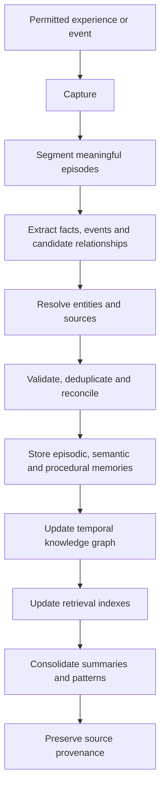

### Associative memory reinforcement

LIA's memory graph should support experience-dependent strengthening of meaningful relationships. This is inspired by associative-learning principles such as Hebbian learning, but is a computational design analogy, not a claim that LIA reproduces biological neural plasticity.

A relationship may become stronger when supported by repeated, sufficiently independent experiences or strong explicit evidence.

Example:

- First experience: The user mentions enjoying Linux internals. LIA records a candidate association between User and Linux Internals.
- Second experience: The user spends multiple sessions exploring kernel internals, process management and memory management. Independent evidence supports the association and creates useful connections among those concepts.
- Third experience: The user explicitly states a long-term goal of understanding Linux internals deeply. This explicit statement provides stronger evidence and can establish a durable learning preference with high confidence.

The system should not require repeated statements when the user has explicitly communicated a clear preference or goal.

#### Association development stages

| Stage | Meaning |
|---|---|
| Candidate association | A relationship is observed, but evidence is insufficient to treat it as an established pattern |
| Consolidated association | Multiple independent experiences support the relationship, or strong explicit evidence establishes it |
| Strong association | The relationship receives consistent support across time, situations and meaningful experiences |

#### Separate memory signals

LIA must maintain distinct values for:

- **Association strength:** How strongly two pieces of information are connected.
- **Factual confidence:** How certain LIA is that the relationship or statement is correct.
- **Importance:** How valuable the information is to preserve.
- **Retrieval activation:** How relevant the memory is to the current situation.

A possible normalized association-strength model is:

S_new = min(1, S_old + ΔS)

ΔS represents the contribution of new supporting evidence. This is a conceptual model, not a finalized update equation or coefficient.

Evidence may have different influence:

| Evidence | Indicative influence |
|---|---|
| Explicit user statement | Very high |
| Repeated independent experiences | High |
| Consistent behavior across sessions | High |
| Relevant task completion | Moderate to high |
| Single contextual observation | Low |
| Mere co-occurrence of concepts | Very low |
| Contradictory information | Triggers reconciliation rather than automatic reinforcement |

#### Selective association and maintenance

LIA must not create strong relationships between every concept that appears in the same conversation. Co-occurrence can suggest a candidate relationship, but semantic meaning requires evidence.

The system should also avoid runaway reinforcement:

- Temporal decay may reduce the retrieval activation or relevance of temporary information.
- Contradictory evidence may challenge a relationship and require reconciliation.
- Strength normalization should produce diminishing gains from repeated evidence, preventing frequently mentioned topics from dominating the graph.
- Repeated retrieval alone must not count as new evidence of truth.
- Historical facts and important decisions must not be erased merely because they are old.

A strong association can guide retrieval without proving a causal relationship or a personal inference.

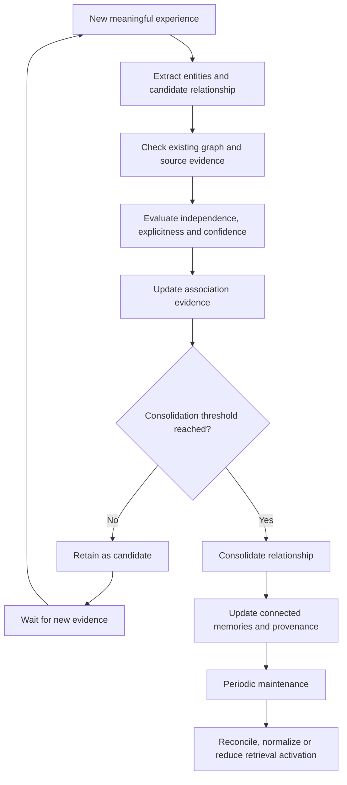

### Context-aware memory retrieval and assembly

The retrieval system should reconstruct the context required for a particular conversation, task or proactive activity. It should not merely return memories that resemble the latest message.

Memory formation, consolidation, retrieval and context assembly are separate responsibilities:

- Formation decides what to remember.
- Consolidation organizes and connects what is remembered.
- Retrieval finds relevant records.
- Context assembly decides what information is supplied to reasoning.

#### Eight retrieval stages

1. Understand the information need.
2. Create a retrieval plan.
3. Query relevant memory stores in parallel.
4. Merge and deduplicate candidate memories.
5. Expand relevant knowledge-graph connections.
6. Rerank and validate evidence.
7. Retrieve original source material when needed.
8. Assemble a bounded working context.

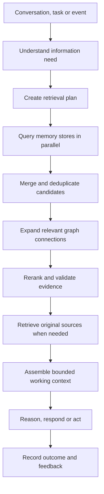

#### Retrieval by information need

| Request | Relevant memory sources |
|---|---|
| Casual conversation | User profile, preferences and recent relevant episodes |
| Personal discussion | Relevant episodic memories, preferences and established boundaries |
| Project discussion | Project summaries, decisions, graph connections and original discussions |
| Technical research | Relevant knowledge, reference documents and previous research |
| Task execution | Task state, procedures, current permissions and fresh application context |
| Task resumption | Checkpoints, execution history, dependencies and latest state |
| Historical question | Temporal graph, original source episodes and evidence |
| Proactive initiative | Active goals, unfinished tasks, deadlines, preferences and permitted observations |

#### Hybrid retrieval and ranking

The retrieval planner may query vector, lexical, structured, graph, temporal and source-archive indexes in parallel. Candidate results should be merged and deduplicated before ranking.

Ranking can consider semantic relevance, lexical relevance, graph relevance, temporal relevance, source authority, factual confidence, current validity, contextual relevance and importance.

A conceptual ranking model is:

R(m,q,c) = w_s S + w_l L + w_g G + w_t T + w_p P + w_v V + w_c C

Where m is a candidate memory, q is the information request, c is current context, and the signals represent semantic, lexical, graph, temporal, provenance, validity and contextual relevance. The weights require evaluation and calibration; they are not fixed in the requirements baseline.

Association strength may influence which graph paths deserve exploration, but must not override factual confidence or source evidence.

#### Bounded graph traversal

Graph retrieval should:

- Identify anchor entities in the request.
- Traverse meaningful typed relationships.
- Expand progressively from directly connected memories.
- Use task-appropriate and bounded hop counts.
- Preserve edge direction and semantics.
- Apply temporal validity and access controls during traversal.
- Stop when additional connections no longer contribute useful evidence.

An unrestricted graph walk is not acceptable because it can retrieve excessive or unrelated context.

#### Temporal and contradiction resolution

Before using a memory as current fact, LIA should identify whether it is current, historical, superseded, stale, incomplete or contradictory.

For example, a previous preference for Application A may be superseded by an explicit later preference for Application B. LIA should retain both records and return the current applicable belief when asked about the present, while still answering historical questions accurately.

When evidence conflicts without a clear resolution, LIA must expose the uncertainty rather than force one answer.

#### Context assembly

The final working-context package should include only information needed for the current task and should preserve:

- Current project or conversation state.
- Relevant established decisions and facts.
- Relevant historical experiences.
- Active tasks and unresolved items.
- Source references.
- Temporal status.
- Explicit versus inferred evidence labels.
- Uncertainty and conflicting evidence.
- Relevant access restrictions.

It should be bounded by the available context budget. A summary must not be treated as equivalent to its original evidence when exact historical detail matters.

#### Reactive and anticipatory retrieval

**Reactive retrieval** occurs in response to a user message, task or event.

**Anticipatory retrieval** prepares likely relevant context as a task or interaction develops. For example, when the user begins working on a known project, LIA may retrieve its current summary, recent decisions and unfinished tasks, provided the relevant context access is permitted.

Anticipatory retrieval does not authorize execution. It prepares information only.

#### Retrieval traceability

LIA should retain enough retrieval trace information to explain which sources and relationships contributed to a response or plan. This enables debugging across extraction, entity resolution, graph traversal, ranking, temporal resolution and context assembly.

#### Memory evaluation

The memory system should be evaluated using LIA-specific tests:

| Test | Expected behavior |
|---|---|
| Exact recall | Retrieve a specific fact and its source |
| Multi-session recall | Combine information from different conversations |
| Multi-hop reasoning | Follow relationships between projects, decisions and events |
| Temporal reasoning | Distinguish historical information from current information |
| Knowledge updates | Correctly handle changed preferences and decisions |
| Provenance | Identify the original source of remembered information |
| Abstention | Acknowledge missing or uncertain information |
| Task continuity | Resume a task using its actual checkpoint |
| Correction | Propagate a correction into dependent representations |
| Deletion | Propagate deletion through authorized stores and indexes |
| Context isolation | Avoid mixing unrelated projects, people or private domains |
| Permission separation | Never treat retrieved memory as current execution authorization |

Measurements should include retrieval precision and recall, source accuracy, temporal correctness, context size, latency, unnecessary memory inclusion and the rate of unsupported answers.

LongMemEval and LoCoMo are potential external benchmark references; they do not replace LIA-specific evaluation.

### Memory architecture diagram

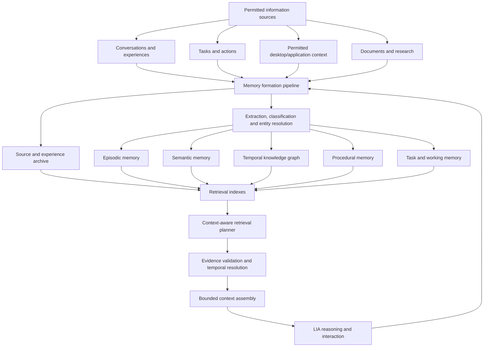

## 11.11 P2.1 and P2.5 boundaries

The memory architecture in this section is a conceptual design direction. P2.5 will formalize memory requirements, governance, persistence, retrieval, correction and deletion. P2.6 will define permissions, sensitive-data boundaries and execution authority. P2.2 will define measurable performance and resource constraints. P2.7 will define acceptance tests.

No specific graph database, vector database, embedding model, programming language, memory framework or orchestration system is selected here. Such choices belong in P3.

---

# 12. P2.5 — Memory governance and integrity

**Workstream status:** Active design  
**Purpose:** Define how LIA retains, classifies, protects, corrects, forgets, deletes, shares and accesses memory throughout its lifecycle.

A sophisticated memory system that remembers everything but cannot reliably correct or forget information would be fundamentally flawed. Governance is therefore part of the memory architecture, not an administrative feature added afterwards.

## 12.1 Historical conversation retention

The user approved the following policy:

- Ordinary permitted conversation archives are retained indefinitely until the user requests deletion.
- Retention does not imply that every screen frame, raw audio stream or transient desktop observation is permanently recorded.
- The user can request deletion of individual conversations or broader memory collections.
- Sensitive information follows stricter classification and retention policies.
- Temporary conversations are available for the active interaction but are not added to the permanent conversation archive or long-term memory formation.

### Temporary conversations

Temporary conversation mode is available in two ways:

1. The user manually activates it.
2. LIA may suggest it when a conversation appears especially sensitive.

LIA must never silently activate temporary mode. The user must explicitly consent to enter it.

While temporary mode is active:

- Conversation content remains available in working memory for the active interaction.
- The conversation is not added to the permanent historical archive.
- Autonomous extraction and consolidation of its contents into long-term memory are disabled.
- No episodic, semantic or associative memories are created from the temporary conversation.
- Temporary conversational context is discarded when the session ends, subject to any separately disclosed operational or security records.
- Sensitive content must not leak into unrelated summaries or retrieval indexes.

If LIA performs an authorized computer operation during a temporary session, minimal operational records may be necessary for execution integrity and security. Such records must not preserve the sensitive conversational content. A separately authorized persistent task may have its own task record, but that must not silently archive the temporary conversation.

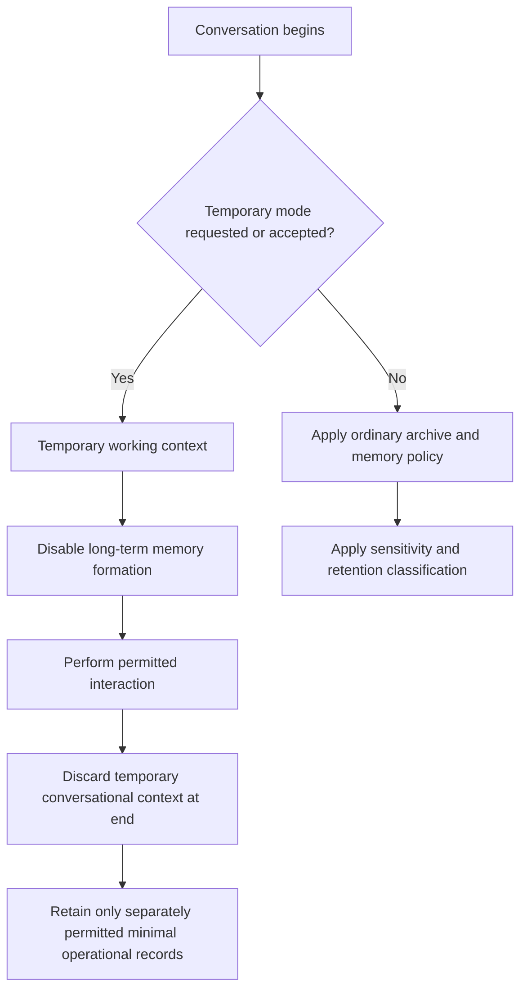

## 12.2 Memory sensitivity classification

The initial proposed classification is:

| Class | Information examples | Default memory policy |
|---|---|---|
| **S0 — Ordinary** | General knowledge, public information and ordinary project facts | Autonomous retention allowed |
| **S1 — Personal** | Interests, preferences, routines and personal context | Autonomous retention under user memory preferences |
| **S2 — Sensitive** | Private correspondence, financial records and sensitive personal documents | May be processed when authorized; explicit authorization required for long-term retention |
| **S3 — Highly sensitive secrets** | Passwords, API tokens, private keys, recovery codes and equivalent secrets | Never store in ordinary conversational or semantic memory |

S3 credentials must be handled through a separate secure credential mechanism if the product later supports them. They must not be embedded in the knowledge graph, ordinary memory records or conversational summaries.

Permission to access information does not automatically grant permission to retain it. LIA may be authorized to inspect a financial document for a specific calculation without being authorized to preserve its full contents indefinitely.

Classification must affect the entire memory pipeline, including extraction, summarization, graph construction, indexing, retrieval and sharing. If LIA is uncertain about sensitivity, she should handle the information conservatively and avoid automatic promotion into unrestricted long-term memory.

## 12.3 Correction, contradiction and temporal reconciliation

LIA must correct her understanding without corrupting historical evidence.

Example:

- January: The user prefers Application A.
- March: The user begins using Application B.
- April: The user explicitly states that Application B is now preferred.

The current semantic profile should reflect Application B. The historical record should preserve the earlier preference and the transition.

Correction rules:

- Explicit user correction takes precedence over an inference within the scope stated by the user.
- Context matters: preferring Linux for development does not establish a preference for Linux in every activity.
- Time matters: earlier information may have been accurate when recorded.
- Contradictions should remain visible when evidence does not establish a clear resolution.
- LIA must not invent an explanation for why information changed.
- Corrections must propagate to derived summaries, graph relationships and retrieval indexes.
- Historical evidence should remain traceable unless the user separately requests erasure.

## 12.4 Forgetting and deletion operations

The user approved three distinct memory-management operations:

| Operation | Meaning |
|---|---|
| **Forget a fact** | Remove the fact from active memory and its derived representations, and prevent it from influencing future reasoning. The original conversation remains unless separately requested for deletion. |
| **Erase an experience** | Delete the selected conversation or experience and its derived memories, relationships, summaries and retrieval representations. |
| **Erase a memory domain** | Remove a selected collection, such as a project-memory or personal-interest domain, including derived records within the requested scope. |

A minimal deletion marker may be retained to prevent accidental re-import, but it must not preserve the deleted content itself.

Deletion must cover the canonical record and its dependent representations, including:

- Knowledge graph nodes and relationships.
- Vector embeddings and lexical indexes.
- Derived summaries and profiles.
- Cached working-context representations.
- Linked episodic and semantic memories.
- Snapshots and backups according to the applicable deletion policy.
- External processing or storage providers, subject to their actual deletion capabilities and terms.

LIA must distinguish deletion from active memory, deletion from primary storage, expiration of backup copies and removal from external providers. She must not claim complete erasure until all applicable deletion work has actually completed or clearly disclose what remains outstanding.

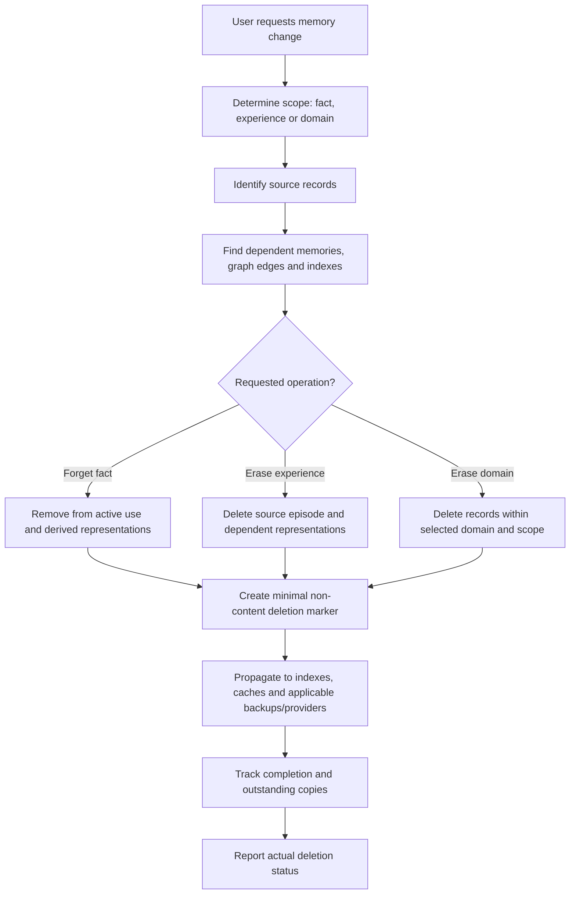

## 12.5 Memory compartments and controlled cross-domain sharing

LIA's memory should be logically compartmentalized. The initial domains are:

| Domain | Contents |
|---|---|
| User memory | Preferences, goals, routines, interests and personal context |
| Project memory | Project-specific objectives, decisions, architecture, files and progress |
| Task memory | Objectives, plans, dependencies, checkpoints and execution history |
| Experience memory | Conversations, episodes, meaningful events and interaction history |
| Procedural memory | Reusable workflows, learned application operations and validated procedures |

These compartments must remain interconnected without becoming one unrestricted information pool.

The user approved controlled cross-domain memory sharing.

The intended behavior is:

- Non-sensitive user-level preferences and technical preferences may be available across projects when relevant and permitted by policy.
- Project-specific or confidential information remains scoped to that project unless sharing is explicitly authorized or covered by a clearly defined user-level sharing rule.
- A task may retrieve relevant project memory and user preferences without gaining access to unrelated private domains.
- LIA may know that two projects are related without being entitled to retrieve every private detail from both.
- A relationship edge does not itself grant access to the connected record.
- Sharing permissions are not automatically transitive. Access to A and a relationship from A to B does not automatically grant access to all of B.
- Cross-domain sharing must retain source provenance, sensitivity classification and the purpose for which information is being retrieved.
- Revoking a sharing grant must prevent future retrieval under that grant and update relevant access indexes or caches.

Access decisions should consider three dimensions:

1. **Ownership:** Which user, project, task or experience owns the memory?
2. **Sensitivity:** How restricted is the information?
3. **Contextual access:** Which task or reasoning activity is allowed to retrieve it?

### Controlled memory-sharing model

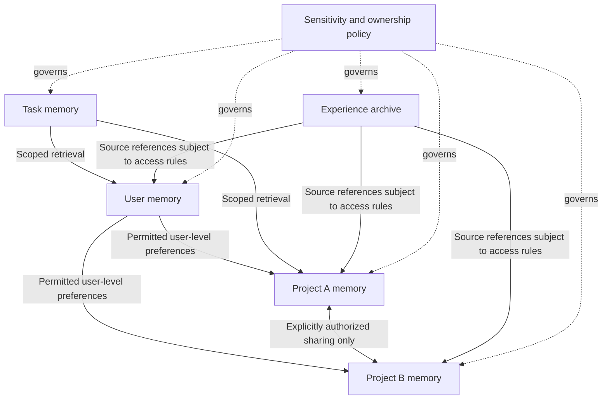

The diagram expresses permitted flows, not automatic access. The access-control decision must be evaluated for each retrieval.

## 12.6 Memory and authorization are separate authorities

Memory records what LIA knows and what happened. A separate permission authority determines what LIA is currently allowed to do.

Example:

Memory records that the user previously authorized LIA to conduct public web research for the LIA project.

The permission authority independently confirms:

- Capability: Public web research.
- Scope: LIA project.
- Authority: Standing permission.
- Status: Active.

LIA may proceed without asking for a new approval if the current permission check succeeds.

If the permission is revoked, the permission authority must reject future execution even though historical memory still records the previous approval.

Likewise, an inferred preference such as "the user usually wants me to do this" must never become authorization.

These components remain separate:

| Component | Responsibility |
|---|---|
| Memory system | Knows what has happened and what has been learned |
| Permission authority | Determines what LIA is currently allowed to do |
| Task scheduler | Determines when work can execute |
| Execution system | Performs authorized operations |

They may reference one another, but must not inherit one another's authority.

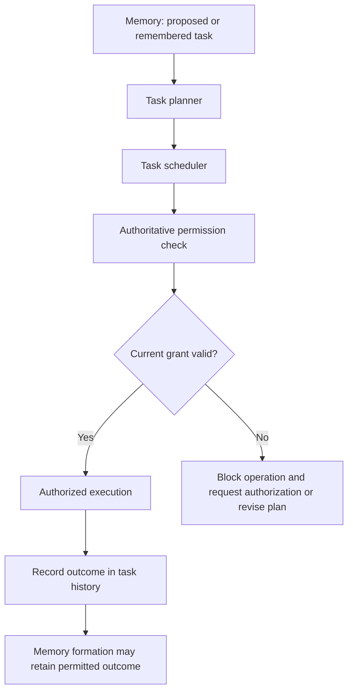

## 12.7 Memory governance requirements

The following security and governance requirements are part of the P2.5/P2.6 design baseline. Their detailed acceptance criteria remain to be completed in P2.7.

| ID | Requirement | Status |
|---|---|---|
| SEC-001 | Ordinary permitted conversation archives shall be retained indefinitely until the user requests deletion, subject to sensitivity classification and the applicable retention policy. | Agreed design direction |
| SEC-002 | LIA shall support user-activated temporary conversations and may suggest temporary mode, but shall not activate it without explicit user consent. | Agreed design direction |
| SEC-003 | Temporary conversation content shall be excluded from permanent conversation archives and autonomous long-term memory formation, subject to separately disclosed minimal operational records. | Agreed design direction |
| SEC-004 | Memory records and source information shall be classified by sensitivity before long-term retention, indexing and cross-domain sharing. | Draft |
| SEC-005 | S2 sensitive information shall require explicit authorization for long-term retention, even when processing access is authorized. | Agreed design direction |
| SEC-006 | S3 secrets shall not be stored in ordinary conversational, semantic or graph memory. | Agreed design direction |
| SEC-007 | The system shall distinguish access permission from retention permission. | Draft |
| SEC-008 | The user shall be able to inspect the source and relationships of retained memories. | Draft |
| SEC-009 | Explicit user corrections shall take precedence over inferred information within the stated scope and shall propagate to dependent representations. | Draft |
| SEC-010 | The system shall preserve historical evidence when information is corrected or superseded, unless the user requests erasure. | Draft |
| SEC-011 | Forgetting a fact shall remove it from active use and derived representations while leaving the original archive intact unless separately requested for deletion. | Agreed design direction |
| SEC-012 | Erasing an experience shall propagate to its dependent memory records, graph relationships, summaries and retrieval indexes within the requested scope. | Agreed design direction |
| SEC-013 | Erasing a memory domain shall remove the selected domain and its derived representations within the requested scope. | Agreed design direction |
| SEC-014 | Deletion status shall distinguish active-storage deletion, primary-store deletion, backup expiration and external-provider deletion. | Draft |
| SEC-015 | Memory domains shall be logically compartmentalized by ownership, sensitivity and contextual access. | Agreed design direction |
| SEC-016 | Cross-domain memory sharing shall be controlled, purpose-relevant and subject to sensitivity, ownership and revocable access rules. | Agreed design direction |
| SEC-017 | Knowledge-graph relationships shall not automatically grant access to connected memory records, and sharing shall not be transitively inherited by default. | Agreed design direction |
| SEC-018 | The permission authority shall remain separate from memory and shall be consulted for current authorization before execution. | Agreed design direction |
| SEC-019 | The system shall not claim complete erasure while applicable deletion work remains outstanding or unverified. | Agreed design direction |
| SEC-020 | If sensitivity or permission status is uncertain, the system shall apply the more restrictive safe handling behavior until resolved. | Draft |

## 12.8 Memory governance workflow

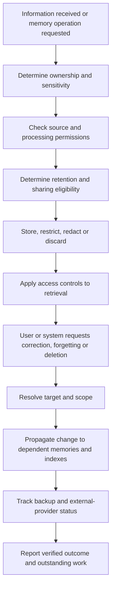

## 12.9 P2.5 completion boundary

The memory governance design is not complete until the following are specified and tested:

- Memory record ownership and sensitivity classification.
- Retention rules for every memory category and source type.
- Temporary conversation lifecycle and operational exceptions.
- Explicit authorization for sensitive-memory retention.
- Correction and temporal contradiction handling.
- Forgetting, experience erasure and domain erasure.
- Deletion propagation, backup handling and external-provider reporting.
- Compartmentalized access and controlled cross-domain sharing.
- Permission-authority integration and audit behavior.
- Retrieval access checks and source-level provenance.
- User inspection, correction and deletion workflows.
- Acceptance criteria covering each governance operation.

