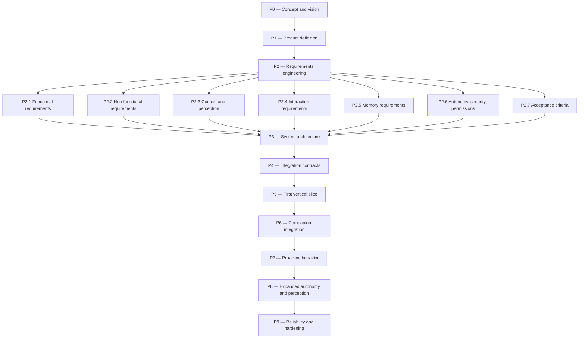

Warning: truncated output (original token count: 182548)
Total output lines: 8911

# LIA --- Project Blueprint & Engineering Specification

> **Project:** LIA\
> **Product identity:** An embodied, autonomous digital companion and
> OS-native agent\
> **Document type:** Living project specification\
> **Version:** 1.14.15
> **Last updated:** 16 November 2026
> **Current phase:** P5 — First Vertical Slice (M0 complete; M1 in progress)
> **Current workstream:** M1 — device-agent core follow-up (in progress); M2 — Linux IPC spike (in progress)
> **Document status:** P5 M0 contract hygiene passed in PR #3; implementation/conformance gates remain Not Run

------------------------------------------------------------------------

## 1. Document purpose

This is the canonical working document for the LIA project. It is
intended to be readable in Obsidian, GitHub, and any standard Markdown
viewer.

It replaces chat history as the primary project reference. Decisions,
requirements, progress, and changes should be recorded here. Chat
discussions may produce proposals, but a proposal becomes part of the
project baseline only when its status is explicitly changed in this
document.

### 1.1 Status vocabulary

  Status        Meaning
  ------------- -----------------------------------------------------
  Proposed      Under discussion; not part of the approved baseline
  Draft         Written and ready for review
  Approved      Accepted into the project baseline
  Implemented   Code or configuration exists
  Verified      Tested against its acceptance criteria
  Deferred      Deliberately postponed
  Rejected      Considered and not accepted

A requirement marked **Draft** must not be treated as an approved
commitment.

### 1.4 Project discussion and documentation workflow

During an active phase, design discussions and requirement refinement take place before the canonical blueprint is revised. The blueprint is normally consolidated at phase completion, rather than updated after every conversation. An explicit user request may authorize an interim consolidation checkpoint.

The document distinguishes approved product/design direction from draft functional requirements, unresolved first-release scope, and implementation status. Approval of a product capability does not mean that it has been implemented or that every detailed acceptance criterion is complete.

The reference technology baseline is selected through P3.8. Remaining vendor choices and proof-gated implementation details are explicitly assigned to P4–P6; a capability is not considered supported until its named evidence gate passes.

### 1.2 Requirement writing convention

Requirements use unique, stable identifiers:

-   `FR-###` --- Functional requirement
-   `NFR-###` --- Non-functional requirement
-   `SEC-###` --- Security, privacy, and permission requirement
-   `UX-###` --- User experience and interaction requirement
-   `AC-###` --- Acceptance criterion or test case
-   `ADR-###` --- Architecture decision record
-   `CTX-###` --- Context and perception requirement
-   `UX-###` --- Interaction and user-experience requirement
-   `CTX-###` --- Context and perception requirement
-   `UX-###` --- Interaction and user-experience requirement

A requirement should describe one observable capability or constraint.
Use "shall" for normative requirements. Avoid embedding implementation
choices unless the choice is already an approved constraint.

### 1.3 Priority vocabulary

  -----------------------------------------------------------------------
  Priority                            Meaning
  ----------------------------------- -----------------------------------
  P0 --- Essential                    Required for the product's defining
                                      experience or a safe minimum
                                      implementation

  P1 --- Important                    Important to the intended product,
                                      but can follow the first working
                                      vertical slice

  P2 --- Extended                     Valuable capability for a later
                                      release

  TBD                                 Priority has not yet been agreed
  -----------------------------------------------------------------------

Priority describes product/development importance, not implementation
status or automatic inclusion in the first vertical slice. The first
vertical slice is a deliberately narrow integration proof, not a complete
release of every P0 capability. Its exact membership is defined separately
in Section 6.

------------------------------------------------------------------------

# 2. Product definition --- approved baseline

## 2.1 Product identity

**LIA --- An embodied, autonomous digital companion and OS-native
agent.**

LIA is a persistent digital entity that inhabits the user's computing
environment. She maintains an ongoing presence, perceives her permitted
digital surroundings, communicates naturally through voice, develops an
understanding of the user and independently participates in their
activities.

She possesses a recognizable personality, persistent memory, contextual
awareness, autonomous initiative and an expressive physical embodiment.

She is both a companion and an intelligent agent. She can engage in
casual conversations, express emotions, entertain, observe, assist,
collaborate, operate applications and execute tasks.

Her existence is not limited to individual conversations or commands.
She maintains continuity across time, sessions and activities, allowing
her relationship with the user and understanding of their digital
environment to develop.

LIA's persistent identity is not confined to a single computer. It
extends across user-enrolled personal devices, including supported
desktop computers, smartphones and connected home/device environments.
Each device contributes only the capabilities and context that the user
has explicitly enabled. A shared coordination and task system preserves
continuity while local device agents execute operations within their own
platform and permission boundaries.

LIA can supervise long-running objectives across devices and services,
resume work after interruptions, and communicate progress through the
notification channels selected by the user. Remote reachability does not
imply unrestricted access to a device that is offline, asleep, locked or
otherwise unavailable.

**Design philosophy:** LIA should feel like someone who lives in the
computer, rather than software that happens to be represented by a
character.

## 2.2 Defining properties

1.  **Persistent presence:** LIA exists beyond individual interactions.
2.  **Embodied identity:** LIA has a physical representation and
    expressive behavior.
3.  **Independent agency:** LIA can initiate, plan, and act within
    authorized boundaries.
4.  **Cognitive continuity:** LIA retains memories and contextual
    understanding.
5.  **Dual purpose:** Companionship and useful assistance are equally
    important.

## 2.3 Intended capability domains

These are the product's intended capability domains. Inclusion here does
not mean every capability belongs in the first release.

1.  Environmental awareness.
2.  Voice and conversational interaction.
3.  Operating-system interaction.
4.  Application and digital-world interaction.
5.  Memory and personalization.
6.  Autonomous behavior.
7.  Physical embodiment and animation.
8.  Runtime self-management.
9.  Multi-device continuity and connected-environment coordination.

## 2.4 Personality and behavioral model

Personality is not the same as emotional state, and neither is the same
as behavior.

The current conceptual model has five layers:

1.  **Core personality:** Relatively stable characteristics such as
    affection, playfulness, curiosity, empathy, independence,
    expressiveness, and supportiveness.
2.  **Emotional state:** Dynamic state such as happiness, excitement,
    curiosity, concern, frustration, sadness, calmness, and affection.
3.  **Social and behavioral tendencies:** Conversational initiative,
    playfulness intensity, affection expression, helpfulness,
    persistence, respect for personal space, and work/leisure behavior.
4.  **Expression:** Spoken language, tone, facial expressions, gestures,
    poses, movement, and interaction with desktop elements.
5.  **Individual experiences:** Shared experiences, user preferences,
    past conversations, behavioral observations, and relationship
    history.

The layers may influence each other but must remain distinguishable.
Core personality should remain relatively stable and recognizable.
Emotional state and expression may change dynamically. An LLM response
must not arbitrarily redefine the character's core personality.

## 2.5 Autonomy principle

> **LIA can have independent intentions, but independent intentions do
> not automatically grant execution authority.**

Decision-making and permission to execute are separate. LIA may identify
an opportunity or form an intention, but an action must still pass its
authorization and safety checks.

Autonomy has four independently configurable dimensions:

-   **Social autonomy:** Initiating conversations, jokes, and social
    interactions.
-   **Cognitive autonomy:** Forming plans and identifying opportunities.
-   **Operational autonomy:** Executing computer operations.
-   **Temporal autonomy:** Maintaining and scheduling ongoing
    activities.

Care, affection, and initiative must respect user boundaries. LIA must
not use guilt, coercion, possessiveness, or emotional pressure to obtain
attention or permission.

## 2.6 Platform strategy --- approved

-   **First-class platforms:** Linux and Windows.
-   **Future platform:** macOS.
-   **Cross-platform approach:** Shared core with separate
    operating-system adapters.
-   **Linux environments:** Wayland and X11 differences must be handled
    explicitly.
-   **Capability parity:** The platform abstraction must report
    unsupported or limited operations honestly. It must not imply that
    every OS provides identical capabilities.

The user environment currently available for early prototyping includes
Arch Linux and Hyprland/Wayland. This is a useful test environment, not
a reason to make Linux the only target.

## 2.7 Initial privacy and permission principles

These are approved design constraints at the product-definition level;
detailed permission behavior remains to be specified in P2.

  Resource                Baseline principle
  ----------------------- -------------------------------------------------
  Screen                  Explicit, user-controlled access
  Microphone              Explicit permission and visible listening state
  Camera                  Disabled by default; explicit activation
  Files                   Scoped permissions
  Applications            User-configurable access
  Processes               Read-only monitoring by default
  Keyboard and mouse      Controlled action permissions
  System administration   Separate elevated authorization

Data retention, local versus cloud processing, encryption, and memory
deletion policy remain open requirements topics.

## 2.8 Experience lifecycle

The conceptual lifecycle includes:

-   Initializing
-   Available
-   Observing
-   Conversing
-   Acting
-   Idle
-   Paused
-   Sleeping

These are behavioral states, not necessarily mutually exclusive
processes. Animation, perception, and task execution may operate
independently. Perceived character sleep must eventually be
distinguished from actual runtime suspension or shutdown.

------------------------------------------------------------------------

## 2.9 Multi-device and connected-environment extension

**Status:** Approved product-scope extension, formalized during P3 discovery.

LIA has one persistent user identity across multiple independently
enrolled device nodes and supported service integrations. The initial
device ecosystem includes Linux and Windows desktop computers, smartphones,
supported home-automation devices and gateways, and external applications
and services through separately authorized connectors.

A durable coordination layer maintains device identity, connectivity,
tasks, schedules, events, permissions, memory references and notification
routing. It does not replace local execution: a PC operation is performed
by the authorized PC agent, and a home action by the relevant authorized
connector or device gateway.

LIA shall supervise recurring and multi-step objectives over hours, days
or longer periods. Task supervision means monitoring approved workflow
state, deadlines, dependencies, worker health and external events. It
does not imply unrestricted continuous capture of the user's screen,
microphone, camera or private activity.

The device and workflow requirements added during P3 discovery are
tracked as FR-225–FR-248, NFR-036–NFR-044, SEC-061–SEC-074 and
AC-040–AC-046. These additions extend the completed Phase 2 baseline
through controlled change; they do not invalidate earlier requirements.

# 3. Project roadmap and progress

## 3.1 Master roadmap

  Phase   Name                               Status
  ------- ---------------------------------- ----------
  P0      Concept and vision                 Complete
  P1      Product definition                 Complete
  P2      Requirements engineering           Complete — baseline approved
  P3      System architecture                Complete — P3.1–P3.8 architecture and reference technology baseline approved
  P4      Integration contracts              In Progress — P4.1 contract package drafted; verification pending
  P5      First vertical slice               In Progress — M0 complete; M1 core merged with proof open; M2 IPC spike in progress
  P6      Companion integration              Pending
  P7      Proactive behavior                 Pending
  P8      Expanded autonomy and perception   Pending
  P9      Reliability and hardening          Pending

## 3.2 Phase 1 workstreams

  -----------------------------------------------------------------------
  ID                      Workstream              Status
  ----------------------- ----------------------- -----------------------
  P1.1                    Product identity        Approved

  P1.2                    Capability              Approved
                          specification           

  P1.3                    Autonomy specification  Approved at initial
                                                  policy level

  P1.4                    Personality and         Approved at initial
                          interaction model       model level

  P1.5                    Platform and technical  Approved
                          constraints             

  P1.6                    Experience and          Approved
                          lifecycle model         
  -----------------------------------------------------------------------

**Phase 1 exit status:** Complete. This closes product definition, not
implementation architecture.

## 3.3 Phase 2 workstreams

| ID | Workstream | Purpose | Status |
|---|---|---|---|
| P2.1 | Functional requirements | Define what LIA must do | Complete — approved baseline |
| P2.2 | Non-functional requirements | Define performance, reliability, resource and quality constraints | Complete — approved baseline |
| P2.3 | Context and perception requirements | Define what LIA can observe, represent and infer | Complete — approved baseline |
| P2.4 | Interaction requirements | Define voice, dialogue, interruption, presence and embodiment behavior | Complete — approved baseline |
| P2.5 | Memory requirements | Define memory types, persistence, retrieval, correction and deletion | Complete — approved baseline |
| P2.6 | Autonomy, security and permissions | Define authority, approval, risk, privacy and safety boundaries | Complete — approved baseline |
| P2.7 | Acceptance criteria | Define verification criteria and test coverage for requirements and user journeys | Complete — criteria specified; execution deferred to implementation/test phases |

**Phase 2 status:** Requirements-engineering baseline complete. This does not mean the system has been implemented, benchmarked or verified. Detailed implementation and runtime test execution remain subsequent engineering work.

## 3.4 Phase dependency graph

------------------------------------------------------------------------

## 3.5 P2.1 discussion progress

**Status:** Complete — approved functional requirements baseline and first
vertical-slice scope.

P2.1 requirements FR-001–FR-224 are approved where assigned; unused
identifier gaps remain reserved and are not missing requirements. The full
product scope is distinguished from first-slice membership. The agreed
voice modes, desktop-awareness levels, window interaction, application and
file capabilities, task model, autonomy defaults, embodied character
control, failure behavior and memory continuity are recorded in Section 4.
The first vertical slice and its AC-001–AC-011 traceability are recorded in
Section 6 and Section 7.

Detailed permissions remain with P2.6, measurable non-functional targets
with P2.2, interaction/perception refinements with P2.3/P2.4, detailed test
procedures and execution with P2.7, and implementation choices with P3.

## 3.6 P2.5 memory requirements progress

**Workstream status:** Design and requirements baseline complete.  
**Verification status:** Acceptance criteria defined; detailed test cases and execution are assigned to P2.7.

| Memory area | Decision status | Remaining work / dependency |
|---|---|---|
| Historical and source archive | Approved | Implement retention and deletion controls in P3; verify in P2.7 |
| Episodic, semantic, procedural, working and task memory | Approved conceptual model | Map to architecture in P3 |
| Temporal knowledge graph and entity resolution | Approved conceptual model | Select representation and algorithms in P3 |
| Autonomous formation and consolidation | Approved | Implement permitted-source capture, evidence validation and lineage in P3 |
| Epistemic states and uncertainty | Approved | Calibrate confidence and promotion thresholds through evaluation |
| Associative reinforcement | Approved conceptual model | Empirically calibrate evidence weights and maintenance behavior |
| Freshness and temporal validity | Approved | Define class-specific freshness behavior; numerical targets remain implementation/evaluation work |
| Hybrid retrieval and context assembly | Approved conceptual model | Select indexes, ranking strategy and budgets in P3/P2.2 |
| Provenance and record integrity | Approved | Implement versioning, source lineage and idempotent updates in P3 |
| Conversation retention and temporary mode | Approved | Implement controls and test isolation in P3/P2.7 |
| Sensitivity and retention classes | Approved | Integrate with P2.6 authorization and implementation |
| Granular access and derived-memory restrictions | Approved | Integrate with the authoritative permission model in P2.6 |
| Cross-project promotion and sharing | Approved | Implement and test scope isolation and revocation |
| Correction, forgetting and deletion | Approved | Implement propagation, tombstones and verification |
| Memory transparency and review | Approved | Implement user-facing inspection and management interface |
| Export and portability | Approved requirement | Select open export schema and package format in P3 |
| Security, external processing and failure behavior | Approved requirements | Select implementation controls in P3; quantitative NFRs in P2.2 |
| Acceptance criteria | Defined in Section 12.17 | Detailed test cases and execution in P2.7 |

P2.5 closes the product-level memory requirements and governance design. It does not claim that memory implementation or verification is complete.

# 4. P2.1 --- Functional requirements

**Workstream status:** Complete — product-functional requirements reviewed and approved\
**Scope:** Define observable functions LIA is expected to provide,
without selecting the implementation technology.

All FR requirements in this chapter are approved product-level
commitments. Approval does not mean implementation or verification. The
first vertical slice is a subset of this full product baseline and is
specified separately in Section 6.

Functional requirements describe system behavior: what input or event is
handled, what operation is performed, and what result is made available.
Performance thresholds belong in P2.2. Detailed permission rules belong
in P2.6, although functional requirements must acknowledge that actions
are authorization-gated.

## 4.1 Functional scope and exclusions

P2.1 covers the functional behavior of:

-   Presence and lifecycle.
-   Desktop and operating-system context.
-   Voice and text communication.
-   Character embodiment and expression.
-   Window and input interaction.
-   Application and file interaction.
-   Memory and continuity.
-   Proactive behavior and task execution.
-   Configuration and user control.
-   Runtime health and recovery.
-   Spatial modeling of the desktop environment.
-   Desktop configuration and cross-window interaction.
-   Hybrid input and application-control mechanisms.
-   Task planning, scheduling, dependencies, and adaptive execution.
-   Autonomous memory formation, consolidation, retrieval, and governance.

P2.1 does **not** decide:

-   Programming languages, frameworks, libraries, databases, or model
    providers.
-   Exact latency, frame-rate, CPU, memory, or reliability targets.
-   Detailed consent flows, authorization tiers, threat models, or data
    retention periods.
-   Final animation assets, character rig, or visual design.
-   Exact internal service topology or IPC protocol.

Those topics belong to P2.2--P2.6 and P3.

## 4.2 Presence and lifecycle

  -------------------------------------------------------------------------
  ID               Requirement                    Priority Status
  ---------------- ----------------- --------------------- ----------------
  FR-001           LIA shall be able                    P0 Approved
                   to maintain a                           
                   persistent                              
                   desktop presence                        
                   beyond an                               
                   individual                              
                   conversation.                           

  FR-002           LIA shall expose                     P1 Approved
                   her current                             
                   lifecycle state,                        
                   including                               
                   initializing,                           
                   available,                              
                   conversing,                             
                   acting, paused,                         
                   and sleeping                            
                   where applicable.                       

  FR-003           LIA shall support                    P0 Approved
                   user-controlled                         
                   pause and resume                        
                   of autonomous                           
                   interactions.                           

  FR-004           LIA shall                            P0 Approved
                   distinguish                             
                   conversational                          
                   availability from                       
                   permission to                           
                   observe or                              
                   operate the                             
                   computer.                               

  FR-005           LIA shall restore                    P0 Approved
                   the supported                           
                   portions of her                         
                   user                                    
                   configuration and                       
                   persistent                              
                   context after a                         
                   restart.                                

  FR-006           LIA shall                            P0 Approved
                   communicate when                        
                   a capability is                         
                   unavailable,                            
                   disabled, or                            
                   suspended rather                        
                   than silently                           
                   behaving as if it                       
                   were active.                            
  -------------------------------------------------------------------------

## 4.3 Environmental and desktop context

| ID | Requirement | Priority | Status |
|---|---|---:|---|
| FR-010 | LIA shall be able to identify the currently active application and active window when the platform adapter supports it. | P0 | Approved |
| FR-011 | LIA shall be able to retrieve basic metadata about visible windows, including title and window identity where available. | P0 | Approved |
| FR-012 | LIA shall be able to detect relevant desktop events, such as application launch, application exit, window focus change, and workspace change, where supported. | P1 | Approved |
| FR-013 | LIA shall be able to capture and analyze screen content on demand when the relevant screen-perception capability has been explicitly enabled. | P0 | Approved |
| FR-014 | LIA shall be able to extract text from permitted screen content when text extraction is available. | P1 | Approved |
| FR-015 | LIA shall be able to associate observed desktop context with the current conversation or task when relevant. | P1 | Approved |
| FR-016 | LIA shall distinguish directly observed facts from inferred user intent or activity. | P0 | Approved |
| FR-017 | LIA shall be able to inspect process information in read-only mode when the relevant capability is available. | P1 | Approved |
| FR-018 | LIA shall not treat unavailable, stale, or incomplete desktop observations as confirmed current facts. | P0 | Approved |
| FR-019 | LIA shall support optional ongoing screen-context perception when explicitly enabled, with a visible active-state indicator, configurable scope, and an immediate user-accessible pause control. | P1 | Approved |

## 4.4 Communication and conversation

| ID | Requirement | Priority | Status |
|---|---|---:|---|
| FR-020 | LIA shall support text-based user interaction. | P0 | Approved |
| FR-021 | LIA shall support voice input and spoken responses through independently configurable push-to-talk, continuous-conversation and wake-word activation modes; microphone access shall remain user-controlled and the active listening state shall be visible. | P0 | Approved |
| FR-022 | When continuous-conversation mode is enabled, LIA shall support subsequent user speech turns without requiring manual activation for each utterance; this mode shall not imply microphone access when the mode is disabled. | P0 | Approved |
| FR-023 | LIA shall maintain conversational context across multiple turns within a conversation. | P0 | Approved |
| FR-024 | LIA shall support user interruption of spoken output. | P0 | Approved |
| FR-025 | LIA shall provide an immediate user-accessible way to pause or end an active listening/conversation session and visibly indicate when listening has stopped or resumed. | P0 | Approved |
| FR-026 | LIA shall be able to initiate a conversation when proactive interaction is enabled and applicable conditions are satisfied. | P1 | Approved |
| FR-027 | LIA shall be able to communicate the reason for a context-triggered suggestion when doing so is useful and appropriate. | P1 | Approved |
| FR-028 | LIA shall support text interaction as an independently usable interaction mode, including when voice input or output is unavailable. | P0 | Approved |
| FR-029 | LIA shall preserve the distinction between a conversational response, a proposed action, and an action that has actually been executed. | P0 | Approved |

## 4.5 Embodiment, animation, and expression

  ------------------------------------------------------------------------
  ID               Requirement                   Priority Status
  ---------------- ---------------- --------------------- ----------------
  FR-030           LIA shall render                    P0 Approved
                   a persistent                           
                   character                              
                   representation                         
                   on the desktop                         
                   when embodiment                        
                   is enabled.                            

  FR-031           LIA shall                           P0 Approved
                   support idle                           
                   behavior when no                       
                   immediate                              
                   interaction or                         
                   task is active.                        

  FR-032           LIA shall                           P0 Approved
                   express                                
                   supported                              
                   interaction                            
                   states through                         
                   visual behavior,                       
                   such as                                
                   listening,                             
                   speaking,                              
                   thinking,                              
                   reacting, and                          
                   acting.                                

  FR-033           LIA shall                           P1 Approved
                   support facial                         
                   expressions,                           
                   gestures, poses,                       
                   and body                               
                   movement as                            
                   distinct                               
                   expressive                             
                   outputs.                               

  FR-034           LIA shall be                        P1 Approved
                   able to direct                         
                   attention toward                       
                   a relevant                             
                   desktop target                         
                   when spatial                           
                   context is                             
                   available.                             

  FR-035           LIA shall be                        P0 Approved
                   able to                                
                   coordinate an                          
                   expressive                             
                   animation with                         
                   an authorized                          
                   desktop action.                        

  FR-036           LIA shall                           P0 Approved
                   continue to                            
                   render                                 
                   appropriate                            
                   character                              
                   behavior when                          
                   the language                           
                   model is delayed                       
                   or unavailable,                        
                   provided the                           
                   rendering                              
                   subsystem                              
                   remains                                
                   operational.                           

  FR-037           LIA shall allow                     P0 Approved
                   the user to                            
                   hide,                                  
                   reposition, or                         
                   otherwise                              
                   control the                            
                   character's                            
                   desktop                                
                   presence.                              
  ------------------------------------------------------------------------

## 4.6 Operating-system and input interaction

  ---------------------------------------------------------------------------
  ID               Requirement                      Priority Status
  ---------------- ------------------- --------------------- ----------------
  FR-040           LIA shall expose a                     P0 Approved
                   common set of                             
                   abstract desktop                          
                   operations to the                         
                   agent core, with                          
                   platform-specific                         
                   implementations                           
                   supplied by OS                            
                   adapters.                                 

  FR-041           LIA shall be able                      P0 Approved
                   to enumerate or                           
                   retrieve supported                        
                   window information.                       

  FR-042           LIA shall be able                      P0 Approved
                   to focus, minimize,                       
                   maximize, restore,                        
                   and close windows                         
                   where supported and                       
                   authorized.                               

  FR-043           LIA shall be able                      P0 Approved
                   to move and resize                        
                   windows where                             
                   supported and                             
                   authorized.                               

  FR-044           LIA shall be able                      P0 Approved
                   to launch an                              
                   application through                       
                   an available                              
                   platform mechanism                        
                   when authorized.                          

  FR-045           LIA shall be able                      P1 Approved
                   to send controlled                        
                   keyboard and                              
                   pointer input when                        
                   the relevant                              
                   capability is                             
                   enabled and                               
                   authorized.                               

  FR-046           LIA shall report                       P0 Approved
                   whether a requested                       
                   OS operation                              
                   succeeded, failed,                        
                   was unsupported, or                       
                   was not attempted.                        

  FR-047           LIA shall verify                       P0 Approved
                   the resulting                             
                   desktop state when                        
                   verification is                           
                   available, rather                         
                   than assuming that                        
                   issuing an                                
                   operation means it                        
                   succeeded.                                

  FR-048           LIA shall not                          P0 Approved
                   silently substitute                       
                   a materially                              
                   different operation                       
                   when the requested                        
                   operation is                              
                   unsupported.                              

  FR-049           LIA shall be able                      P1 Approved
                   to present an                             
                   action plan or                            
                   preview before                            
                   executing a                               
                   multi-step desktop                        
                   operation when                            
                   required by its                           
                   authorization                             
                   policy.                                   
  ---------------------------------------------------------------------------

## 4.7 Application, web, and file interaction

  ------------------------------------------------------------------------------
  ID               Requirement                         Priority Status
  ---------------- ---------------------- --------------------- ----------------
  FR-050           LIA shall be able to                      P1 Approved
                   interact with                                
                   supported desktop                            
                   applications through                         
                   available application                        
                   interfaces or                                
                   permitted UI                                 
                   interaction.                                 

  FR-051           LIA shall be able to                      P1 Approved
                   open and navigate web                        
                   pages through an                             
                   available browser                            
                   interaction                                  
                   capability.                 …162548 tokens truncated…tered HNSW behavior.
- [SQLite WAL documentation](https://sqlite.org/wal.html) and [Online Backup API](https://sqlite.org/backup.html) — local-host WAL and consistent backup semantics.
- [NATS JetStream delivery model](https://docs.nats.io/using-nats/jetstream/model_deep_dive) — acknowledgement, redelivery and bounded message deduplication.
- [Home Assistant WebSocket API](https://developers.home-assistant.io/docs/api/websocket/) — authentication, command/result and event stream.
- [Fastify v5 migration guide](https://fastify.dev/docs/latest/Guides/Migration-Guide-V5/) — Node.js runtime baseline.
- [OpenTelemetry JavaScript SDK 3.0 release](https://opentelemetry.io/blog/2026/otel-js-sdk-3-0/) and [OpenTelemetry Rust status](https://opentelemetry.io/docs/languages/rust/) — language/signal maturity.
- [Docker Compose production guidance](https://docs.docker.com/compose/how-tos/production/) — single-server and production deployment considerations.
- [PostgreSQL versioning policy](https://www.postgresql.org/support/versioning/) and [Temporal persistence compatibility matrix](https://docs.temporal.io/temporal-service/persistence) — PostgreSQL 16 lifecycle and Temporal-tested database versions.
- [Rust Update: gRPC Welcomes Tonic](https://grpc.io/blog/grpc-welcomes-tonic/) — Tonic stewardship transition and bug-fix maintenance statement.
- [gRPC-Rust Preview Release](https://grpc.io/blog/grpc-rust-announcement/) and [gRPC-Rust Roadmap](https://grpc.io/blog/grpc-rust-roadmap/) — preview limitations and the server/interoperability work reported in June 2026.
- [Tonic 0.14.9 release documentation](https://docs.rs/crate/tonic/0.14.9) — released Tonic compatibility line available at the P3.8 review date.
- [OpenTelemetry documentation](https://opentelemetry.io/docs/) — vendor-neutral instrumentation.
- [Android Jetpack Compose](https://developer.android.com/compose) and [Apple SwiftUI](https://developer.apple.com/swiftui/) — native companion UI foundations.

## 19.95 P3.8 upstream compatibility audit and post-selection constraints

**Audit date:** 14 November 2026  
**Scope:** Upstream lifecycle/support statements and implementation constraints for the selected reference stack.  
**Status:** Documentary review only. No package installation, benchmark, integration test or deployment test is claimed.

The P3.8 reference stack remains unchanged. This section records current upstream facts that affect version pinning, compatibility and P4 proof gates.

| Selected area | Upstream status checked on the audit date | Consequence for LIA |
|---|---|---|
| Node.js 24 with Temporal TypeScript SDK | Node 24 is Maintenance LTS from 20 October 2026 through 30 April 2028. Node 26 entered Active LTS on 28 October 2026 and is scheduled to enter Maintenance in October 2027. The Temporal TypeScript SDK support list currently includes Node 20, 22 and 24, not 26. | Keep Node 24 as the compatible reference runtime. P4 shall pin an SDK release and CI runtime matrix. Reassess Node 26 when the SDK officially supports it and before Node 24 exits Maintenance LTS. |
| Godot 4.7.2 | Officially released as stable on 18 August 2026. Godot 4.8 is still Beta 3 as of 9 November 2026. | The 4.7.2 selection remains current. Retain the migration/VRM/transparent-window proof gate; do not migrate the production baseline to a beta release. |
| PostgreSQL 16 and Temporal persistence | PostgreSQL 16 remains supported upstream through 9 November 2028. Temporal's published persistence test matrix lists PostgreSQL 16.6 among the tested versions. | Keep PostgreSQL 16 as the reference major. P4 shall pin a current 16.x minor and test that exact PostgreSQL/Temporal Server combination for migration, isolation, persistence and restore. A major-version test-matrix entry is not a substitute for testing the pinned pair. |
| pgvector | Exact nearest-neighbor search provides the recall baseline. HNSW is approximate and filters may be applied after the index scan, reducing qualifying results under selective tenant/scope filters. | Keep exact search as the correctness baseline. HNSW remains conditional on scope-filtered recall@k, latency and isolation evidence from MEM-01. |
| SQLite WAL | Readers can coexist with a writer, but WAL permits only one writer at a time, requires processes to share a host and cannot be used on network filesystems. Long-running readers can limit checkpoint progress. | Keep SQLite WAL local to one device. P4/P5 shall test short write transactions, writer contention, SQLITE_BUSY handling, long readers, checkpointing and consistent backup/restore (SQLITE-02). |
| NATS JetStream | JetStream provides persisted streams and at-least-once delivery. Unacknowledged messages can be redelivered. | Keep PostgreSQL outbox/inbox and durable application deduplication authoritative. JetStream acknowledgement or duplicate-window detection is not proof of exactly-once processing or side effects. |
| Hyprland IPC | The request socket is synchronous; an unclosed connection can block Hyprland until its timeout. A separate event socket carries live events. | Keep short-lived request connections and a separate event listener. HYPR-01/02 must test reconnect, event loss, cancellation and post-operation geometry. |
| OpenTelemetry SDK maturity | JavaScript SDK 3.0 was released on 5 November 2026 and stabilized Logs alongside Traces and Metrics. Rust currently lists Traces as Beta and Metrics/Logs as Stable. | Use OTel as the semantic/correlation standard, but pin per-language/per-signal packages. Rust tracing integration is an explicit proof gate; do not describe it as equally stable with Rust metrics/logs. |
| Docker Compose | Official production guidance describes deploying a Compose application on a single server. | Keep Compose as a single-host reference/self-host profile. Managed-hosted deployment must independently evidence the P3.2 availability and recovery targets (OPS-02). |

### Version pinning and compatibility policy

P3.8 selects product families and reference majors/minors where known; it does not freeze every transitive library version. P4 shall maintain a versioned compatibility matrix recording exact toolchain/runtime/package/database versions, support source, target OS versions, upgrade policy and proof result.

A dependency is eligible for a production lockfile only when its license and dependency tree are reviewed, its supported runtime/OS matrix covers the intended targets, required APIs are not deprecated or pre-stable without an approved exception, the selected version passes reproducible build/security/conformance/rollback tests, and its upgrade/migration path is recorded.

### P4/P5/P6 proof-gate clarifications

- **Node/Temporal:** Pin Node 24 and a Temporal TypeScript SDK release together. Node 26 is a compatibility candidate, not an implicit upgrade.
- **PostgreSQL/Temporal:** Pin the precise PostgreSQL 16.x minor and Temporal Server release together. Test migration, persistence, replay/recovery and restore on that exact pair.
- **OpenTelemetry:** Pin exact Rust and JavaScript SDK packages per signal and version. Preserve trace-context propagation; explicitly evaluate Rust Beta tracing before it becomes a required production signal.
- **SQLite:** Exercise the one-writer model and WAL checkpoint behavior under real device-agent concurrency and process/host restart conditions.
- **Compose/managed hosting:** Keep the Compose single-host profile distinct from the managed production topology. Do not claim the P3.2 99.5% availability, RTO or RPO targets from an unreplicated single-host deployment.
- **Cryptography and identity:** P4 must select and test concrete TLS/certificate/key profiles, OIDC client flows, device proof-of-possession and revocation propagation. gRPC/HTTP2 is the transport baseline, not the complete security protocol.
- **Home Assistant and platform adapters:** Retain optional/proof-gated status until a real gateway/device and each claimed Hyprland/Windows capability pass conformance.

**P3.8 post-selection audit closure:** The reference stack has been checked against current upstream lifecycle and compatibility documentation. No technology selection changed. Signal-maturity, version-pin, database-pair, local-WAL and deployment-availability constraints are explicit. These checks remain documentary; the stated P4/P5/P6 implementation proof gates are not marked passed.

# 20. Phase 4 — Integration Contracts

## 20.1 Phase status and source of truth

**Phase status:** In Progress.  
**Current workstream:** P4.1 — Contract inventory and interface drafts.  
**Contract package revision:** 0.2.2.
**Package status:** Draft; owner review and implementation proof required.

The P4 package is maintained under [docs/p4/README.md](docs/p4/README.md). This section is the canonical phase summary; the linked artifacts hold the detailed schemas and operational rules. P4 turns the approved P2/P3 boundaries into implementable interfaces without changing their authority model.

P4.1 is a design and contract milestone, not an implementation milestone. P5 M1 consumes the draft SQLite migrations in a local Rust library and has partial migration/replay checks; this does not claim a P4 implementation gate is Passed. No service integration, generated client, Godot/Rust IPC, Temporal workflow, NATS consumer, provider adapter, or full security test is claimed as implemented or Verified.

## 20.2 P4 workstream breakdown

| Workstream | Scope | Current status |
|---|---|---|
| P4.1 — Contract inventory and versioning | Contract ownership, version rules, traceability and package structure | Draft package created |
| P4.2 — Device/control-plane RPC | Protobuf service and message definitions, device session, capabilities, signed commands and evidence | Draft; RPC-01/02 pending |
| P4.3 — Authenticated HTTP API | OIDC-authenticated user/coordinator operations, idempotency and object-level authorization | Draft OpenAPI 3.1 |
| P4.4 — Presentation IPC | Godot/Rust local transport, peer identity, message schemas and authority boundary | Draft; IPC-01 pending |
| P4.5 — Persistence and data lifecycle | PostgreSQL integrity, issuance ledger and rebuildable API read projections; SQLite device journal/consume-before-effect replay ledgers; Temporal search attributes and owner-domain deletion propagation | Draft; DB-01, SQLITE-02 and RETENTION-01 pending |
| P4.6 — Workflow and event contracts | Temporal Workflow/Activity/reconciliation/retention boundaries, Search Attributes, NATS subjects/envelope, bounded transport retention, outbox/inbox and consumers | Draft; TEMP-01/02 and NATS-01 pending |
| P4.7 — Context, tools and provider interfaces | Governed context-package schema, tool registry/validation, provider-neutral model/speech/embedding interfaces and synthetic evaluation harness | Draft schemas/harness; CONTEXT-01, TOOL-01, MODEL-01 and SPEECH-01 pending |
| P4.8 — Conformance, runtime and supply chain | Cross-language/API/adapter proofs, exact dependency compatibility, packaging/keystore/secrets/telemetry, SBOM/licenses, vulnerability and update/rollback evidence | Draft matrices/contracts; all implementation gates Not Run |

## 20.3 Contract artifacts

| Area | Artifact | Contract boundary |
|---|---|---|
| Protobuf RPC | [control_plane.proto](docs/p4/proto/lia/v1/control_plane.proto) | Device sessions, control stream, capability manifests, signed command/offline-lease envelopes, operation acknowledgement and evidence |
| User API | [lia-v1.yaml](docs/p4/openapi/lia-v1.yaml) | Device management, objectives, run inspection/cancellation, grant metadata/revocation and exact operation approvals |
| Security | [security-profile-v1.md](docs/p4/security/security-profile-v1.md) | OIDC user authentication, device mTLS identity, command signature profile, local peer identity and offline lease rules |
| Godot/Rust IPC | [presentation-agent-v1.md](docs/p4/ipc/presentation-agent-v1.md) | Local-only presentation state and user-interaction messages; Godot has no OS/tool authority |
| PostgreSQL | [001-control-plane.sql](docs/p4/sql/postgres/001-control-plane.sql) | Device registry/capability snapshots, operation attempts/evidence, event outbox/inbox; no duplicate memory/grant/Temporal-internal schemas |
| SQLite | [001-device-agent.sql](docs/p4/sql/sqlite/001-device-agent.sql) | One installation's local operation journal, attempts, outbox and capability cache |
| NATS | [event-contract-v1.md](docs/p4/events/event-contract-v1.md), [subjects.yaml](docs/p4/events/subjects.yaml) | Account-scoped routing, versioned facts, at-least-once delivery, inbox deduplication, aggregate sequence and quarantine |
| Temporal | [temporal-contracts-v1.md](docs/p4/workflows/temporal-contracts-v1.md) | Run/campaign/reconciliation workflows, signals, queries, Activity boundaries, replay and idempotency |
| Providers | [provider-interfaces-v1.ts](docs/p4/providers/provider-interfaces-v1.ts) | Normalized model, speech and embedding interfaces; no provider selection or execution authority |
| Adapter conformance | [adapter-conformance-v1.md](docs/p4/adapters/adapter-conformance-v1.md) | Manifest lifecycle, operation checks, typed outcomes and common adapter contract suite |
| Manifest schema | [capability-manifest-v1.schema.json](docs/p4/adapters/capability-manifest-v1.schema.json) | Strict JSON Schema for capability manifests |
| Hyprland fixture | [hyprland-wayland-manifest.example.json](docs/p4/adapters/fixtures/hyprland-wayland-manifest.example.json) | Synthetic example for the first Linux adapter profile |
| Compatibility | [compatibility-matrix.md](docs/p4/compatibility-matrix.md) | Selected stack families, unpinned dependencies and exact-version proof rules |
| PostgreSQL retention | [002-retention-deletion.sql](docs/p4/sql/postgres/002-retention-deletion.sql) | Bounded retention/deletion orchestration metadata; canonical tombstones remain domain-owned |
| PostgreSQL integrity/lease ledger | [003-integrity-and-lease-ledger.sql](docs/p4/sql/postgres/003-integrity-and-lease-ledger.sql) | Account-consistent references and exact offline-lease/operation matching |
| PostgreSQL API projections | [004-api-projections-and-revision-bound.sql](docs/p4/sql/postgres/004-api-projections-and-revision-bound.sql) | Rebuildable objective/run/grant/request summaries; not canonical domain state |
| SQLite tombstones | [002-retention-tombstones.sql](docs/p4/sql/sqlite/002-retention-tombstones.sql) | Device-local tombstone markers applied before sync/restore |
| SQLite consumption ledger | [003-consumption-ledger.sql](docs/p4/sql/sqlite/003-consumption-ledger.sql) | Device-local single-use lease and nonce consumption before effect |
| SQLite manifest revision bound | [004-manifest-revision-json-safe.sql](docs/p4/sql/sqlite/004-manifest-revision-json-safe.sql) | JSON/JCS-safe integer range for manifest revision |
| Context package | [context-package-v1.md](docs/p4/context/context-package-v1.md), [schema](docs/p4/context/context-package-v1.schema.json) and [example](docs/p4/context/fixtures/context-package-v1.example.json) | Immutable scoped invocation context with trust/digest/access/sensitivity/expiry/egress rules |
| Tool registry | [tool-registry-v1.schema.json](docs/p4/tools/tool-registry-v1.schema.json) and [example](docs/p4/tools/tool-registry-v1.example.json) | Versioned capability projection, not permission |
| Tool validation | [tool-validation-pipeline-v1.md](docs/p4/tools/tool-validation-pipeline-v1.md) | Completed proposal validation and broker-mediated execution |
| Synthetic provider harness | [synthetic-evaluation-harness-v1.md](docs/p4/providers/synthetic-evaluation-harness-v1.md) | Provider-independent synthetic safety and policy tests |
| Windows UIA profile/fixture | [adapter-conformance-v1.md](docs/p4/adapters/adapter-conformance-v1.md) and [fixture](docs/p4/adapters/fixtures/windows-uia-manifest.example.json) | Windows UIA-specific restrictions and synthetic fixture; no Windows support claim |
| Runtime profile | [runtime-profile-v1.md](docs/p4/operations/runtime-profile-v1.md) | Local/distributed profiles, configuration, keystore, health and telemetry |
| Supply-chain/release | [supply-chain-release-v1.md](docs/p4/operations/supply-chain-release-v1.md) | SPDX SBOM, licensing, asset rights, vulnerabilities and rollback |
| Conformance matrix | [p4-conformance-matrix.md](docs/p4/conformance/p4-conformance-matrix.md) | Procedures and required evidence for P3.8 proof gates |

## 20.4 P4 integration invariants

1. User authentication, device identity, service identity and connector identity remain separate.
2. OIDC/API scopes and device mTLS prove identity/authentication; neither creates an operation grant.
3. Command envelopes and offline authorization leases are bound to exact issuer/audience, target, credential generation, operation, capability, resource generation, arguments digest, grant/policy/revocation versions, risk, expiry and replay identity. Offline leases are single-use and limited to the P3.3 five-minute R0/R1 local-operation ceiling.
4. A command ID is unique to a dispatch attempt; the operation ID remains stable across retries and reconciliation.
5. The resource-owning Rust/device/provider adapter performs final permission, capability and resource checks immediately before an effect.
6. Acknowledgement or transport delivery is not operation success. Verified success requires resource-appropriate evidence.
7. Unknown outcomes are reconciled before retry/reassignment. Cancellation does not imply rollback.
8. Temporal owns durable workflow execution. PostgreSQL read projections cannot independently advance Run/Step state.
9. Event outbox/inbox records are durable application state; JetStream delivery is at least once and consumers are idempotent.
10. Godot is presentation-only. It cannot invoke generic OS tools, mutate canonical memory, grant permissions, or assert execution success.
11. Model output is a typed proposal. The model gateway and deterministic tool broker validate it; partial stream tokens never trigger a tool.
12. Data locality, sensitivity, retention, deletion, tenant boundaries and secret exclusion follow P2.5/P3.5. No global sync or unrestricted model egress is introduced by transport.
13. Linux and Windows capability differences remain explicit. The first implementation slice remains Linux-first; macOS, mobile and home integrations remain separate adapters.

## 20.5 Security profile and unresolved vendor decisions

The draft proposes OIDC Authorization Code with PKCE for interactive sign-in, TLS 1.3 with X.509 mTLS for device/control-plane gRPC, and a versioned Ed25519 signature profile over RFC 8785 canonical JSON for command/offline-lease envelopes. The local Godot bridge uses OS peer identity and ACLs rather than an unauthenticated localhost service.

These are P4 protocol proposals, not production security verification. SECURITY-01 must prove token validation, device/key binding, signature test vectors, target binding, rotation/revocation, replay rejection, offline lease limits, local peer isolation and secret/log minimization. The identity-provider, certificate-authority, KMS/HSM, protected-storage and hosting vendors remain deliberately unselected.

The five-minute offline lease ceiling remains restricted to the P3.3 allowlisted R0/R1 local operation class. No R2–R4, cross-device, connector, publication or home safety/security operation is eligible.

## 20.6 Persistence and workflow ownership

The PostgreSQL migration defines only control metadata and durable delivery/operation records in this draft. It does not duplicate canonical grants, approvals, user memory, provider state, or Temporal's internal persistence. The SQLite migration is a one-host device journal/cache and must not be placed on a network filesystem.

Temporal workflow history is the durable Run/Campaign execution authority. PostgreSQL query projections are rebuildable and non-authoritative; a projection/outbox Activity follows a committed Temporal transition using stable transition/event IDs. The Temporal persistence database/schema/role remains isolated from the LIA application schema.

NATS JetStream is the event transport. Every event is created from an owning-domain durable transition, uses event and aggregate identities, and is committed through an outbox/inbox pattern. Consumer acknowledgement occurs only after durable processing or quarantine. Transport-level duplicate detection does not replace application idempotency.

## 20.7 Model-provider boundary

No model, embedding, ASR or TTS vendor is selected. The provider interface returns normalized responses and typed tool proposals. It does not receive a callback capable of executing tools, grant permissions, write memory, change workflow state, or access secret material. Routing is evaluated against task capability, data sensitivity, locality, retention/training terms, region, latency, budget and user policy. A candidate that violates data policy is ineligible regardless of quality or latency.

Speech capture, recognition, synthesis and interruption remain separate cancellable modalities. Raw audio remains transient by default. Low-confidence or ambiguous speech cannot authorize a consequential operation.

## 20.8 P4 exit criteria

P4 is complete only after:

- interface schemas and versioning rules are reviewed and stable;
- API-01 validates the OpenAPI 3.1 contract, object-level authorization, idempotency, 429/Retry-After, and accepted-request status projections;
- ADAPTER-01 validates the shared ADP-001–ADP-024 contract suite and only claims the exact platform/capability matrix with retained evidence;
- MEM-01 validates scoped exact-search behavior against the approved retrieval baseline and records filtered recall, latency and isolation evidence;
- CONTEXT-01 validates context schema/digests, source-reference closure, access-decision freshness, expiry, scope and provider-egress enforcement;
- TOOL-01 validates per-invocation registry filtering, completed-proposal validation, approval-digest binding, revocation races and denied-effect behavior;
- RETENTION-01 verifies canonical owner tombstones, propagation, delete-wins behavior and restore/anti-resurrection procedures;
- Rust and TypeScript generated clients interoperate under RPC-01/02 with pinned toolchains and documented version-skew behavior;
- SECURITY-01 passes with reproducible credential, signature, rotation, revocation, replay and tenant-isolation evidence;
- IPC-01 passes on the selected Linux/Windows transport profiles;
- PostgreSQL migrations 001–004 and SQLite migrations 001–005 pass apply/upgrade/rollback, isolation, crash/recovery and restore procedures;
- ART-01 verifies content-addressed artifact integrity, scope, retention, deletion and restore;
- OTel-01 verifies trace propagation and signal-level privacy/redaction/cardinality behavior;
- SUPPLY-01 verifies artifact-derived SBOM, licensing/asset rights, vulnerability disposition, provenance and rollback evidence;
- TEMP-01/02 prove deterministic replay, worker recovery, bounded cancellation, activity idempotency and post-effect reconciliation;
- NATS-01 proves outbox/inbox delivery, duplicate/reorder/gap handling, durable quarantine and no duplicate side effect;
- MODEL-01/SPEECH-01 synthetic provider tests prove schema enforcement, cancellation, locality/retention policy, refusal/error normalization and safe fallback;
- OPS-01/OPS-02 prove the selected deployment profile's install/upgrade/rollback, secret isolation, backup/restore and separately measured managed-host recovery objectives; a single-host Compose profile does not satisfy OPS-02;
- exact runtime, compiler, code-generation, database, broker, Temporal and TLS-library versions are recorded in the compatibility matrix;
- SBOM, dependency/license review, supply-chain/update plan, migration plan and rollback evidence are recorded;
- every passed claim is linked to retained raw test evidence and review.

P4 exit does not prove the Godot migration, Hyprland window movement, complete Windows adapter coverage, provider quality at production scale, hosted availability, mobile lifecycle, or physical home-device behavior. Those retain their P5/P6 proof gates.

**Current P4 state:** Contract drafts and consistency corrections are merged; all implementation and conformance gates remain Not Run. `MOBILE-01` and `HOME-01` are explicitly deferred to P6 and are not P4 exit requirements. P5 M0 may establish tooling and contract-hygiene checks while P4 verification remains open. P5 implementation may use a named draft revision as an engineering input, but must not treat it as a verified interface or claim the associated gate Passed until the applicable procedure and evidence are reviewed.

**Owner-approved P5-local gate profile (15 November 2026):** P5 may proceed against the Linux local-first profile with SQLITE-02, the local SECURITY-01 subset, Linux IPC-01, ADAPTER-01, HYPR-01/02 and GODOT-01 as its milestone gates. TEMP-01/02, NATS-01, DB-01, RPC-02 and OPS-01/02 are not P5 prerequisites and are deferred to the P6 coordinator profile. All remain Not Run; this sequencing decision does not verify a gate or remove its contract obligation.

## 20.9 Adapter contract and compatibility baseline

The P4 adapter contract formalizes the P3.6 capability-manifest, resource identity, operation invocation, outcome, cancellation and evidence semantics. The strict manifest schema and synthetic Hyprland fixture are maintained with the adapter conformance specification. A manifest is a technical support declaration, never an authorization grant. Every executor independently authenticates, resolves resource generation, negotiates schema, rechecks current policy/grant, validates preconditions, executes the declared capability and verifies actual state.

The common adapter suite defines 24 semantic cases, including stale manifests/resources, missing/revoked grants, incompatible schemas, duplicate commands, uncertain effects, stale worker leases, cancellation, evidence strength, account isolation, privacy/logging and the Godot presentation boundary. Adapter support is claimed only for the exact capability/OS/runtime/compositor/provider matrix that passes. Hyprland Wayland remains the first Linux profile; no general Wayland or cross-platform parity is inferred.

The runtime/toolchain compatibility matrix records the P3.8 selected baselines and explicitly distinguishes known versions from exact patch-level pins still pending. Tonic 0.14.9 is the RPC-01 proof-spike candidate, not a production lock. The Node 24 + Temporal SDK + Temporal Server + PostgreSQL 16 combination, Protobuf compiler/plugins, NATS server/client, SQLite runtime, Rust toolchain/crates, TLS/crypto implementation, OTel per-signal packages and deployment image digests must be pinned and tested as a compatible set.

The matrix also carries forward the P3.8 dependency and supply-chain obligation: exact direct/transitive versions, licenses/notices, SBOM, vulnerability review, generated-code provenance, asset/model/font/audio rights, build artifact digests, and update/rollback policy are required before release eligibility. None of those review or test outputs is claimed by this draft.

**P4.1 extension status:** Adapter manifest schema, a synthetic Hyprland example, common adapter conformance cases and the version compatibility matrix are drafted. All adapter/runtime conformance tests remain Not Run.

## 20.10 Governed context and tool mediation

Each model invocation consumes one immutable, revisioned context package bound to an authenticated principal, explicit purpose, account/project/task/device/session scope, instruction-bundle revision, expiry, sensitivity, locality, retention, egress decision, source-reference digest and bounded token/tool-cycle budget. Every source reference includes owner domain, exact revision/digest, scope and its own access-decision reference. Account membership is not transitive access to project/task/device compartments. Context assembly rechecks access and deletion state; a deleted, expired, revoked or mismatched source prevents the package from being used. The package schema does not replace Memory Authority or the permission decision.

The tool registry is a versioned metadata projection of P3.6 adapter capabilities. Before model dispatch, the broker derives a per-invocation tool subset using principal/purpose, exact scope and resource references, live manifest and resource generation, current grant/revocation/policy version, risk/confirmation, provider modality, locality/retention/egress and runtime budgets. A model call must be a completed structured proposal before validation. The broker rejects unknown tools/fields, ambiguous resources, invalid schema, stale manifest, approval digest mismatch or a revoked grant. Only then does it issue the P3.3 command envelope; the owner executor repeats checks immediately before effect. The model never receives a tool-execution callback, grant token or success-authority field.

The synthetic evaluation harness uses deterministic synthetic providers and content. It covers malformed structured output, partial tool streams, prompt injection in retrieved/tool content, locality/retention mismatch, cancellation, failure, quota, fallback and provider diagnostics. No production provider is selected or contacted by this harness. ADR-143 remains the vendor-evaluation gate.

## 20.11 Retention, deletion and event-history boundaries

The PostgreSQL retention_work_item/attempt records are orchestration metadata only. Each canonical domain owner decides and commits its own tombstone/deletion: Memory Authority for memory and derived context, Permission Authority for grants/approvals, Artifact Authority for artifacts, Temporal's supported namespace/API lifecycle for eligible workflow histories, provider/source owners for provider records, and device agents for local projections. A work item is not proof of deletion. Propagation verifies owner tombstones plus search indexes, caches, device replicas and restore paths. SQLite keeps local tombstone markers to reject stale sync/replay; canonical deletion remains remote/domain-owned.

Temporal adds a bounded custom Search Attribute catalog for account-scoped operational visibility. Search Attributes are not authorization and cannot contain prompt/context/user content, secrets, paths or raw observation data. RetentionSweepWorkflow and RetentionPropagationWorkflow create and verify bounded owner-domain work. Active Temporal histories are not rewritten; eligible terminal-history retention uses the supported Temporal namespace/API policy. Restores reapply current tombstones and revocation state before reads or writes.

NATS JetStream is explicitly a finite, bounded transport tier. All messages on the initial LIA_EVENTS_V1 stream have one transport retention class and finite max_age/max_bytes; different per-message TTLs are not implied. Canonical audit/business event history remains with the domain owner. Tombstone events originate from the owner that commits the tombstone; retention work-item events are not deletion authority. Replay beyond the transport window is fetched from the canonical owner, not an infinite broker stream.

## 20.12 Runtime, packaging and supply-chain obligations

The runtime contract separates the P5 local-first device profile from the distributed coordinator profile. Local desktop presentation, agent, adapters and SQLite do not require Temporal, PostgreSQL, NATS or hosted inference for baseline local operation. The distributed profile adds Fastify/Node 24, Temporal, isolated Temporal persistence, PostgreSQL 16, JetStream and provider connectors. Docker Compose remains a single-host reference profile, not evidence of the hosted availability/RTO/RPO targets.

The keystore interface, credential classes, just-in-time secret injection, typed configuration, health/draining states, trace propagation and redaction rules are defined without selecting an identity-provider, CA, KMS/HSM, secret-store or release-signing vendor. Device keys, TLS credentials, user tokens, connector credentials and provider keys remain distinct.

Every release must produce an artifact-derived SPDX 2.3 JSON SBOM, dependency/license/notice inventory, bundled asset/model/font/audio rights record, vulnerability disposition, build provenance, immutable artifact digest and signature-verification evidence. Update/rollback must preserve monotonic revocation epochs, consumed command/lease IDs, deletion tombstones, workflow history and external side-effect evidence. Unknown/incompatible licenses and unresolved critical/high vulnerabilities block release unless an explicitly approved, time-bounded exception is recorded.

**P4.1 extension status:** Governed context, tool schema/validation, synthetic provider harness, owner-domain retention workflow, bounded event transport, runtime/packaging, SBOM and Hyprland/Windows UIA adapter profiles are drafted. All new proof gates remain Not Run.

## 20.13 P4.1 consistency corrections

P4.1 contract package revision 0.2.2 reconciles cross-surface field types and response semantics and clarifies that the first command session sequence is zero exactly once, then strictly increases, adds the accepted-request status endpoint, makes `RATE_LIMITED` observable through HTTP 429/`Retry-After`, aligns evidence response identifiers with operation attempts, and carries device event source identity/sensitivity into Protobuf. Manifest revisions are restricted to the exact JSON/JCS-safe integer range `1..9007199254740991`; the Protobuf wire field remains `uint64`, while ProtoJSON's string representation is explicitly mapped to bounded JSON/SQL integers.

PostgreSQL migration 003 adds account-consistent foreign keys and a coordinator offline-lease issuance ledger whose claims must match the referenced operation. SQLite migration 003 records device-side lease/nonce/session-sequence consumption before side effects in one transaction. PostgreSQL migration 004 adds rebuildable ObjectiveSummary, RunSummary, GrantSummary and RequestStatus projections; it does not create canonical run/step or grant authority. SQLite migration 004 enforces the manifest revision bound. The exact schema and mapping contract is maintained in [docs/p4/README.md](docs/p4/README.md).

## 20.14 P5 implementation progress — 15 November 2026

PR #4 (P5 scope decision) and PR #5 (M1 device-agent core) are merged to `main`. PR #5 CI run [43733004489](https://github.com/ranjanssgj/lia/actions/runs/43733004489) passed the Rust and contract-hygiene jobs. M1 records attempt completion, verified/unknown outcomes, evidence metadata and local outbox events atomically; configures SQLite `synchronous=FULL`; serializes migrations with `BEGIN IMMEDIATE`; backfills legacy RFC3339 time to integer microseconds; and uses migrations 001–008, including a table rebuild that removes floating-point `julianday()` checks. A development filesystem sidecar prototype detects SQLite-only stale restore and observed clock rollback. It is not protected monotonic storage: a crash after sidecar advance but before SQLite commit fails closed, and restoring both files together is not detected.

PR #5 retained 20 local Rust tests; the M1 follow-up adds expired-command and out-of-order sequence tests. Local checks include Clippy with warnings denied, migration 001–008, consume-before-effect/process-kill windows, WAL contention/checkpoint behavior, replay, sidecar mismatch and clock rollback. Local SECURITY-01 vectors cover RFC 8032, RFC 8785 numeric formatting/key ordering, and selected negative signature cases. These are implementation checks, not conformance passes. Extended workload/WAL measurements, coordinated restore recovery, generated ProtoJSON interoperability, OIDC/mTLS, key lifecycle and live adapters remain open. SQLITE-02, SECURITY-01 and all other implementation gates remain Not Run.

M2 is in progress on `feat/p5-m2-ipc-spike`, using the repository's pinned Ubuntu 24.04 CI environment as the Linux development baseline (not a desktop support commitment). The Rust spike provides bounded length-prefixed framing, strict envelope/parser validation, private Unix-socket endpoint checks, Linux `SO_PEERCRED`, a connection state machine requiring one non-expired hello followed by one matching non-expired ready, and a UID-authenticated listener helper for the framed hello/ready handshake under one absolute monotonic deadline. The hello response issues a random session UUID and echoes request/correlation IDs; expired hello/ready messages do not advance the connection phase, and expired user events do not consume the strict per-session sequence watermark. This sequence remains replay ordering only; it does not authenticate the renderer or authorize controls. Eighteen IPC unit tests include reconnect with a fresh session and stale-ready rejection, symlink parent/endpoint rejection, replacement-inode cleanup, wrong-UID rejection before parsing, disconnect handling, timeout shutdown and slow-drip deadline enforcement. The long-running accept loop/service lifecycle, foreign-owner and concurrent path-race tests, same-UID renderer binding, dispatch authorization, renderer process restart/snapshot integration, bounded queues/backpressure and complete adversarial IPC-01 procedure remain open. The threat map remains at [docs/p5/tasks/M2-threat-model-test-map.md](docs/p5/tasks/M2-threat-model-test-map.md); IPC-01 remains Not Run. The owner authorized selecting a stable Hyprland target; v0.57.2 is recorded in the P4 compatibility matrix and P5 plan. Its 0.57 release removes `.conf` support; the M3 test profile must migrate to Lua before adapter testing.

**1.14.11 — 15 Nov 2026:** Recorded PR #5 merge and M1 follow-up implementation/evidence limits; began the separate M2 Unix-socket IPC spike; and selected the exact P5 M3 Hyprland baseline as stable v0.57.2 under the owner’s explicit delegation. The profile must use Lua configuration because Hyprland 0.57 no longer supports `.conf`; HYPR-01/02 remain Not Run. P4 contract revision 0.2.7 now defines an agent-issued random session UUID and per-connection user-event sequence beginning at zero and strictly increasing. Sequence validation does not authenticate the renderer or authorize controls; do not enable state-changing dispatch until same-UID renderer binding and policy checks are integrated. No conformance gate or acceptance condition is marked Passed.

**1.14.12 — 16 Nov 2026:** Records P4 contract revision 0.2.8 and the M2 hello/session state-machine primitive. A non-expired hello is required before user-event acceptance; the response echoes optional request/correlation IDs, and expired events leave the sequence watermark untouched. Parser, handshake, expiry and replay unit checks pass locally. Socket-level service/lifecycle, same-UID renderer binding, dispatch policy, backpressure and full IPC-01 remain open and Not Run; no P5 gate is marked Passed.

**1.14.13 — 16 Nov 2026:** Records P4 contract revision 0.2.9 and a readiness barrier: one non-expired `presentation.ready` request for the issued session is required before user events. Wrong-session, expired or repeated readiness reports do not activate controls. UID-authenticated session acceptance now has local reconnect coverage for fresh session issuance and stale-ready rejection; the long-running listener service, authorization binding, snapshot/restart and backpressure evidence remain open. No IPC-01 or other P5 gate is marked Passed.

**1.14.14 — 16 Nov 2026:** Adds local M2 socket-path coverage for symlink parent/endpoint rejection and cleanup that preserves a replacement socket inode. Fourteen IPC tests now cover the framed protocol, hello/ready handshake and single-connection reconnect helper. Foreign-owner/concurrent path-race tests, long-running service, renderer identity binding, dispatch authorization, snapshot/restart and backpressure remain open. IPC-01 remains Not Run.

**1.14.15 — 16 Nov 2026:** Records M2 transport hardening: one absolute monotonic deadline spans hello, hello response and ready; a slow-drip peer cannot extend the handshake. Local IPC coverage now includes wrong-UID rejection before parsing, disconnect mid-header/body and timeout-driven connection shutdown, alongside prior framing, handshake, reconnect and socket-path checks. Long-running service lifecycle, same-UID renderer binding, dispatch authorization, reply-side disconnect, renderer restart/snapshot, bounded backpressure and full IPC-01 remain open; no conformance gate is marked Passed.
