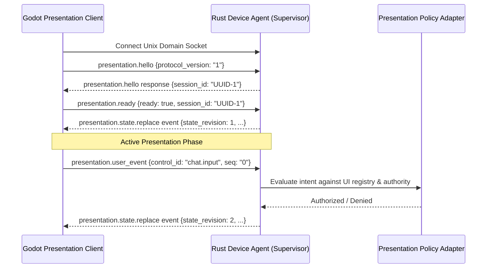

# M4 Technical Design — Godot Presentation Architecture

**Milestone:** P5 M4 — Godot Presentation  
**Status:** In Progress  
**Authority:** Blueprint v1.14.35 (ADR-128, ADR-145), P4 Contract `docs/p4/ipc/presentation-agent-v1.md`, and `docs/p5/tasks/M4-godot-presentation.md`.

## 1. Architectural Role and Trust Boundaries

The presentation layer owns character rendering, visual expression, animations, presentation layout, and typed user interaction collection.

### Invariants:
1. **Zero OS Execution Authority:** Godot is an untrusted presentation surface. It has no authority to execute OS commands, mint grants, access raw screen/audio capture, or mutate system state.
2. **Proposals Only:** User interactions in the presentation layer emit typed `presentation.user_event` intents with bounded fields. The Rust device agent's `DeterministicPresentationPolicy` authorizes or rejects every intent.
3. **No Optimistic Success:** The presentation client must never display optimistic success upon dispatch or socket acknowledgement. Operation outcomes are driven strictly by authoritative agent state snapshots.
4. **Session Isolation & Freshness:** Reconnection establishes a fresh session UUID. Prior user events and sequence numbers are discarded and cannot be replayed.
5. **Fail-Closed State Handling:** Malformed, expired, or out-of-order frames are rejected, and the client gracefully falls back to a neutral/unavailable degraded state.

## 2. Protocol Integration (`presentation-agent/1`)

The client communicates over a private Unix domain stream socket at `$XDG_RUNTIME_DIR/lia/presentation.sock` with 4-byte big-endian length-prefixed JSON frames (maximum 262,144 bytes).

### Handshake Lifecycle:
1. **Connect & Hello:** Client initiates connection and sends `presentation.hello` request with body `{"protocol_version":"1"}` and no `session_id`.
2. **Session Negotiation:** Agent validates Linux peer credentials (`SO_PEERCRED`), verifies UID/PID match, and replies with `presentation.hello` response carrying a fresh random `session_id`.
3. **Readiness Notification:** Client sends `presentation.ready` request with body `{"ready":true}` and the bound `session_id`.
4. **Active Phase:** Agent acknowledges readiness by delivering the initial authoritative `presentation.state.replace` snapshot. Client is now eligible to send user events.

### Message Flow:



## 3. Character Lifecycle & Presentation State Model

The client maintains an internal state machine driven by incoming `presentation.state.replace` snapshots:

### Presentation States:
- **`Idle` / `Neutral`:** Default resting state. Breathing, ambient blinking, neutral eye contact.
- **`Listening`:** Active when `listening == true`. Attentive tilt, focused gaze, visual audio-capture indicator.
- **`Speaking`:** Active when `speaking == true`. Lip sync animation, active conversational gestures.
- **`Paused`:** Active when `paused == true`. Dimmed presence, suspended autonomous animations, frozen pose.
- **`Degraded` / `Disconnected`:** Socket loss or agent termination. Neutral resting posture, visual reconnection banner.

### Truthful Operation Outcome Visualization (AC-007):
When the agent reports an operation outcome via action/attention cue, the client transitions the character visualization accordingly:
1. **`VerifiedSuccess`:** Confident nodding, affirmative gesture, green status shimmer.
2. **`VerifiedFailure`:** Thoughtful headshake, puzzled expression, amber status cue.
3. **`UnknownOutcome`:** Questioning expression, shrug, visible caution indicator (strictly distinguishable from success).
4. **`Denied`:** Subtle polite refusal gesture, no effect executed.
5. **`Unsupported`:** Honest incapability shrug, neutral decline indicator.

## 4. User Controls & Typed Intent Dispatch (AC-010)

The presentation interface exposes approved user controls mapped to canonical AC-010 identifiers:

| Control ID | Event | Argument Bounds | Behavior |
|---|---|---|---|
| `panel.hide` | `clicked` | None | Hides/minimizes desktop presence |
| `panel.pin` | `clicked` | None | Toggles keep-on-top window layering |
| `panel.lock` | `clicked` | None | Locks position; overrides autonomous repositioning |
| `panel.reposition` | `clicked` | None | User drag/reposition mode |
| `presentation.pause` | `clicked` | None | Requests pause of agent presence/speech |
| `presentation.resume` | `clicked` | None | Requests resumption from paused state |
| `chat.input` | `text_submitted` | String <= 8,192 UTF-8 bytes | Submits user text prompt |
| `chat.stop` | `interruption_requested` | None | Requests immediate interruption of active turn |

### Placement Precedence (AC-010):
- If the user has manually placed, pinned, or locked the character, user placement strictly takes precedence over autonomous positioning.
- The client sets `user_locked: true` when locked, preventing task-bound autonomous moves from shifting the window.

## 5. Directory Structure

```
apps/lia-presentation-godot/
├── project.godot                     # Godot 4 project definition (transparent, DPI-aware)
├── scripts/
│   ├── ipc/
│   │   ├── presentation_ipc_client.gd # Bounded length-prefixed Unix stream client
│   │   └── protocol_types.gd          # Envelope, body schemas, and sequence counters
│   ├── state/
│   │   ├── presentation_state_machine.gd # Lifecycle and outcome state machine
│   │   └── presentation_snapshot.gd   # Strict parsing of state.replace snapshots
│   └── ui/
│       ├── user_controls.gd           # Canonical AC-010 control handlers
│       └── character_view.gd          # Visual representation controller
└── test/
    └── test_presentation_client.gd   # Unit test suite verifying handshake, parsing, and bounds
```
